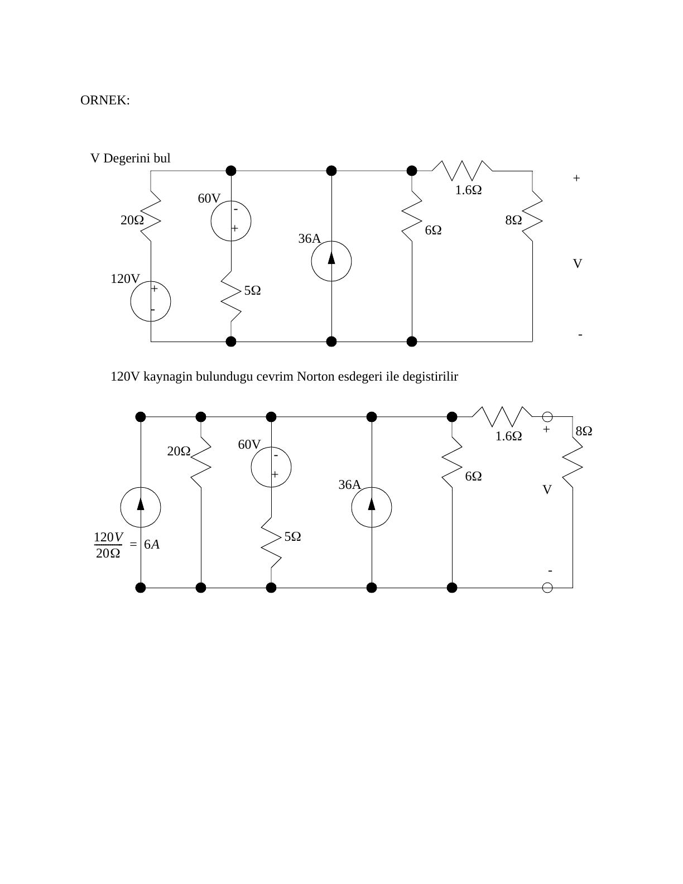

Bu yazı, ders klasöründe "sorular3" adıyla saklanan, **"Devre Çözüm Yöntemleri"** başlıklı 11 sayfalık notu içeriyor (PDF Mayıs 2007; PDF künyesinde yazar olarak **Fatih Tüysüz** görünüyor). İkinci bölümdeki örnek çözümlerde "Şekil 7.3(c)", "Şekil 7.11(b)" gibi atıflar var; bu kısım bir ders kitabından derlenmiş olabilir. Not DC devreler üzerinden Thevenin–Norton eşdeğerlerini, süperpozisyonu ve maksimum güç aktarımını anlatıyor ve çözümlü örnekler veriyor; EEM202'deki fazör devrelerinde de aynı yöntemler kullanıldığı için tekrar amaçlı klasöre konmuş. Metin ve sonuçlar aşağıda aktarıldı; orijinal PDF yazının sonunda indirilebilir.

*Bu içerik üçüncü taraf bir kaynağa aittir; arşiv ve nostalji amacıyla kaynak belirtilerek paylaşılmıştır. Hak sahibinin talebi hâlinde kaldırılır.*

## Thevenin ve Norton eşdeğer devrelerinin kullanımı

Thevenin devresi: V_s kaynağı ve seri R1. Norton devresi: I_s kaynağı ve paralel R2.

- İki devre de kısa devre yapılırsa: I_t = I_n ve V_t = V_n = 0 → V_s = R1·I_t, yani **V_s/R1 = I_t = I_n**.
- İki devre de açık devre yapılırsa: V_t = V_n ve I_t = I_n = 0 → **V_t = V_s** ve **V_n = I_s·R2**.

Bu temel eşitliklerden hem devre çözümünde hem de devre sadeleştirmede yararlanılır.

### Örnek: kaynak dönüşümleriyle V geriliminin bulunması

Devrede 120 V kaynak ve 20 Ω, 60 V kaynak ve 5 Ω, 36 A'lik akım kaynağı, 6 Ω, ardından seri 1,6 Ω ve 8 Ω'luk yük var; 8 Ω üzerindeki V isteniyor.

1. 120 V'luk kaynağın bulunduğu kol Norton eşdeğeriyle değiştirilir: 120 V/20 Ω = 6 A.
1. İkinci gerilim kaynağı ve direnci de Norton eşdeğerine çevrilir: 60 V/5 Ω = 12 A (ters yönde).
1. Bütün akım kaynakları ve paralel dirençler toplanır: 6 − 12 + 36 = 30 A; 1/(1/20 + 1/5 + 1/6) = 2,4 Ω.
1. Akım kaynağı Thevenin eşdeğerine çevrilir: 30 A·2,4 Ω = 72 V.
1. Seri dirençler toplanır (2,4 + 1,6 = 4 Ω) ve gerilim bölücüyle **V = 72·8/(8 + 4) = 48 V** bulunur.

## Süperpozisyon

Birden fazla kaynağın bulunduğu devrelerde kullanılabilen basit bir tekniktir:

1. Devredeki bir kaynağı seç; onun dışındaki bütün akım kaynaklarını açık devre, bütün gerilim kaynaklarını kısa devre yap.
1. Devreyi normal bir devre gibi analiz et.
1. Sonraki kaynağı seç ve ilk adıma dön.
1. Her bir kaynak için bulunan sonuçları topla.

### Örnek

100 V'luk kaynak ve 20 Ω, 40 Ω'luk direnç (V bu direnç üzerinde), 10 Ω ve 2,5 Ω; 20 Ω ile 10 Ω'un birleştiği iki düğüm arasında 6 A'lik akım kaynağı.

- **a) Yalnız akım kaynağı (gerilim kaynağı kısa devre):** 20 ∥ 40 = 13,3 Ω; 10 + 13,3 = 23,3 Ω ile 2,5 Ω paralel: 1/(1/2,5 + 1/23,3) = 2,26 Ω. Akım kaynağının uçlarındaki gerilim 6·2,26 ≈ 13,5 V; gerilim bölücüyle V = 13,5·13,3/(10 + 13,3) ≈ **7,73 V**.
- **b) Yalnız gerilim kaynağı (akım kaynağı açık devre):** 40 ∥ (10 + 2,5) = 9,52 Ω; V = 100·9,52/(20 + 9,52) = **32,25 V**.
- **c) Toplam:** **V = 7,73 + 32,25 = 40 V**

*Not: Notta (a) şıkkında "V_s = 6(2,2) = 7,73 V" ve "V = 13,5 V" yazılmış; iki değerin yeri karışmış. Doğrusu V_s = 6·2,26 ≈ 13,5 V ve V ≈ 7,73 V'tur (son toplam 40 V doğru). (b) şıkkında "akım kaynağı kısa devre edilir" denmiş; yöntemin kuralı gereği ve şekilde görüldüğü gibi akım kaynağı **açık devre** edilir.*

## Maksimum güç aktarımı

Bir devreye yük bağlanırken aktarılacak gücün maksimum olması amaçlanır. V_s ve R_s kaynağa ait olmak üzere:

- I = V_s/(R_s + R_L), V_L = I·R_L
- P_L = I·V_L = [V_s/(R_s + R_L)]²·R_L
- ∂P_L/∂R_L = 0 → **R_L = R_s** (maksimum güç transferi için)

## Örnek çözümler

### Soru 1: R3 akımı (süperpozisyon)

U1 = 20 V ve U2 = 15 V'luk iki kaynak, R1 = R2 = 1 kΩ, R3 = 2,2 kΩ. R3 üzerinden geçen akım süperpozisyonla bulunuyor.

- Yalnız U1: R_T1 = R1 + R2∥R3 = 1 kΩ + (1 kΩ·2,2 kΩ)/3,2 kΩ = 1,69 kΩ; I_T1 = 20 V/1,69 kΩ = 11,8 mA; akım bölücüyle I_3(1) = (1 kΩ/3,2 kΩ)·11,8 mA = **3,69 mA**
- Yalnız U2: R_T2 = R2 + R1∥R3 = 1,69 kΩ; I_T2 = 15 V/1,69 kΩ = 8,88 mA; I_3(2) = (1 kΩ/3,2 kΩ)·8,88 mA = **2,78 mA** (ters yönde)
- **I_3 = 3,69 − 2,78 = 0,91 mA (910 µA)**; pozitif çıkması akımın U1'in akıttığı yönde olduğunu gösteriyor.

### Soru 2: 8,65 Ω'luk dirençteki akım (Thevenin)

20 V kaynak, 5 Ω ve 15 Ω; 10 V kaynak, 2 Ω ve 8 Ω; iki tarafın A ve B düğümleri arasında 8,65 Ω.

- Akımı bulunacak direnç çıkarılır, uçlar A ve B olarak adlandırılır. Gerilim bölücüyle U_A = 15/(5 + 15)·20 = 15 V, U_B = 8/(8 + 2)·10 = 8 V → **U_TH = U_A − U_B = 7 V**
- R_TH = 5∥15 + 2∥8 = 3,75 + 1,6 = **5,35 Ω**
- **I = 7 V/(5,35 Ω + 8,65 Ω) = 0,5 A**

## İndirilebilir dosya

11 sayfalık orijinal PDF aşağıdan indirilebilir.
