This post is the content of the **Three-Phase Circuits** presentation prepared by Asst. Prof. Dr. Selda Güney for the **EEM202 Circuit Theory II** course in the Electrical and Electronics Engineering Department at Başkent University (May 2014). The slide text, example problems, and summary are reproduced here; circuit diagrams and phasor diagrams are included as images. The original 35-slide PDF can be downloaded at the end of the post.

## Contents

- Balanced three-phase voltages
- Three-phase voltage sources
- Y-Y circuit analysis
- Y-Δ circuit analysis
- Power calculations in balanced three-phase circuits
- Measuring average power in three-phase circuits

A three-phase system consists of three parts: a **three-phase voltage source**, a **three-phase line**, and a **three-phase load**.

## Balanced three-phase voltages

Balanced three-phase voltages are three voltages of equal magnitude with a 120° phase difference between them. There are two phase sequences:

- **abc positive sequence:** V_b lags V_a by 120°; V_c leads V_a by 120°
- **acb negative sequence:** V_c lags V_a by 120°; V_b leads V_a by 120°

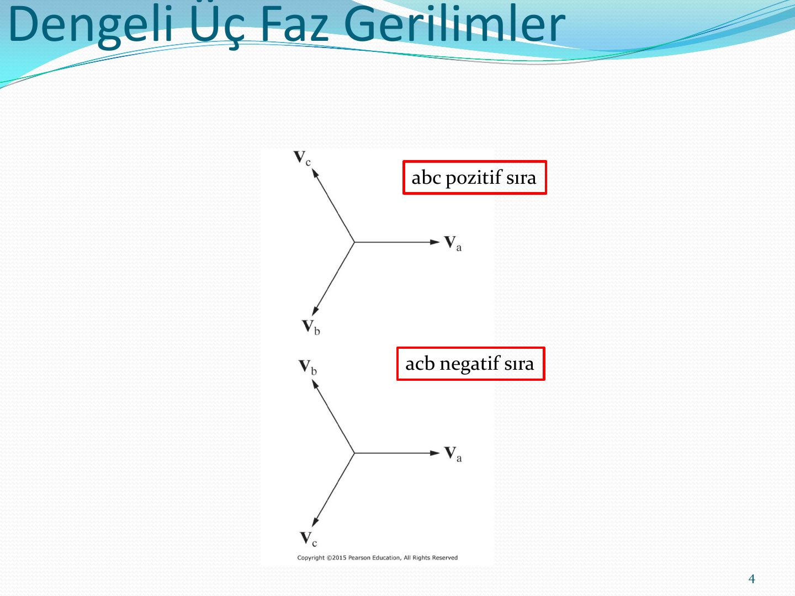

## Three-phase voltage sources

In a three-phase generator, the axes of the a, b, and c phase windings are placed on the stator 120° apart. The source can be **wye (Y)** or **delta (Δ)** connected. In a real source, each phase winding has a **winding resistance** (R_w) and a **winding inductive reactance** (jX_w).

 and delta (b) connected sources")

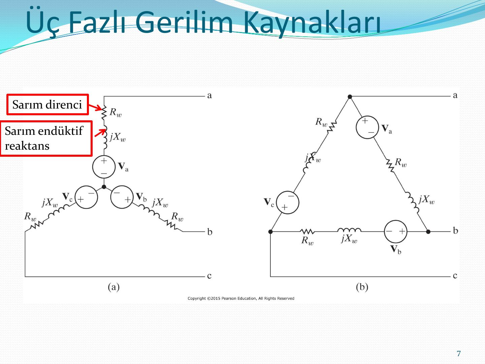

Three-phase sources can be Y- or Δ-connected. Since the load can also be Y- or Δ-connected, there are 4 different circuit configurations:

| Source | Load |
|---|---|
| Y | Y |
| Y | Δ |
| Δ | Y |
| Δ | Δ |

## Analysis of the Y-Y circuit

A three-phase Y-Y system consists of a three-phase voltage source (with internal impedances Z_ga, Z_gb, Z_gc), a three-phase transmission line (Z_1a, Z_1b, Z_1c and neutral line Z_0), and a three-phase load impedance (Z_A, Z_B, Z_C).

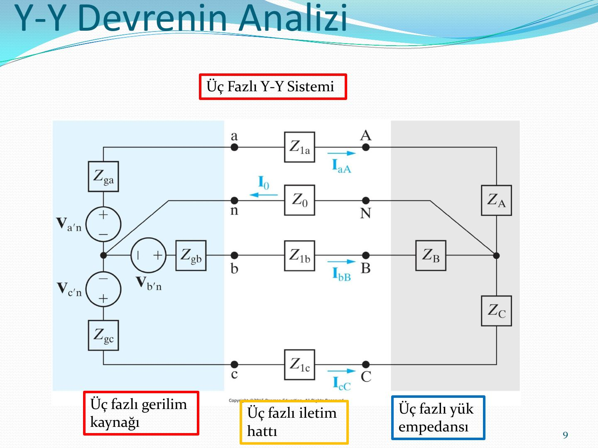

In a balanced system, the analysis is carried out using the **single-phase equivalent circuit**: the source V_a'n, Z_ga, Z_1a, and Z_A are connected in series, and the line current I_aA is found from this circuit.

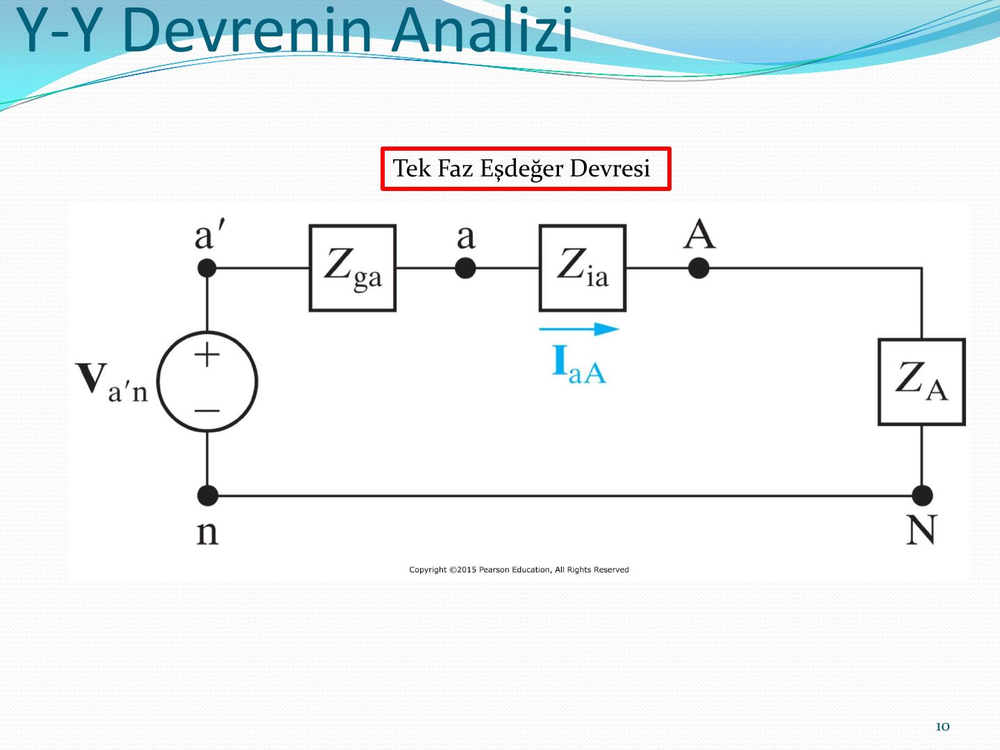

### Line-to-line and line-to-neutral voltages

The phasor diagram between the line-to-line voltages (V_AB, V_BC, V_CA) and the line-to-neutral voltages (V_AN, V_BN, V_CN) in a balanced system: the line voltages are √3 times larger in magnitude than the phase voltages, and lead by 30° in the abc sequence and lag by 30° in the acb sequence.

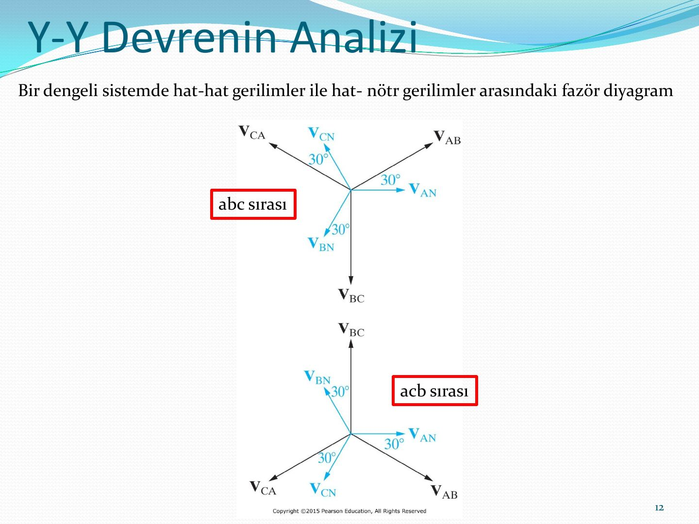

### Example: Y-Y connected system

A balanced three-phase, Y-Y connected generator with positive phase sequence has an impedance of 0.2+j0.5 Ω/Φ and an internal voltage of 120 V/Φ. The generator supplies a balanced three-phase Y-Y connected load with an impedance of 39+j28 Ω/Φ. The line connecting the generator to the load has an impedance of 0.8+j1.5 Ω/Φ. The internal voltage of generator phase a is taken as the reference phasor.

1. Construct the equivalent circuit of phase a of the system.
1. Calculate the line currents I_aA, I_bB, and I_cC.
1. Calculate the three phase voltages at the load, V_AN, V_BN, and V_CN.
1. Calculate the line voltages V_AB, V_BC, and V_CA at the load terminals.
1. Calculate the phase voltages V_an, V_bn, and V_cn at the generator terminals.
1. Calculate the line voltages V_ab, V_bc, and V_ca at the generator terminals.
1. Repeat parts a–f for the negative phase sequence.

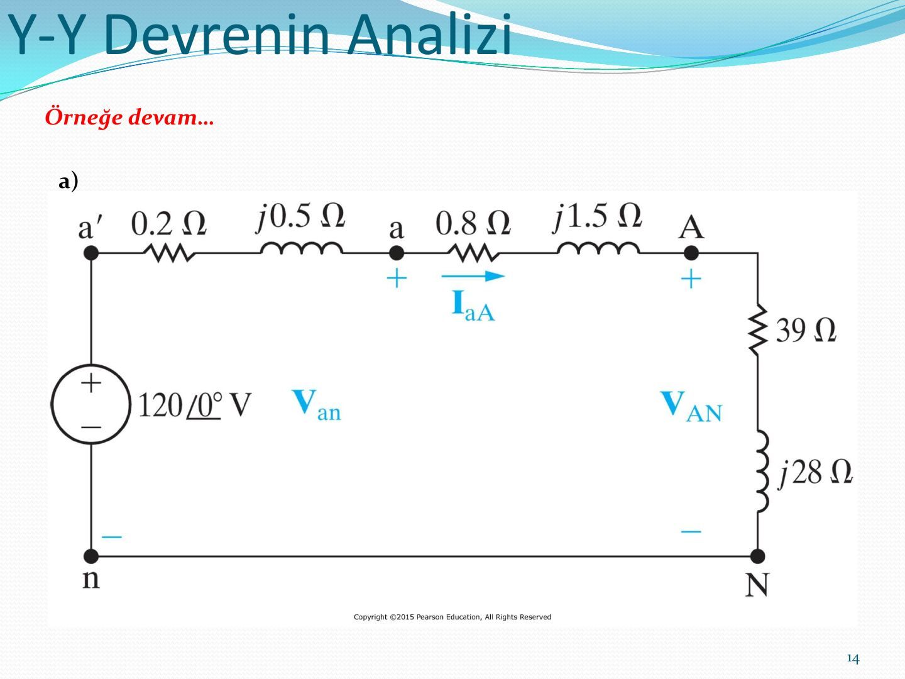

**Example:** In a Y-connected balanced three-phase system, the voltage of phase c is 450∠−25° V. If the phase sequence is negative, what is the value of V_AB?

**Practice problem:** In a balanced three-phase circuit, the voltage from A to N is 240∠−30° V. If the phase sequence is positive, what is the value of V_BC? (Answer: 415.69∠−120° V)

## Analysis of the Y-Δ circuit

A Δ-connected load has two kinds of current: the **line current** flowing through the line (I_aA, I_bB, I_cC) and the **phase current** flowing through the legs of the load (I_AB, I_BC, I_CA).

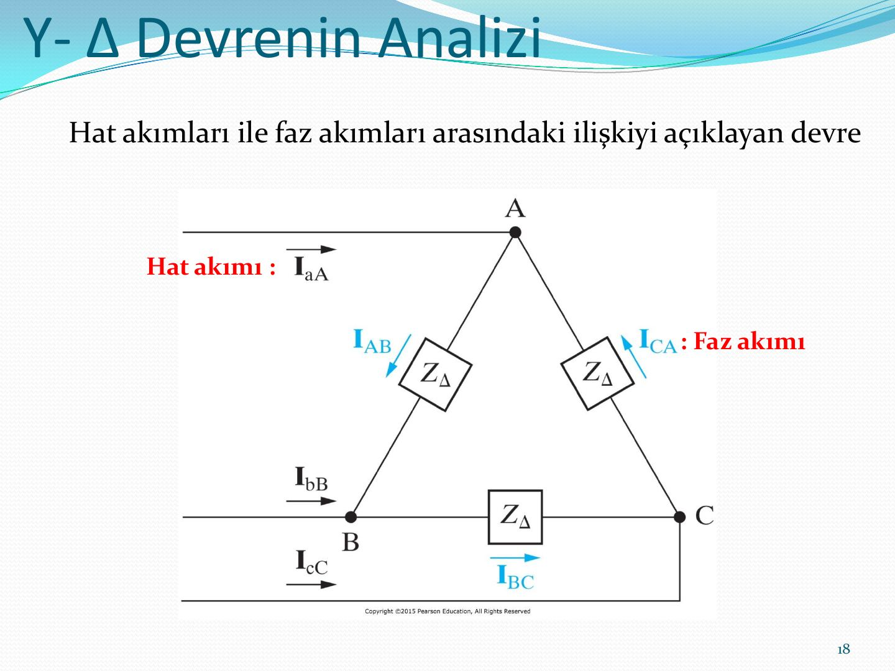

In a balanced Δ load, the line currents are √3 times larger than the phase currents; they lag by 30° in the positive sequence and lead by 30° in the negative sequence.

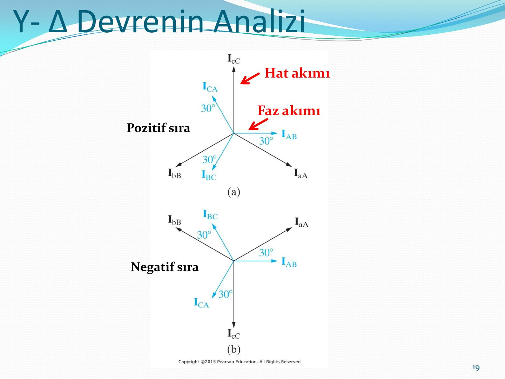

### Example: Y-Δ connected system

A balanced three-phase Y-Δ connected generator with positive phase sequence has an impedance of 0.2+j0.5 Ω/Φ and an internal voltage of 120 V/Φ. The generator supplies a balanced three-phase Δ-connected load with an impedance of 118.5+j85.8 Ω/Φ. The line connecting the generator to the load has an impedance of 0.3+j0.9 Ω/Φ. The internal voltage of generator phase a is taken as the reference phasor.

1. Construct the equivalent circuit of phase a of the system.
1. Calculate the line currents I_aA, I_bB, and I_cC.
1. Calculate the phase voltage at the load terminal.
1. Calculate the phase currents of the load.
1. Calculate the line voltages at the source terminal.

When the Δ load is converted to an equivalent Y load, the impedance per phase becomes (118.5+j85.8)/3 = 39.5+j28.6 Ω:

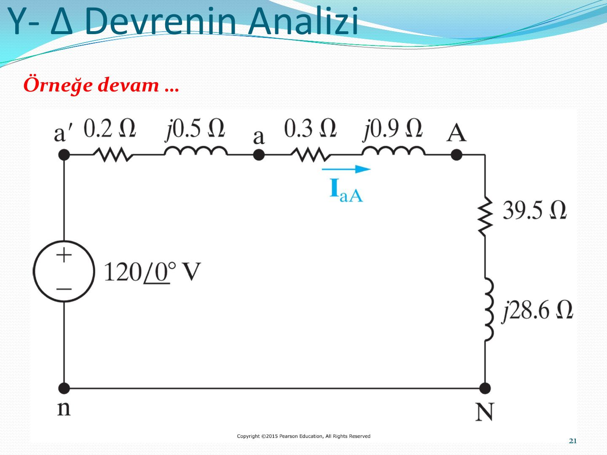

**Example:** In a balanced three-phase Δ-connected load, the current I_CA is 8∠−15° A. If the phase sequence is positive, what is the value of I_cC?

**Example:** A Δ-connected balanced three-phase load is supplied from a balanced three-phase circuit. The current in phase b is 12∠65° A. If the phase sequence is negative, what is the value of I_AB?

## Problem-solving strategy

- **Step 1:** To obtain the unknown phasors using the wye-wye connection, delta connections must be converted to wye connections.
- **Step 2:** Since the three-phase system is balanced, only the unknown phasors of phase a of the circuit need to be determined.
- **Step 3:** Finally, use the calculated phasors to find the corresponding phasors in the original system.

> Note: In a wye connection the line and phase currents are the same; in a delta connection the line and phase voltages are the same.

## Power calculations in balanced three-phase circuits

In the presentation, average power is treated separately for a balanced Y load (phase voltages V_AN, V_BN, V_CN and line currents) and a balanced Δ load (line voltages V_AB, V_BC, V_CA and phase currents I_AB, I_BC, I_CA).

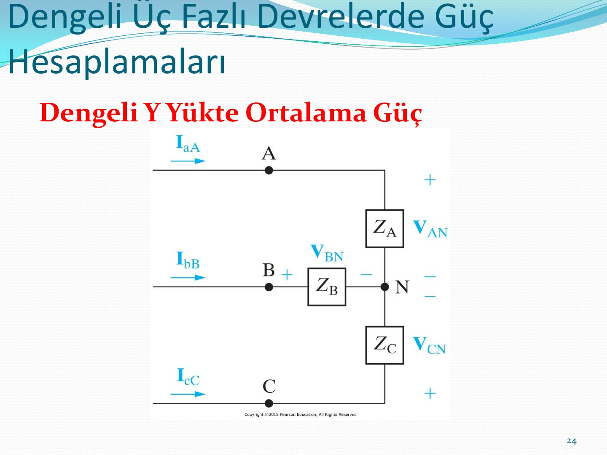

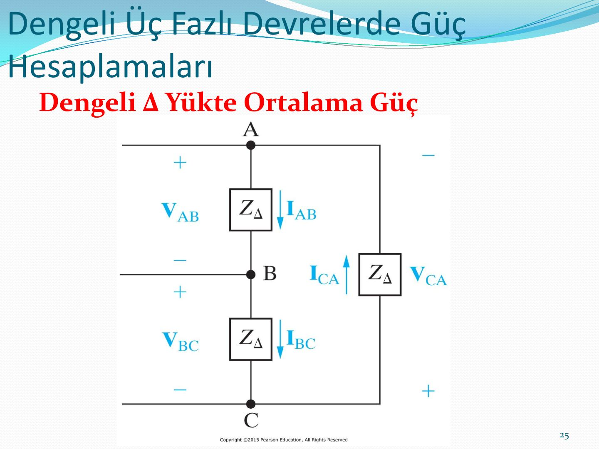

### Example: Power in the Y-Y system

For the system in the previous Y-Y example (generator 0.2+j0.5 Ω/Φ and 120 V/Φ, line 0.8+j1.5 Ω/Φ, load 39+j28 Ω/Φ):

1. Calculate the average power delivered to each phase of the Y-connected load.
1. Calculate the total average power delivered to the load.
1. Calculate the total average power lost in the line.
1. Calculate the total average power lost in the generator (source).
1. Find the total magnetizing (VAr) absorbed by the load.
1. Calculate the total complex power delivered by the source.

### Example: 480 kW load

A balanced three-phase load requires 480 kW at a lagging power factor of 0.8. The load is supplied through a line with an impedance of 0.005+j0.025 Ω/ϕ. The line voltage at the load terminal is 600 V.

1. Construct the single-phase equivalent circuit of the system.
1. Calculate the magnitude of the line current.
1. Calculate the magnitude of the line voltage at the sending end of the line.
1. Calculate the power factor at the sending end of the line.

In the single-phase equivalent, the load draws 160 kW per phase (0.8 lagging), and the load phase voltage is taken as (600/√3)∠0° V:

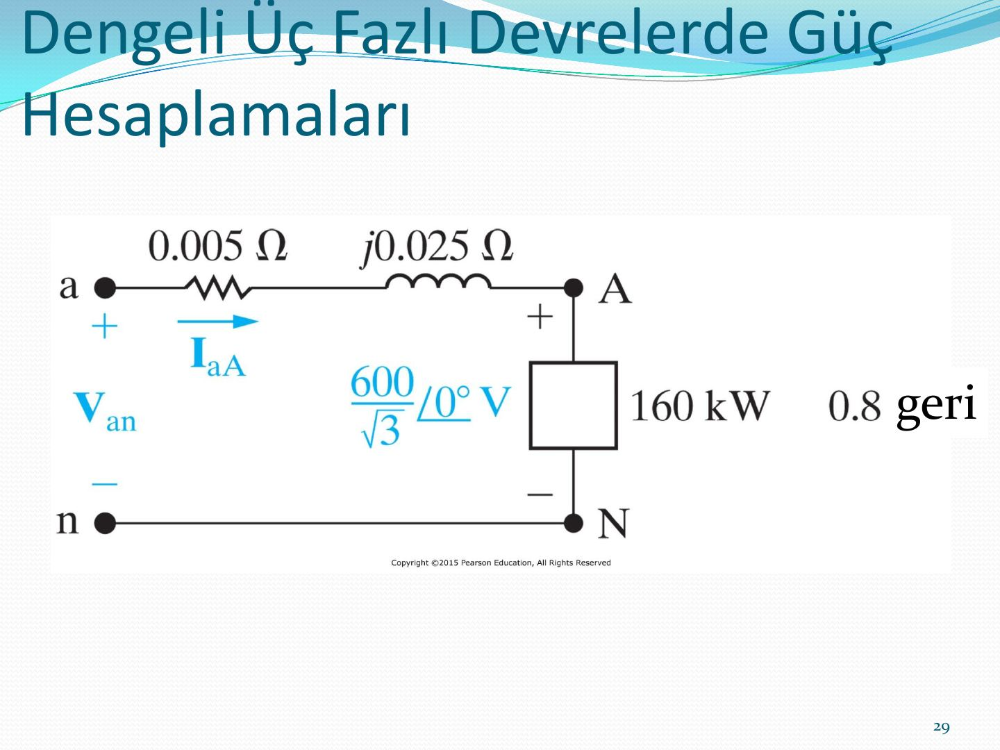

## Measuring average power in three-phase circuits

Average power is measured with an **electrodynamometer wattmeter**: the wattmeter has current coil terminals, voltage coil terminals, and a meter that indicates the watt scale.

### Two-wattmeter method

In a balanced three-phase circuit, the current coil of wattmeter W₁ is connected to line a and that of W₂ to line c; the voltage coils are connected between these lines and line b. The total average power is the sum of the readings of the two wattmeters.

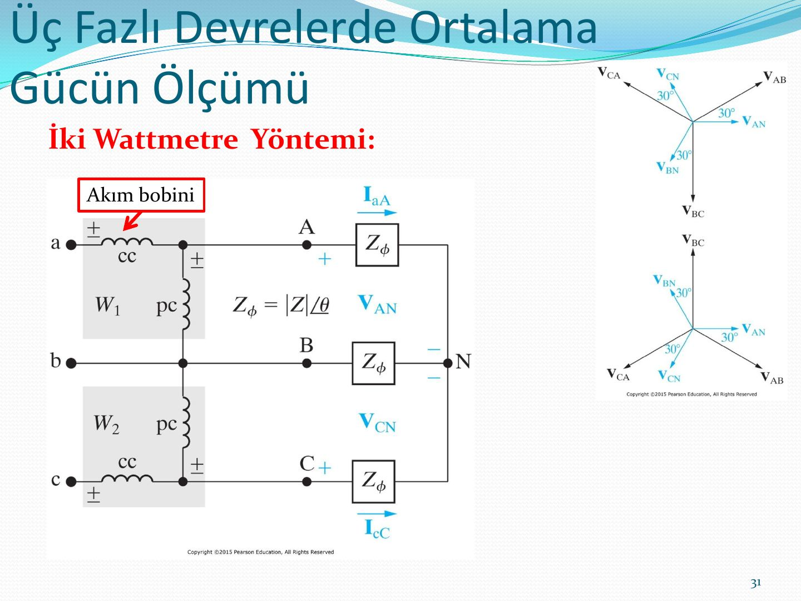

**Example:** In the figure below, the phase voltage at the load is 120 V. For (a) Z_Φ = 8+j6 Ω, (b) Z_Φ = 8−j6 Ω, (c) Z_Φ = 5+j5√3 Ω, (d) Z_Φ = 10∠−75° Ω, calculate the power that each wattmeter should read.

## Summary

- In circuit analysis, all Δ connections should be converted to Y.
- The single-phase equivalent circuit is used to find the line current of the Y-Y configuration and the voltage of one phase.
- Once the phase a line current and phase voltage are found, the phase b and c voltages and currents are the same except for a 120° phase difference.
- The set of line voltages differs from the set of phase voltages by a factor of √3 in magnitude and by ±30° in phase (positive/negative sequence).
- For a Δ-connected source and load, the set of line currents differs from the set of phase currents by a factor of √3 and by −/+30° (positive/negative sequence).
- In a balanced three-phase circuit, the total instantaneous power is constant and equals 1.5 times the average power per phase.
- In three-phase systems, the total active power, reactive power, and complex power are 3 times the per-phase power, or √3 times the product of line voltage and line current.
- A wattmeter measures the average power delivered to a load by means of a current coil connected in series with the load and a voltage coil connected in parallel with the load.
- In a balanced three-phase circuit, the average power can be measured by summing the readings of two wattmeters connected to two different phases.

*Note: The presentation's summary states that "the total instantaneous power is 1.5 times the average power per phase"; in a balanced three-phase circuit, the total instantaneous power equals 3 times the average power per phase (i.e., the total average power). The factor 1.5 probably comes from the expression p = 1.5·V_m·I_m·cos θ in Nilsson, written with peak values (V_m, I_m).*
