Bu yazı, Başkent Üniversitesi Elektrik-Elektronik Mühendisliği **EEM202 Devre Teorisi II** dersinde Yrd. Doç. Dr. Selda Güney'in hazırladığı **Üç Fazlı Devreler** sunumunun içeriğidir (Mayıs 2014). Slaytlardaki metinler, örnek soruları ve özetiyle birlikte aktarıldı; devre şemaları ve fazör diyagramları görsel olarak eklendi. 35 slaytlık orijinal PDF yazının sonunda indirilebilir.

## İçerik

- Dengeli üç faz gerilimler
- Üç fazlı gerilim kaynakları
- Y-Y devre analizi
- Y-Δ devre analizi
- Dengeli üç fazlı devrelerde güç hesabı
- Üç fazlı devrelerde ortalama gücün ölçümü

Bir üç fazlı sistem üç parçadan oluşur: **üç faz gerilim kaynağı**, **üç fazlı hat** ve **üç fazlı yük**.

## Dengeli üç faz gerilimler

Dengeli üç faz gerilimler eşit genlikli ve aralarında 120° faz farkı olan üç gerilimdir. Faz sırası iki türlüdür:

- **abc pozitif sıra:** V_b, V_a'dan 120° geride; V_c, V_a'dan 120° ileride
- **acb negatif sıra:** V_c, V_a'dan 120° geride; V_b, V_a'dan 120° ileride

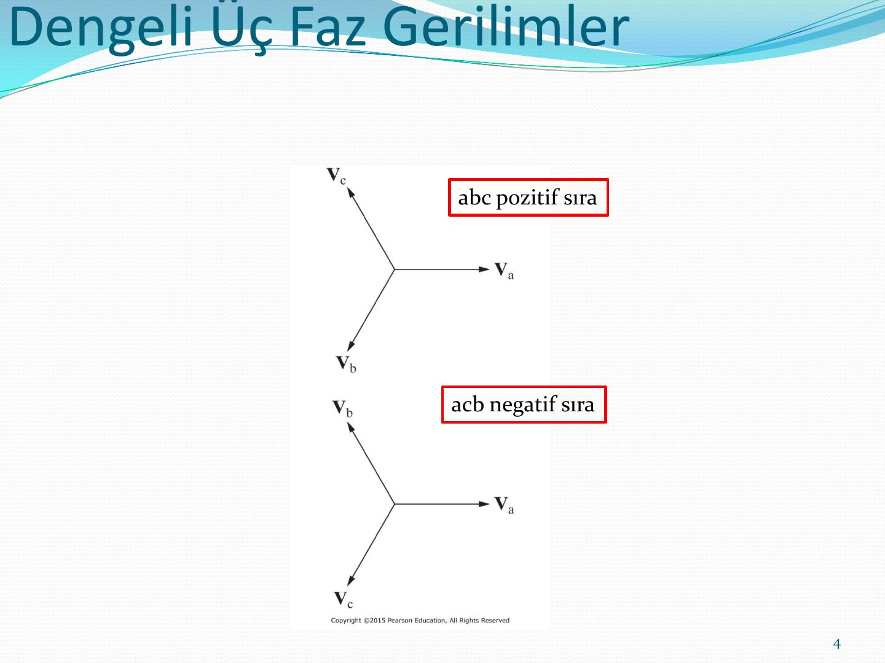

## Üç fazlı gerilim kaynakları

Üç fazlı jeneratörde a, b ve c fazı sargılarının eksenleri statorda 120° aralıklarla yerleşmiştir. Kaynak **yıldız (Y)** ya da **üçgen (delta, Δ)** bağlı olabilir. Gerçek bir kaynakta her faz sargısının bir **sarım direnci** (R_w) ve bir **sarım endüktif reaktansı** (jX_w) vardır.

 ve üçgen (b) bağlı kaynak")

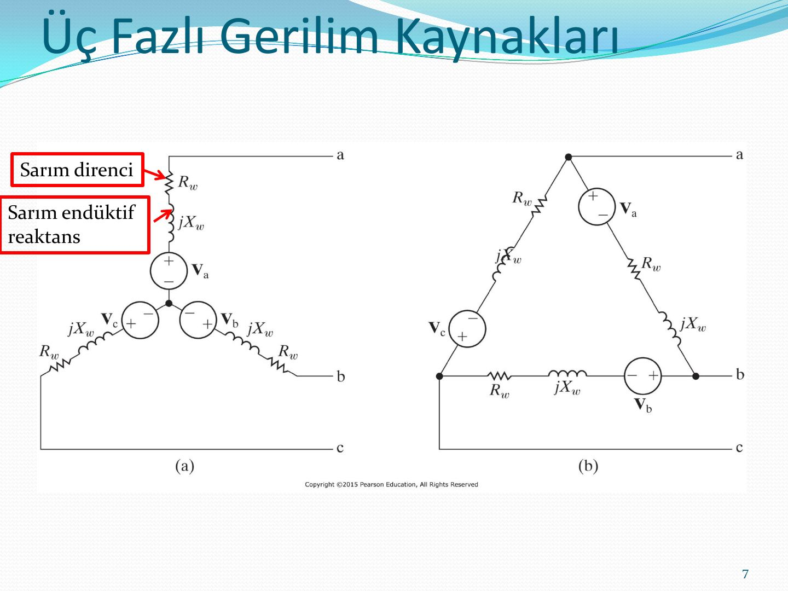

Üç fazlı kaynaklar Y veya Δ bağlı olabilir. Yük de Y veya Δ bağlı olabileceği için 4 farklı devre yapısı ortaya çıkar:

| Kaynak | Yük |
|---|---|
| Y | Y |
| Y | Δ |
| Δ | Y |
| Δ | Δ |

## Y-Y devrenin analizi

Üç fazlı Y-Y sistemi; üç fazlı gerilim kaynağı (Z_ga, Z_gb, Z_gc iç empedanslarıyla), üç fazlı iletim hattı (Z_1a, Z_1b, Z_1c ve nötr hattı Z_0) ve üç fazlı yük empedansından (Z_A, Z_B, Z_C) oluşur.

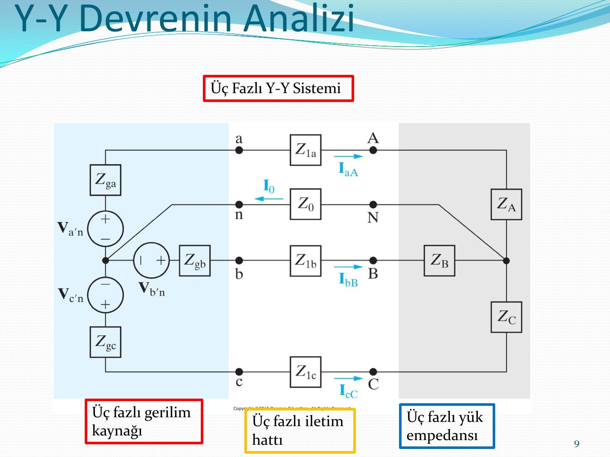

Dengeli sistemde analiz **tek faz eşdeğer devresi** ile yapılır: V_a'n kaynağı, Z_ga, Z_1a ve Z_A seri bağlıdır; bu devreden I_aA hat akımı bulunur.

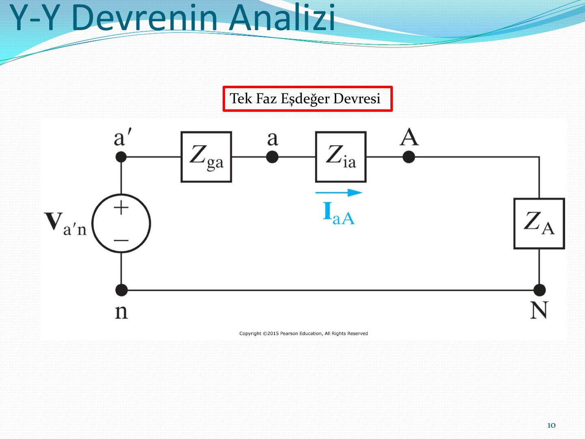

### Hat-hat ve hat-nötr gerilimleri

Dengeli bir sistemde hat-hat gerilimleri (V_AB, V_BC, V_CA) ile hat-nötr gerilimleri (V_AN, V_BN, V_CN) arasındaki fazör diyagramı: hat gerilimleri, faz gerilimlerinden genlik olarak √3 kat büyüktür ve abc sırasında 30° ileride, acb sırasında 30° geridedir.

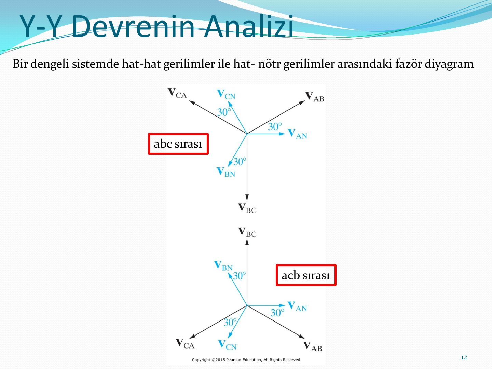

### Örnek: Y-Y bağlı sistem

Bir dengeli üç fazlı ve Y-Y bağlı, pozitif faz sırası olan bir jeneratörün empedansı 0.2+j0.5 Ω/Φ ve iç gerilimi 120 V/Φ'dir. Jeneratör, üç fazlı Y-Y bağlı dengeli ve 39+j28 Ω/Φ empedanslı bir yükü beslemektedir. Jeneratörü yüke bağlayan hattın empedansı 0.8+j1.5 Ω/Φ'dir. Jeneratörün a fazı iç gerilimi referans fazörü olarak belirlenmiştir.

1. Sistemin a fazının eşdeğer devresini oluşturunuz.
1. I_aA, I_bB ve I_cC hat akımlarını hesaplayınız.
1. Yükteki üç faz gerilimi V_AN, V_BN ve V_CN'yi hesaplayınız.
1. Yük terminallerinde V_AB, V_BC ve V_CA hat gerilimlerini hesaplayınız.
1. Jeneratör terminallerinde V_an, V_bn ve V_cn faz gerilimlerini hesaplayınız.
1. Jeneratör terminallerinde V_ab, V_bc ve V_ca hat gerilimlerini hesaplayınız.
1. a–f şıklarını negatif faz sırası için tekrarlayınız.

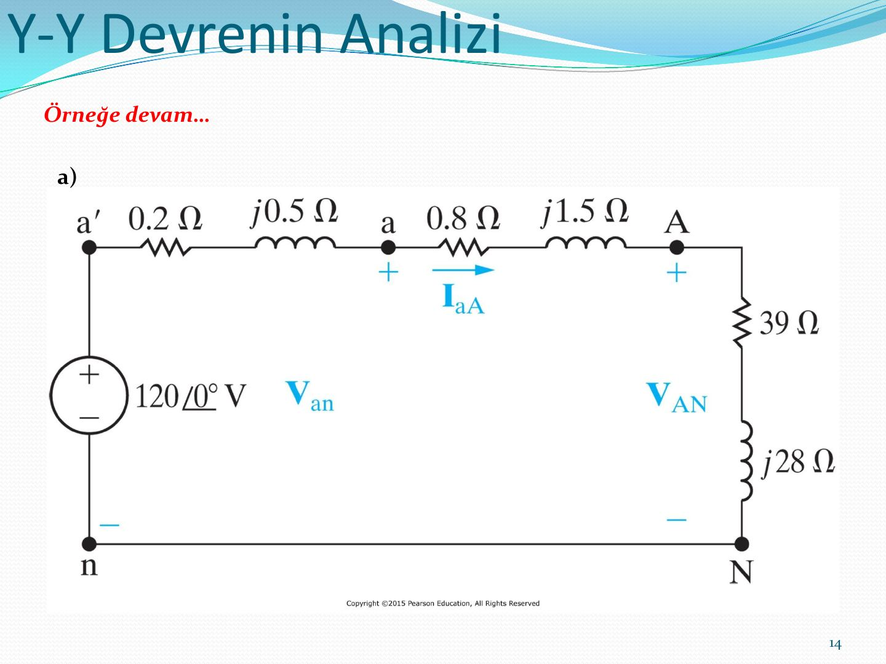

**Örnek:** Bir Y bağlı dengeli üç fazlı sistemde c fazının gerilimi 450∠−25° V'tur. Eğer faz sırası negatif ise V_AB değeri nedir?

**Çalışma sorusu:** Bir dengeli üç faz devrede A'dan N'ye gerilim 240∠−30° V'tur. Eğer faz sırası pozitif ise V_BC'nin değeri nedir? (Cevap: 415.69∠−120° V)

## Y-Δ devrenin analizi

Δ bağlı yükte iki tür akım vardır: hattan geçen **hat akımı** (I_aA, I_bB, I_cC) ve yükün kollarından geçen **faz akımı** (I_AB, I_BC, I_CA).

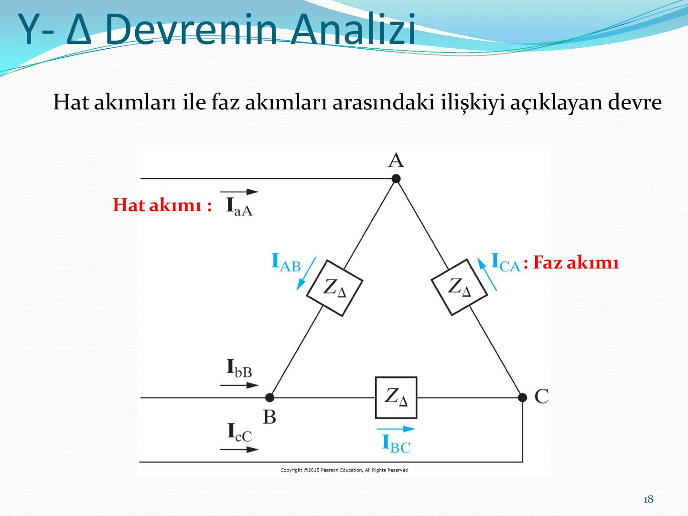

Dengeli Δ yükte hat akımları faz akımlarından √3 kat büyüktür; pozitif sırada 30° geride, negatif sırada 30° ileridedir.

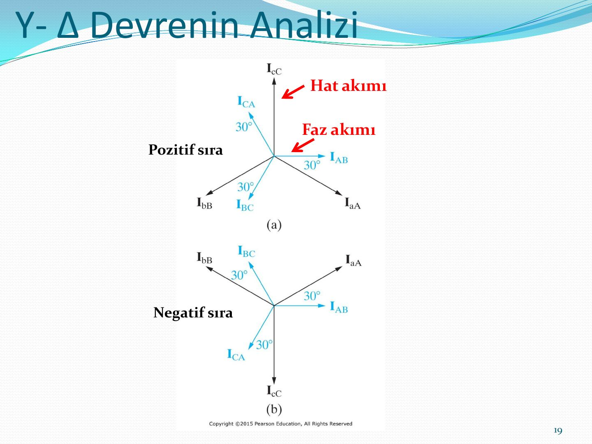

### Örnek: Y-Δ bağlı sistem

Bir dengeli üç fazlı ve Y-Δ bağlı, pozitif faz sırası olan bir jeneratörün empedansı 0.2+j0.5 Ω/Φ ve iç gerilimi 120 V/Φ'dir. Jeneratör, üç fazlı Δ bağlı dengeli ve 118.5+j85.8 Ω/Φ empedanslı bir yükü beslemektedir. Jeneratörü yüke bağlayan hattın empedansı 0.3+j0.9 Ω/Φ'dir. Jeneratörün a fazı iç gerilimi referans fazörü olarak belirlenmiştir.

1. Sistemin a fazının eşdeğer devresini oluşturunuz.
1. I_aA, I_bB ve I_cC hat akımlarını hesaplayınız.
1. Yük terminalindeki faz gerilimini hesaplayınız.
1. Yükün faz akımlarını hesaplayınız.
1. Kaynak terminalindeki hat gerilimlerini hesaplayınız.

Δ yük, eşdeğer Y yüke çevrildiğinde faz başına empedans (118.5+j85.8)/3 = 39.5+j28.6 Ω olur:

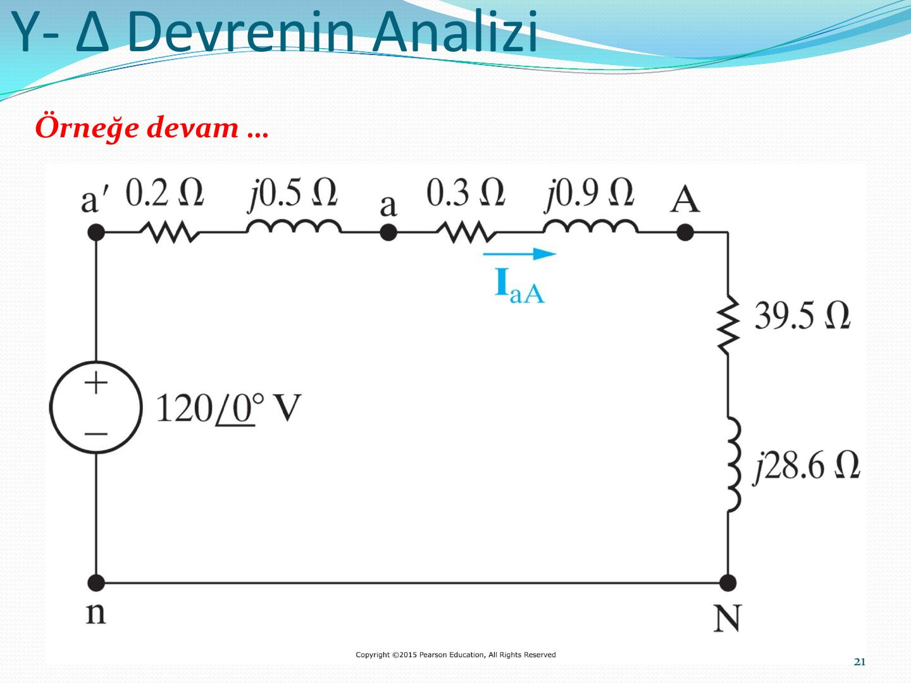

**Örnek:** Dengeli üç fazlı ve Δ bağlı bir yükte I_CA akımı 8∠−15° A'dir. Eğer faz sırası pozitif ise I_cC değeri nedir?

**Örnek:** Δ bağlı, dengeli bir üç faz yük, dengeli bir üç faz devreden beslenmektedir. b fazındaki akım değeri 12∠65° A'dir. Eğer faz sırası negatif ise I_AB'nin değeri nedir?

## Problem çözme stratejisi

- **Adım 1:** Bilinmeyen fazörleri elde etmek için yıldız-yıldız bağlantısı kullanmak için üçgen bağlantılar yıldız bağlantıya dönüştürülmesi gerekir.
- **Adım 2:** Üç fazlı sistem dengeli olduğu için, sadece devrenin a fazının bilinmeyen fazörlerinin belirlenmesine gerek vardır.
- **Adım 3:** En sonunda hesaplanan fazörleri kullanarak orijinal sistemde bunlara karşılık gelen fazörleri bulunuz.

> Not: Yıldız bağlantıda hat ve faz akımı aynı, üçgen bağlantıda hat ve faz gerilimi aynıdır.

## Dengeli üç fazlı devrelerde güç hesaplamaları

Sunumda ortalama güç, dengeli Y yük (faz gerilimleri V_AN, V_BN, V_CN ve hat akımları) ve dengeli Δ yük (hat gerilimleri V_AB, V_BC, V_CA ve faz akımları I_AB, I_BC, I_CA) için ayrı ayrı ele alınır.

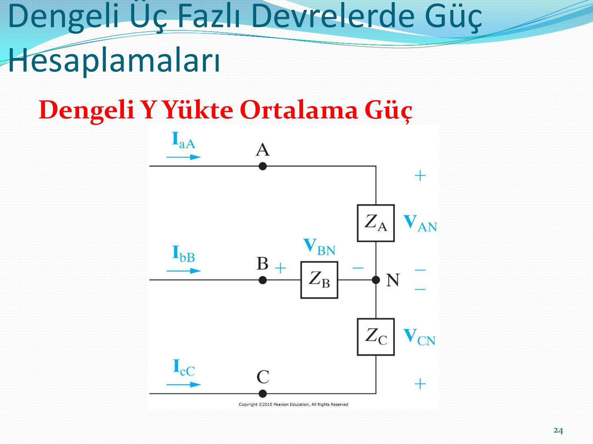

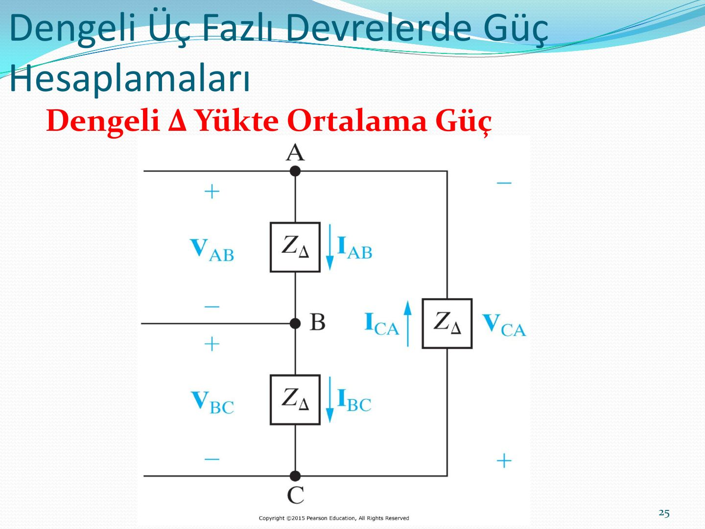

### Örnek: Y-Y sistemde güç

Önceki Y-Y örneğindeki sistem (jeneratör 0.2+j0.5 Ω/Φ ve 120 V/Φ, hat 0.8+j1.5 Ω/Φ, yük 39+j28 Ω/Φ) için:

1. Y bağlı yükün her fazı için aktarılan ortalama gücü hesaplayınız.
1. Yüke aktarılan toplam ortalama gücü hesaplayınız.
1. Hattaki toplam ortalama kayıp gücü hesaplayınız.
1. Jeneratörde (kaynakta) kaybedilen toplam ortalama gücü hesaplayınız.
1. Yük tarafından soğurulan toplam mıknatıslanma (VAr) miktarını bulunuz.
1. Kaynağın aktardığı toplam kompleks gücü hesaplayınız.

### Örnek: 480 kW'lık yük

Dengeli, üç fazlı bir yük, geri (gecikmeli) 0.8 güç çarpanında 480 kW güce gereksinim duymaktadır. Yük, empedansı 0.005+j0.025 Ω/ϕ olan bir hatla beslenmektedir. Yük terminalindeki hat gerilimi 600 V'tur.

1. Sistemin tek faz eşdeğer devresini oluşturunuz.
1. Hat akımının büyüklüğünü hesaplayınız.
1. Hattın gönderen ucunda hat geriliminin büyüklüğünü hesaplayınız.
1. Hattın gönderen ucundaki güç çarpanını hesaplayınız.

Tek faz eşdeğerinde yük faz başına 160 kW (0.8 geri) çeker ve yük faz gerilimi (600/√3)∠0° V alınır:

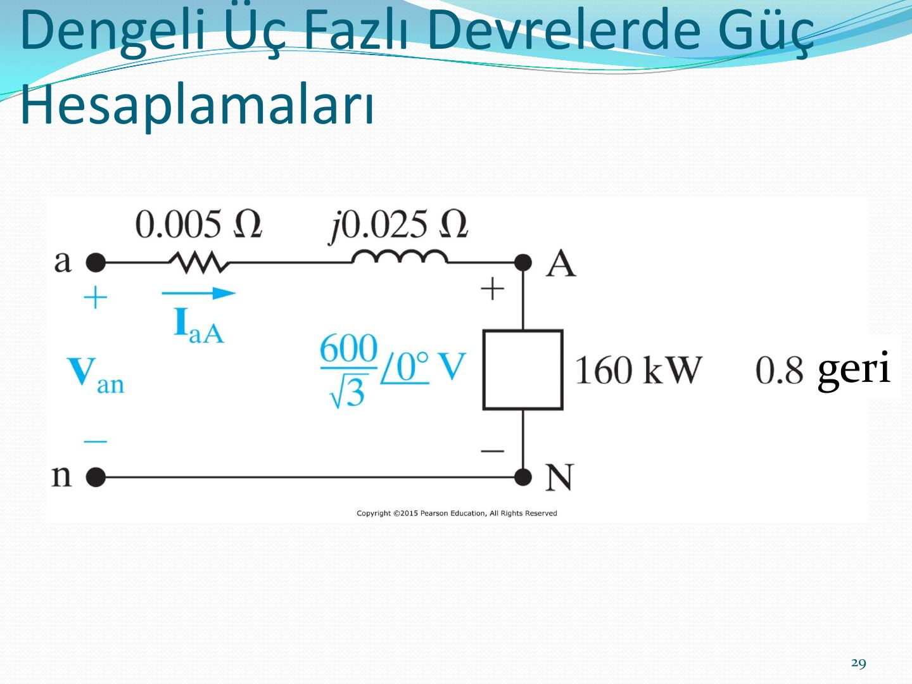

## Üç fazlı devrelerde ortalama gücün ölçümü

Ortalama güç **elektrodinanometre wattmetre** ile ölçülür: wattmetrenin akım bobini terminalleri, gerilim bobini terminalleri ve watt ölçeğini gösteren göstergesi vardır.

### İki wattmetre yöntemi

Dengeli üç fazlı bir devrede W₁ wattmetresinin akım bobini a hattına, W₂'ninki c hattına bağlanır; gerilim bobinleri bu hatlarla b hattı arasına bağlanır. Toplam ortalama güç, iki wattmetrenin okumasının toplamıdır.

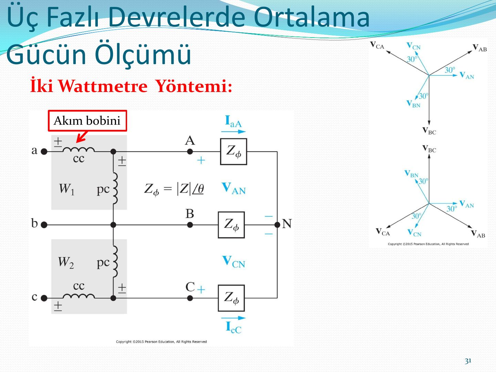

**Örnek:** Aşağıdaki şekilde yükteki faz gerilimi 120 V ve (a) Z_Φ = 8+j6 Ω, (b) Z_Φ = 8−j6 Ω, (c) Z_Φ = 5+j5√3 Ω, (d) Z_Φ = 10∠−75° Ω ise her bir wattmetrenin okuması gereken gücü hesaplayınız.

## Özet

- Devre analizinde tüm Δ bağlantıları Y haline getirilmelidir.
- Tek faz eşdeğer devre, Y-Y yapının hat akımını ve bir fazın gerilimini bulmak için kullanılır.
- a fazı hat akımı ve faz gerilimi bulunduktan sonra b ve c fazı gerilim ve akımları 120° faz farkı dışında aynıdır.
- Hat gerilimlerinin kümesi, faz gerilimleri kümesinden genlik olarak √3 katı ve ±30° (pozitif/negatif sıra) faz farklıdır.
- Δ bağlı kaynak ve yük durumunda hat akımları kümesi faz akımları kümesinden √3 katı ve −/+30° farklıdır (pozitif/negatif sıra).
- Dengeli üç fazlı bir devrede toplam anlık güç sabittir ve faz başına ortalama gücün 1.5 katıdır.
- 3 fazda toplam aktif güç, reaktif güç ve kompleks güç, faz başına gücün 3 katı ya da hat gerilimi ve akımıyla çarpımın √3 katıdır.
- Bir wattmetre yüke aktarılan ortalama gücü, yükle seri bağlanan bir akım bobini ve yüke paralel bağlanan bir gerilim bobini bağlanarak ölçer.
- Dengeli üç fazlı bir devrede ortalama güç, iki farklı fazına bağlanan iki wattmetrenin okuması toplanarak ölçülebilir.

*Not: Sunumun özetinde "toplam anlık güç faz başına ortalama gücün 1.5 katıdır" yazıyor; dengeli üç fazlı devrede toplam anlık güç, faz başına ortalama gücün 3 katına (toplam ortalama güce) eşittir. 1.5 katsayısı, Nilsson'daki p = 1.5·V_m·I_m·cos θ ifadesinde tepe değerlerle (V_m, I_m) yazılmış hâlinden geliyor olmalı.*
