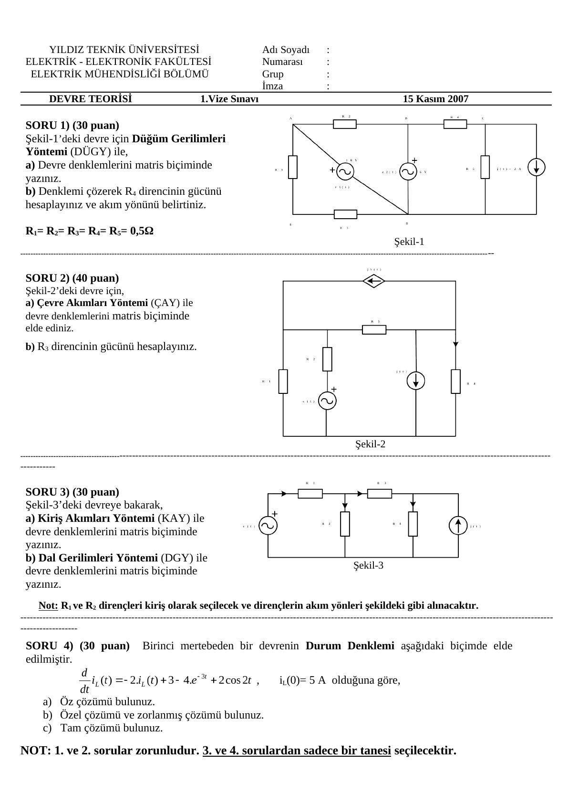
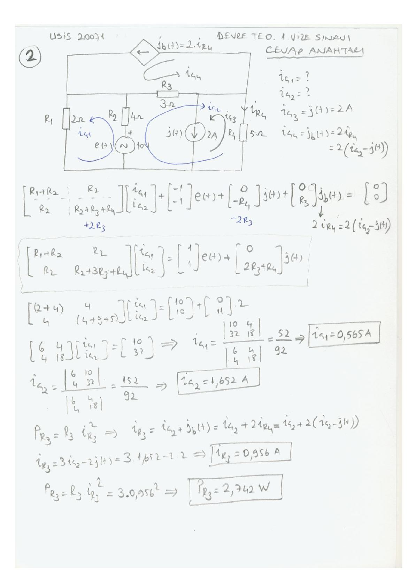
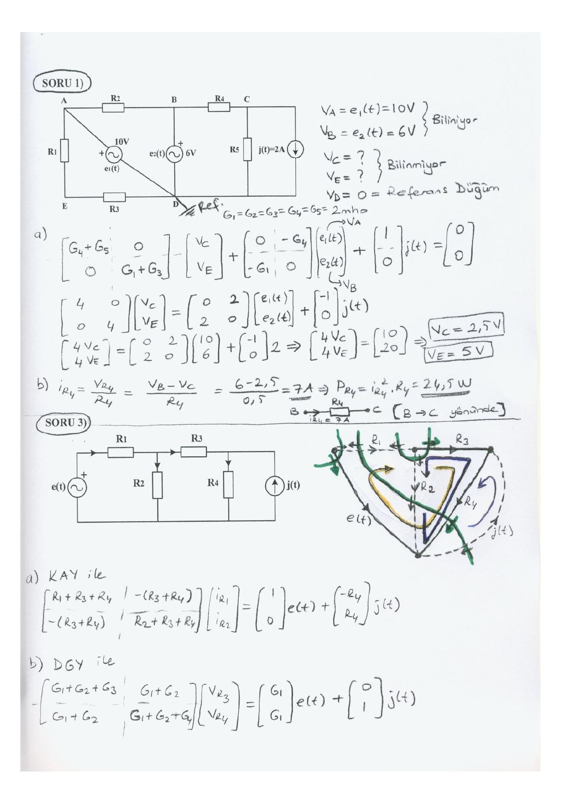
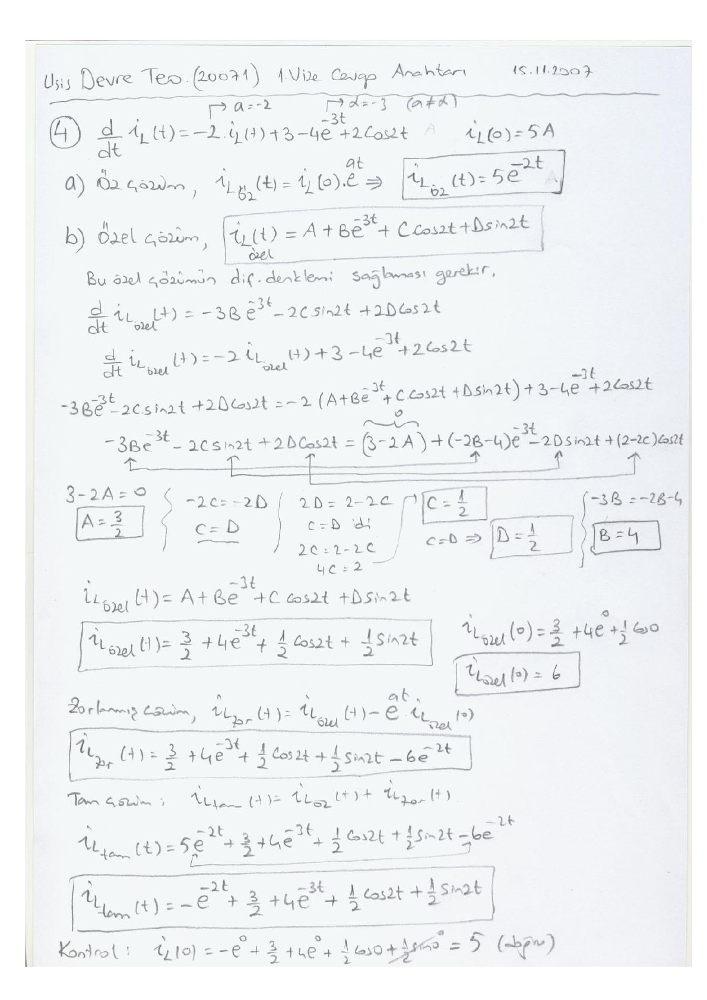

This post covers a Word document kept in the course folder under the name "Devre Teorisi (usis) 20071": the **Circuit Theory Midterm Exam 1** of the **Yıldız Technical University Faculty of Electrical and Electronics Engineering, Department of Electrical Engineering** (November 15, 2007; Asst. Prof. Dr. Adem Ünal, Asst. Prof. Dr. Recep Yumurtacı, Asst. Prof. Dr. Mehmet Uzunoğlu), together with the **handwritten answer key** appended to the end of the document ("USİS 20071 Devre Teo. 1. Vize Sınavı Cevap Anahtarı"). Although it is an exam from another university, it was kept in the folder because it is a good study resource for circuit analysis methods. The question texts have been transcribed, the answer key pages are included as images, and the main results are written out in the text. The original Word document can be downloaded at the end of the post.

*This content belongs to a third-party source; it is shared for archival and nostalgic purposes with the source credited. It will be removed at the request of the rights holder.*

Duration: 90 minutes. Questions 1 and 2 are mandatory; only one of Questions 3 and 4 is to be chosen.

## Question 1 (30 points): Node voltage method

For the circuit in Figure 1, using the Node Voltage Method (NVM):

- a) Write the circuit equations in matrix form.
- b) Solve the equations to calculate the power of resistor R4 and state the direction of its current. R1 = R2 = R3 = R4 = R5 = 0.5 Ω.

The circuit has voltage sources e₁(t) = 10 V and e₂(t) = 6 V and a current source j(t) = 2 A. Answer key:

- D is the reference node; V_A = e₁ = 10 V and V_B = e₂ = 6 V are known, V_C and V_E are unknown. G₁ = … = G₅ = 2 mho.
- a) [G₄+G₅, 0; 0, G₁+G₃]·[V_C; V_E] + [0, −G₄; −G₁, 0]·[e₁; e₂] + [1; 0]·j(t) = 0 → [4, 0; 0, 4]·[V_C; V_E] = [0, 2; 2, 0]·[e₁; e₂] + [−1; 0]·j(t)
- 4V_C = 2·6 − 2 = 10, 4V_E = 2·10 = 20 → **V_C = 2.5 V, V_E = 5 V**
- b) i_R4 = (V_B − V_C)/R4 = (6 − 2.5)/0.5 = **7 A** (from B to C), **P_R4 = 7²·0.5 = 24.5 W**

## Question 2 (40 points): Mesh current method

For the circuit in Figure 2:

- a) Obtain the circuit equations in matrix form using the Mesh Current Method (MCM).
- b) Calculate the power of resistor R3.

The circuit has R1 = 2 Ω, R2 = 4 Ω, R3 = 3 Ω, R4 = 5 Ω, e(t) = 10 V, j(t) = 2 A, and a dependent current source j_b(t) = 2·i_R4. Answer key:

- Substituting i_ç3 = j(t) = 2 A and i_ç4 = j_b(t) = 2i_R4 = 2(i_ç2 − j(t)):
- [R1+R2, R2; R2, R2+3R3+R4]·[i_ç1; i_ç2] = [1; 1]·e(t) + [0; 2R3+R4]·j(t)
- [6, 4; 4, 18]·[i_ç1; i_ç2] = [10; 32] → **i_ç1 = 52/92 = 0.565 A**, **i_ç2 = 152/92 = 1.652 A**
- i_R3 = i_ç2 + j_b = 3i_ç2 − 2j(t) = 3·1.652 − 4 = **0.956 A**, **P_R3 = 3·0.956² = 2.742 W**

## Question 3 (30 points): Link current and branch voltage methods

Referring to the circuit in Figure 3 (e(t), R1, R2, R3, R4, j(t)):

- a) Write the circuit equations in matrix form using the Link Current Method (LCM).
- b) Write the circuit equations in matrix form using the Branch Voltage Method (BVM).

Note: Resistors R1 and R2 are to be chosen as links, and the resistor current directions are to be taken as shown in the figure.

Answer key:

- a) LCM: [R1+R3+R4, −(R3+R4); −(R3+R4), R2+R3+R4]·[i_R1; i_R2] = [1; 0]·e(t) + [−R4; R4]·j(t)
- b) BVM: [G1+G2+G3, G1+G2; G1+G2, G1+G2+G4]·[V_R3; V_R4] = [G1; G1]·e(t) + [0; 1]·j(t)

## Question 4 (30 points): State equation of a first-order circuit

The state equation of a first-order circuit has been obtained as: di_L/dt = −2i_L(t) + 3 − 4e^(−3t) + 2 cos 2t, i_L(0) = 5 A.

- a) Find the natural (zero-input) response.
- b) Find the particular solution and the forced (zero-state) response.
- c) Find the complete solution.

Answer key:

- a) Natural response (a = −2): **i_L,nat(t) = i_L(0)·e^(at) = 5e^(−2t)**
- b) Substituting the particular solution i_L,part = A + Be^(−3t) + C cos 2t + D sin 2t into the differential equation and equating coefficients: 3 − 2A = 0 → A = 3/2; −3B = −2B − 4 → B = 4; C = D and 2D = 2 − 2C → C = D = 1/2
- **i_L,part(t) = 3/2 + 4e^(−3t) + ½ cos 2t + ½ sin 2t**, i_L,part(0) = 6
- Forced response: i_L,forced(t) = i_L,part(t) − e^(at)·i_L,part(0) = **3/2 + 4e^(−3t) + ½ cos 2t + ½ sin 2t − 6e^(−2t)**
- c) Complete solution = natural + forced: **i_L(t) = −e^(−2t) + 3/2 + 4e^(−3t) + ½ cos 2t + ½ sin 2t**
- Check: i_L(0) = −1 + 3/2 + 4 + ½ = 5 A (correct)

## Downloadable file

The original Word document containing the exam sheet and the answer key can be downloaded below.
