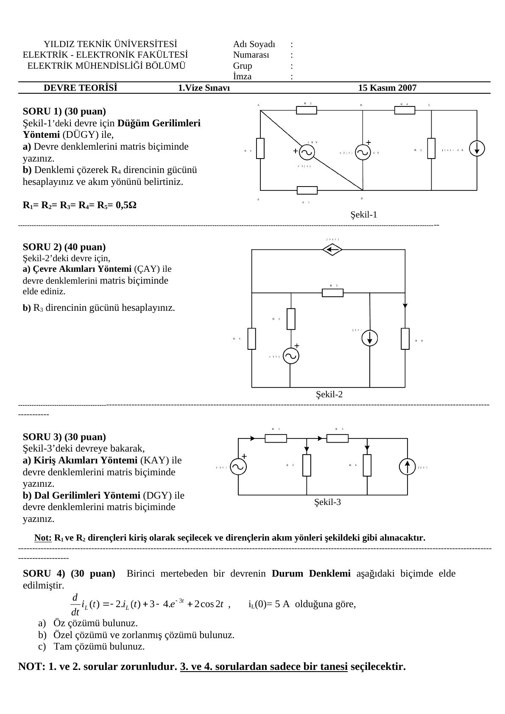
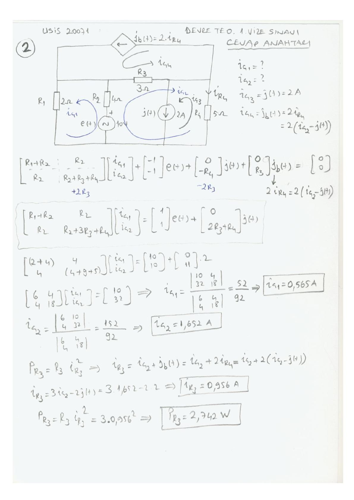
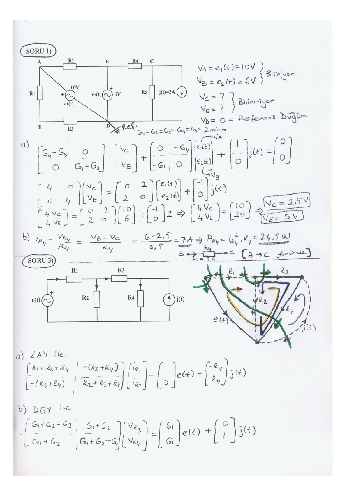
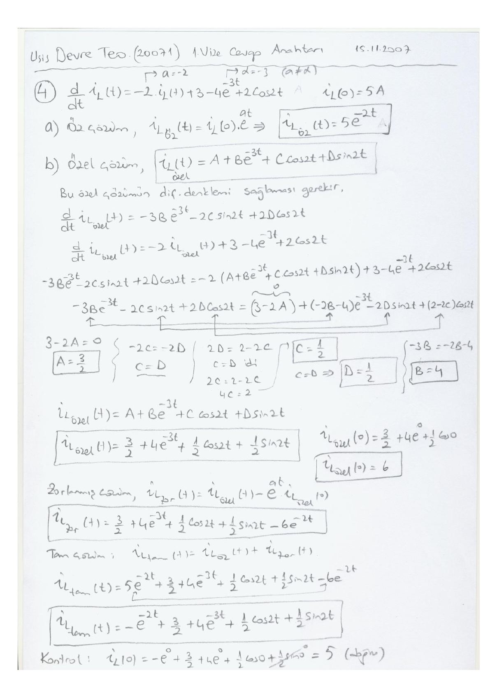

Bu yazı, ders klasöründe "Devre Teorisi (usis) 20071" adıyla saklanan bir Word belgesini içeriyor: **Yıldız Teknik Üniversitesi Elektrik-Elektronik Fakültesi, Elektrik Mühendisliği Bölümü**'nün **Devre Teorisi 1. Vize Sınavı** (15 Kasım 2007; Y. Doç. Dr. Adem Ünal, Y. Doç. Dr. Recep Yumurtacı, Y. Doç. Dr. Mehmet Uzunoğlu) ve belgenin sonuna eklenmiş **el yazısı cevap anahtarı** ("USİS 20071 Devre Teo. 1. Vize Sınavı Cevap Anahtarı"). Başka bir üniversitenin sınavı olsa da devre analizi yöntemleri için iyi bir çalışma kaynağı olduğundan klasörde tutulmuş. Soru metinleri aktarıldı, cevap anahtarı sayfaları görsel olarak eklendi ve ana sonuçlar metne döküldü. Orijinal Word belgesi yazının sonunda indirilebilir.

*Bu içerik üçüncü taraf bir kaynağa aittir; arşiv ve nostalji amacıyla kaynak belirtilerek paylaşılmıştır. Hak sahibinin talebi hâlinde kaldırılır.*

Süre: 90 dakika. 1. ve 2. sorular zorunludur; 3. ve 4. sorulardan yalnız biri seçilecektir.

## Soru 1 (30 puan): Düğüm gerilimleri yöntemi

Şekil-1'deki devre için Düğüm Gerilimleri Yöntemi (DÜGY) ile:

- a) Devre denklemlerini matris biçiminde yazınız.
- b) Denklemi çözerek R4 direncinin gücünü hesaplayınız ve akım yönünü belirtiniz. R1 = R2 = R3 = R4 = R5 = 0,5 Ω.

Devrede e₁(t) = 10 V ve e₂(t) = 6 V gerilim kaynakları ile j(t) = 2 A akım kaynağı var. Cevap anahtarı:

- D referans düğümü; V_A = e₁ = 10 V ve V_B = e₂ = 6 V biliniyor, V_C ve V_E bilinmiyor. G₁ = … = G₅ = 2 mho.
- a) [G₄+G₅, 0; 0, G₁+G₃]·[V_C; V_E] + [0, −G₄; −G₁, 0]·[e₁; e₂] + [1; 0]·j(t) = 0 → [4, 0; 0, 4]·[V_C; V_E] = [0, 2; 2, 0]·[e₁; e₂] + [−1; 0]·j(t)
- 4V_C = 2·6 − 2 = 10, 4V_E = 2·10 = 20 → **V_C = 2,5 V, V_E = 5 V**
- b) i_R4 = (V_B − V_C)/R4 = (6 − 2,5)/0,5 = **7 A** (B'den C'ye doğru), **P_R4 = 7²·0,5 = 24,5 W**

## Soru 2 (40 puan): Çevre akımları yöntemi

Şekil-2'deki devre için:

- a) Çevre Akımları Yöntemi (ÇAY) ile devre denklemlerini matris biçiminde elde ediniz.
- b) R3 direncinin gücünü hesaplayınız.

Devrede R1 = 2 Ω, R2 = 4 Ω, R3 = 3 Ω, R4 = 5 Ω, e(t) = 10 V, j(t) = 2 A ve j_b(t) = 2·i_R4 değerli bağımlı akım kaynağı var. Cevap anahtarı:

- i_ç3 = j(t) = 2 A ve i_ç4 = j_b(t) = 2i_R4 = 2(i_ç2 − j(t)) yerine konunca:
- [R1+R2, R2; R2, R2+3R3+R4]·[i_ç1; i_ç2] = [1; 1]·e(t) + [0; 2R3+R4]·j(t)
- [6, 4; 4, 18]·[i_ç1; i_ç2] = [10; 32] → **i_ç1 = 52/92 = 0,565 A**, **i_ç2 = 152/92 = 1,652 A**
- i_R3 = i_ç2 + j_b = 3i_ç2 − 2j(t) = 3·1,652 − 4 = **0,956 A**, **P_R3 = 3·0,956² = 2,742 W**

## Soru 3 (30 puan): Kiriş akımları ve dal gerilimleri yöntemleri

Şekil-3'teki devreye (e(t), R1, R2, R3, R4, j(t)) bakarak:

- a) Kiriş Akımları Yöntemi (KAY) ile devre denklemlerini matris biçiminde yazınız.
- b) Dal Gerilimleri Yöntemi (DGY) ile devre denklemlerini matris biçiminde yazınız.

Not: R1 ve R2 dirençleri kiriş olarak seçilecek ve dirençlerin akım yönleri şekildeki gibi alınacaktır.

Cevap anahtarı:

- a) KAY: [R1+R3+R4, −(R3+R4); −(R3+R4), R2+R3+R4]·[i_R1; i_R2] = [1; 0]·e(t) + [−R4; R4]·j(t)
- b) DGY: [G1+G2+G3, G1+G2; G1+G2, G1+G2+G4]·[V_R3; V_R4] = [G1; G1]·e(t) + [0; 1]·j(t)

## Soru 4 (30 puan): Birinci mertebeden devrenin durum denklemi

Birinci mertebeden bir devrenin durum denklemi şöyle elde edilmiştir: di_L/dt = −2i_L(t) + 3 − 4e^(−3t) + 2 cos 2t, i_L(0) = 5 A.

- a) Öz çözümü bulunuz.
- b) Özel çözümü ve zorlanmış çözümü bulunuz.
- c) Tam çözümü bulunuz.

Cevap anahtarı:

- a) Öz çözüm (a = −2): **i_L,öz(t) = i_L(0)·e^(at) = 5e^(−2t)**
- b) Özel çözüm i_L,özel = A + Be^(−3t) + C cos 2t + D sin 2t diferansiyel denklemde yerine konup katsayılar eşitlenir: 3 − 2A = 0 → A = 3/2; −3B = −2B − 4 → B = 4; C = D ve 2D = 2 − 2C → C = D = 1/2
- **i_L,özel(t) = 3/2 + 4e^(−3t) + ½ cos 2t + ½ sin 2t**, i_L,özel(0) = 6
- Zorlanmış çözüm: i_L,zor(t) = i_L,özel(t) − e^(at)·i_L,özel(0) = **3/2 + 4e^(−3t) + ½ cos 2t + ½ sin 2t − 6e^(−2t)**
- c) Tam çözüm = öz + zorlanmış: **i_L(t) = −e^(−2t) + 3/2 + 4e^(−3t) + ½ cos 2t + ½ sin 2t**
- Kontrol: i_L(0) = −1 + 3/2 + 4 + ½ = 5 A (doğru)

## İndirilebilir dosya

Sınav kâğıdını ve cevap anahtarını içeren orijinal Word belgesi aşağıdan indirilebilir.
