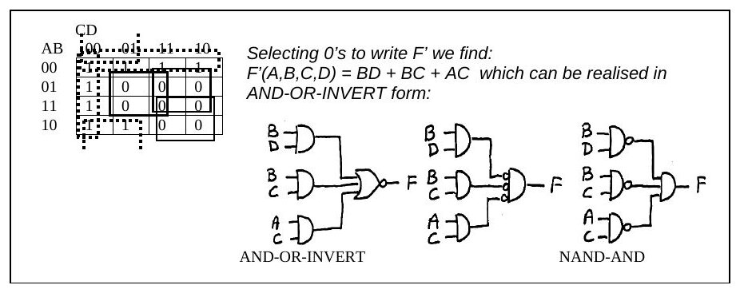

Bu yazı, Başkent Üniversitesi **EEM211 Sayısal Mantık Tasarımı (Digital Logic Design)** dersinin **20 Kasım 2006** tarihli ara sınavının sorularını ve hocaların hazırladığı cevap anahtarını ("EEM211 Midterm Answers") içeriyor. Sınav İngilizce; sorular ve çözümler aşağıda metin olarak verildi, devre çizimleri ve dalga şekilleri görsel olarak eklendi. Orijinal Word dosyası yazının sonunda indirilebilir.

## 1. Answer the following questions

### a) 9E36.7AH = ?₂ = ?₈

> Since the given number is Hexadecimal, we may convert it into binary by writing each digit in 4-bits binary.

(9E36.7A)₁₆ = (1001111000110110 . 01111010)₂

> Now, by rearranging the number in 3-bits groups, we may find its corresponding octal number:

(001 001 111 000 110 110 . 011 110 100)₂ = **(117066.364)₈**

### b) Kendini tümleyen kod

> Decimal 3 is expressed as 0110 in a self-complementing code alphabet. Find the corresponding code for decimal 6, in the same alphabet.

> The property of self-complementing codes is that, the 9's complement of a given number can be found by complementing each bit. Since the 9's complement of 3 is 6, it should be obtained by complementing each bit of 3, which is 1001.

Cevap: **1001**

### c) 6 bitlik en küçük sayı

> What is the smallest number that can be represented in 6-bit signed 2's complement form? Is it the same in 6-bit signed 1's complement representation? Why?

> −32 (100000), is the smallest number that can be represented in 6 bit signed-2's complement form. In 1's complement form, it becomes −31 (100000), since one of the combinations (111111) is used for −0, which is not available in 2's complement.

### d) Hamming kodu

> Find the corresponding Hamming Code for the 4-bit message 1101. Show all of your steps clearly.

| Position | 1 | 2 | 3 | 4 | 5 | 6 | 7 |
|---|---|---|---|---|---|---|---|
| Word | p1 | p2 | **1** | p3 | **1** | **0** | **1** |

Mesaj bitleri kalın yazılmıştır.

- 4, 5, 6, 7 parity check: even → p3 = 0
- 2, 3, 6, 7 parity check: even → p2 = 0
- 1, 3, 5, 7 parity check: odd → p1 = 1

Coded word: **1010101**

### e) Kanonik biçimler

> Given F(x,y,z) = x'y' + x'z. Find F'(x,y,z) in canonical S.O.P and P.O.S forms and express them in ∏ and Σ standard formats.

| # | x y z | F = x'(y' + z) | F' |
|---|---|---|---|
| 0 | 000 | 1 | 0 |
| 1 | 001 | 1 | 0 |
| 2 | 010 | 0 | 1 |
| 3 | 011 | 1 | 0 |
| 4 | 100 | 0 | 1 |
| 5 | 101 | 0 | 1 |
| 6 | 110 | 0 | 1 |
| 7 | 111 | 0 | 1 |

- F'(x, y, z) = **Σ(2, 4, 5, 6, 7)**
- F'(x, y, z) = **∏(0, 1, 3)**

## 2. Answer the following questions

### a) 8 bitlik 2'ye tümleyen aritmetiği

> Given A = (00011001)₂ and B = (11010010)₂. Show how A+B, A−B, −A−B and B−A would be computed, using 8-bit two's complement arithmetic, step by step separately.

A = (25)₁₀ = (00011001)₂, B = (11010010)₂, −A = 11100111, −B = 00101110

| İşlem | Sonuç (ikili) | Ondalık |
|---|---|---|
| A + B | 11101011 | −21 |
| A − B | 01000111 | 71 |
| B − A | 10111001 | −71 |
| −A − B = (−A) + (−B) | 00010101 | 21 |

### b) Tam toplayıcının çıkış dalga şekilleri

> Draw the output waveforms S and C (into the given spaces) of the Full Adder, that would be generated in response to the given input signals.

 ve çıkış (S, Co) dalga şekilleri")

Dalga şekillerinin altı zaman aralığındaki değerleri:

| Aralık | 1 | 2 | 3 | 4 | 5 | 6 |
|---|---|---|---|---|---|---|
| Ci | 1 | 1 | 1 | 0 | 0 | 0 |
| A | 0 | 1 | 0 | 1 | 0 | 1 |
| B | 1 | 0 | 0 | 1 | 1 | 1 |
| **S** | 0 | 0 | 1 | 0 | 1 | 0 |
| **Co** | 1 | 1 | 0 | 1 | 0 | 1 |

## 3) İki seviyeli NAND-AND gerçekleştirme

> F(A,B,C,D) = Σ(0,1,2,3,4,8,9,12). Implement this function using two level NAND – AND form with minimum logic gates.

| AB \ CD | 00 | 01 | 11 | 10 |
|---|---|---|---|---|
| 00 | 1 | 1 | 1 | 1 |
| 01 | 1 | 0 | 0 | 0 |
| 11 | 1 | 0 | 0 | 0 |
| 10 | 1 | 1 | 0 | 0 |

> Selecting 0's to write F' we find: F'(A,B,C,D) = BD + BC + AC which can be realised in AND-OR-INVERT form.

F = (BD + BC + AC)' ifadesi önce AND-OR-INVERT (AND kapıları + NOR) olarak çiziliyor, sonra NOR kapısı eşdeğeri olan girişleri terslenmiş AND kapısıyla değiştirilip terslemeler AND kapılarının çıkışına taşınarak **NAND-AND** biçimine getiriliyor.

## 4) BCD ≥ 5 dedektörü

> Design a 4-input, 1-output logic circuit, that will receive BCD numbers at its input and generate an output of 1, if the received number is ≥ 5, an output of 0 otherwise. Realize your circuit in AND – OR form, with minimum number of gates/inputs, without any inverter. Repeat your design in NOR – NOR form. NOTE: The inverted inputs are not available.

| # | A | B | C | D | F |
|---|---|---|---|---|---|
| 0 | 0 | 0 | 0 | 0 | 0 |
| 1 | 0 | 0 | 0 | 1 | 0 |
| 2 | 0 | 0 | 1 | 0 | 0 |
| 3 | 0 | 0 | 1 | 1 | 0 |
| 4 | 0 | 1 | 0 | 0 | 0 |
| 5 | 0 | 1 | 0 | 1 | 1 |
| 6 | 0 | 1 | 1 | 0 | 1 |
| 7 | 0 | 1 | 1 | 1 | 1 |
| 8 | 1 | 0 | 0 | 0 | 1 |
| 9 | 1 | 0 | 0 | 1 | 1 |
| 10–15 | | | | | X |

Karnaugh haritası (satırlar CD, sütunlar AB):

| CD \ AB | 00 | 01 | 11 | 10 |
|---|---|---|---|---|
| 00 | 0 | 0 | X | 1 |
| 01 | 0 | 1 | X | 1 |
| 11 | 0 | 1 | X | X |
| 10 | 0 | 1 | X | X |

> If we select the 1's in the map, we can write: **F(A,B,C,D) = A + BC + BD** which can be directly realized as shown in Fig. A.

> Now, if we select 0's, we can write: **F(A,B,C,D) = (A+B)(A+C+D)** which can be realized in OR-AND form and then by adding cancelling bubbles it can easily be converted into NOR-NOR form, as shown in Fig. B.

(A+C+D) NOR-NOR")

## 5) Devre sadeleştirme

> Find a simplified (minimized) expression and draw your new circuit, for the logic circuit below.

Devrede a, b girişli bir NAND (P1), a' ve c girişli bir NOR (P2), b ve c' girişli bir XOR (P3) var; P1 ve P2 bir AND kapısında birleşip P4'ü veriyor, P3 ile P4 de bir NOR kapısından geçerek f(a, b, c) çıkışını üretiyor.

- P1 = (ab)'
- P2 = (a' + c)'
- P3 = b ⊕ c'
- P4 = P1 · P2 = (ab)' · (a' + c)'
- f(a, b, c) = (P3 + P4)' = [(b ⊕ c') + (ab)'(a' + c)']'

Tümleyen sadeleştirilir:

- f'(a, b, c) = (b ⊕ c') + (ab)'(a' + c)'
- = bc + b'c' + (ab)'(a' + c)'
- = bc + b'c' + (a' + b')ac'
- = bc + b'c' + ab'c'
- = bc + b'c'
- f'(a, b, c) = b ⊙ c
- **f(a, b, c) = (b ⊙ c)' = b ⊕ c**

Yani bütün devre tek bir XOR kapısına indirgeniyor.

 = b ⊕ c")
