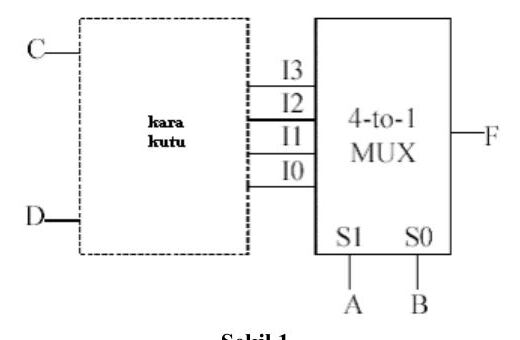
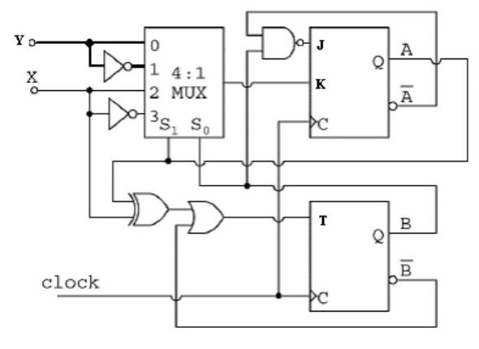
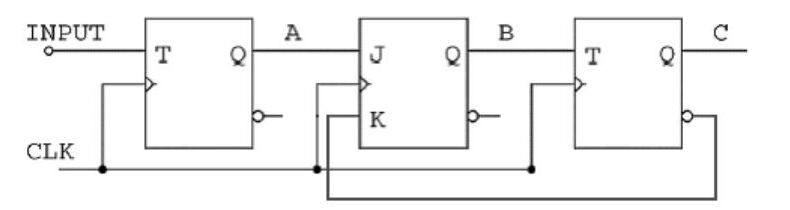

This post is a **final exam** found in the sample questions folder of the EEM211 Digital Logic Design course: the final exam of the **Başkent University Department of Computer Engineering BİL275 Digital Logic Design** course (the PDF was created on 28 January 2004; exam duration 150 minutes). This course, offered in the computer engineering department of the same university, corresponds in content to EEM211. The document contains only the questions, without answers. The questions are given below as text and the figures as images; the original PDF can be downloaded at the end of the post.

*This content belongs to a third-party source; it is shared for archival and nostalgic purposes with the source credited. It will be removed at the request of the rights holder.*

## Point distribution

| Question | 1 | 2 | 3 (lab) | 4 | 5 | Total |
|---|---|---|---|---|---|---|
| Points | 25 | 30 | 10 | 25 | 20 | 100 |

## Question 1 (25 points)

A sequential circuit with one input and one output sets the output to **1** when **1101** or **1001** occurs in the input sequence. Design this sequential circuit using D flip-flops. Show the output sequence for the sequence `001101101100101101001101`.

## Question 2 (30 points)

**a)** Design the circuit that performs the following operation for 3-bit inputs using the minimum number of 2x4 decoders and the minimum number of 4-to-2 encoders (do not use gates). [10]

Operation: output = mod((input · 3), 8)

For example, for the input 6 (110), the output must be mod(6 · 3, 8) = mod(18, 8) = 2 (010).

**b)** Design the operation given in part a using the minimum number of 2x1 MUXes (do not use gates). [10]

**c)** Design the black box below so that it implements the function F(A, B, C, D) = Σ(0, 7, 8, 9, 10, 11, 12, 14, 15). [10]

## Question 3 (10 points, laboratory final question)

Design, using T flip-flops, a circuit that counts 0, 4, 5, 7, 6, 2, 3, 1, 0, 4, … when its input is 1, and 0, 1, 3, 2, 6, 7, 5, 4, 0, 1, … when its input is 0. Draw the state diagram. State the function of the circuit.

## Question 4 (25 points)

For a counter that counts 0, 1, 3, 6, 7, 4, 0, 1, 3, …:

**a)** Draw the state table and the state diagram. [5]

**b)** Design the counter using J-K flip-flops. Analyze the unused states (do not draw the circuit). [10]

**c)** By adding a ROM with the minimum number of address inputs to the circuit you designed in part b, design a counter that counts in the sequence 7, 0, 3, 4, 6, 7, 7, 0, 3, 4, 6, 7, 7, 0, 3, … [10]

## Question 5 (20 points)

**a)** Analyze the circuit below (Figure 2). Draw the state table and the state diagram. [12] (No partial credit will be given for this question.)

**b)** i) Determine the output sequence that the circuit below (Figure 3) will produce for the input sequence 01101110 (assume the flip-flops are initially in the Reset state). ii) If output C is connected to the input of flip-flop A, what is the counting sequence? (Find all possible counting sequences.) [8] (No partial credit will be given for this question.)

## Flip-flop excitation tables on the exam sheet

| Q(t) | Q(t+1) | J | K | D | T | S | R |
|---|---|---|---|---|---|---|---|
| 0 | 0 | 0 | X | 0 | 0 | 0 | X |
| 0 | 1 | 1 | X | 1 | 1 | 1 | 0 |
| 1 | 0 | X | 1 | 0 | 1 | 0 | 1 |
| 1 | 1 | X | 0 | 1 | 0 | X | 0 |
