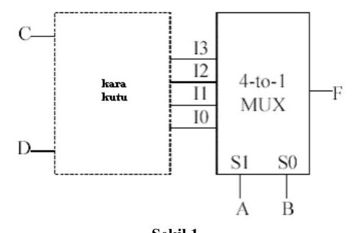
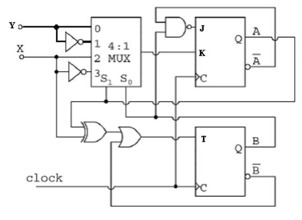
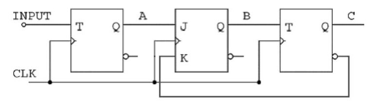

Bu yazı, EEM211 Sayısal Mantık Tasarımı dersinin örnek sorular klasöründe bulunan bir **final sınavıdır**: **Başkent Üniversitesi Bilgisayar Mühendisliği Bölümü BİL275 Sayısal Mantık Tasarımı** dersinin final sınavı (PDF'in oluşturulma tarihi 28 Ocak 2004; sınav süresi 150 dakika). Aynı üniversitenin bilgisayar mühendisliği bölümünde verilen bu ders, içerik olarak EEM211'in karşılığı. Belgede yalnızca sorular var, cevaplar yok. Sorular aşağıda metin olarak, şekiller görsel olarak verildi; orijinal PDF yazının sonunda indirilebilir.

*Bu içerik üçüncü taraf bir kaynağa aittir; arşiv ve nostalji amacıyla kaynak belirtilerek paylaşılmıştır. Hak sahibinin talebi hâlinde kaldırılır.*

## Puan dağılımı

| Soru | 1 | 2 | 3 (lab) | 4 | 5 | Toplam |
|---|---|---|---|---|---|---|
| Puan | 25 | 30 | 10 | 25 | 20 | 100 |

## Soru 1 (25 puan)

Bir girişi ve bir çıkışı olan sıralı bir devre, giriş dizisinde **1101** veya **1001** olduğunda çıkışı **1** yapmaktadır. Bu sıralı devreyi D flip-floplarıyla tasarlayınız. `001101101100101101001101` dizisi için çıkış dizisini gösteriniz.

## Soru 2 (30 puan)

**a)** 3 bitlik girişler için aşağıdaki işlemi gerçekleştiren devreyi minimum sayıda 2x4 kod çözücü (decoder) ve minimum sayıda 4'e 2 kodlayıcı (encoder) kullanarak tasarlayınız (kapı kullanmayınız). [10]

İşlem: çıkış = mod((giriş · 3), 8)

Örneğin 6 (110) girişi için çıkış = mod(6 · 3, 8) = mod(18, 8) = 2 (010) olmalıdır.

**b)** a'da verilen işlemi minimum sayıda 2x1 MUX kullanarak tasarlayınız (kapı kullanmayınız). [10]

**c)** Aşağıdaki kara kutuyu F(A, B, C, D) = Σ(0, 7, 8, 9, 10, 11, 12, 14, 15) fonksiyonunu gerçekleştirecek şekilde tasarlayınız. [10]

## Soru 3 (10 puan, laboratuvar final sorusu)

Girişi 1 olduğunda 0, 4, 5, 7, 6, 2, 3, 1, 0, 4, … şeklinde; girişi 0 olduğunda 0, 1, 3, 2, 6, 7, 5, 4, 0, 1, … şeklinde sayan devreyi T flip-floplarıyla tasarlayınız. Durum diyagramını çiziniz. Devrenin işlevini belirtiniz.

## Soru 4 (25 puan)

0, 1, 3, 6, 7, 4, 0, 1, 3, … şeklinde sayan bir sayıcı için:

**a)** Durum tablosunu ve durum diyagramını çiziniz. [5]

**b)** Sayıcıyı J-K flip-floplarıyla tasarlayınız. Kullanılmayan durumların analizini yapınız (devre çizimi yapmayınız). [10]

**c)** b'de tasarladığınız devreye minimum sayıda adres girişi olan bir ROM ekleyerek 7, 0, 3, 4, 6, 7, 7, 0, 3, 4, 6, 7, 7, 0, 3, … sırasında sayan bir sayıcı tasarlayınız. [10]

## Soru 5 (20 puan)

**a)** Aşağıdaki devreyi (Şekil 2) analiz ediniz. Durum tablosunu ve durum diyagramını çiziniz. [12] (Bu soruda kısmi puanlama yapılmayacaktır.)

**b)** i) Aşağıdaki devrenin (Şekil 3) 01101110 giriş dizisi için vereceği çıkış dizisini belirtiniz (başlangıçta flip-flopların Reset durumunda olduğunu kabul ediniz). ii) C çıkışı A flip-flopunun girişine bağlanırsa sayma sırası nasıl olur? (Mümkün olabilecek tüm sayma sıralarını bulunuz.) [8] (Bu soruda kısmi puanlama yapılmayacaktır.)

## Sınav kâğıdındaki flip-flop uyarma tabloları

| Q(t) | Q(t+1) | J | K | D | T | S | R |
|---|---|---|---|---|---|---|---|
| 0 | 0 | 0 | X | 0 | 0 | 0 | X |
| 0 | 1 | 1 | X | 1 | 1 | 1 | 0 |
| 1 | 0 | X | 1 | 0 | 1 | 0 | 1 |
| 1 | 1 | X | 0 | 1 | 0 | X | 0 |
