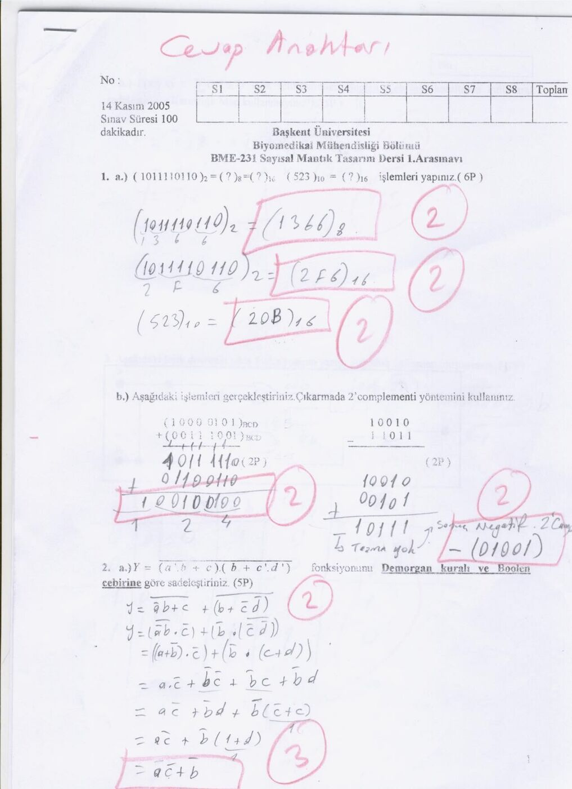
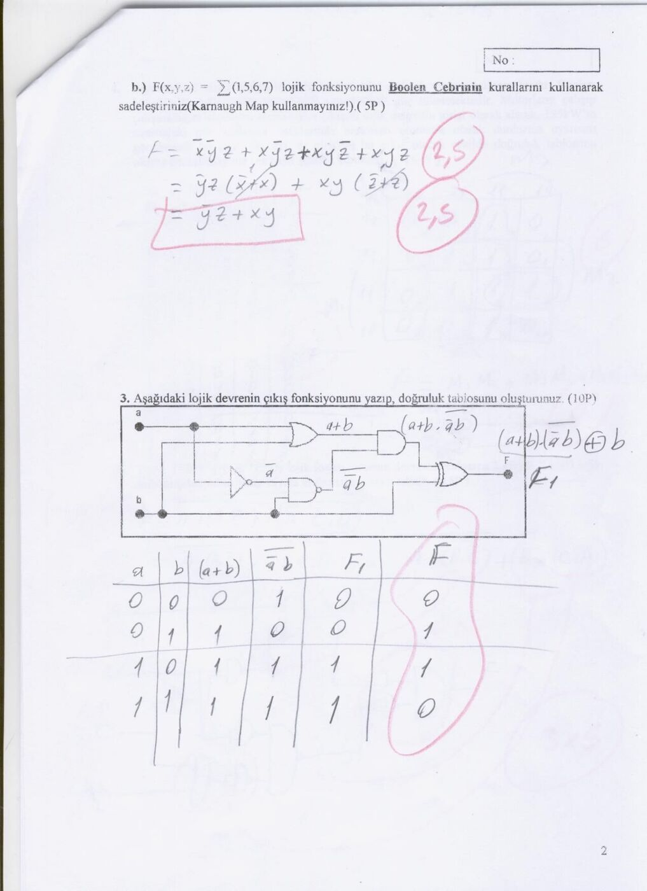
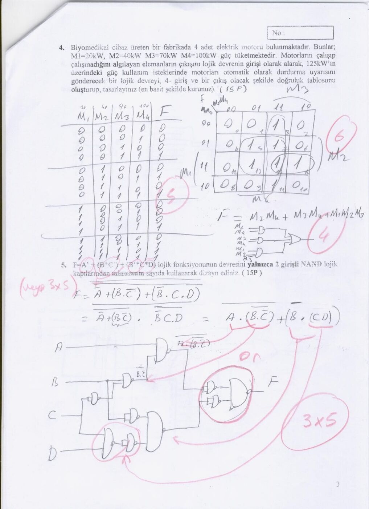
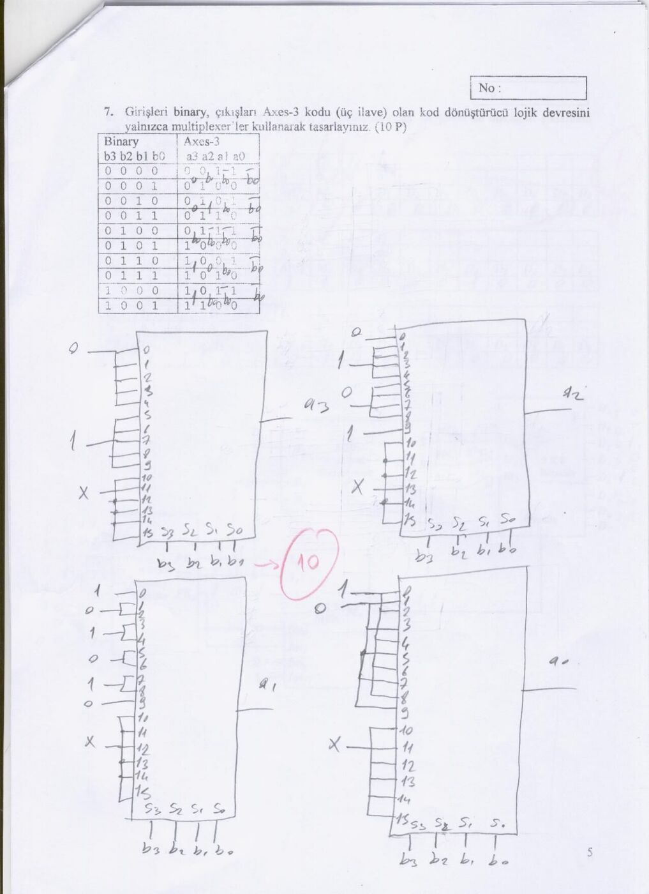

This post consists of four scanned pages found under the name "sayısal mantık vize" in the sample questions folder of the EEM211 Digital Logic Design course: the **BME-231 Digital Logic Design Course Midterm Exam 1** (**14 November 2005**, exam duration 100 minutes) of the Biomedical Engineering Department at Başkent University, with "Answer Key" written on it in red pen and its solutions and points filled in. This course, given to biomedical engineering students at the same university, corresponds to EEM211. Page 4 (Question 6) is missing from the scanned paper. The questions and solutions are transcribed below, and the scanned pages are attached as well; the four pages can be downloaded as a PDF at the end of the post.

## Question 1 (6 + 4 points)

**a)** Perform the operations (1011110110)₂ = (?)₈ = (?)₁₆ and (523)₁₀ = (?)₁₆.

- (1 011 110 110)₂ = **(1366)₈**
- (10 1111 0110)₂ = **(2F6)₁₆**
- (523)₁₀ = **(20B)₁₆**

**b)** Perform the following operations; use the 2's complement method for subtraction.

BCD addition: (1000 0101)BCD + (0011 1001)BCD, that is, 85 + 39.

```
   1000 0101
 + 0011 1001
 -----------
   1011 1110
 + 0110 0110   (iki basamak da 9'dan büyük: 6 eklenir)
 -----------
 1 0010 0100   = 124
```

Subtraction: 10010 − 11011. The 2's complement of the subtrahend (00101) is added:

```
   10010
 + 00101
 -------
   10111
```

There is no overflow (carry), so the result is negative; taking the 2's complement of 10111 gives the result **−(01001)** (18 − 27 = −9).



## Question 2 (5 + 5 points)

**a)** Simplify the function Y = [(a'·b + c)·(b + c'·d')]' using De Morgan's law and Boolean algebra.

Y = (a'b + c)' + (b + c'd')'
= (a'b)'·c' + b'·(c'd')'
= (a + b')c' + b'(c + d)
= ac' + b'c' + b'c + b'd
= ac' + b'd + b'(c' + c)
= ac' + b'(1 + d)
= **ac' + b'**

**b)** Simplify the logic function F(x, y, z) = Σ(1, 5, 6, 7) using the rules of Boolean algebra (do not use a Karnaugh map).

F = x'y'z + xy'z + xyz' + xyz
= y'z(x' + x) + xy(z' + z)
= **y'z + xy**

## Question 3 (10 points)

Write the output function of the logic circuit below and construct its truth table.

In the circuit, a and b feed an OR gate (a + b), and a' and b feed a NAND gate ((a'b)'); these two signals are combined in an AND gate, and the result is XORed with b:

F = [(a + b)·(a'b)'] ⊕ b

| a | b | a + b | (a'b)' | F1 = (a + b)(a'b)' | F = F1 ⊕ b |
|---|---|---|---|---|---|
| 0 | 0 | 0 | 1 | 0 | 0 |
| 0 | 1 | 1 | 0 | 0 | 1 |
| 1 | 0 | 1 | 1 | 1 | 1 |
| 1 | 1 | 1 | 1 | 1 | 0 |

Result: F = a ⊕ b.



## Question 4 (15 points)

> A factory that manufactures biomedical devices has 4 electric motors. They consume M1 = 20 kW, M2 = 40 kW, M3 = 70 kW, and M4 = 100 kW of power. Taking the outputs of the sensors that detect whether the motors are running as the inputs of the logic circuit, design a logic circuit with 4 inputs and one output, by constructing its truth table, that sends a warning to automatically stop the motors when the power demand exceeds 125 kW (build it in the simplest form).

In the truth table, F is 1 when the total power exceeds 125 kW: M3 + M4 (170 kW), M2 + M4 (140 kW), M1 + M2 + M3 (130 kW), and all combinations that contain them. Using a Karnaugh map:

**F = M2·M4 + M3·M4 + M1·M2·M3**

The circuit is built with three AND gates and one OR gate.

## Question 5 (15 points)

Design the circuit of the logic function F = A' + (B·C') + (B'·C·D) using the minimum number of 2-input NAND gates only.

In the solution, the expression is brought to NAND form using De Morgan's laws: F = [A·(BC')'·(B'CD)']', and the terms are built with 2-input NANDs (three-input products with two NAND stages). In the answer key, two different solutions are marked for the output part ("or"), and the grading is noted as 3 × 5.



## Question 7 (10 points)

Design the logic circuit of a code converter whose inputs are binary and whose outputs are in excess-3 code, using only multiplexers.

| b3 b2 b1 b0 | a3 a2 a1 a0 |
|---|---|
| 0000 | 0011 |
| 0001 | 0100 |
| 0010 | 0101 |
| 0011 | 0110 |
| 0100 | 0111 |
| 0101 | 1000 |
| 0110 | 1001 |
| 0111 | 1010 |
| 1000 | 1011 |
| 1001 | 1100 |

In the solution, a 16-to-1 MUX with select inputs b3 b2 b1 b0 is used for each output bit; the 0 and 1 values from the table are connected to the data inputs, and inputs 10–15 are left as don't-care (X). The table also marks the relationship a0 = b0' (a0 is the complement of b0 in all rows).


