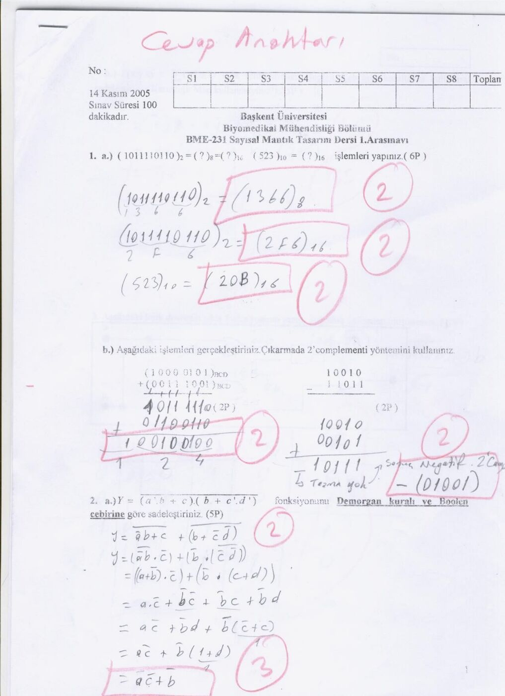
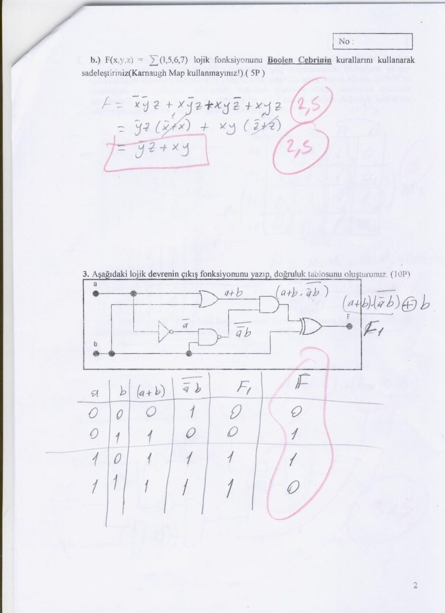
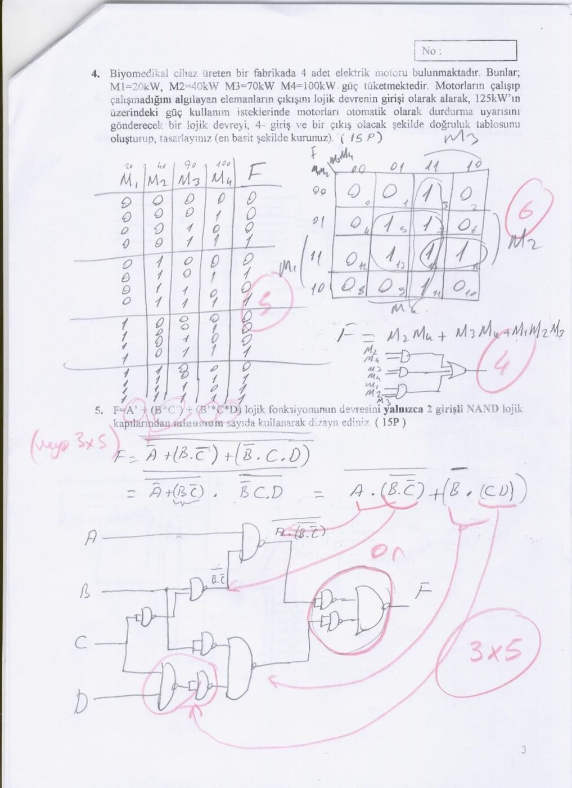
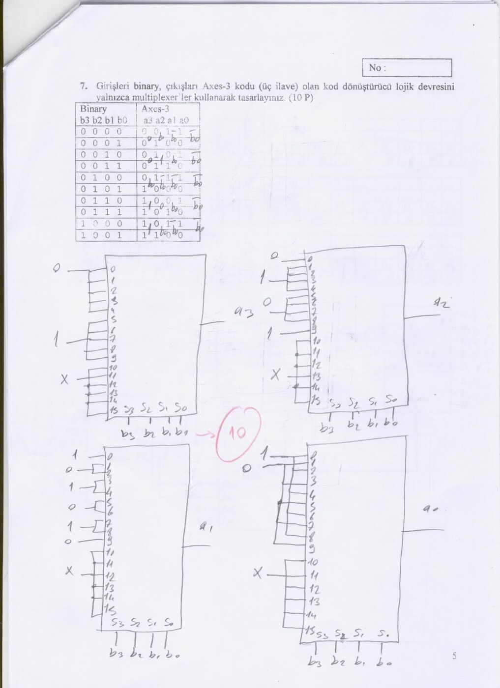

Bu yazı, EEM211 Sayısal Mantık Tasarımı dersinin örnek sorular klasöründe "sayısal mantık vize" adıyla bulunan taranmış dört sayfadır: Başkent Üniversitesi Biyomedikal Mühendisliği Bölümü **BME-231 Sayısal Mantık Tasarım Dersi 1. Ara Sınavı**'nın (**14 Kasım 2005**, sınav süresi 100 dakika) üzerine kırmızı kalemle "Cevap Anahtarı" yazılmış, çözümleri ve puanları işlenmiş kâğıdı. Aynı üniversitede biyomedikal mühendisliği öğrencilerine verilen bu ders, EEM211'in karşılığı. Taranmış kâğıtta 4. sayfa (6. soru) yok. Sorular ve çözümler aşağıda metne döküldü, taranmış sayfalar da eklendi; dört sayfa yazının sonunda PDF olarak indirilebilir.

## Soru 1 (6 + 4 puan)

**a)** (1011110110)₂ = (?)₈ = (?)₁₆ ve (523)₁₀ = (?)₁₆ işlemlerini yapınız.

- (1 011 110 110)₂ = **(1366)₈**
- (10 1111 0110)₂ = **(2F6)₁₆**
- (523)₁₀ = **(20B)₁₆**

**b)** Aşağıdaki işlemleri gerçekleştiriniz; çıkarmada 2'ye tümleyen yöntemini kullanınız.

BCD toplama: (1000 0101)BCD + (0011 1001)BCD, yani 85 + 39.

```
   1000 0101
 + 0011 1001
 -----------
   1011 1110
 + 0110 0110   (iki basamak da 9'dan büyük: 6 eklenir)
 -----------
 1 0010 0100   = 124
```

Çıkarma: 10010 − 11011. Çıkanın 2'ye tümleyeni (00101) eklenir:

```
   10010
 + 00101
 -------
   10111
```

Taşma (elde) yok, dolayısıyla sonuç negatiftir; 10111'in 2'ye tümleyeni alınarak sonuç **−(01001)** bulunur (18 − 27 = −9).



## Soru 2 (5 + 5 puan)

**a)** Y = [(a'·b + c)·(b + c'·d')]' fonksiyonunu De Morgan kuralı ve Boole cebrine göre sadeleştiriniz.

Y = (a'b + c)' + (b + c'd')'
= (a'b)'·c' + b'·(c'd')'
= (a + b')c' + b'(c + d)
= ac' + b'c' + b'c + b'd
= ac' + b'd + b'(c' + c)
= ac' + b'(1 + d)
= **ac' + b'**

**b)** F(x, y, z) = Σ(1, 5, 6, 7) lojik fonksiyonunu Boole cebrinin kurallarını kullanarak sadeleştiriniz (Karnaugh haritası kullanmayınız).

F = x'y'z + xy'z + xyz' + xyz
= y'z(x' + x) + xy(z' + z)
= **y'z + xy**

## Soru 3 (10 puan)

Aşağıdaki lojik devrenin çıkış fonksiyonunu yazıp doğruluk tablosunu oluşturunuz.

Devrede a ve b bir OR kapısına (a + b), a' ile b bir NAND kapısına ((a'b)') giriyor; bu iki sinyal bir AND kapısında birleşiyor ve sonuç b ile XOR'lanıyor:

F = [(a + b)·(a'b)'] ⊕ b

| a | b | a + b | (a'b)' | F1 = (a + b)(a'b)' | F = F1 ⊕ b |
|---|---|---|---|---|---|
| 0 | 0 | 0 | 1 | 0 | 0 |
| 0 | 1 | 1 | 0 | 0 | 1 |
| 1 | 0 | 1 | 1 | 1 | 1 |
| 1 | 1 | 1 | 1 | 1 | 0 |

Sonuç: F = a ⊕ b.



## Soru 4 (15 puan)

> Biyomedikal cihaz üreten bir fabrikada 4 adet elektrik motoru bulunmaktadır. Bunlar M1 = 20 kW, M2 = 40 kW, M3 = 70 kW, M4 = 100 kW güç tüketmektedir. Motorların çalışıp çalışmadığını algılayan elemanların çıkışını lojik devrenin girişi olarak alarak, 125 kW'ın üzerindeki güç kullanım isteklerinde motorları otomatik olarak durdurma uyarısını gönderecek bir lojik devreyi, 4 giriş ve bir çıkış olacak şekilde doğruluk tablosunu oluşturup tasarlayınız (en basit şekilde kurunuz).

Doğruluk tablosunda F, toplam güç 125 kW'ı aştığında 1'dir: M3 + M4 (170 kW), M2 + M4 (140 kW), M1 + M2 + M3 (130 kW) ve bunları içeren bütün birleşimler. Karnaugh haritasıyla:

**F = M2·M4 + M3·M4 + M1·M2·M3**

Devre üç AND kapısı ve bir OR kapısıyla kuruluyor.

## Soru 5 (15 puan)

F = A' + (B·C') + (B'·C·D) lojik fonksiyonunun devresini yalnızca 2 girişli NAND kapılarından minimum sayıda kullanarak tasarlayınız.

Çözümde De Morgan ile ifade NAND biçimine getiriliyor: F = [A·(BC')'·(B'CD)']' ve terimler 2 girişli NAND'lerle kuruluyor (üç girişli çarpımlar iki NAND aşamasıyla). Cevap anahtarında çıkıştaki kısım için iki farklı çözüm işaretlenmiş ("veya") ve puanlama 3 × 5 olarak not edilmiş.



## Soru 7 (10 puan)

Girişleri ikili (binary), çıkışları fazlalık-3 (excess-3, "üç ilave") kodu olan kod dönüştürücü lojik devresini yalnızca çoklayıcılar (multiplexer) kullanarak tasarlayınız.

| b3 b2 b1 b0 | a3 a2 a1 a0 |
|---|---|
| 0000 | 0011 |
| 0001 | 0100 |
| 0010 | 0101 |
| 0011 | 0110 |
| 0100 | 0111 |
| 0101 | 1000 |
| 0110 | 1001 |
| 0111 | 1010 |
| 1000 | 1011 |
| 1001 | 1100 |

Çözümde her çıkış biti için seçme girişleri b3 b2 b1 b0 olan bir 16'ya 1 MUX kullanılıyor; veri girişlerine tablodaki 0 ve 1 değerleri bağlanıyor, 10–15 girişleri keyfi (X) bırakılıyor. Tabloda ayrıca a0 = b0' ilişkisi işaretlenmiş (a0 bütün satırlarda b0'ın tersi).


