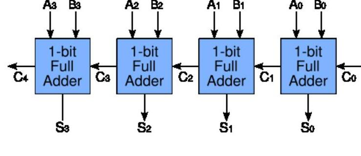

This post brings together the Fall 2006 documents of the **BME 231 Digital Design (Digital Logic Design)** course of the Biomedical Engineering Department at Başkent University, found in the EEM211 Digital Logic Design course folder: two quiz solutions by the course instructor **Mehmet Yüksekkaya**, eight lab handouts, and a student's term project report. The student's name and number have been redacted from the project report, and the manufacturer datasheet (74F283 datasheet) pages attached to the report have been removed. All documents can be downloaded as a ZIP at the end of the post.

## Quiz 1 solutions

**1)** Perform the subtraction of unsigned binary numbers using the 2's complement of the subtrahend; if the result is negative, take its 2's complement and put a minus sign in front.

- b) 110100 − 10101: The 2's complement of Y = 010101 is 101011. X + (−Y) = 110100 + 101011 = 1011111. There is an end carry, which is discarded: the result is **011111** (52 − 21 = 31).
- d) 101010 − 101011: The 2's complement of Y is 010101. X + (−Y) = 101010 + 010101 = 111111. There is no end carry: the 2's complement of the result is taken and a minus sign is put in front, giving **−000001** (42 − 43 = −1).

**2)** The largest and smallest signed and unsigned binary numbers that can be represented with 5 bits and their decimal equivalents:

| | Binary | Decimal |
|---|---|---|
| Largest unsigned | 11111 | 31 |
| Smallest unsigned | 00000 | 0 |
| Largest signed | 01111 | 15 |
| Smallest signed | 10000 | −16 |

**3)** Represent the number 8620 in a) BCD, b) excess-3 code.

- BCD: 1000 0110 0010 0000
- Excess-3 (0011 is added to each digit): 1011 1001 0101 0011

## Quiz 2 solutions

**1)** Design the expression given by the truth table using only one full adder.

| a | b | F | G |
|---|---|---|---|
| 0 | 0 | 0 | 1 |
| 0 | 1 | 1 | 0 |
| 1 | 0 | 1 | 0 |
| 1 | 1 | 1 | 1 |

F = a + b (OR), G = (a ⊕ b)' (XNOR). If a, b and a constant 1 are applied to the full adder's inputs (a, b and carry input), the sum output is a ⊕ b ⊕ 1 = (a ⊕ b)' = G, and the carry output is ab + (a ⊕ b)·1 = a + b = F.

*Note: The solution is given as a drawing on the paper; the connection above was checked against the truth table.*

**2)** Simplify the expression F(x, y, z, w) = Σ(0, 2, 3, 4, 6, 8, 10, 11, 12, 13, 14, 15) and design its circuit; then redesign the circuit using only 2-input NAND gates.

Simplified expression: **F = w' + xy + y'z**. In the solution, the AND-OR circuit is drawn first, then the circuit using only 2-input NAND gates.

## Lab handouts (Electronics Workbench and laboratory)

1. **Experiment 2 – Introduction to logic circuits:** NOT, AND, OR, NAND, NOR; 3- and 4-input AND, 3-input OR and NAND built from 2-input gates; complementer, and AND with NAND; truth tables with 7408 and 7400.
1. **Experiment 3 – Boolean algebra:** demonstrating rules such as A + 1 = 1, A·0 = 0, A + A'B = A + B, (A + B)(A + C) = A + BC and De Morgan's theorems with circuits; converting the expression F = (y + z')(x + y)(y' + z) to OR-complement form only and F = x'y' + x'z + y'z to AND-complement form only; the truth table, minterm and maxterm expansions, and simplification of F, which gives 1 when there are **two or more adjacent empty chairs** among four chairs in a row.
1. **Experiment 4 – Karnaugh map:** a function that detects invalid BCD codes (1010–1111); the map of F = A'D + B'D + BC + AB'D', and simplification of F and F' by grouping 1's and 0's.
1. **Experiment 5 – Additional work:** in addition to the work in the EWB handout, problem 3-25 of Mano's book (2nd edition) and a BCD-to-7-segment display driver circuit that shows the data coming from the word generator on a 7-segment display.
1. **Experiment 6 – Adder circuits with displays:** a BCD-to-7-segment display decoder that works like the 7447; a 2-bit full adder with 3x8 decoders (74138, 4012) (test 01 + 01 = 10); a BCD adder that shows the addends and the sum on four displays (7447, 4008, 4025; tests 1 + 7 = 8, 5 + 5 = 10, 9 + 8 = 17, 0 + 0 = 0).
1. **Experiment 7 – Basic MUX/DEMUX transmission system:** a 4x16 decoder with 2x4 decoders (74139) and comparison with the 74154; a data transmission system with multiplexer and decoder using the 74156 and 74153; design of an 8-bit comparator from 4-bit comparators.
1. **Experiment 8 – Synchronous sequential logic:** design with D and JK flip-flops from a state diagram with three flip-flops (A, B, C), one input x and one output y (unused states are don't-cares; check that the circuit is self-correcting); the state table and diagram of a given circuit with two JK flip-flops.
1. **Experiment 10 – Counters and shift registers:** a 2-minute stopwatch with 7-segment displays that counts from 0:00 to 1:59; a 4-bit bidirectional shift register with D flip-flops that shifts right, shifts left and loads in parallel. Bonus: a hexadecimal 7-segment display driver (30 points) and a text driver that scrolls the first and last name on a 4x8 LED matrix (70 points).

## Project report: Digital integrated circuits

A term project report prepared by a student for the BME 231 course (topic: digital integrated circuits). The sections of the report:

- **Introduction to integrated circuits:** the digital logic families RTL (resistor-transistor), DTL (diode-transistor), TTL (transistor-transistor), ECL (emitter-coupled), MOS and CMOS. RTL and DTL are now of only historical importance; the basic circuit of each family is a NAND or NOR gate.
- **Special characteristics:** fan-out, power dissipation, propagation delay and noise margin.
- **74F283 – 4-bit full adder with fast carry:** a chain of four one-bit full adders; it adds two 4-bit numbers, has a Cin input and a Cout output; thanks to its internal look-ahead carry circuit it produces Cout in about 5.7 ns; it is designed to operate between 0 and 70 °C.
- **References:** Mano, *Digital Design* (2nd edition), Chapter 10 and manufacturer datasheets.

