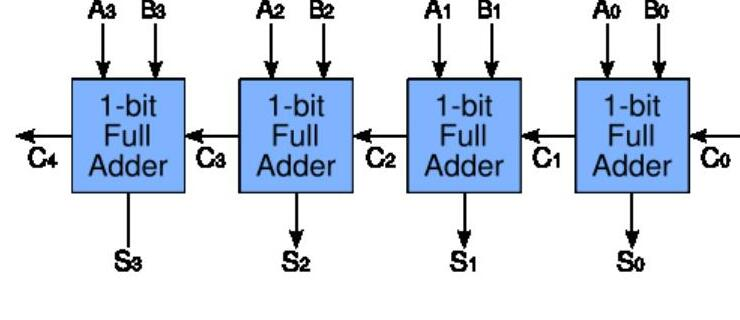

Bu yazı, EEM211 Sayısal Mantık Tasarımı dersinin klasöründe bulunan, Başkent Üniversitesi Biyomedikal Mühendisliği Bölümü'nün **BME 231 Digital Design (Sayısal Mantık Tasarımı)** dersine ait 2006 güz dönemi belgelerini bir araya getiriyor: dersin öğretim görevlisi **Mehmet Yüksekkaya**'nın iki quiz çözümü, sekiz deney föyü ve bir öğrencinin dönem projesi raporu. Proje raporunda öğrencinin adı ve numarası kapatıldı, rapora eklenmiş üretici veri sayfası (74F283 datasheet) sayfaları çıkarıldı. Tüm belgeler yazının sonunda ZIP olarak indirilebilir.

## Quiz 1 çözümleri

**1)** İşaretsiz ikili sayılarda çıkanın 2'ye tümleyenini kullanarak çıkarma yapınız; sonuç negatifse 2'ye tümleyenini alıp eksi işareti koyunuz.

- b) 110100 − 10101: Y = 010101'in 2'ye tümleyeni 101011. X + (−Y) = 110100 + 101011 = 1011111. Son elde var, atılır: sonuç **011111** (52 − 21 = 31).
- d) 101010 − 101011: Y'nin 2'ye tümleyeni 010101. X + (−Y) = 101010 + 010101 = 111111. Son elde yok: sonucun 2'ye tümleyeni alınıp eksi konur, sonuç **−000001** (42 − 43 = −1).

**2)** 5 bitle ifade edilebilecek en büyük ve en küçük işaretli ve işaretsiz ikili sayılar ve onluk karşılıkları:

| | İkili | Onluk |
|---|---|---|
| En büyük işaretsiz | 11111 | 31 |
| En küçük işaretsiz | 00000 | 0 |
| En büyük işaretli | 01111 | 15 |
| En küçük işaretli | 10000 | −16 |

**3)** 8620 sayısını a) BCD, b) fazlalık-3 (excess-3) kodunda gösteriniz.

- BCD: 1000 0110 0010 0000
- Fazlalık-3 (her basamağa 0011 eklenir): 1011 1001 0101 0011

## Quiz 2 çözümleri

**1)** Doğruluk tablosu verilen ifadeyi yalnızca bir tam toplayıcı kullanarak tasarlayınız.

| a | b | F | G |
|---|---|---|---|
| 0 | 0 | 0 | 1 |
| 0 | 1 | 1 | 0 |
| 1 | 0 | 1 | 0 |
| 1 | 1 | 1 | 1 |

F = a + b (OR), G = (a ⊕ b)' (XNOR). Tam toplayıcının girişlerine a, b ve elde girişine sabit 1 verilirse toplam çıkışı a ⊕ b ⊕ 1 = (a ⊕ b)' = G, elde çıkışı ab + (a ⊕ b)·1 = a + b = F olur.

*Not: Çözüm kâğıtta çizim olarak verilmiş; yukarıdaki bağlantı doğruluk tablosundan kontrol edildi.*

**2)** F(x, y, z, w) = Σ(0, 2, 3, 4, 6, 8, 10, 11, 12, 13, 14, 15) ifadesini sadeleştirip devresini tasarlayınız; devreyi yalnızca 2 girişli NAND kapılarıyla yeniden tasarlayınız.

Sadeleştirilmiş ifade: **F = w' + xy + y'z**. Çözümde önce AND-OR devresi, sonra yalnız 2 girişli NAND kapılarıyla devre çizilmiş.

## Deney föyleri (Electronics Workbench ve laboratuvar)

1. **Deney 2 – Mantık devrelerine giriş:** NOT, AND, OR, NAND, NOR; 2 girişli kapılarla 3 ve 4 girişli AND, 3 girişli OR ve NAND; tümleyici ve AND ile NAND; 7408 ve 7400 ile doğruluk tabloları.
1. **Deney 3 – Boole cebri:** A + 1 = 1, A·0 = 0, A + A'B = A + B, (A + B)(A + C) = A + BC gibi kuralların ve De Morgan teoremlerinin devreyle gösterilmesi; F = (y + z')(x + y)(y' + z) ifadesinin yalnız OR-tümleyen, F = x'y' + x'z + y'z ifadesinin yalnız AND-tümleyen biçimine çevrilmesi; yan yana dört sandalyede **iki veya daha fazla bitişik boş sandalye** olduğunda 1 veren F'nin doğruluk tablosu, minterm ve maksterm açılımları ve sadeleştirilmesi.
1. **Deney 4 – Karnaugh haritası:** geçersiz BCD kodlarını (1010–1111) algılayan fonksiyon; F = A'D + B'D + BC + AB'D'nin haritası, 1'ler ve 0'lar gruplanarak F ve F' sadeleştirmesi.
1. **Deney 5 – Ek çalışma:** EWB föyündeki çalışmaya ek olarak Mano'nun kitabının (2. baskı) 3-25 numaralı problemi ve kelime üretecinden gelen veriyi 7 parçalı göstergede gösteren BCD-7 parçalı gösterge sürücüsü devresi.
1. **Deney 6 – Göstergeli toplayıcı devreleri:** 7447 gibi çalışan BCD-7 parçalı gösterge kod çözücüsü; 3x8 kod çözücülerle (74138, 4012) 2 bitlik tam toplayıcı (01 + 01 = 10 testi); toplananları ve toplamı dört göstergede gösteren BCD toplayıcı (7447, 4008, 4025; 1 + 7 = 8, 5 + 5 = 10, 9 + 8 = 17, 0 + 0 = 0 testleri).
1. **Deney 7 – Temel MUX/DEMUX iletim sistemi:** 2x4 kod çözücülerle (74139) 4x16 kod çözücü ve 74154 ile karşılaştırma; 74156 ve 74153 ile çoklayıcı-çözücülü veri iletim sistemi; 4 bitlik karşılaştırıcıdan 8 bitlik karşılaştırıcı tasarımı.
1. **Deney 8 – Senkron ardışıl mantık:** üç flip-flop (A, B, C), bir giriş x ve bir çıkış y'li durum diyagramından D ve JK flip-floplarla tasarım (kullanılmayan durumlar keyfi; devrenin kendini düzelttiği kontrol edilecek); iki JK flip-floplu verilen devrenin durum tablosu ve diyagramı.
1. **Deney 10 – Sayıcılar ve kaydırmalı yazmaçlar:** 0:00'dan 1:59'a sayan, 7 parçalı göstergeli 2 dakikalık kronometre; D flip-floplarla sağa, sola kaydırma ve paralel yükleme yapan 4 bitlik çift yönlü kaydırmalı yazmaç. Bonus: onaltılık 7 parçalı gösterge sürücüsü (30 puan) ve 4x8 LED matrisinde ad-soyad kaydıran yazı sürücüsü (70 puan).

## Proje raporu: Dijital tümleşik devreler

BME 231 dersi için bir öğrencinin hazırladığı dönem projesi raporu (konu: dijital tümleşik devreler). Raporun bölümleri:

- **Tümleşik devrelere giriş:** sayısal lojik aileler RTL (direnç-transistör), DTL (diyot-transistör), TTL (transistör-transistör), ECL (emetör kuplajlı), MOS ve CMOS. RTL ve DTL artık yalnızca tarihsel öneme sahip; her ailenin temel devresi bir NAND ya da NOR kapısıdır.
- **Özel karakteristikler:** çıkış yelpazesi (fan-out), güç kaybı, yayılma gecikmesi ve gürültü payı.
- **74F283 – hızlı eldeli 4 bitlik tam toplayıcı:** dört bir bitlik tam toplayıcının zincirlenmesi; iki 4 bitlik sayıyı toplar, Cin girişi ve Cout çıkışı vardır; içindeki ileri bakışlı elde (look-ahead) devresi sayesinde Cout'u yaklaşık 5,7 ns'de üretir; 0–70 °C arasında çalışmak üzere tasarlanmıştır.
- **Kaynaklar:** Mano, *Digital Design* (2. baskı), 10. bölüm ve üretici veri sayfaları.

