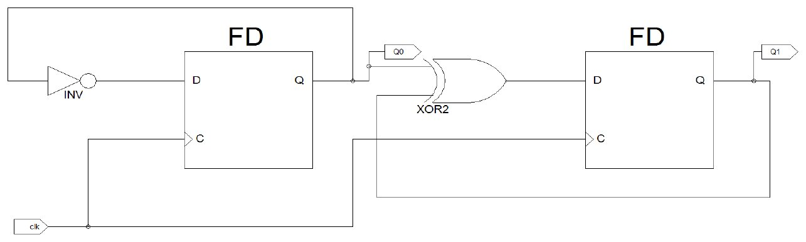

This post compiles the Fall 2012 laboratory experiment sheets for the Başkent University **EEM 211 Digital Logic Design** course (October–December 2012; the author metadata of the PDFs names the laboratory assistant Gencer Tulay). The experiments were designed as schematic circuits in the **Xilinx** development environment, tested by simulation, and then loaded onto an **FPGA board** and run. For how the laboratory operated and its weekly schedule, see the archived laboratory information form post. The PDFs of the experiment sheets can be downloaded as a ZIP at the end of the post (the 3rd sheet is included as a copy with the student list redacted).

## Experiment 1: Logic circuits

**Lab group:** EEM211/01-02

A student takes four courses, A, B, C and D. Courses in which the student is successful are denoted by 1, and courses in which the student fails are denoted by 0. The student's pass status is defined as F, and the conditions for being considered successful are as follows:

- To be considered successful, the student must pass at least two courses.
- One of the courses passed must necessarily be course A.

Obtain the output expression of the function according to the above.

Design a schematic circuit in the Xilinx program development environment according to the function you obtained. Perform testing, simulation, and pin assignments for the FPGA board, and examine the operation of the circuit you created on the FPGA board.

Show the operations you perform at every stage of the experimental work to the laboratory assistants.

## Experiment 2: Combinational logic

**Lab group:** EEM211/01-02

Design the circuit that outputs the sum of two two-bit numbers plus one.

> WARNING: The highest value a two-bit number can take in the binary number system, (11)₂, corresponds to 3 in decimal. Taking this into account, consider how many bits at most are needed to represent the sum of two two-bit numbers plus one.

A separate function must be obtained for each output bit.

Design a schematic circuit in the Xilinx program development environment according to the function you obtained. Perform testing, simulation, and pin assignments for the FPGA board, and examine the operation of the circuit you created on the FPGA board.

## Experiment 3: Combinational circuit design problems

The third experiment sheet ("EEM211 Course Laboratory Third Experiment") consists of sixteen design problems; the internal structures of the circuits are to be designed by the students using gates. Because the term project assignment list at the end of the sheet contains student names, it was blacked out in the copy in the download file, and the last page, where the list continues, was removed.

1. A student takes 3 courses, A, B and C. To be considered successful, a) the student must pass at least two courses, and b) one of the courses passed must necessarily be C. Using these conditions, obtain the pass status as a function. Implement the function you obtained using only gates.
1. Implement the given function F using a 3x8 decoder. (The internal structure of the decoder is to be designed by the students using gates.)
1. Implement the given function F using a 4x1 MUX. The MUX will have select inputs X and Y. (The internal structure of the multiplexer is to be designed by the students using gates.)
1. Design a two-bit multiplier circuit.
1. Design the circuit that takes the 2's complement of a two-bit number.
1. Design the circuit that takes the 1's complement of a two-bit number.
1. Design the circuit that converts three-bit data entered in Gray code to binary code.
1. Design the circuit that converts three-bit data entered in binary code to Gray code.
1. Design the circuit that generates the odd parity bit for a three-bit binary code.
1. Design the circuit that generates the even parity bit for a three-bit binary code.
1. Design a two-bit comparator circuit.
1. Implement the XOR function using a 2x4 decoder circuit.
1. Implement the XNOR function using a 2x4 decoder circuit.
1. Implement the OR function, with inputs A and B and output F, using a 2x1 MUX. (The internal structure of the MUX is to be designed by the students.)
1. Implement the XOR function using a 2x1 multiplexer circuit.
1. Implement the XNOR function using a 2x1 multiplexer circuit.

Truth tables of the functions F in problems 2 and 3:

| X | Y | Z | F (problem 2) | F (problem 3) |
|---|---|---|---|---|
| 0 | 0 | 0 | 0 | 1 |
| 0 | 0 | 1 | 1 | 0 |
| 0 | 1 | 0 | 0 | 0 |
| 0 | 1 | 1 | 0 | 1 |
| 1 | 0 | 0 | 1 | 0 |
| 1 | 0 | 1 | 0 | 1 |
| 1 | 1 | 0 | 1 | 0 |
| 1 | 1 | 1 | 1 | 1 |

## Experiment 4: Sequential logic (from D flip-flop to JK flip-flop)

**Lab group:** EEM211/01-02

")

In the circuit above, the design uses a D flip-flop. In the circuit, the `mclk` signal goes both directly to the D input of the FD flip-flop and, through two INV (NOT) gates in series, to the C (clock) input; the output Q is taken as F.

The timing settings were made in Xilinx's "Initial Timing and Clock Wizard – Initialize Timing" window as follows:

| Setting | Value |
|---|---|
| Clock timing | Rising Edge, Single Clock (`mclk`) |
| Clock High Time | 100 ns |
| Clock Low Time | 100 ns |
| Input Setup Time | 15 ns |
| Output Valid Delay | 15 ns |
| Offset | 0 ns |
| Initial Length of Test Bench | 1000 ns |
| Time Scale | ns |

Obtain the waveform seen at the output of this flip-flop by designing with a **JK flip-flop**. For the JK flip-flop, you may use the **FJKC** and a **pulldown** element on the **Clear** input for testing purposes.

## Experiment 5: Sequential logic (two-bit counter)

**Lab group:** EEM211/01-02

In the circuit above, a two-bit counter has been designed using D flip-flops. After reaching the value '11' in the binary system, the circuit starts counting again from the beginning. In the schematic, the Q output of the first flip-flop (Q0) is fed back to its own D input through an INV gate; the XOR of Q0 and Q1 from the XOR2 gate is applied to the D input of the second flip-flop; both flip-flops use the same `clk` clock.

The timing settings are the same as in Experiment 4 (Rising Edge, Single Clock `mclk`, Clock High/Low Time 100 ns, Input Setup Time 15 ns, Output Valid Delay 15 ns, Offset 0, test bench length 1000 ns).

Obtain the circuit that performs the same operation by designing with a **JK flip-flop**. For the JK flip-flop, you may use the **FJKC** and a **pulldown** element on the **Clear** input for testing purposes.
