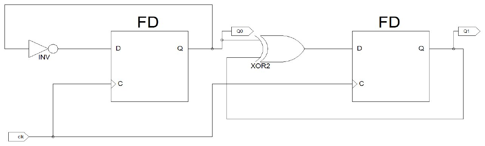

Bu yazı, Başkent Üniversitesi **EEM 211 Sayısal Mantık Tasarımı** dersinin 2012 güz dönemi laboratuvar deney föylerini bir araya getiriyor (Ekim–Aralık 2012; PDF'lerin yazar bilgisinde laboratuvar asistanı Gencer Tulay'ın adı geçiyor). Deneyler **Xilinx** geliştirme ortamında şematik devre olarak tasarlanıp benzetimle test ediliyor, sonra **FPGA kartına** yüklenerek çalıştırılıyordu. Laboratuvarın işleyişi ve haftalık programı için arşivdeki laboratuvar bilgilendirme formu yazısına bakabilirsiniz. Föylerin PDF'leri yazının sonunda ZIP olarak indirilebilir (3. föy, öğrenci listesi kapatılmış kopya olarak).

## Deney 1: Mantık devreleri

**Deney grubu:** EEM211/01-02

Bir öğrenci A, B, C ve D olmak üzere dört ders almaktadır. Öğrencinin derste başarılı olduğu durumlar 1, başarısız olduğu durumlar 0 ile gösterilmektedir. Bu öğrencinin başarı durumu F ile tanımlanmıştır ve başarılı sayılması için verilen koşullar aşağıdaki gibidir:

- Öğrencinin başarılı sayılması için en az iki dersten başarılı olmalıdır.
- Başarılı olduğu derslerden biri mutlaka A dersi olmalıdır.

Yukarıda verilenlere göre fonksiyonun çıkış ifadesini elde ediniz.

Elde ettiğiniz fonksiyona göre Xilinx program geliştirme ortamında şematik devre tasarlayınız. Test, benzetim, FPGA kartı için pin tanımlamalarını gerçekleştirip oluşturduğunuz devrenin FPGA kartı üzerinde çalışmasını inceleyiniz.

Deneysel çalışmanın her aşamasında yaptığınız işlemleri laboratuvar asistanlarına gösteriniz.

## Deney 2: Birleşimsel mantık

**Deney grubu:** EEM211/01-02

İki bitlik iki sayının toplamının bir fazlasını alan devreyi tasarlayınız.

> UYARI: İki bitlik bir sayının ikilik (binary) sayı sisteminde alabileceği en yüksek değer (11)₂, onluk sayı sisteminde 3'e karşılık gelir. Bu durumu göz önüne alarak iki bitlik iki sayının toplamının bir fazlasının en fazla kaç bit ile ifade edilebileceğini göz önünde bulundurunuz.

Her çıkış biti için ayrı birer fonksiyon elde edilmelidir.

Elde ettiğiniz fonksiyona göre Xilinx program geliştirme ortamında şematik devre tasarlayınız. Test, benzetim, FPGA kartı için pin tanımlamalarını gerçekleştirip oluşturduğunuz devrenin FPGA kartı üzerinde çalışmasını inceleyiniz.

## Deney 3: Birleşimsel devre tasarım soruları

Üçüncü deney föyü ("EEM211 Dersi Laboratuvarı Üçüncü Deneyi") on altı tasarım sorusundan oluşuyor; devrelerin iç yapıları kapılar kullanılarak öğrenciler tarafından tasarlanacak. Föyün sonundaki dönem projesi dağılım listesi öğrenci adları içerdiği için indirme dosyasındaki kopyada siyahla kapatıldı ve listenin devam ettiği son sayfa çıkarıldı.

1. Bir öğrenci A, B ve C olmak üzere 3 ders almaktadır. Bu derslerden başarılı sayılması için a) en az iki dersten başarılı olmalı, b) başarılı olduğu derslerden biri mutlaka C olmalıdır. Bu koşulları kullanarak başarılı olma durumunu fonksiyon olarak elde ediniz. Elde ettiğiniz fonksiyonu sadece kapılar kullanarak gerçekleştiriniz.
1. Verilen F fonksiyonunu 3x8 kod çözücü kullanarak gerçekleştiriniz. (Kod çözücünün iç yapısı kapılar kullanılarak öğrenciler tarafından tasarlanacaktır.)
1. Verilen F fonksiyonunu 4x1 MUX kullanarak gerçekleştiriniz. MUX için X ve Y seçme girişleri olacaktır. (Çoklayıcının iç yapısı kapılar kullanılarak öğrenciler tarafından tasarlanacaktır.)
1. İki bitlik çarpıcı devre tasarlayınız.
1. İki bitlik bir sayının ikiye tümleyenini alan devreyi tasarlayınız.
1. İki bitlik bir sayının bire tümleyenini alan devreyi tasarlayınız.
1. Gray kodda girilen üç bitlik veriyi ikilik (binary) koda çeviren devreyi tasarlayınız.
1. İkilik (binary) kodda girilen üç bitlik veriyi Gray koda çeviren devreyi tasarlayınız.
1. Üç bitlik ikilik (binary) kod için tek eşlenik (parity) bitini üreten devreyi tasarlayınız.
1. Üç bitlik ikilik (binary) kod için çift eşlenik bitini üreten devreyi tasarlayınız.
1. İki bitlik karşılaştırıcı devre tasarlayınız.
1. XOR fonksiyonunu 2x4 kod çözücü devre ile elde ediniz.
1. XNOR fonksiyonunu 2x4 kod çözücü devre ile elde ediniz.
1. Girişleri A ve B, çıkışı F olan OR fonksiyonunu 2x1 MUX kullanarak elde ediniz. (MUX'un iç yapısı öğrenciler tarafından tasarlanacaktır.)
1. XOR fonksiyonunu 2x1 çoklayıcı devre ile elde ediniz.
1. XNOR fonksiyonunu 2x1 çoklayıcı devre ile elde ediniz.

2. ve 3. sorulardaki F fonksiyonlarının doğruluk tabloları:

| X | Y | Z | F (soru 2) | F (soru 3) |
|---|---|---|---|---|
| 0 | 0 | 0 | 0 | 1 |
| 0 | 0 | 1 | 1 | 0 |
| 0 | 1 | 0 | 0 | 0 |
| 0 | 1 | 1 | 0 | 1 |
| 1 | 0 | 0 | 1 | 0 |
| 1 | 0 | 1 | 0 | 1 |
| 1 | 1 | 0 | 1 | 0 |
| 1 | 1 | 1 | 1 | 1 |

## Deney 4: Sıralı mantık (D flip-flop'tan JK flip-flop'a)

**Deney grubu:** EEM211/01-02

 ile kurulmuş devre")

Yukarıdaki devrede D flip-flop kullanarak tasarım yapılmıştır. Devrede `mclk` sinyali hem doğrudan FD flip-flop'unun D girişine hem de art arda iki INV (NOT) kapısından geçerek C (saat) girişine gidiyor; çıkış Q, F olarak alınıyor.

Zamanla ilgili ayarlamalar Xilinx'in "Initial Timing and Clock Wizard – Initialize Timing" penceresinde şöyle yapılmıştır:

| Ayar | Değer |
|---|---|
| Clock timing | Rising Edge, Single Clock (`mclk`) |
| Clock High Time | 100 ns |
| Clock Low Time | 100 ns |
| Input Setup Time | 15 ns |
| Output Valid Delay | 15 ns |
| Offset | 0 ns |
| Initial Length of Test Bench | 1000 ns |
| Time Scale | ns |

Bu flip-flop'un çıkışında görülen dalga şeklini **JK flip-flop** ile tasarım yaparak elde ediniz. JK flip-flop için **FJKC**, **Clear** girişlerinde test amaçlı olarak **pulldown** elemanını kullanabilirsiniz.

## Deney 5: Sıralı mantık (iki bitlik sayaç)

**Deney grubu:** EEM211/01-02

Yukarıdaki devrede D flip-flop kullanarak iki bitlik sayaç tasarımı yapılmıştır. Devre ikilik sistemdeki '11' değerine ulaştıktan sonra saymaya en baştan başlamaktadır. Şemada birinci flip-flop'un Q çıkışı (Q0) bir INV kapısından geçerek kendi D girişine geri besleniyor; ikinci flip-flop'un D girişine Q0 ile Q1'in XOR2 kapısındaki XOR'u uygulanıyor; iki flip-flop da aynı `clk` saatini kullanıyor.

Zamanla ilgili ayarlamalar Deney 4'tekiyle aynıdır (Rising Edge, Single Clock `mclk`, Clock High/Low Time 100 ns, Input Setup Time 15 ns, Output Valid Delay 15 ns, Offset 0, test bench uzunluğu 1000 ns).

Aynı işlemi gerçekleştiren devreyi **JK flip-flop** ile tasarım yaparak elde ediniz. JK flip-flop için **FJKC**, **Clear** girişlerinde test amaçlı olarak **pulldown** elemanını kullanabilirsiniz.
