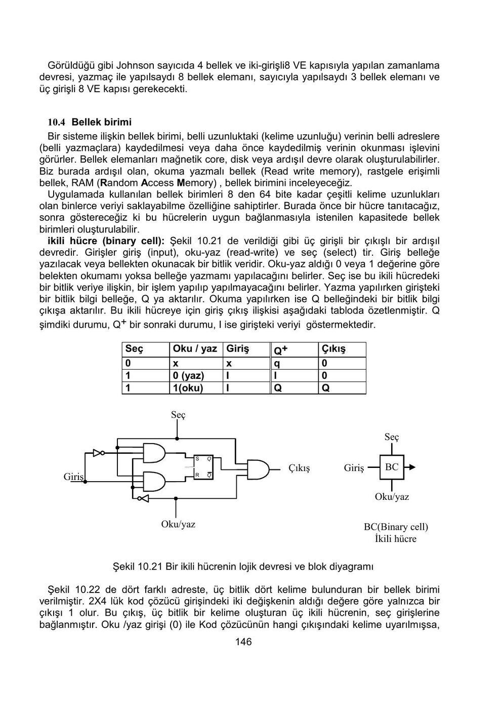

The "Logic Circuits Lecture Notes" by Prof. Dr. Ertuğrul Eriş from the Department of Electronics and Communications Engineering at Yıldız Technical University. The cover reads Istanbul, 2001; the 164-page PDF was created on 30 October 2002. The full lecture notes, kept in the EEM211 folder, can be downloaded at the end of this post.

*Note: This content belongs to a third-party source; it is shared for archival and nostalgic purposes with the source credited. It will be removed upon the request of the rights holder.*

## Digital Systems and Data Representation

The first chapter begins with the representation, transmission, storage, and processing of data in digital systems. Positional number systems, representation in different bases, and arithmetic operations are explained. The coding of digital information is linked to the physical operations performed on that information.

## Introduction to Boolean Algebra

The second chapter builds up the structure of Boolean algebra, starting from sets, relations, and functions. In the two-valued algebra, the AND, OR, and complement operations are taken as the basis. Identities, duality, and algebraic transformations underlie the circuit simplification procedures that follow.

The third chapter relates digital systems to Boolean algebra. A switching function can be represented by a truth table or by an algebraic expression. Canonical expressions and the concepts of minterm and maxterm provide transitions between different representations.

## Combinational Circuit Synthesis

The fourth chapter deals with the design of circuits whose output depends only on the current inputs. The desired behavior is first defined as a table or a function; simplification and gate-level implementation follow.

Karnaugh maps, prime implicants, the tabular method, and don't-care conditions are covered. Adjacencies on the map allow the elimination of changing variables. When don't-care conditions are chosen appropriately, a smaller implementation can be obtained. Examples of arithmetic circuits and code converters make this method concrete.

## MSI and LSI Components

The fifth chapter moves from basic gates to larger functional blocks. Parallel adders, comparators, decoders, multiplexers, ROM, and PLA structures are introduced. In design with ready-made blocks, how to connect the inputs, select lines, and enable pins becomes important.

A truth table can be thought of as ROM contents; the address represents the input combination, and the stored bits represent the output functions. The PLA approach, on the other hand, exploits the shared structure of multiple functions through product terms and their sums.

## Sequential Logic and Memory Elements

The sixth chapter introduces the concept of state. The output and the next state depend not only on the external inputs but also on the stored present state. The characteristics of the SR, D, JK, and T memory elements, their triggering methods, and their auxiliary inputs are examined.

The relations Q⁺=D for the D flip-flop, Q⁺=T⊕Q for the T flip-flop, and Q⁺=JQ′+K′Q for the JK flip-flop are the fundamental relations used in design. The hold, set, reset, and toggle behaviors are distinguished from one another.

## Analysis of Sequential Circuits

In the seventh chapter, one proceeds from an existing circuit to the state table and the state diagram. In the Moore model, the output depends on the state; in the Mealy model, it depends on the state and the input. In analysis, the input functions of the memory elements are found first; the next states are computed with the characteristic relations; together with the output functions, the behavior of the machine is determined.

## Synthesis of Sequential Circuits

The eighth chapter covers the reverse process: going from the desired behavior to a working circuit. There are examples of a modulo-8 counter, special counting sequences, and sequence detection. Defining the states, binary encoding, flip-flop selection, and simplification of the excitation functions are the steps of the design.

## State Reduction and Encoding

The ninth chapter describes reducing the machine by merging equivalent states. States that give the same observable behavior for the same input sequences are examined. After the equivalence classes and the reduced table are obtained, the binary codes to be assigned to the states are chosen. The relationship between the number of states and the amount of memory and combinational circuitry used is evaluated.

## Registers, Counters, and Memories

The tenth chapter covers shift registers, counters, and timing circuits. In the Johnson counter, a particular state sequence is generated by feedback and shifting. Different timing solutions are compared in terms of the number of memory elements and gates required.

In the memory section, the input, read/write, and select lines of the binary cell are shown. When the cell is not selected, the information is retained; in a selected cell, the input bit is stored in write mode, and the stored bit is transferred to the output in read mode. Combining the cells with an address decoding circuit provides larger word and address capacity.

## Appendices and Exam Questions

The last part of the document contains the bibliography and the course's exam questions. The questions aim at using Boolean functions, combinational circuits, and sequential design methods together. The text here summarizes the topic flow and fundamental relations of the notes; the detailed tables, circuit drawings, derivations, and additional questions are in the downloadable PDF.
