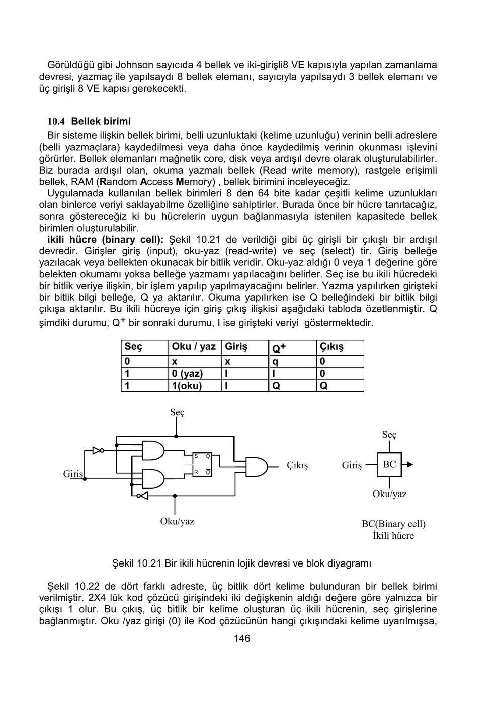

Yıldız Teknik Üniversitesi Elektronik ve Haberleşme Mühendisliği Bölümünden Prof. Dr. Ertuğrul Eriş'in “Lojik Devreler Ders Notları”. Kapakta İstanbul, 2001 yazıyor; 164 sayfalık PDF 30 Ekim 2002'de oluşturulmuş. EEM211 klasöründe saklanan bu ders notunun tamamı yazının sonunda indirilebilir.

*Bu içerik üçüncü taraf bir kaynağa aittir; arşiv ve nostalji amacıyla kaynak belirtilerek paylaşılmıştır. Hak sahibinin talebi hâlinde kaldırılır.*

## Sayısal dizgeler ve veri gösterimi

Birinci bölüm sayısal sistemlerde verinin gösterilmesi, iletilmesi, saklanması ve işlenmesiyle başlar. Konumsal sayı sistemleri, farklı tabanlarda gösterim ve aritmetik işlemler açıklanır. Sayısal bir bilginin kodlanması ile o bilgi üzerinde gerçekleştirilen fiziksel işlem birbirine bağlanır.

## Boole cebrine giriş

İkinci bölüm kümeler, bağıntılar ve fonksiyonlardan başlayarak Boole cebrinin yapısını kurar. İki değerli cebirde VE, VEYA ve tümleme işlemleri temel alınır. Özdeşlikler, dualite ve cebirsel dönüşümler sonraki devre sadeleştirme işlemlerinin dayanağıdır.

Üçüncü bölüm sayısal dizgeleri Boole cebriyle ilişkilendirir. Bir anahtarlama fonksiyonu doğruluk tablosuyla veya cebirsel ifadeyle gösterilebilir. Kanonik ifadeler, minterm ve maxterm kavramları farklı gösterimler arasında geçiş sağlar.

## Kombinezonsal devre sentezi

Dördüncü bölümde çıkışı yalnız o andaki girişlere bağlı devrelerin tasarımı ele alınır. İstenen davranış önce tablo ya da fonksiyon olarak tanımlanır; ardından sadeleştirme ve kapı düzeyinde gerçekleştirme gelir.

Karnaugh haritaları, asal kapsayanlar, tablo yöntemi ve belirsiz durumlar işlenir. Haritadaki komşuluklar değişen değişkenlerin elenmesini sağlar. Belirsiz durumlar uygun seçildiğinde daha küçük bir gerçekleştirme elde edilebilir. Aritmetik devreler ve kod dönüştürme örnekleri bu yöntemi somutlaştırır.

## MSI ve LSI elemanları

Beşinci bölüm temel kapılardan daha büyük işlev bloklarına geçer. Paralel toplayıcı, karşılaştırıcı, kod çözücü, çoğullayıcı, ROM ve PLA yapıları tanıtılır. Hazır bloklarla tasarımda girişlerin, seçme hatlarının ve etkinleştirme uçlarının nasıl bağlanacağı önem kazanır.

Bir doğruluk tablosu ROM içeriği olarak düşünülebilir; adres giriş birleşimini, saklanan bitler çıkış fonksiyonlarını temsil eder. PLA yaklaşımı ise çarpım terimleri ve bunların toplamları üzerinden birden çok fonksiyonun ortak yapısını kullanır.

## Ardışıl mantık ve bellek elemanları

Altıncı bölüm durum kavramını getirir. Çıkış ve sonraki durum yalnız dış girişlere değil, saklanan şimdiki duruma da bağlıdır. SR, D, JK ve T bellek elemanlarının karakteristikleri; tetikleme biçimleri ve yardımcı girişleri incelenir.

D flip-flopta Q⁺=D, T flip-flopta Q⁺=T⊕Q, JK flip-flopta Q⁺=JQ′+K′Q bağıntıları tasarımda kullanılan temel ilişkilerdir. Durum koruma, kurma, sıfırlama ve tümleme davranışları birbirinden ayrılır.

## Ardışıl devrelerin analizi

Yedinci bölümde mevcut devreden durum tablosuna ve durum diyagramına gidilir. Moore modelinde çıkış duruma, Mealy modelinde durum ve girişe bağlıdır. Analizde önce bellek elemanlarının giriş fonksiyonları bulunur; karakteristik bağıntılarla sonraki durumlar hesaplanır; çıkış fonksiyonlarıyla birlikte makinenin davranışı belirlenir.

## Ardışıl devrelerin sentezi

Sekizinci bölüm ters yöndeki işlemi ele alır: istenen davranıştan çalışan devreye geçiş. Modulo-8 sayıcı, özel sayma dizileri ve dizi algılama örnekleri vardır. Durumların tanımlanması, ikili kodlanması, flip-flop seçimi ve uyarma fonksiyonlarının sadeleştirilmesi tasarımın adımlarıdır.

## Durum indirgenmesi ve kodlama

Dokuzuncu bölüm eşdeğer durumları birleştirerek makineyi küçültmeyi anlatır. Aynı giriş dizilerine aynı gözlenebilir davranışı veren durumlar incelenir. Eşdeğerlik sınıfları ve indirgenmiş tablo elde edildikten sonra durumlara verilecek ikili kodlar seçilir. Durum sayısı ile kullanılan bellek ve kombinasyonel devre miktarı arasındaki ilişki değerlendirilir.

## Yazmaçlar, sayıcılar ve bellekler

Onuncu bölüm kaydırmalı yazmaçları, sayıcıları ve zamanlama devrelerini kapsar. Johnson sayıcıda geri besleme ve kaydırma ile belirli bir durum dizisi oluşturulur. Farklı zamanlama çözümleri gereken bellek elemanı ve kapı sayısı açısından karşılaştırılır.

Bellek bölümünde ikili hücrenin giriş, oku/yaz ve seç hatları gösterilir. Hücre seçilmediğinde bilgi korunur; seçilmiş hücrede yazma kipinde giriş biti saklanır, okuma kipinde saklanan bit çıkışa aktarılır. Hücrelerin adres çözme devresiyle birleştirilmesi daha geniş kelime ve adres kapasitesi sağlar.

## Ekler ve sınav soruları

Belgenin son bölümünde kaynakça ve dersin sınav soruları bulunur. Sorular Boole fonksiyonları, kombinezonsal devreler ve ardışıl tasarım yöntemlerini bir arada kullanmaya yöneliktir. Buradaki metin notların konu akışını ve temel bağıntılarını özetler; ayrıntılı tablolar, devre çizimleri, türetmeler ve ek sorular indirilebilir PDF'dedir.
