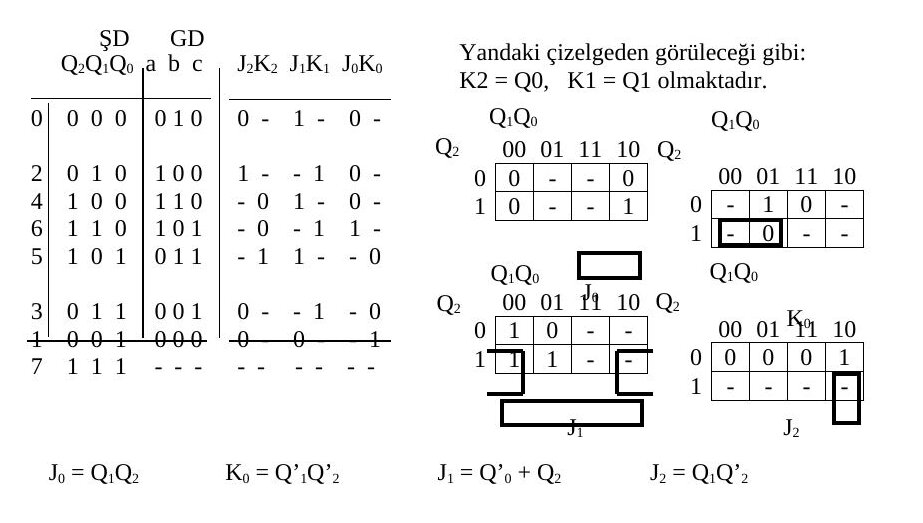
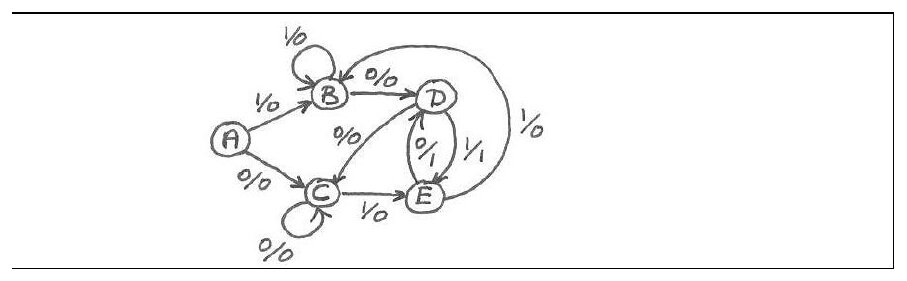
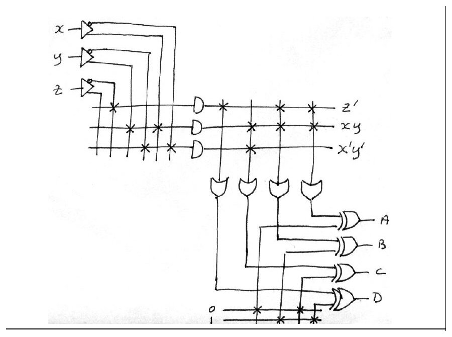
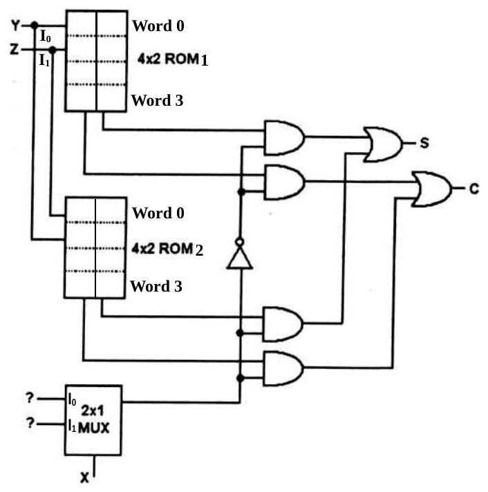
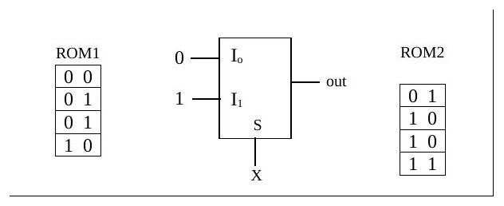

This post contains the questions and answers of the final exam of the Başkent University **EEM 211 Digital Logic Design** course, held on **11 January 2005**. The exam is in Turkish and lasts 120 minutes. In the original, the answers are given in a box under each question; some drawings, such as the state diagram and the PLA, are handwritten. The original Word file can be downloaded at the end of the post.

## Question 1: Answer the following questions (5 points each part, 25 in total)

### a) Canonical forms

> Given F(x,y,z) = x'(y'+z), write the canonical product-of-sums and canonical sum-of-products expressions of F'(x,y,z) in the standard ∏ and Σ notations.

| # | x y z | F = x'(y' + z) | F' |
|---|---|---|---|
| 0 | 000 | 1 | 0 |
| 1 | 001 | 1 | 0 |
| 2 | 010 | 0 | 1 |
| 3 | 011 | 1 | 0 |
| 4 | 100 | 0 | 1 |
| 5 | 101 | 0 | 1 |
| 6 | 110 | 0 | 1 |
| 7 | 111 | 0 | 1 |

- F'(x, y, z) = **Σ(2, 4, 5, 6, 7)**
- F'(x, y, z) = **∏(0, 1, 3)**

### b) XOR with MUX

> Implement the XOR function of variables X, Y using i) a 2x1 MUX, ii) a 4x1 MUX. (You may use 0 and 1 at the inputs.)

- 2x1 MUX: I0 = Y, I1 = Y', select input S = X.
- 4x1 MUX: I0 = 0, I1 = 1, I2 = 1, I3 = 0; select inputs S1 = X, S0 = Y.

 and 4x1 MUX (right)")

### c) Hamming check bits

> In a Hamming code, how many check bits must be added to a 6-bit data word? At which positions are these check bits placed?

> Since 2ᵏ ≥ m + k + 1 must hold, the condition 2⁴ = 16 > 6 + 4 + 1 is satisfied with 4 check bits. These bits are placed at the positions that are powers of 2, namely positions 1, 2, 4 and 8.

### d) Signed magnitude to 2's complement

> What is the signed 2's complement representation of the number whose signed magnitude representation is 00110?

> It remains 00110. Since the most significant bit is 0, the number is positive.

### e) Gray-to-binary converter

> Draw a 4-bit Gray-to-binary code converter using only 3 XOR gates.

- Bn = Gn (MSB)
- Bi = Gi ⊕ Bi+1, i = 0, …, n−1

That is, B3 = G3, B2 = G2 ⊕ B3, B1 = G1 ⊕ B2, B0 = G0 ⊕ B1 (the circuit is the same as the drawing in the 2007 final exam).

## Question 2: Answer the following questions (37 points in total)

### a) State reduction (10 points)

> Investigate whether the sequential circuit defined by the state table on the side contains redundant states, and if it does, find the reduced state table corresponding to the equivalent circuit without redundant states.

| Present state | Next state, x = 0 | Next state, x = 1 | Output, x = 0 | Output, x = 1 |
|---|---|---|---|---|
| a | f | b | 0 | 0 |
| b | d | c | 0 | 0 |
| c | f | e | 0 | 0 |
| d | g | a | 1 | 0 |
| e | d | c | 0 | 0 |
| f | f | b | 1 | 1 |
| g | g | h | 0 | 1 |
| h | g | a | 1 | 0 |

> If we group the states in the given table into equivalence classes according to whether they produce the same output sequences for the same input sequences, we obtain:

- P0 = (abcdefgh)
- P1 = (abce)(dh)(f)(g)
- P2 = (ac)(be)(dh)(f)(g)

> This shows that the given sequential circuit can be reduced to an equivalent circuit with 5 states. We choose one state from each class and rearrange the next states and outputs accordingly to form the reduced table:

| Present state | Next state, x = 0 | Next state, x = 1 | Output, x = 0 | Output, x = 1 |
|---|---|---|---|---|
| a | f | b | 0 | 0 |
| b | d | a | 0 | 0 |
| d | g | a | 1 | 0 |
| f | f | b | 1 | 1 |
| g | g | d | 0 | 1 |

### b) Synchronous counter with JK flip-flops (15 points)

> Using J-K flip-flops, design a synchronous counter that repeats the sequence 0-2-4-6-5-3-1 (binary) over and over. The J-K flip-flops have only J, K and clock inputs. Begin your design by first constructing the state and excitation (J-K input signals) table, and make sure that your circuit (the combinational part) is both minimal and able to leave the unused state.

State and excitation table (PS: present state, NS: next state, "-": don't care):

| # | Q2Q1Q0 | NS | J2K2 | J1K1 | J0K0 |
|---|---|---|---|---|---|
| 0 | 000 | 010 | 0 - | 1 - | 0 - |
| 2 | 010 | 100 | 1 - | - 1 | 0 - |
| 4 | 100 | 110 | - 0 | 1 - | 0 - |
| 6 | 110 | 101 | - 0 | - 1 | 1 - |
| 5 | 101 | 011 | - 1 | 1 - | - 0 |
| 3 | 011 | 001 | 0 - | - 1 | - 0 |
| 1 | 001 | 000 | 0 - | 0 - | - 1 |
| 7 | 111 | - - - | - - | - - | - - |

> As can be seen from the table on the side: K2 = Q0, K1 = Q1.

From the Karnaugh maps:

- J0 = Q1Q2
- K0 = Q1'Q2'
- J1 = Q0' + Q2
- J2 = Q1Q2'

> When Q2Q1Q0 = 111, J0 = 1, K0 = 0, J1 = 1, K1 = 1, J2 = 0, K2 = 1, so the next state is Q2Q1Q0 = 100. This is a valid state.



*Note: In the map for J2, there is a 1 only in the state Q2Q1Q0 = 010 (J2 must be 0 in state 011); therefore J2 should be Q1Q0'. The expression J2 = Q1Q2' given in the document yields J2 = 1 in the 011 → 001 transition and sends the counter to the wrong state. Also, with the values given in the document, in state 111 Q2 is reset (J2 = 0, K2 = 1), Q1 toggles (1 → 0) and Q0 becomes 1; that is, the next state is Q2Q1Q0 = 001 (again a valid state). The result "100" in the document appears to be written in Q0Q1Q2 bit order.*

### c) 101 / 010 sequence detector (12 points)

> Construct the state diagram of a sequential circuit that receives the transmitted bits serially from its input terminal and outputs 1 each time it detects a 101 or 010 sequence, and outputs 0 otherwise. The sequences may overlap. Your diagram must contain the minimum number of states.

EXAMPLE (the leftmost bit is the first bit to enter):

```
girdi dizisi: 0 0 1 0 1 0 1 1 1 0 1 1 0 0 . . .
çıktı dizisi: 0 0 0 1 1 1 1 0 0 0 1 0 0 0 . . .
```

The answer gives a handwritten Mealy state diagram with five states (A–E); the transitions are labeled in input/output form.



## Question 3: PLA (18 points)

> Draw a PLA circuit that implements the functions A, B, C and D given below. The product terms in your circuit must be minimal.
> A(x,y,z) = Σ(0,2,4,6,7), B(x,y,z) = Σ(1,3,5), C(x,y,z) = Σ(0,1,6,7), D(x,y,z) = Σ(1,3,5,7)

Karnaugh maps (rows x, columns yz = 00, 01, 11, 10):

| | 00 | 01 | 11 | 10 |
|---|---|---|---|---|
| A, x = 0 | 1 | 0 | 0 | 1 |
| A, x = 1 | 1 | 0 | 1 | 1 |
| B, x = 0 | 0 | 1 | 1 | 0 |
| B, x = 1 | 0 | 1 | 0 | 0 |
| C, x = 0 | 1 | 1 | 0 | 0 |
| C, x = 1 | 0 | 0 | 1 | 1 |
| D, x = 0 | 0 | 1 | 1 | 0 |
| D, x = 1 | 0 | 1 | 1 | 0 |

> Writing the minimal functions from the Karnaugh maps:

| Function | Complement |
|---|---|
| **A = z' + xy** | A' = x'z + y'z |
| B = x'z + y'z | **B' = z' + xy** |
| **C = xy + x'y'** | C' = x'y + xy' |
| D = z | **D' = z'** |

> The bold expressions require the fewest product terms.

Thus the PLA uses only three product terms (z', xy, x'y'); B and D are obtained by inverting the sums B' and D' with the XOR gates at the outputs.



## Question 4 (20 points in total)

### a) Full adder with ROM (12 points)

> For the circuit given below to be a full adder, write the required bits (0-1) into the cells of ROM1 and ROM2 and at the places marked with ?.

The circuit contains two 4x2 ROMs with address inputs Y and Z, one 2x1 MUX, one NOT gate, four AND gates and two OR gates; the outputs are S and C.



Answer:

| Word | ROM1 | ROM2 |
|---|---|---|
| 0 | 0 0 | 0 1 |
| 1 | 0 1 | 1 0 |
| 2 | 0 1 | 1 0 |
| 3 | 1 0 | 1 1 |

Inputs of the 2x1 MUX: I0 = 0, I1 = 1, select input S = X (output out).



### b) Shift registers (8 points)

> In the circuit below, what are the contents of registers A and B at the clock pulses T1, T2 and T3 that follow after Shift control = 1? (Initially A = 1100 and B = 1110 are loaded.)

> After 3 clock pulses, A = 1101 and B = 1101.

| Pulse | A | B |
|---|---|---|
| Initial | 1100 | 1110 |
| T1 | 0110 | 0111 |
| T2 | 1011 | 1011 |
| T3 | 1101 | 1101 |

## Points

| Question | Points |
|---|---|
| Question 1 | 25 (5 per part) |
| Question 2 | 37: a) 10, b) 15, c) 12 |
| Question 3 | 18 |
| Question 4 | 20: a) 12, b) 8 |
