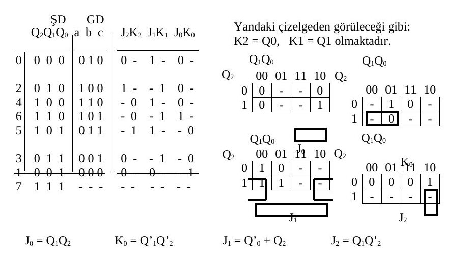
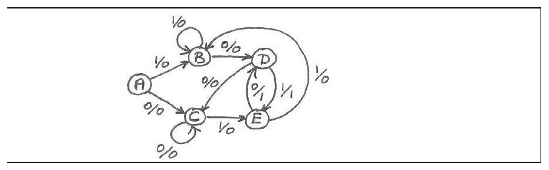
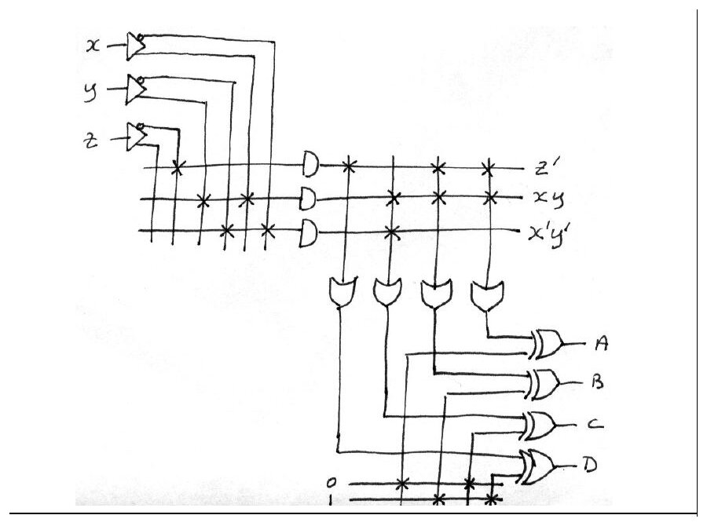
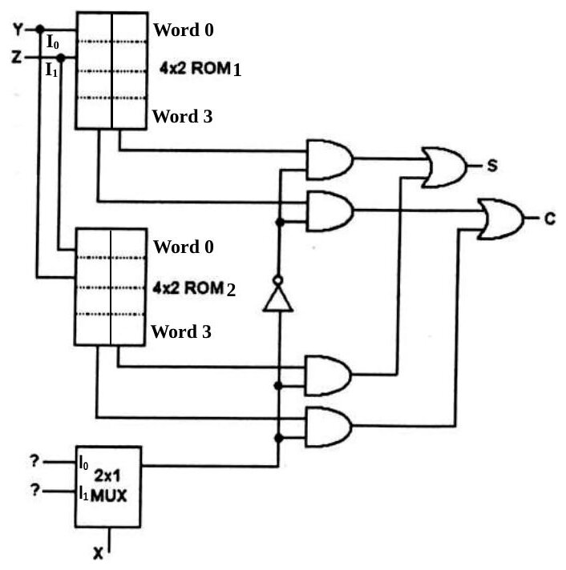
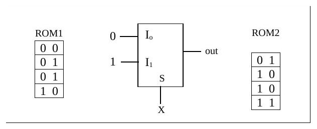

Bu yazı, Başkent Üniversitesi **EEM 211 Sayısal Mantık Tasarımı** dersinin **11 Ocak 2005** tarihli yarıyıl sonu (final) sınavının sorularını ve yanıtlarını içeriyor. Sınav Türkçe, süresi 120 dakika. Yanıtlar belgede her sorunun altında çerçeve içinde verilmiş; durum çizgesi ve PLA gibi bazı çizimler el yazısı. Orijinal Word dosyası yazının sonunda indirilebilir.

## Soru 1: Aşağıdaki soruları yanıtlayınız (her şık 5 puan, toplam 25)

### a) Kanonik biçimler

> F(x,y,z) = x'(y'+z) olduğuna göre, F'(x,y,z) ifadesinin özbiçimsel toplamların-çarpımı (canonical product-of-sums) ve özbiçimsel çarpımların-toplamı (canonical sum-of-products) ifadelerini ∏ ve Σ standart kalıplarında yazınız.

| # | x y z | F = x'(y' + z) | F' |
|---|---|---|---|
| 0 | 000 | 1 | 0 |
| 1 | 001 | 1 | 0 |
| 2 | 010 | 0 | 1 |
| 3 | 011 | 1 | 0 |
| 4 | 100 | 0 | 1 |
| 5 | 101 | 0 | 1 |
| 6 | 110 | 0 | 1 |
| 7 | 111 | 0 | 1 |

- F'(x, y, z) = **Σ(2, 4, 5, 6, 7)**
- F'(x, y, z) = **∏(0, 1, 3)**

### b) MUX ile XOR

> XOR işlevini, X, Y değişkenleri için i) 2x1 MUX ile, ii) 4x1 MUX ile oluşturunuz. (girdilerde 0-1 kullanabilirsiniz)

- 2x1 MUX: I0 = Y, I1 = Y', seçme girişi S = X.
- 4x1 MUX: I0 = 0, I1 = 1, I2 = 1, I3 = 0; seçme girişleri S1 = X, S0 = Y.

 ve 4x1 MUX (sağda)")

### c) Hamming denetim bitleri

> Hamming kodda, 6-bit veri sözcüğüne kaç adet denetim biti eklemek gerekir? Bu denetim bitleri hangi pozisyonlara yerleşir?

> 2ᵏ ≥ m + k + 1 olacağına göre, 2⁴ = 16 > 6 + 4 + 1 koşulu, 4 denetim biti ile sağlanır. Bu bitler, 2'nin kuvvetleri olan pozisyonlara, yani 1, 2, 4 ve 8. pozisyonlara yerleşir.

### d) İşaret-genlikten 2'ye tümleyene

> İşaret-genlik (signed magnitude) yapısındaki gösterimi 00110 olan sayının işaretli 2'ye tümleyen (signed 2's complement) yapısında karşılığı ne olur?

> Yine 00110 olarak kalır. Çünkü en anlamlı bit 0 olduğundan sayı pozitiftir.

### e) Gray'den ikiliye çevirici

> Yalnızca 3 adet XOR geçidi kullanarak bir 4-bit Gray-to-Binary kod dönüştürücü çiziniz.

- Bn = Gn (MSB)
- Bi = Gi ⊕ Bi+1, i = 0, …, n−1

Yani B3 = G3, B2 = G2 ⊕ B3, B1 = G1 ⊕ B2, B0 = G0 ⊕ B1 (devre, 2007 final sınavındaki çizimle aynı).

## Soru 2: Aşağıdaki soruları yanıtlayınız (toplam 37 puan)

### a) Durum indirgeme (10 puan)

> Yandaki durum çizelgesi ile tanımlanan "sequential" devrede gereksiz durumlar bulunup bulunmadığını araştırınız ve şayet varsa, devrenin gereksiz durumları bulunmayan eşdeğerine karşılık gelen indirgenmiş durum çizelgesini bulunuz.

| Şimdiki durum | Gelecek, x = 0 | Gelecek, x = 1 | Çıktı, x = 0 | Çıktı, x = 1 |
|---|---|---|---|---|
| a | f | b | 0 | 0 |
| b | d | c | 0 | 0 |
| c | f | e | 0 | 0 |
| d | g | a | 1 | 0 |
| e | d | c | 0 | 0 |
| f | f | b | 1 | 1 |
| g | g | h | 0 | 1 |
| h | g | a | 1 | 0 |

> Verilen çizelgedeki durumları, aynı girdi dizilerine karşın aynı çıktı dizileri üretip üretmediklerine bakarak denklik kümeleri içinde toparlarsak:

- P0 = (abcdefgh)
- P1 = (abce)(dh)(f)(g)
- P2 = (ac)(be)(dh)(f)(g)

> buluruz. Bu da verilen "sequential" devrenin kendisine denk olan 5 durumlu bir devreye indirgenebileceğini gösterir. Her küme içinden bir durum seçer ve gelecek durumlarla çıktıları buna göre yeniden düzenleyerek indirgenmiş çizelgeyi oluştururuz:

| Şimdiki durum | Gelecek, x = 0 | Gelecek, x = 1 | Çıktı, x = 0 | Çıktı, x = 1 |
|---|---|---|---|---|
| a | f | b | 0 | 0 |
| b | d | a | 0 | 0 |
| d | g | a | 1 | 0 |
| f | f | b | 1 | 1 |
| g | g | d | 0 | 1 |

### b) JK flip-flop'lu senkron sayaç (15 puan)

> J-K flip-floplar kullanarak, 0-2-4-6-5-3-1 dizisini (binary) art arda yineleyen bir senkron sayaç tasarlayınız. J-K flip-floplarda yalnızca J, K ve saat girişleri bulunmaktadır. Tasarımınıza önce durum ve uyarı (J-K giriş sinyalleri) çizelgesini oluşturarak başlayınız ve devrenizin (combinational bölüm) hem minimal olmasına, hem de kullanılmayan durumdan çıkabilmesine özen gösteriniz.

Durum ve uyarı çizelgesi (ŞD: şimdiki durum, GD: gelecek durum, "-": fark etmez):

| # | Q2Q1Q0 | GD | J2K2 | J1K1 | J0K0 |
|---|---|---|---|---|---|
| 0 | 000 | 010 | 0 - | 1 - | 0 - |
| 2 | 010 | 100 | 1 - | - 1 | 0 - |
| 4 | 100 | 110 | - 0 | 1 - | 0 - |
| 6 | 110 | 101 | - 0 | - 1 | 1 - |
| 5 | 101 | 011 | - 1 | 1 - | - 0 |
| 3 | 011 | 001 | 0 - | - 1 | - 0 |
| 1 | 001 | 000 | 0 - | 0 - | - 1 |
| 7 | 111 | - - - | - - | - - | - - |

> Yandaki çizelgeden görüleceği gibi: K2 = Q0, K1 = Q1 olmaktadır.

Karnaugh haritalarından:

- J0 = Q1Q2
- K0 = Q1'Q2'
- J1 = Q0' + Q2
- J2 = Q1Q2'

> Q2Q1Q0 = 111 iken J0 = 1, K0 = 0, J1 = 1, K1 = 1, J2 = 0, K2 = 1 olacağından, gelecek durum Q2Q1Q0 = 100 olur. Bu da geçerli bir durumdur.



*Not: J2 için haritada yalnız Q2Q1Q0 = 010 durumunda 1 var (011 durumunda J2 = 0 olmalı); bu yüzden J2 = Q1Q0' olmalı. Belgedeki J2 = Q1Q2' ifadesi 011 → 001 geçişinde J2 = 1 verip sayacı yanlış duruma götürür. Ayrıca belgede verilen değerlerle 111 durumunda Q2 sıfırlanır (J2 = 0, K2 = 1), Q1 tersine döner (1 → 0) ve Q0 1 olur; yani gelecek durum Q2Q1Q0 = 001'dir (yine geçerli bir durum). Belgedeki "100" sonucu bitlerin Q0Q1Q2 sırasıyla yazılmış hâli gibi görünüyor.*

### c) 101 / 010 dizi algılayıcı (12 puan)

> İletilen bitleri girdi ucundan seri olarak alan ve her 101 veya 010 dizisini algılayışında 1 çıktısı, bunun dışında ise 0 çıktısı veren bir "sequential" devrenin durum çizgesini (state diagram) oluşturunuz. Diziler iç içe (overlapping) olabilir. Çizgeniz minimum sayıda durum içermelidir.

ÖRNEK (en soldaki bit, ilk giren bittir):

```
girdi dizisi: 0 0 1 0 1 0 1 1 1 0 1 1 0 0 . . .
çıktı dizisi: 0 0 0 1 1 1 1 0 0 0 1 0 0 0 . . .
```

Yanıtta beş durumlu (A–E) el çizimi bir Mealy durum çizgesi veriliyor; geçişler girdi/çıktı biçiminde etiketli.



## Soru 3: PLA (18 puan)

> Aşağıda verilen A, B, C ve D işlevlerini gerçekleştiren bir PLA devresi çiziniz. Devrenizdeki çarpım terimleri (product terms) minimal olmalıdır.
> A(x,y,z) = Σ(0,2,4,6,7), B(x,y,z) = Σ(1,3,5), C(x,y,z) = Σ(0,1,6,7), D(x,y,z) = Σ(1,3,5,7)

Karnaugh haritaları (satırlar x, sütunlar yz = 00, 01, 11, 10):

| | 00 | 01 | 11 | 10 |
|---|---|---|---|---|
| A, x = 0 | 1 | 0 | 0 | 1 |
| A, x = 1 | 1 | 0 | 1 | 1 |
| B, x = 0 | 0 | 1 | 1 | 0 |
| B, x = 1 | 0 | 1 | 0 | 0 |
| C, x = 0 | 1 | 1 | 0 | 0 |
| C, x = 1 | 0 | 0 | 1 | 1 |
| D, x = 0 | 0 | 1 | 1 | 0 |
| D, x = 1 | 0 | 1 | 1 | 0 |

> Karnaugh çizgeleri üzerinden minimal işlevleri yazarsak:

| İşlev | Tümleyeni |
|---|---|
| **A = z' + xy** | A' = x'z + y'z |
| B = x'z + y'z | **B' = z' + xy** |
| **C = xy + x'y'** | C' = x'y + xy' |
| D = z | **D' = z'** |

> Bold ifadeler en az çarpım terimi gerektirmektedir.

Böylece PLA'da yalnızca üç çarpım terimi (z', xy, x'y') kullanılıyor; B ve D, B' ve D' toplamlarının çıkıştaki XOR kapılarıyla terslenmesiyle elde ediliyor.



## Soru 4 (toplam 20 puan)

### a) ROM ile tam toplayıcı (12 puan)

> Aşağıda verilen devrenin tam toplayıcı (full adder) olabilmesi için, ROM1 ve ROM2 gözlerine ve ? işareti ile belirlenen yerlere gereken bitleri (0-1) yazınız.

Devrede Y ve Z adres girişli iki adet 4x2 ROM, bir 2x1 MUX, bir NOT kapısı, dört AND ve iki OR kapısı var; çıkışlar S ve C.



Yanıt:

| Word | ROM1 | ROM2 |
|---|---|---|
| 0 | 0 0 | 0 1 |
| 1 | 0 1 | 1 0 |
| 2 | 0 1 | 1 0 |
| 3 | 1 0 | 1 1 |

2x1 MUX'un girişleri: I0 = 0, I1 = 1, seçme girişi S = X (çıkış out).



### b) Kaydırma yazmaçları (8 puan)

> Aşağıdaki devrede Shift control = 1 olduktan sonra gelen T1, T2 ve T3 saat vurularında A ve B yazmaçlarının içeriği ne olur? (başlangıçta A = 1100 ve B = 1110 yüklüdür.)

> 3 clock darbesinden sonra A = 1101 ve B = 1101 olur.

| Darbe | A | B |
|---|---|---|
| Başlangıç | 1100 | 1110 |
| T1 | 0110 | 0111 |
| T2 | 1011 | 1011 |
| T3 | 1101 | 1101 |

## Puanlar

| Soru | Puan |
|---|---|
| Soru 1 | 25 (her şık 5) |
| Soru 2 | 37: a) 10, b) 15, c) 12 |
| Soru 3 | 18 |
| Soru 4 | 20: a) 12, b) 8 |
