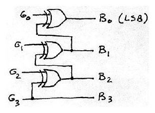
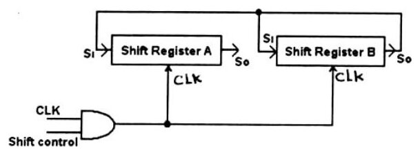
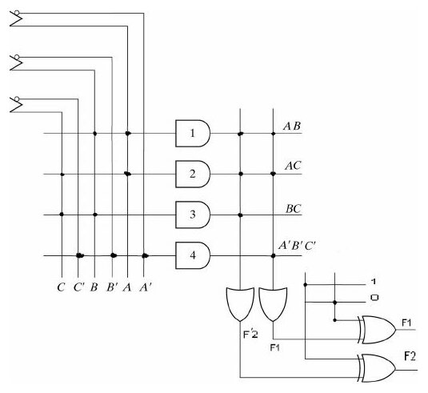

This post contains the questions and answer key of the final exam of the Başkent University **EEM211 Digital Logic Design** course, dated **18 January 2007** (file name: EEM211_YSS_06_Y, i.e. the answers to the 2006–2007 fall semester final exam). The questions are in English, with some explanations in Turkish. The exam duration is 100 minutes. The original Word file can be downloaded at the end of the post.

## Question 1: Answer the following questions (5 points each, 30 in total)

### a) Base conversion

> Convert (257.0554)₈ to base 16 and base 2

(257.0554)₈ = (010 101 111 . 000 101 101 100)₂ = (1010 1111 . 0001 0110 1100)₂ = **(AF.16C)₁₆**

### b) Gray-to-binary converter

> Implement a 4-bit Gray to Binary code conversion circuit by using three 2-input XOR gates only.

- Bn = Gn (MSB)
- Bi = Gi ⊕ Bi+1, i = 0, …, n−1

That is, B3 = G3, B2 = G2 ⊕ B3, B1 = G1 ⊕ B2, B0 = G0 ⊕ B1.

### c) Error correction with a Hamming code

> A 7-bit Hamming Code word 0010011 of 4 data bits and 3 parity bits is received through a transmission channel. Check this word for a possible 1-bit error and find out the original 4-bit data word put into the channel.

- C1 = XOR of bits (1, 3, 5, 7) = 0
- C2 = XOR of bits (2, 3, 6, 7) = 1
- C4 = XOR of bits (4, 5, 6, 7) = 0
- Error bit position C4C2C1 = 010 = 2
- Corrected code = **0110011**
- Data = **1011**

### d) OR from NAND and NOT

> Implement a 2-input OR function with use of minimum number of INVERTERs and NAND gates. (Complements of inputs are not available)

x and y are each inverted by a NOT gate and fed to a NAND gate: (x'y')' = **x + y**

' = x + y")

### e) Number of RAM chips

> How many 32K × 8 RAM chips are needed to provide a total memory capacity of 512 K bytes?

512 Kbyte / 32 Kbyte = **16 memory chip**

### f) Canonical SOP

> Convert the following function to canonical SOP form. F(A,B,C) = AB + AC' + A'C

| A | B | C | F |
|---|---|---|---|
| 0 | 0 | 0 | 0 |
| 0 | 0 | 1 | 1 |
| 0 | 1 | 0 | 0 |
| 0 | 1 | 1 | 1 |
| 1 | 0 | 0 | 1 |
| 1 | 0 | 1 | 0 |
| 1 | 1 | 0 | 1 |
| 1 | 1 | 1 | 1 |

F(A, B, C) = A'B'C + A'BC + AB'C' + ABC' + ABC = **Σ(1, 3, 4, 6, 7)**

## Question 2 (a: 10, b: 10 points)

### a) Shift registers

> Binary information is shifted and distributed through 4-bit shift registers A and B, when shift control is high (1). Write the contents of each shift register, after the application of 3 clock pulses. (Initial values of shift registers are A = 1100 and B = 1110)

> After 3 clock pulses, A = 1101 and B = 1101.

| Pulse | A | B |
|---|---|---|
| Initial | 1100 | 1110 |
| 1 | 0110 | 0111 |
| 2 | 1011 | 1011 |
| 3 | 1101 | 1101 |

### b) Counter with D flip-flops

> A 2-bit binary counter is shown in the figure. Redraw this counter by using D type flip flop's.

The question gives a 2-bit counter built with T flip-flops and with Count, Clear, and High inputs; in the answer, the same counter is drawn with each D flip-flop's complement output fed back to its own D input.

 and the question's T flip-flop version (right)")

## Question 3: PLA (20 points)

> Implement the following two functions simultaneously with the given PLA:
> F1(A,B,C) = Σ(0, 5, 6, 7)
> F2(A,B,C) = Σ(0, 1, 2, 4)

| F1: A \ BC | 00 | 01 | 11 | 10 |
|---|---|---|---|---|
| 0 | 1 | 0 | 0 | 0 |
| 1 | 0 | 1 | 1 | 1 |

- F1 = AB + AC + A'B'C'
- F1 = (A'C + A'B + AB'C')'

| F2: A \ BC | 00 | 01 | 11 | 10 |
|---|---|---|---|---|
| 0 | 1 | 1 | 0 | 1 |
| 1 | 1 | 0 | 0 | 0 |

- F2 = A'B' + A'C' + B'C'
- F2 = (AB + AC + BC)'

Four product terms are used in the PLA: AB, AC, BC, and A'B'C'. F1 is obtained directly as AB + AC + A'B'C', while F2 is obtained by inverting the sum AB + AC + BC with the XOR gate at the output.

## Question 4: State reduction (10 points)

> Reduce the number of states in the following state table and find the reduced state table.

| Present state | Next state, x = 0 | Next state, x = 1 | Output, x = 0 | Output, x = 1 |
|---|---|---|---|---|
| a | f | b | 0 | 0 |
| b | d | c | 0 | 0 |
| c | f | e | 0 | 0 |
| d | g | a | 1 | 0 |
| e | d | c | 0 | 0 |
| f | f | b | 1 | 1 |
| g | g | h | 0 | 1 |
| h | g | a | 1 | 0 |

> Grouping the states in the given table into equivalence classes according to whether they produce the same output sequences for the same input sequences, we get:

- P0 = (abcdefgh)
- P1 = (abce)(dh)(f)(g)
- P2 = (ac)(be)(dh)(f)(g)

> This shows that the given sequential circuit can be reduced to an equivalent circuit with 5 states. We choose one state from each class and rearrange the next states and outputs accordingly to form the reduced table:

| Present state | Next state, x = 0 | Next state, x = 1 | Output, x = 0 | Output, x = 1 |
|---|---|---|---|---|
| a | f | b | 0 | 0 |
| b | d | a | 0 | 0 |
| d | g | a | 1 | 0 |
| f | f | b | 1 | 1 |
| g | g | d | 0 | 1 |

## Question 5: 0011 sequence detector (20 points)

> Design a sequential circuit as a Mealy machine, which detects the occurrence of each 0011 sequence, by using T type flip-flops as memory elements. First find the state diagram and use minimal number of states and combinational circuit elements. Show all of your design steps clearly. The machine must generate an output of 1, whenever the sequence received and 0 at all other times.

The state diagram in the answer has four states (A, B, C, D); transitions are labeled in input/output format. State table:

| PS | NS, x = 0 | NS, x = 1 | z, x = 0 | z, x = 1 |
|---|---|---|---|---|
| A | B | A | 0 | 0 |
| B | C | A | 0 | 0 |
| C | C | D | 0 | 0 |
| D | B | A | 0 | 1 |

The states are encoded as A = 00, B = 01, C = 10, D = 11 (Q2Q1). Next states and T flip-flop inputs:

| Q2Q1 | q2q1, x = 0 | q2q1, x = 1 | T2T1, x = 0 | T2T1, x = 1 | z, x = 0 | z, x = 1 |
|---|---|---|---|---|---|---|
| 00 | 01 | 00 | 01 | 00 | 0 | 0 |
| 01 | 10 | 00 | 11 | 01 | 0 | 0 |
| 10 | 10 | 11 | 00 | 01 | 0 | 0 |
| 11 | 01 | 00 | 10 | 11 | 0 | 1 |

Karnaugh maps (rows x, columns Q2Q1 = 00, 01, 11, 10):

| | 00 | 01 | 11 | 10 |
|---|---|---|---|---|
| T1, x = 0 | 1 | 1 | 0 | 0 |
| T1, x = 1 | 0 | 1 | 1 | 1 |
| T2, x = 0 | 0 | 1 | 1 | 0 |
| T2, x = 1 | 0 | 0 | 1 | 0 |

The answer key gives the results both as a product of sums and as a sum of products:

- T1 = (x' + Q2 + Q1)(x + Q2') = **x'Q2' + xQ2 + Q2'Q1**
- T2 = Q1(x' + Q2) = **x'Q1 + Q2Q1**
- **z = xQ1Q2**

## Grading

| Question | Points |
|---|---|
| Q1 | 5 points each, 30 in total |
| Q2 | a) 10, b) 10, 20 in total |
| Q3 | 20 |
| Q4 | 10 |
| Q5 | 20 |

*Note: In the Word file, the state diagram of Question 5 overflows onto the reduced table of Question 4; when the original file is opened, the two figures may appear on top of each other.*
