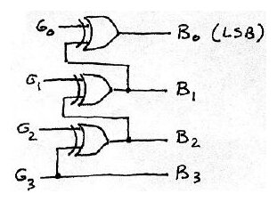
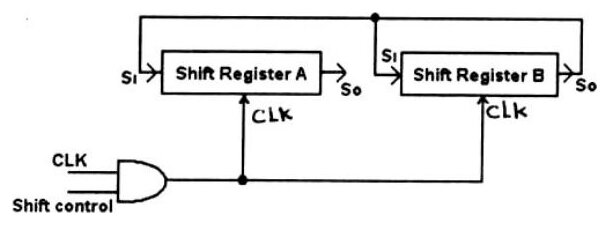
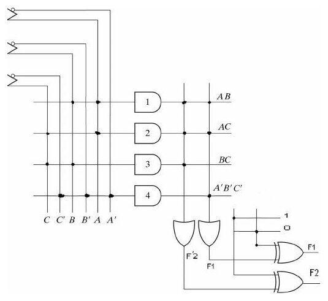

Bu yazı, Başkent Üniversitesi **EEM211 Sayısal Mantık Tasarımı** dersinin **18 Ocak 2007** tarihli final sınavının sorularını ve cevap anahtarını içeriyor (dosya adı: EEM211_YSS_06_Y, yani 2006–2007 güz dönemi yarıyıl sonu sınavı yanıtları). Sorular İngilizce, bazı açıklamalar Türkçe. Sınav süresi 100 dakika. Orijinal Word dosyası yazının sonunda indirilebilir.

## Soru 1: Answer the following questions (her biri 5 puan, toplam 30)

### a) Taban çevirme

> Convert (257.0554)₈ to base 16 and base 2

(257.0554)₈ = (010 101 111 . 000 101 101 100)₂ = (1010 1111 . 0001 0110 1100)₂ = **(AF.16C)₁₆**

### b) Gray'den ikiliye çevirici

> Implement a 4-bit Gray to Binary code conversion circuit by using three 2-input XOR gates only.

- Bn = Gn (MSB)
- Bi = Gi ⊕ Bi+1, i = 0, …, n−1

Yani B3 = G3, B2 = G2 ⊕ B3, B1 = G1 ⊕ B2, B0 = G0 ⊕ B1.

### c) Hamming kodu ile hata düzeltme

> A 7-bit Hamming Code word 0010011 of 4 data bits and 3 parity bits is received through a transmission channel. Check this word for a possible 1-bit error and find out the original 4-bit data word put into the channel.

- C1 = XOR of bits (1, 3, 5, 7) = 0
- C2 = XOR of bits (2, 3, 6, 7) = 1
- C4 = XOR of bits (4, 5, 6, 7) = 0
- Error bit position C4C2C1 = 010 = 2
- Corrected code = **0110011**
- Data = **1011**

### d) NAND ve NOT ile OR

> Implement a 2-input OR function with use of minimum number of INVERTERs and NAND gates. (Complements of inputs are not available)

x ve y birer NOT kapısıyla terslenip bir NAND kapısına verilir: (x'y')' = **x + y**

' = x + y")

### e) RAM yongası sayısı

> How many 32K × 8 RAM chips are needed to provide a total memory capacity of 512 K bytes?

512 Kbyte / 32 Kbyte = **16 memory chip**

### f) Kanonik SOP

> Convert the following function to canonical SOP form. F(A,B,C) = AB + AC' + A'C

| A | B | C | F |
|---|---|---|---|
| 0 | 0 | 0 | 0 |
| 0 | 0 | 1 | 1 |
| 0 | 1 | 0 | 0 |
| 0 | 1 | 1 | 1 |
| 1 | 0 | 0 | 1 |
| 1 | 0 | 1 | 0 |
| 1 | 1 | 0 | 1 |
| 1 | 1 | 1 | 1 |

F(A, B, C) = A'B'C + A'BC + AB'C' + ABC' + ABC = **Σ(1, 3, 4, 6, 7)**

## Soru 2 (a: 10, b: 10 puan)

### a) Kaydırma yazmaçları

> Binary information is shifted and distributed through 4-bit shift registers A and B, when shift control is high (1). Write the contents of each shift register, after the application of 3 clock pulses. (Initial values of shift registers are A = 1100 and B = 1110)

> 3 clock darbesinden sonra A = 1101 ve B = 1101 olur.

| Darbe | A | B |
|---|---|---|
| Başlangıç | 1100 | 1110 |
| 1 | 0110 | 0111 |
| 2 | 1011 | 1011 |
| 3 | 1101 | 1101 |

### b) D flip-flop'lu sayaç

> A 2-bit binary counter is shown in the figure. Redraw this counter by using D type flip flop's.

Soruda T flip-flop'larla kurulmuş, Count, Clear ve High girişli iki bitlik sayaç veriliyor; cevapta aynı sayaç, her D flip-flop'un tümleyen çıkışı kendi D girişine geri beslenerek çiziliyor.

 ve T flip-flop'lu soru (sağ)")

## Soru 3: PLA (20 puan)

> Implement the following two functions simultaneously with the given PLA:
> F1(A,B,C) = Σ(0, 5, 6, 7)
> F2(A,B,C) = Σ(0, 1, 2, 4)

| F1: A \ BC | 00 | 01 | 11 | 10 |
|---|---|---|---|---|
| 0 | 1 | 0 | 0 | 0 |
| 1 | 0 | 1 | 1 | 1 |

- F1 = AB + AC + A'B'C'
- F1 = (A'C + A'B + AB'C')'

| F2: A \ BC | 00 | 01 | 11 | 10 |
|---|---|---|---|---|
| 0 | 1 | 1 | 0 | 1 |
| 1 | 1 | 0 | 0 | 0 |

- F2 = A'B' + A'C' + B'C'
- F2 = (AB + AC + BC)'

PLA'da dört çarpım terimi kullanılıyor: AB, AC, BC ve A'B'C'. F1 doğrudan AB + AC + A'B'C' olarak, F2 ise AB + AC + BC toplamının çıkıştaki XOR kapısıyla terslenmesiyle elde ediliyor.

## Soru 4: Durum indirgeme (10 puan)

> Reduce the number of states in the following state table and find the reduced state table.

| Şimdiki durum | Gelecek, x = 0 | Gelecek, x = 1 | Çıktı, x = 0 | Çıktı, x = 1 |
|---|---|---|---|---|
| a | f | b | 0 | 0 |
| b | d | c | 0 | 0 |
| c | f | e | 0 | 0 |
| d | g | a | 1 | 0 |
| e | d | c | 0 | 0 |
| f | f | b | 1 | 1 |
| g | g | h | 0 | 1 |
| h | g | a | 1 | 0 |

> Verilen çizelgedeki durumları, aynı girdi dizilerine karşın aynı çıktı dizileri üretip üretmediklerine bakarak denklik kümeleri içinde toparlarsak:

- P0 = (abcdefgh)
- P1 = (abce)(dh)(f)(g)
- P2 = (ac)(be)(dh)(f)(g)

> buluruz. Bu da verilen "sequential" devrenin kendisine denk olan 5 durumlu bir devreye indirgenebileceğini gösterir. Her küme içinden bir durum seçer ve gelecek durumlarla çıktıları buna göre yeniden düzenleyerek indirgenmiş çizelgeyi oluştururuz:

| Şimdiki durum | Gelecek, x = 0 | Gelecek, x = 1 | Çıktı, x = 0 | Çıktı, x = 1 |
|---|---|---|---|---|
| a | f | b | 0 | 0 |
| b | d | a | 0 | 0 |
| d | g | a | 1 | 0 |
| f | f | b | 1 | 1 |
| g | g | d | 0 | 1 |

## Soru 5: 0011 dizisi algılayıcı (20 puan)

> Design a sequential circuit as a Mealy machine, which detects the occurrence of each 0011 sequence, by using T type flip-flops as memory elements. First find the state diagram and use minimal number of states and combinational circuit elements. Show all of your design steps clearly. The machine must generate an output of 1, whenever the sequence received and 0 at all other times.

Cevaptaki durum diyagramında dört durum var (A, B, C, D); geçişler giriş/çıkış biçiminde etiketlenmiş. Durum tablosu:

| PS | NS, x = 0 | NS, x = 1 | z, x = 0 | z, x = 1 |
|---|---|---|---|---|
| A | B | A | 0 | 0 |
| B | C | A | 0 | 0 |
| C | C | D | 0 | 0 |
| D | B | A | 0 | 1 |

Durumlar A = 00, B = 01, C = 10, D = 11 olarak kodlanıyor (Q2Q1). Gelecek durumlar ve T flip-flop girişleri:

| Q2Q1 | q2q1, x = 0 | q2q1, x = 1 | T2T1, x = 0 | T2T1, x = 1 | z, x = 0 | z, x = 1 |
|---|---|---|---|---|---|---|
| 00 | 01 | 00 | 01 | 00 | 0 | 0 |
| 01 | 10 | 00 | 11 | 01 | 0 | 0 |
| 10 | 10 | 11 | 00 | 01 | 0 | 0 |
| 11 | 01 | 00 | 10 | 11 | 0 | 1 |

Karnaugh haritaları (satırlar x, sütunlar Q2Q1 = 00, 01, 11, 10):

| | 00 | 01 | 11 | 10 |
|---|---|---|---|---|
| T1, x = 0 | 1 | 1 | 0 | 0 |
| T1, x = 1 | 0 | 1 | 1 | 1 |
| T2, x = 0 | 0 | 1 | 1 | 0 |
| T2, x = 1 | 0 | 0 | 1 | 0 |

Cevap anahtarında sonuçlar hem toplamlar çarpımı hem çarpımlar toplamı olarak veriliyor:

- T1 = (x' + Q2 + Q1)(x + Q2') = **x'Q2' + xQ2 + Q2'Q1**
- T2 = Q1(x' + Q2) = **x'Q1 + Q2Q1**
- **z = xQ1Q2**

## Puanlama

| Soru | Puan |
|---|---|
| Q1 | 5 puan her biri, toplam 30 |
| Q2 | a) 10, b) 10, toplam 20 |
| Q3 | 20 |
| Q4 | 10 |
| Q5 | 20 |

*Not: Word dosyasında Soru 5'in durum diyagramı, Soru 4'ün indirgenmiş çizelgesinin üzerine taşmış durumda; orijinal dosya açıldığında iki şekil üst üste görünebilir.*
