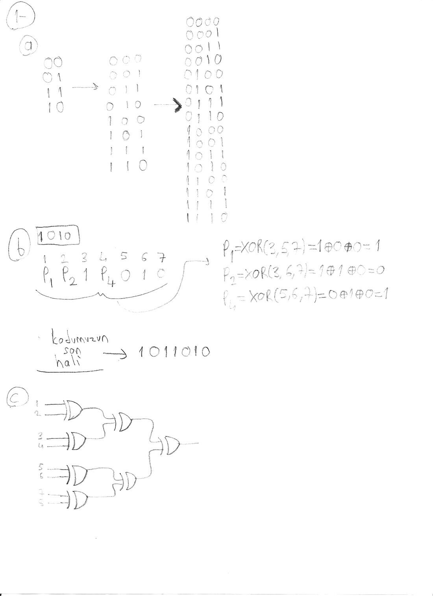
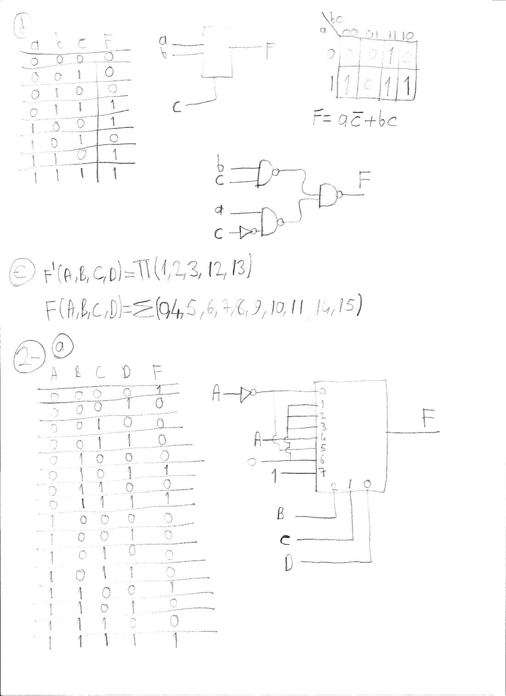
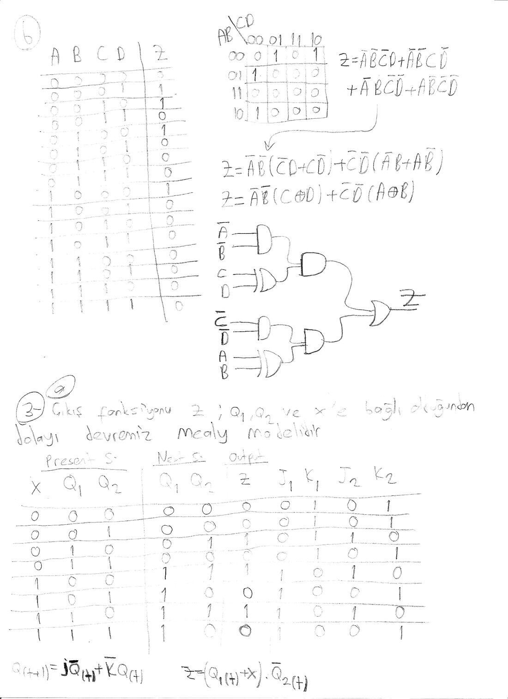
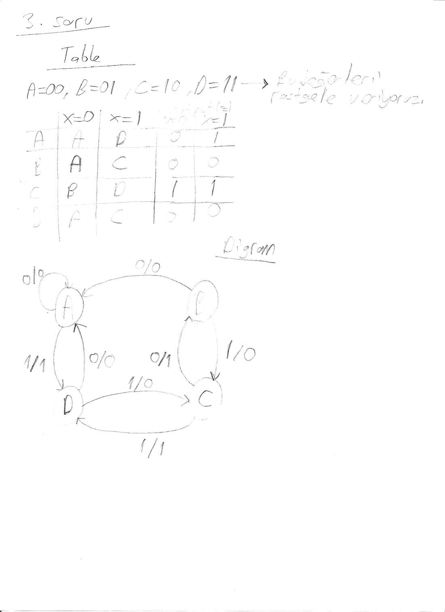
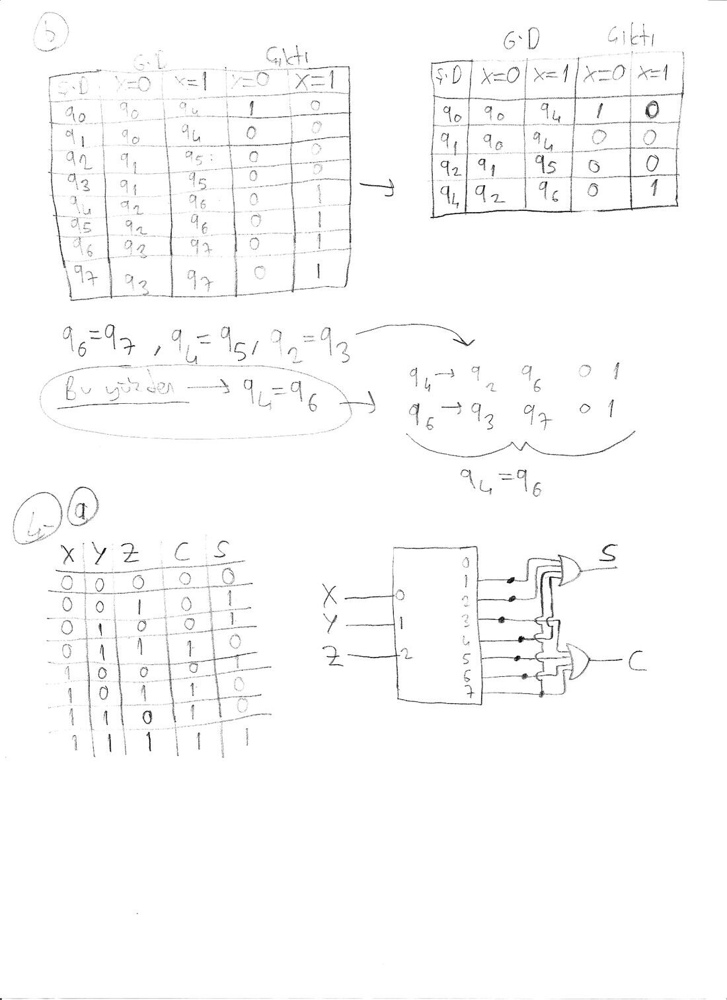
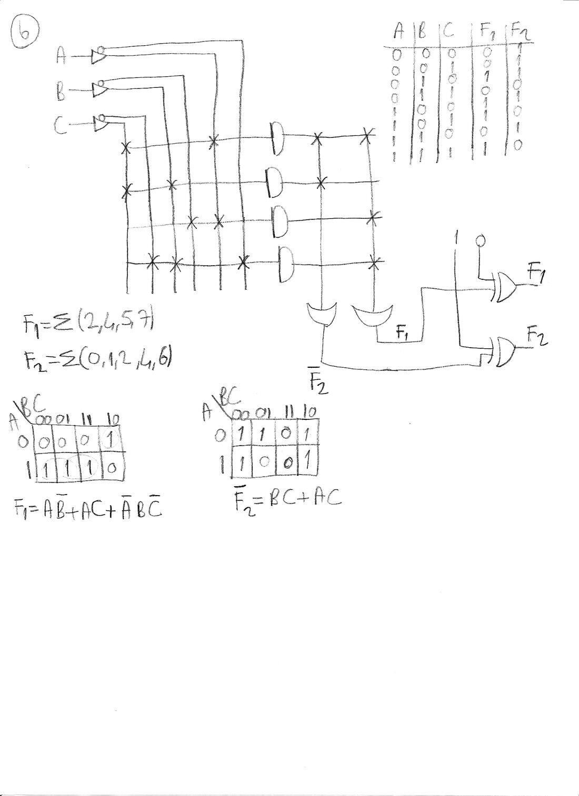
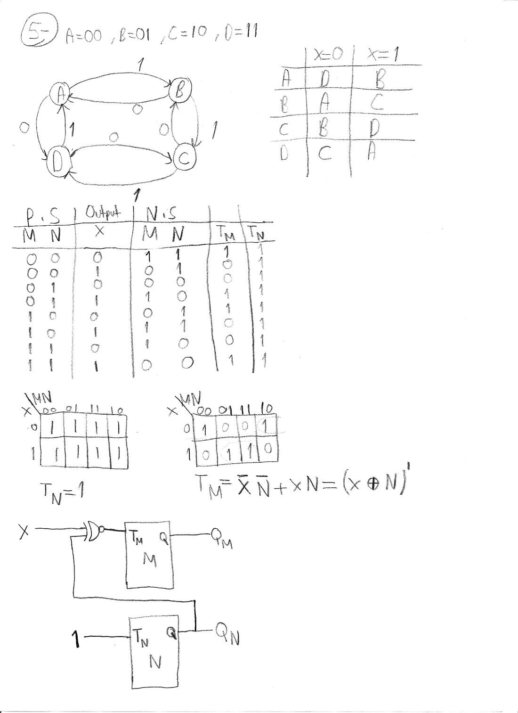

This post compiles seven Word files named "final cozumleri" from the EEM211 Digital Logic Design sample questions folder. Each file contains a scanned page of pencil-written solutions to the questions of a final exam; the files do not say who wrote the question text or the solutions. The headings, main formulas, and results of the solutions are transcribed below as text; a scanned image of each page (with contrast enhanced for readability) is included. The original Word files can be downloaded as a ZIP at the end of the post.

## Page 1: Gray Code, Hamming Code, and Parity Tree (Question 1 a–c)

**1a) Gray code by reflection.** The 2-bit Gray code (00, 01, 11, 10) is reflected to extend it to the 3-bit code (000, 001, 011, 010, 110, 111, 101, 100), which is then reflected to extend it to the 4-bit code. The 4-bit list on the page:

```
0000 0001 0011 0010 0110 0111 0101 0100
1100 1101 1111 1110 1010 1011 1001 1000
```

*Note: On the page, the last four rows of the 3-bit list are written as 100, 101, 111, 110, and the second half of the 4-bit list as 1000, 1001, 1011, 1010, 1100, 1101, 1111, 1110; that is, the lower halves were not reflected but copied straight. In this order, the single-bit difference between adjacent codes breaks down (e.g., from 010 to 100). The correct order according to the reflection method is given above.*

**1b) Hamming code for the data 1010.** The data bits are placed at positions 3, 5, 6, 7: P1 P2 1 P4 0 1 0.

- P1 = XOR(3, 5, 7) = 1 ⊕ 0 ⊕ 0 = 1
- P2 = XOR(3, 6, 7) = 1 ⊕ 1 ⊕ 0 = 0
- P4 = XOR(5, 6, 7) = 0 ⊕ 1 ⊕ 0 = 1

Final code: **1011010**.

**1c)** A three-level XOR tree that finds the parity of an 8-bit input: the inputs are XORed in pairs (1-2, 3-4, 5-6, 7-8), the results are again XORed in pairs, and the final XOR gives the output.



## Page 2: NAND Implementation, Canonical Form, and 8x1 MUX (Question 1 d–e, 2a)

**1d)** In the truth table, F is 1 for abc = 011, 100, 110, 111. Using a Karnaugh map, **F = ac' + bc**; this expression is implemented with a two-level NAND-NAND circuit (one inverter for c, two NANDs, and a NAND at the output).

**1e)** F'(A, B, C, D) = ∏(1, 2, 3, 12, 13) is given; F = Σ(0, 4, 5, 6, 7, 8, 9, 10, 11, 14, 15).

**2a)** In the truth table, F is 1 for ABCD = 0000, 0101, 0111, 1100, 1111. The function is implemented with an 8x1 MUX with select inputs B, C, D; A, A', or constant 0/1 is connected to the data inputs. From the table, the data inputs are: I0 = A', I1 = I2 = I3 = 0, I4 = A, I5 = A', I6 = 0, I7 = 1.



## Page 3: Simplification with XOR and Analysis of a Mealy Circuit (Question 2b, 3a)

**2b)** Z is 1 for ABCD = 0001, 0010, 0100, 1000 (when exactly one input is 1). From the Karnaugh map:

Z = A'B'C'D + A'B'CD' + A'BC'D' + AB'C'D'
= A'B'(C'D + CD') + C'D'(A'B + AB')
= **A'B'(C ⊕ D) + C'D'(A ⊕ B)**

Circuit: an AND for A'B', an XOR for C ⊕ D, and the AND of these; an AND for C'D', an XOR for A ⊕ B, and the AND of these; the two results are combined in an OR gate.

**3a)** "Since the output function Z depends on Q1, Q2, and x, our circuit is a Mealy model." The state table of the circuit with two JK flip-flops (present state, next state, Z, and J1 K1 J2 K2) is derived. The relations used: Q(t+1) = J·Q'(t) + K'·Q(t) and Z = (Q1(t) + x)·Q2'(t).



## Page 4: State Table and Diagram (Question 3)

The values A = 00, B = 01, C = 10, D = 11 are assigned to the states ("we assign these values arbitrarily"), and the state table and diagram are drawn:

| Present state | Next (x = 0) | Next (x = 1) | Z (x = 0) | Z (x = 1) |
|---|---|---|---|---|
| A | A | D | 0 | 1 |
| B | A | C | 0 | 0 |
| C | B | D | 1 | 1 |
| D | A | C | 0 | 0 |



## Page 5: State Reduction and Full Adder with a Decoder (Question 3b, 4a)

**3b) State reduction.** Table with states q0–q7 (N.S.: next state, output):

| P.S. | N.S. (x = 0) | N.S. (x = 1) | Output (x = 0) | Output (x = 1) |
|---|---|---|---|---|
| q0 | q0 | q4 | 1 | 0 |
| q1 | q0 | q4 | 0 | 0 |
| q2 | q1 | q5 | 0 | 0 |
| q3 | q1 | q5 | 0 | 0 |
| q4 | q2 | q6 | 0 | 1 |
| q5 | q2 | q6 | 0 | 1 |
| q6 | q3 | q7 | 0 | 1 |
| q7 | q3 | q7 | 0 | 1 |

States with the same outputs and the same next states are equivalent: q6 = q7, q4 = q5, q2 = q3. After substituting these, q4 (→ q2, q6; 0, 1) and q6 (→ q2, q6; 0, 1) also become the same: **q4 = q6**. Reduced table:

| P.S. | N.S. (x = 0) | N.S. (x = 1) | Output (x = 0) | Output (x = 1) |
|---|---|---|---|---|
| q0 | q0 | q4 | 1 | 0 |
| q1 | q0 | q4 | 0 | 0 |
| q2 | q1 | q4 | 0 | 0 |
| q4 | q2 | q4 | 0 | 1 |

*Note: In the reduced table on the page, the next state of q2 for x = 1 is left as q5, and that of q4 as q6; since q5 = q4 and q6 = q4, these should be written as q4. The table has been corrected accordingly above.*

**4a) Full adder with a 3x8 decoder.** The inputs X, Y, Z are fed to the decoder; the sum and carry are obtained by ORing the relevant outputs:

- S = Σ(1, 2, 4, 7)
- C = Σ(3, 5, 6, 7)



## Page 6: PLA Implementation (Question 4b)

F1 = Σ(2, 4, 5, 7) and F2 = Σ(0, 1, 2, 4, 6) are implemented with a PLA. From the Karnaugh maps:

- F1 = AB' + AC + A'BC'
- F2' = BC + AC (since F2 = Σ(0, 1, 2, 4, 6), F2' = Σ(3, 5, 7))

To share the common term AC, the implementation goes through the complement of F2: the PLA has four product terms (A'BC', AB', AC, BC); the OR output of F1 passes through an XOR connected to 0, and the F2' output passes through an XOR connected to 1 (inverting it to give F2).



## Page 7: Up-Down Counter with T Flip-Flops (Question 5)

The states are A = 00, B = 01, C = 10, D = 11. When x = 1 the counter counts A → B → C → D → A (up), and when x = 0 it counts A → D → C → B → A (down). From the state table and Karnaugh maps for the two T flip-flops (M and N):

- T_N = 1
- T_M = x'N' + xN = (x ⊕ N)'

Circuit: the T input of flip-flop N is connected to 1; the T input of flip-flop M is driven by the XNOR of x and Q_N.


