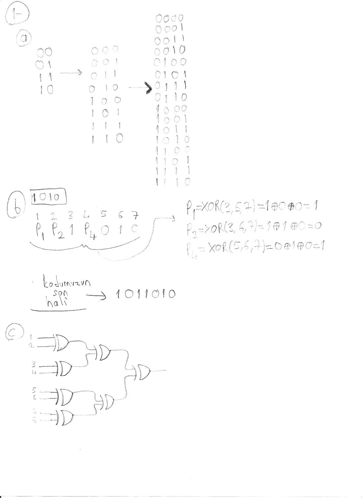
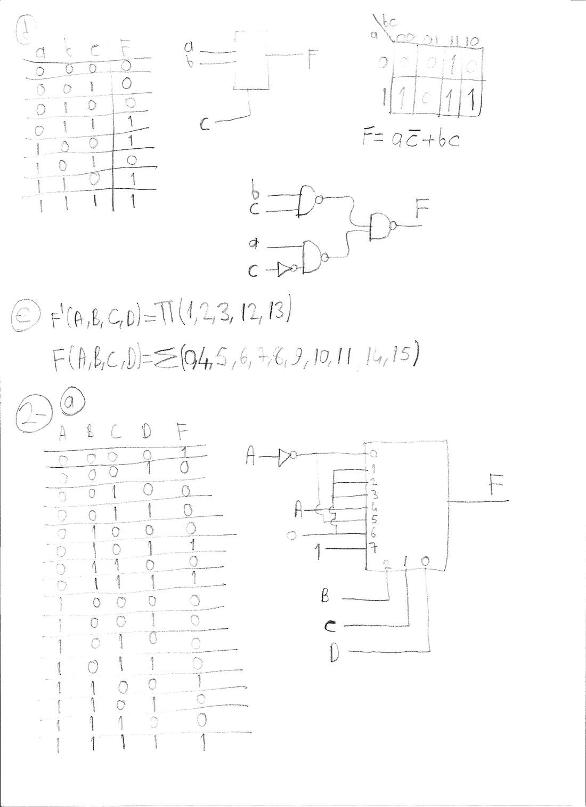
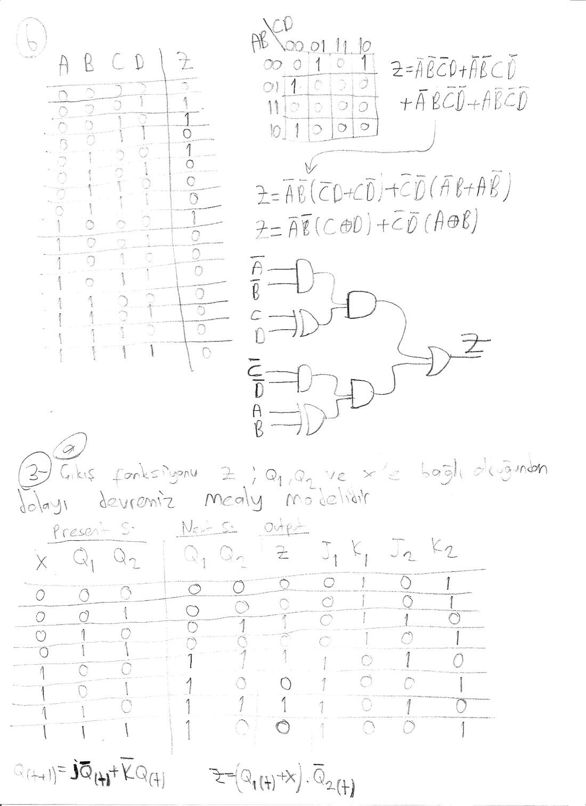
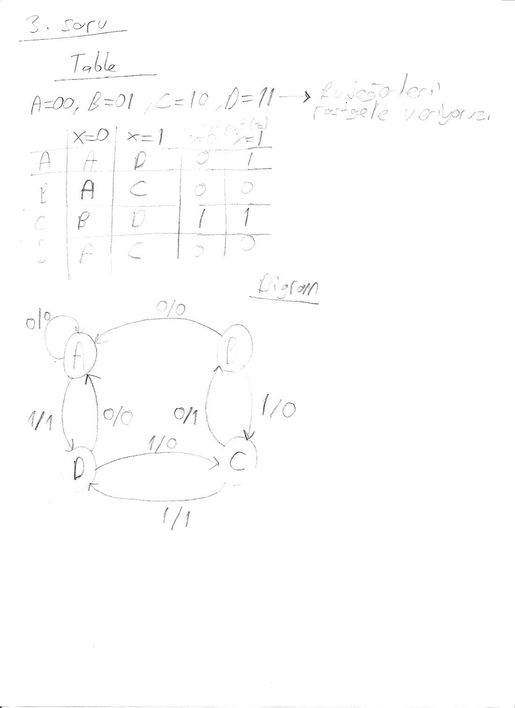
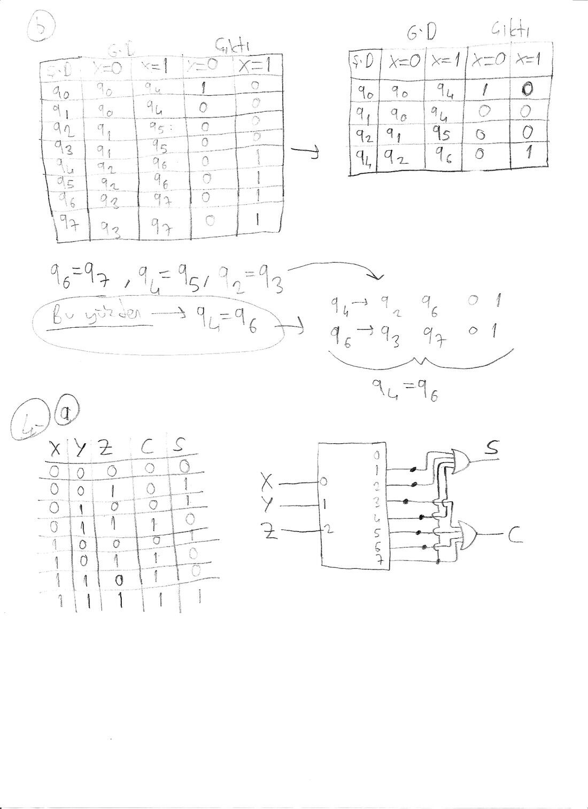
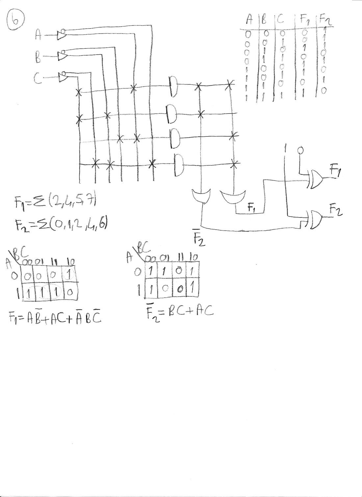
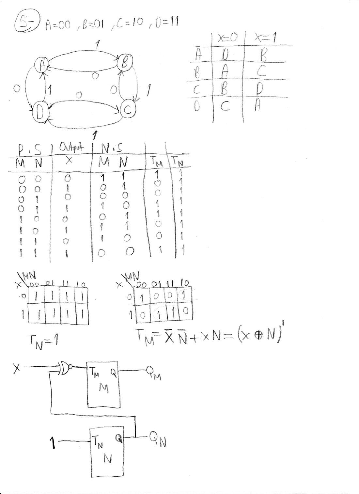

Bu yazı, EEM211 Sayısal Mantık Tasarımı dersinin örnek sorular klasöründeki "final cozumleri" adlı yedi Word dosyasını bir araya getiriyor. Her dosyada bir final sınavının sorularına kurşun kalemle yazılmış çözümlerin taranmış bir sayfası var; soruların metni ve çözümleri kimin yazdığı dosyalarda yok. Çözümlerin başlıkları, ana formülleri ve sonuçları aşağıda metne döküldü; her sayfanın taranmış görüntüsü (okunabilirlik için kontrastı artırılarak) eklendi. Orijinal Word dosyaları yazının sonunda ZIP olarak indirilebilir.

## Sayfa 1: Gray kodu, Hamming kodu ve eşlik ağacı (Soru 1 a–c)

**1a) Yansıtma ile Gray kodu.** 2 bitlik Gray kodu (00, 01, 11, 10) yansıtılarak 3 bitlik koda (000, 001, 011, 010, 110, 111, 101, 100), o da yansıtılarak 4 bitlik koda genişletiliyor. Sayfadaki 4 bitlik liste:

```
0000 0001 0011 0010 0110 0111 0101 0100
1100 1101 1111 1110 1010 1011 1001 1000
```

*Not: Sayfada 3 bitlik listenin son dört satırı 100, 101, 111, 110 ve 4 bitlik listenin ikinci yarısı 1000, 1001, 1011, 1010, 1100, 1101, 1111, 1110 sırasıyla yazılmış; yani alt yarılar yansıtılmamış, düz kopyalanmış. Bu sırada komşu kodlar arasında tek bit farkı bozuluyor (ör. 010'dan 100'e). Yukarıda yansıtma yöntemine göre doğru sıra verildi.*

**1b) 1010 verisinin Hamming kodu.** Veri bitleri 3, 5, 6, 7. konumlara yerleştiriliyor: P1 P2 1 P4 0 1 0.

- P1 = XOR(3, 5, 7) = 1 ⊕ 0 ⊕ 0 = 1
- P2 = XOR(3, 6, 7) = 1 ⊕ 1 ⊕ 0 = 0
- P4 = XOR(5, 6, 7) = 0 ⊕ 1 ⊕ 0 = 1

Kodun son hâli: **1011010**.

**1c)** 8 bitlik bir girişin eşliğini bulan, üç seviyeli XOR ağacı: girişler ikişer ikişer XOR'lanıyor (1-2, 3-4, 5-6, 7-8), sonuçlar yine ikişer XOR'lanıyor ve son XOR çıkışı veriyor.



## Sayfa 2: NAND ile gerçekleştirme, kanonik biçim ve 8x1 MUX (Soru 1 d–e, 2a)

**1d)** Doğruluk tablosunda F, abc = 011, 100, 110, 111 için 1'dir. Karnaugh haritasıyla **F = ac' + bc**; bu ifade iki seviyeli NAND-NAND devresiyle kuruluyor (c için bir tümleyici, iki NAND ve çıkışta bir NAND).

**1e)** F'(A, B, C, D) = ∏(1, 2, 3, 12, 13) verilmiş; F = Σ(0, 4, 5, 6, 7, 8, 9, 10, 11, 14, 15).

**2a)** Doğruluk tablosunda F, ABCD = 0000, 0101, 0111, 1100, 1111 için 1'dir. Fonksiyon B, C, D seçme girişli bir 8x1 MUX ile gerçekleştiriliyor; veri girişlerine A, A' ya da sabit 0/1 bağlanıyor. Tablodan veri girişleri: I0 = A', I1 = I2 = I3 = 0, I4 = A, I5 = A', I6 = 0, I7 = 1.



## Sayfa 3: XOR'lu sadeleştirme ve Mealy devresi analizi (Soru 2b, 3a)

**2b)** Z, ABCD = 0001, 0010, 0100, 1000 için 1'dir (tek bir giriş 1 iken). Karnaugh haritasından:

Z = A'B'C'D + A'B'CD' + A'BC'D' + AB'C'D'
= A'B'(C'D + CD') + C'D'(A'B + AB')
= **A'B'(C ⊕ D) + C'D'(A ⊕ B)**

Devre: A'B' için bir AND, C ⊕ D için bir XOR, bunların AND'i; C'D' için bir AND, A ⊕ B için bir XOR, bunların AND'i; iki sonuç bir OR kapısında birleşiyor.

**3a)** "Çıkış fonksiyonu Z; Q1, Q2 ve x'e bağlı olduğundan dolayı devremiz Mealy modelidir." İki JK flip-floplu devrenin durum tablosu (şimdiki durum, sonraki durum, Z ve J1 K1 J2 K2) çıkarılıyor. Kullanılan bağıntılar: Q(t+1) = J·Q'(t) + K'·Q(t) ve Z = (Q1(t) + x)·Q2'(t).



## Sayfa 4: Durum tablosu ve diyagramı (Soru 3)

Durumlara A = 00, B = 01, C = 10, D = 11 değerleri ("bu değerleri rastgele veriyoruz") verilerek durum tablosu ve diyagramı çiziliyor:

| Şimdiki durum | Sonraki (x = 0) | Sonraki (x = 1) | Z (x = 0) | Z (x = 1) |
|---|---|---|---|---|
| A | A | D | 0 | 1 |
| B | A | C | 0 | 0 |
| C | B | D | 1 | 1 |
| D | A | C | 0 | 0 |



## Sayfa 5: Durum indirgeme ve kod çözücüyle tam toplayıcı (Soru 3b, 4a)

**3b) Durum indirgeme.** q0–q7 durumlu tablo (G.D: gelecek durum, çıktı):

| Ş.D | G.D (x = 0) | G.D (x = 1) | Çıktı (x = 0) | Çıktı (x = 1) |
|---|---|---|---|---|
| q0 | q0 | q4 | 1 | 0 |
| q1 | q0 | q4 | 0 | 0 |
| q2 | q1 | q5 | 0 | 0 |
| q3 | q1 | q5 | 0 | 0 |
| q4 | q2 | q6 | 0 | 1 |
| q5 | q2 | q6 | 0 | 1 |
| q6 | q3 | q7 | 0 | 1 |
| q7 | q3 | q7 | 0 | 1 |

Aynı çıktıları ve aynı gelecek durumları olan durumlar eşdeğerdir: q6 = q7, q4 = q5, q2 = q3. Bunlar yerine konunca q4 (→ q2, q6; 0, 1) ile q6 (→ q2, q6; 0, 1) de aynı olur: **q4 = q6**. İndirgenmiş tablo:

| Ş.D | G.D (x = 0) | G.D (x = 1) | Çıktı (x = 0) | Çıktı (x = 1) |
|---|---|---|---|---|
| q0 | q0 | q4 | 1 | 0 |
| q1 | q0 | q4 | 0 | 0 |
| q2 | q1 | q4 | 0 | 0 |
| q4 | q2 | q4 | 0 | 1 |

*Not: Sayfadaki indirgenmiş tabloda q2'nin x = 1 için gelecek durumu q5, q4'ünkü q6 olarak bırakılmış; q5 = q4 ve q6 = q4 olduğundan bunların q4 yazılması gerekir. Tablo yukarıda bu şekilde düzeltildi.*

**4a) 3x8 kod çözücü ile tam toplayıcı.** X, Y, Z girişleri kod çözücüye veriliyor; toplam ve elde, ilgili çıkışların OR'lanmasıyla elde ediliyor:

- S = Σ(1, 2, 4, 7)
- C = Σ(3, 5, 6, 7)



## Sayfa 6: PLA ile gerçekleştirme (Soru 4b)

F1 = Σ(2, 4, 5, 7) ve F2 = Σ(0, 1, 2, 4, 6) bir PLA ile gerçekleştiriliyor. Karnaugh haritalarından:

- F1 = AB' + AC + A'BC'
- F2' = BC + AC (F2 = Σ(0, 1, 2, 4, 6) olduğundan F2' = Σ(3, 5, 7))

Ortak terim AC'yi paylaşmak için F2 tümleyeni üzerinden gerçekleştiriliyor: PLA'da dört çarpım terimi (A'BC', AB', AC, BC) var; F1'in OR çıkışı 0'a bağlı bir XOR'dan, F2' çıkışı 1'e bağlı bir XOR'dan (tersleyerek F2) geçiyor.



## Sayfa 7: T flip-floplu yukarı-aşağı sayaç (Soru 5)

Durumlar A = 00, B = 01, C = 10, D = 11. x = 1 iken A → B → C → D → A (yukarı), x = 0 iken A → D → C → B → A (aşağı) sayılıyor. İki T flip-flop (M ve N) için durum tablosundan ve Karnaugh haritalarından:

- T_N = 1
- T_M = x'N' + xN = (x ⊕ N)'

Devre: N flip-flopunun T girişi 1'e bağlı; M flip-flopunun T girişine x ile Q_N'nin XNOR'u veriliyor.


