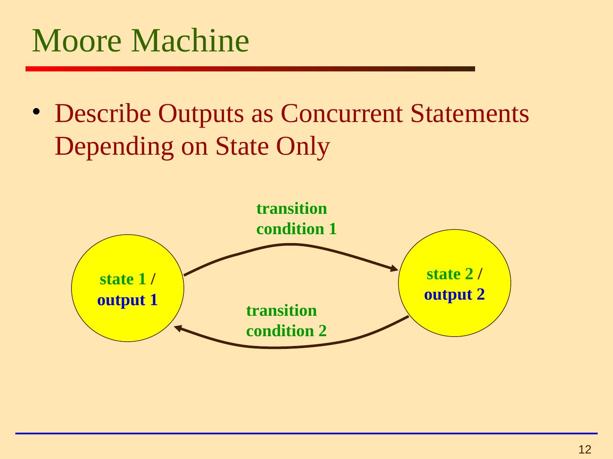
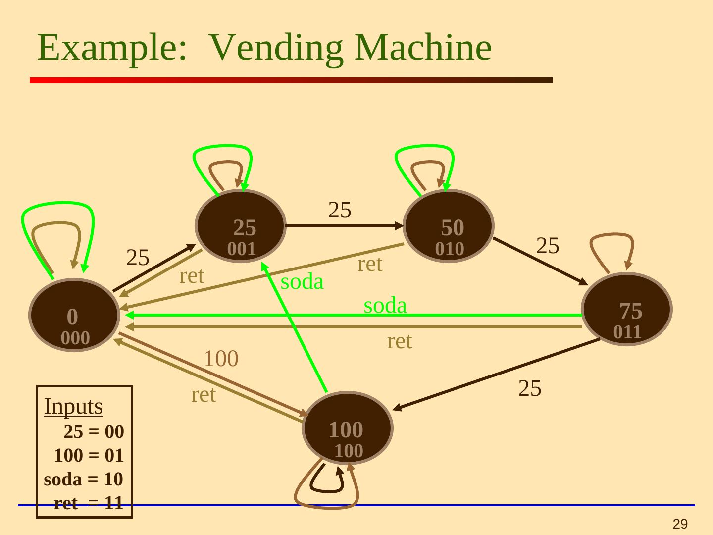
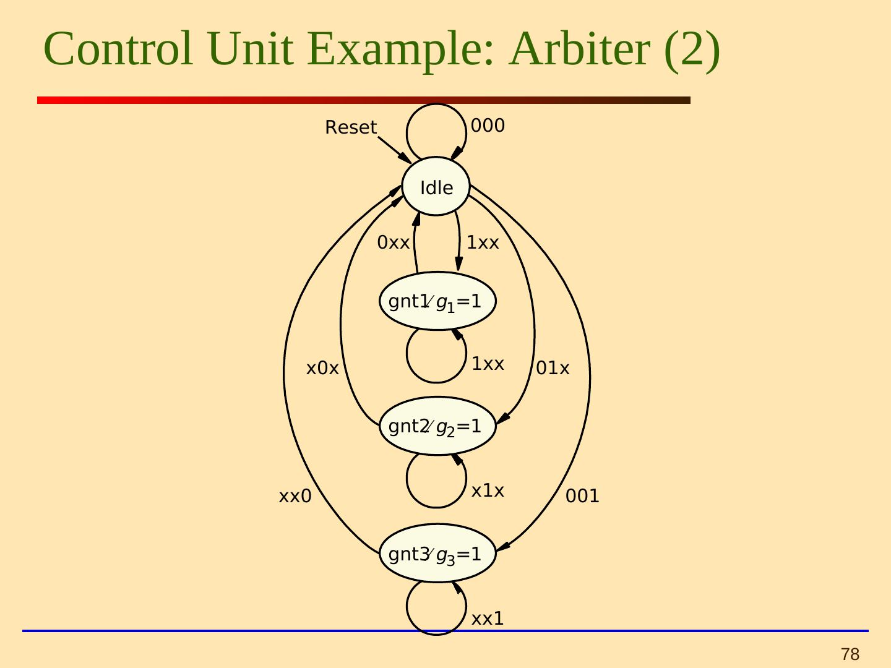

This post presents the 84-slide **"Finite State Machines" (Lecture 7)** presentation found in the folder of the EEM211 Digital Logic Design course. The slides were used in the courses of Yehuda Afek and Nathan Intrator at **Tel Aviv University**; the first slide carries the note "based on George Mason and CMU courses". Most of the slides are in English, and a section (slides 19–26) is in Hebrew. Chapters 6 and 10 of Sundar Rajan's book *Essential VHDL: RTL Synthesis Done Right* are cited as the source. The main content and the VHDL code are reproduced below; the original presentation can be downloaded at the end of the post.

*This content belongs to a third-party source; it is shared for archival and nostalgic purposes with attribution to the source. It will be removed at the request of the rights holder.*

## What is a state machine?

All programmable logic designs can be specified in Boolean form, but some designs are easier to conceptualize using non-Boolean models; the state machine is one such model. A state machine represents a system as a set of states, the transitions between them and the associated inputs and outputs. Any circuit with memory is a finite state machine — even computers can be viewed as huge FSMs. Designing an FSM involves defining states, defining transitions and optimization/minimization; this approach is practical for small FSMs only.

Terms:

- **State diagram:** a bubble-and-arrow diagram showing the form and function of a state machine.
- **State:** a set of uniquely identifiable values measured at various points in a digital system.
- **Next state:** the state to which the machine moves, depending on the inputs, when the clock arrives.
- **Branch:** a transition from the present state to the next state.
- **Mealy machine:** a machine whose outputs are determined by the present state and the inputs.
- **Moore machine:** a machine whose outputs are determined by the present state only.

## Moore and Mealy

In a Moore diagram the output is written inside the state bubble, because the output does not change as long as the machine stays in that state. In a Mealy diagram the outputs are written on the transition arrows, because they depend on the inputs as well as on the next state.

- Moore and Mealy FSMs can be functionally equivalent.
- A Mealy FSM has a richer description and generally requires fewer states (smaller circuit area).
- A Mealy FSM computes its output as soon as the inputs change; it responds one clock cycle earlier than the equivalent Moore FSM.
- In a Moore FSM there is no combinational path between the inputs and the outputs.



## Example 1: FSM that detects the sequence "10"

The Moore machine uses three states (S0: no element of the sequence seen yet, S1: "1" seen, S2: "10" seen, output 1); the Mealy machine gets by with two states.

```vhdl
-- Moore FSM in VHDL
type state is (S0, S1, S2);
signal Moore_state: state;
U_Moore: process(clock, reset)
Begin
    if(reset = '1') then
      Moore_state <= S0;
    elsif (clock = '1' and clock'event) then
      case Moore_state is
         when S0 =>
           if input = '1' then Moore_state <= S1; end if;
         when S1 =>
           if input = '0' then Moore_state <= S2; end if;
         when S2 =>
           if input = '0' then Moore_state <= S0;
           else Moore_state <= S1; end if;
      end case;
    end if;
End process;
Output <= '1' when Moore_state = S2 else '0';
```

```vhdl
-- Mealy FSM in VHDL
type state is (S0, S1);
signal Mealy_state: state;
U_Mealy: process(clock, reset)
Begin
    if(reset = '1') then
      Mealy_state <= S0;
    elsif (clock = '1' and clock'event) then
      case Mealy_state is
         when S0 =>
           if input = '1' then Mealy_state <= S1; end if;
         when S1 =>
           if input = '0' then Mealy_state <= S0; end if;
      end case;
    end if;
End process;
Output <= '1' when (Mealy_state = S1 and input = '0') else '0';
```

## Example: vending machine

The machine accepts only 25-cent coins and 1-dollar bills, holds no more than 1 dollar, and a drink costs 75 cents. Inputs: insert 25 cents (00), insert 1 dollar (01), drink button (10), coin return button (11). The states are the amount of money accumulated in the machine: 0, 25, 50, 75, 100.



## VHDL

VHDL is the abbreviation of *Very High Speed Integrated Circuit Hardware Description Language*. In the slides, a 1-bit full adder is described structurally, arithmetically and behaviorally; the combination of components in the Altera environment and coding tips (not forgetting semicolons, making the top-level entity name the same as the file name, testing small parts separately, etc.) are given. Then FSM coding with the `process` statement and the `'EVENT` attribute is explained.

### Example 2: Moore FSM

State table (input w, output z):

| Present state | Next (w = 0) | Next (w = 1) | z |
|---|---|---|---|
| A | A | B | 0 |
| B | A | C | 0 |
| C | A | C | 1 |

The machine gives z = 1 when w = 1 lasts for at least two clock cycles.

```vhdl
USE ieee.std_logic_1164.all ;
ENTITY simple IS
   PORT ( Clock, Resetn, w : IN STD_LOGIC ;
          z                : OUT STD_LOGIC ) ;
END simple ;
ARCHITECTURE Behavior OF simple IS
   TYPE State_type IS (A, B, C) ;
   SIGNAL y : State_type ;
BEGIN
   PROCESS ( Resetn, Clock )
   BEGIN
      IF Resetn = '0' THEN
         y <= A ;
      ELSIF (Clock'EVENT AND Clock = '1') THEN
         CASE y IS
            WHEN A =>
               IF w = '0' THEN y <= A ; ELSE y <= B ; END IF ;
            WHEN B =>
               IF w = '0' THEN y <= A ; ELSE y <= C ; END IF ;
            WHEN C =>
               IF w = '0' THEN y <= A ; ELSE y <= C ; END IF ;
         END CASE ;
      END IF ;
   END PROCESS ;
   z <= '1' WHEN y = C ELSE '0' ;
END Behavior ;
```

The Mealy version of the same function is written with only two states (A, B); z becomes 1 when in state B with w = 1.

## State encoding

State encoding greatly affects the efficiency of an FSM implementation; no method is known that guarantees the best circuit other than trying all encodings (which is feasible only for small circuits). If the states are defined in VHDL with enumerated types, the encoding is left to the synthesis tool.

- **Binary (sequential) encoding:** states are encoded with consecutive binary numbers; it uses few flip-flops, but the transition functions can be complex and slow.
- **One-hot encoding:** in each state only one bit is 1; as many flip-flops as states are required, and the transition functions are simple and fast. It is the preferred method in FPGAs.

| State | Binary code | One-hot code |
|---|---|---|
| S0 | 000 | 10000000 |
| S1 | 001 | 01000000 |
| S2 | 010 | 00100000 |
| S3 | 011 | 00010000 |
| S4 | 100 | 00001000 |
| S5 | 101 | 00000100 |
| S6 | 110 | 00000010 |
| S7 | 111 | 00000001 |

There are also examples of specifying the encoding manually, using user-defined attributes and constants.

## RTL design: datapath and control unit

An RTL design consists of the **datapath** (all the required resources and connections), which performs the operations, and the **control unit** (control circuit), which manages data movement by switching multiplexers and enabling registers. As an example of a control unit, an **arbiter** with three requests (r1, r2, r3) is given: from the Idle state, the machine moves to state gnt1, gnt2 or gnt3 according to request priority, and the corresponding g output becomes 1; the grant is held as long as the request continues. At the end of the slides, the VHDL code of the arbiter and `std_logic_vector` arrays are explained.


