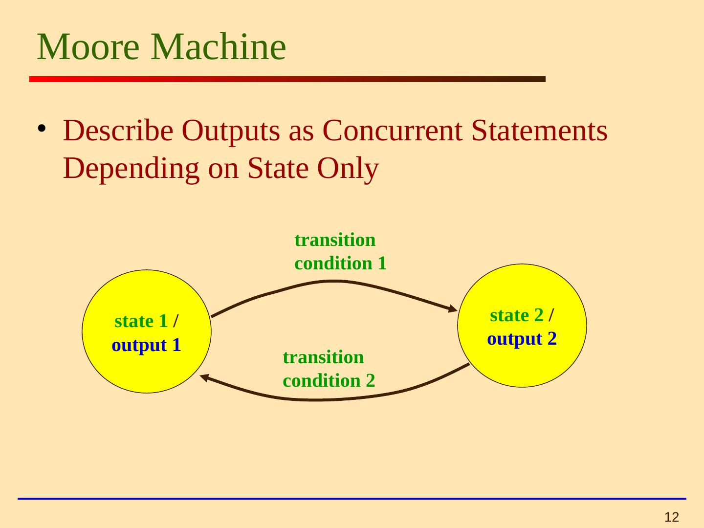
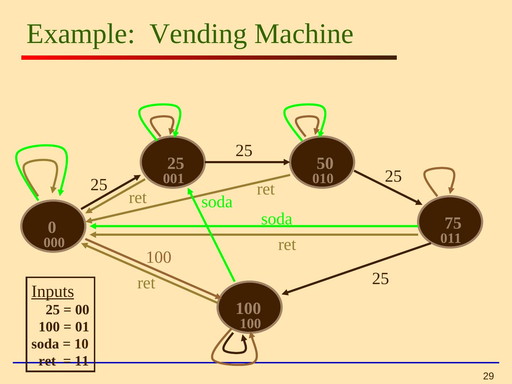

Bu yazı, EEM211 Sayısal Mantık Tasarımı dersinin klasöründe bulunan 84 slaytlık **"Finite State Machines" (Lecture 7)** sunusunu tanıtıyor. Sunu **Tel Aviv Üniversitesi**'nde Yehuda Afek ve Nathan Intrator'ın derslerinde kullanılmış; ilk slaytta "George Mason ve CMU derslerine dayanır" notu var. Slaytların çoğu İngilizce, bir bölümü (slayt 19–26) İbranice. Kaynak olarak Sundar Rajan'ın *Essential VHDL: RTL Synthesis Done Right* kitabının 6. ve 10. bölümleri gösteriliyor. Aşağıda ana içerik ve VHDL kodları aktarıldı; sununun orijinali yazının sonunda indirilebilir.

*Bu içerik üçüncü taraf bir kaynağa aittir; arşiv ve nostalji amacıyla kaynak belirtilerek paylaşılmıştır. Hak sahibinin talebi hâlinde kaldırılır.*

## Durum makinesi nedir?

All programmable logic designs can be specified in Boolean form, but some designs are easier to conceptualize using non-Boolean models; the state machine is one such model. A state machine represents a system as a set of states, the transitions between them and the associated inputs and outputs. Any circuit with memory is a finite state machine — even computers can be viewed as huge FSMs. Designing an FSM involves defining states, defining transitions and optimization/minimization; this approach is practical for small FSMs only.

Terimler:

- **State diagram:** durum makinesinin biçimini ve işlevini gösteren baloncuk-ok diyagramı.
- **State:** sayısal sistemin çeşitli noktalarında ölçülen, benzersiz olarak tanımlanabilen değerler kümesi.
- **Next state:** saat geldiğinde girişlere göre geçilecek durum.
- **Branch:** şimdiki durumdan sonraki duruma geçiş.
- **Mealy machine:** çıkışları şimdiki durum ve girişlerden belirlenen makine.
- **Moore machine:** çıkışları yalnızca şimdiki durumdan belirlenen makine.

## Moore ve Mealy

Moore diyagramında çıkış durum baloncuğunun içine yazılır, çünkü makine o durumda kaldıkça çıkış değişmez. Mealy diyagramında çıkışlar geçiş oklarının üzerine yazılır, çünkü sonraki durum gibi girişlere de bağlıdır.

- Moore ve Mealy FSM'ler işlevsel olarak eşdeğer olabilir.
- Mealy FSM daha zengin bir tanıma sahiptir ve genellikle daha az durum (daha küçük devre alanı) gerektirir.
- Mealy FSM, girişler değişir değişmez çıkışı hesaplar; eşdeğer Moore FSM'den bir saat çevrimi önce yanıt verir.
- Moore FSM'de girişlerle çıkışlar arasında kombinezonsal yol yoktur.



## Örnek 1: "10" dizisini algılayan FSM

Moore makinesi üç durum kullanır (S0: dizinin hiçbir elemanı görülmedi, S1: "1" görüldü, S2: "10" görüldü, çıkış 1); Mealy makinesi iki durumla yetinir.

```vhdl
-- Moore FSM in VHDL
type state is (S0, S1, S2);
signal Moore_state: state;
U_Moore: process(clock, reset)
Begin
    if(reset = '1') then
      Moore_state <= S0;
    elsif (clock = '1' and clock'event) then
      case Moore_state is
         when S0 =>
           if input = '1' then Moore_state <= S1; end if;
         when S1 =>
           if input = '0' then Moore_state <= S2; end if;
         when S2 =>
           if input = '0' then Moore_state <= S0;
           else Moore_state <= S1; end if;
      end case;
    end if;
End process;
Output <= '1' when Moore_state = S2 else '0';
```

```vhdl
-- Mealy FSM in VHDL
type state is (S0, S1);
signal Mealy_state: state;
U_Mealy: process(clock, reset)
Begin
    if(reset = '1') then
      Mealy_state <= S0;
    elsif (clock = '1' and clock'event) then
      case Mealy_state is
         when S0 =>
           if input = '1' then Mealy_state <= S1; end if;
         when S1 =>
           if input = '0' then Mealy_state <= S0; end if;
      end case;
    end if;
End process;
Output <= '1' when (Mealy_state = S1 and input = '0') else '0';
```

## Örnek: içecek otomatı

Otomat yalnızca 25 sentlik ve 1 dolarlık para kabul ediyor, 1 dolardan fazla tutmuyor, içecek 75 sent. Girişler: 25 sent atma (00), 1 dolar atma (01), içecek düğmesi (10), para iade düğmesi (11). Durumlar makinede biriken para miktarıdır: 0, 25, 50, 75, 100.



## VHDL

VHDL, *Very High Speed Integrated Circuit Hardware Description Language*'in kısaltmasıdır. Sunuda 1 bitlik tam toplayıcı yapısal, aritmetik ve davranışsal olarak tanımlanıyor, bileşenlerin Altera ortamında birleştirilmesi ve yazım ipuçları (noktalı virgülleri unutmamak, üst düzey varlık adının dosya adıyla aynı olması, küçük parçaları ayrı ayrı test etmek vb.) veriliyor. Ardından `process` deyimi ve `'EVENT` niteliğiyle FSM kodlaması anlatılıyor.

### Örnek 2: Moore FSM

Durum tablosu (w girişi, z çıkışı):

| Şimdiki durum | Sonraki (w = 0) | Sonraki (w = 1) | z |
|---|---|---|---|
| A | A | B | 0 |
| B | A | C | 0 |
| C | A | C | 1 |

Makine w = 1 en az iki saat çevrimi boyunca sürdüğünde z = 1 verir.

```vhdl
USE ieee.std_logic_1164.all ;
ENTITY simple IS
   PORT ( Clock, Resetn, w : IN STD_LOGIC ;
          z                : OUT STD_LOGIC ) ;
END simple ;
ARCHITECTURE Behavior OF simple IS
   TYPE State_type IS (A, B, C) ;
   SIGNAL y : State_type ;
BEGIN
   PROCESS ( Resetn, Clock )
   BEGIN
      IF Resetn = '0' THEN
         y <= A ;
      ELSIF (Clock'EVENT AND Clock = '1') THEN
         CASE y IS
            WHEN A =>
               IF w = '0' THEN y <= A ; ELSE y <= B ; END IF ;
            WHEN B =>
               IF w = '0' THEN y <= A ; ELSE y <= C ; END IF ;
            WHEN C =>
               IF w = '0' THEN y <= A ; ELSE y <= C ; END IF ;
         END CASE ;
      END IF ;
   END PROCESS ;
   z <= '1' WHEN y = C ELSE '0' ;
END Behavior ;
```

Aynı işlevin Mealy sürümü yalnızca iki durumla (A, B) yazılıyor; z, B durumunda w = 1 iken 1 oluyor.

## Durum kodlaması

Durum kodlaması FSM gerçekleştirmesinin verimini büyük ölçüde etkiler; bütün kodlamaları denemek dışında en iyi devreyi garanti eden bir yöntem bilinmez (yalnızca küçük devrelerde mümkündür). VHDL'de durumlar sayılan tiplerle (enumerated type) tanımlanırsa kodlama sentez aracına bırakılır.

- **İkili (sıralı) kodlama:** durumlar ardışık ikili sayılarla kodlanır; az flip-flop kullanır ama geçiş fonksiyonları karmaşık ve yavaş olabilir.
- **One-hot kodlama:** her durumda yalnızca bir bit 1'dir; durum sayısı kadar flip-flop gerekir, geçiş fonksiyonları basit ve hızlıdır. FPGA'larda tercih edilen yöntemdir.

| Durum | İkili kod | One-hot kod |
|---|---|---|
| S0 | 000 | 10000000 |
| S1 | 001 | 01000000 |
| S2 | 010 | 00100000 |
| S3 | 011 | 00010000 |
| S4 | 100 | 00001000 |
| S5 | 101 | 00000100 |
| S6 | 110 | 00000010 |
| S7 | 111 | 00000001 |

Kodlamanın elle verilmesi için kullanıcı tanımlı nitelik (attribute) ve sabitlerle (constant) yapılan örnekler de var.

## RTL tasarım: veri yolu ve denetim birimi

RTL tasarım, işlemleri yapan **veri yolu** (datapath; gereken bütün kaynaklar ve bağlantılar) ile çoklayıcıları anahtarlayıp yazmaçları etkinleştirerek veri hareketini yöneten **denetim biriminden** (control circuit) oluşur. Denetim birimi örneği olarak üç istekli (r1, r2, r3) bir **hakem (arbiter)** veriliyor: Idle durumundan istek önceliğine göre gnt1, gnt2 ya da gnt3 durumuna geçiliyor ve ilgili g çıkışı 1 oluyor; istek sürdükçe izin korunuyor. Sununun sonunda hakemin VHDL kodu ve `std_logic_vector` dizileri anlatılıyor.

 durum diyagramı")
