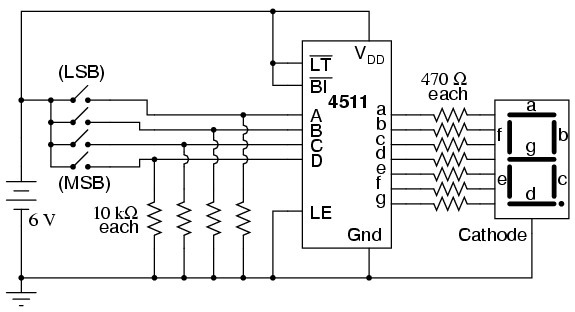
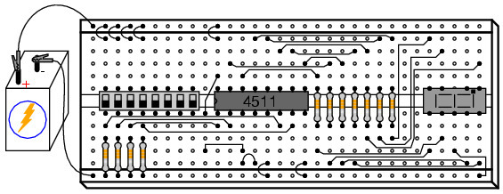

Archive notes from AllAboutCircuits' "7-segment display" experiment article and from the breadboard and display explanations quoted in the web notebook "SDD" dated 6 September 2006. The sources are cited in the texts as AllAboutCircuits, Iguana Labs, Play-Hookey and Doctronics. The files were saved to the archive in 2006. The related text dumps can be downloaded at the end of the post; photographs, datasheets and software advertisements were not transferred.

*Note: This content belongs to a third-party source; it is shared for archival and nostalgic purposes with the source cited. It will be removed at the request of the rights holder.*

## Breadboard connections

Under the holes on a breadboard there are conductive strips. Holes connected to the same strip form a common electrical node. Components are connected to one another through these nodes and jumper wires. The long side rails are usually reserved for supply lines.

A multi-pin DIP integrated circuit is placed across the center gap, so that the pins on the two sides remain in separate connection groups. The source's purpose is to show that two physically adjacent holes are not necessarily connected, and that the connection is established according to the layout of the internal metal strips.

## Seven-segment display

The segments are named with the letters a–g; g is the middle bar. The decimal point may be a separate LED. In a common-cathode display, the LED cathodes are tied together; in a common-anode display, the anodes are tied together. The driver and the display type must be chosen to be compatible.

The AllAboutCircuits experiment uses a 4511 BCD-to-7-segment latch/decoder/driver and a common-cathode display. The A, B, C, D inputs are ordered from the least significant bit to the most significant bit. The outputs drive the a–g segments.

## Experiment materials

- 4511 decoder and a common-cathode seven-segment LED display.
- Eight-position DIP switch.
- Four 10 kΩ resistors.
- Seven 470 Ω segment resistors.
- A 6 V battery in the source's circuit.

Each segment has its own series resistor. The inputs 0000–1001 display the digits 0–9, respectively. The combinations 1010–1111 are not valid single-digit BCD numbers; the experiment asks you to observe what is displayed for these inputs.

## Control inputs

LT (lamp test) and BI (blanking input) are active-low: to invoke the corresponding function, the input is set to 0. LE (latch enable) is active-high. Switching LE between the 0 and 1 states shows whether the display follows the inputs or holds the previous value while the BCD switches are being changed.

The Doctronics explanation in the SDD compilation likewise states that the 4511 is designed for a common-cathode display and that the same connection cannot be used with a common-anode display. The Play-Hookey excerpt explains display packages and segment layout.

## Other electronics connections in the compilation

The SDD page also contains LED driving, 555 astable timer and JK flip-flop connections. The 555 calculator tool is intended to compute the high/low times, period, frequency and duty cycle from the R1, R2 and C1 inputs. The JK explanation discusses how the inputs determine the next state. The PHP, Moodle and .NET promotions at the end of the compilation were not included in this post, since they are unrelated to the course content.

## Connection diagrams

