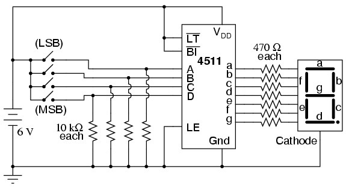
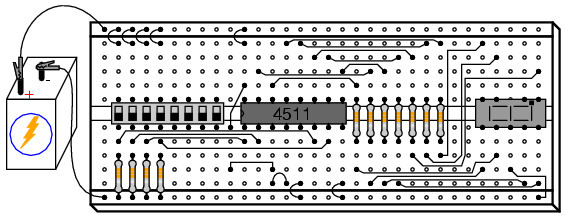

AllAboutCircuits'in “7-segment display” deney yazısı ile 6 Eylül 2006 tarihli “SDD” web not defterinde alıntılanan breadboard ve gösterge açıklamalarından arşiv notları. Kaynaklar AllAboutCircuits, Iguana Labs, Play-Hookey ve Doctronics olarak metinlerde belirtiliyor. Dosyaların arşive kaydedilme yılı 2006. İlgili metin dökümleri yazının sonunda indirilebilir; fotoğraflar, veri sayfaları ve yazılım reklamları aktarılmadı.

*Bu içerik üçüncü taraf bir kaynağa aittir; arşiv ve nostalji amacıyla kaynak belirtilerek paylaşılmıştır. Hak sahibinin talebi hâlinde kaldırılır.*

## Breadboard bağlantıları

Breadboard üzerindeki deliklerin altında iletken şeritler bulunur. Aynı şeride bağlı delikler ortak bir elektriksel düğüm oluşturur. Bileşenler bu düğümler ve atlama telleriyle birbirine bağlanır. Uzun yan sıralar genellikle besleme hatları için ayrılır.

Çok bacaklı DIP tümdevre orta yarığın üzerine yerleştirilir; böylece iki taraftaki bacaklar ayrı bağlantı gruplarında kalır. Kaynağın amacı, fiziksel olarak yakın iki deliğin mutlaka bağlı olmadığı ve bağlantının iç metal şerit düzenine göre kurulduğunu göstermektir.

## Yedi parçalı gösterge

Segmentler a–g harfleriyle adlandırılır; g orta çizgidir. Ondalık nokta ayrı bir LED olabilir. Ortak katotlu göstergede LED katotları, ortak anotluda anotları birleştirilir. Sürücü ile gösterge türünün uyumlu seçilmesi gerekir.

AllAboutCircuits deneyi 4511 BCD-to-7-segment latch/decoder/driver ve ortak katotlu gösterge kullanır. A, B, C, D girişleri en düşük anlamlı bitten en yüksek anlamlı bite sıralanır. Çıkışlar a–g segmentlerini sürer.

## Deney malzemeleri

- 4511 kod çözücü ve ortak katotlu yedi parçalı LED gösterge.
- Sekiz konumlu DIP anahtar.
- Dört adet 10 kΩ direnç.
- Yedi adet 470 Ω segment direnci.
- Kaynağın devresinde 6 V pil.

Her segmentin kendi seri direnci bulunur. 0000–1001 girişleri sırasıyla 0–9 rakamlarını gösterir. 1010–1111 birleşimleri geçerli tek basamaklı BCD sayıları değildir; deney bu girişlerde ne görüldüğünün gözlenmesini ister.

## Kontrol girişleri

LT (lamp test) ve BI (blanking input) etkin-düşüktür: ilgili işlevi çağırmak için giriş 0 yapılır. LE (latch enable) etkin-yüksektir. LE'nin 0 ve 1 durumları arasında değiştirilmesi, BCD anahtarları oynatılırken göstergenin girişleri izleme veya önceki değeri saklama davranışını gösterir.

SDD derlemesindeki Doctronics açıklaması da 4511'in ortak katotlu gösterge için tasarlandığını, ortak anotlu göstergeyle aynı bağlantının kullanılamayacağını belirtir. Play-Hookey alıntısı gösterge paketleri ve segment yerleşimini açıklar.

## Derlemedeki diğer elektronik bağlantıları

SDD sayfasında ayrıca LED sürme, 555 astable zamanlayıcı ve JK flip-flop bağlantıları vardır. 555 hesap aracında R1, R2 ve C1 girişlerinden yüksek/düşük süre, periyot, frekans ve görev oranı hesaplanması amaçlanır. JK açıklaması, girişlerin sonraki durumu nasıl belirlediğini tartışır. Derlemenin sonundaki PHP, Moodle ve .NET tanıtımları ders içeriğiyle ilgili olmadığından bu yazıya alınmadı.

## Bağlantı çizimleri

