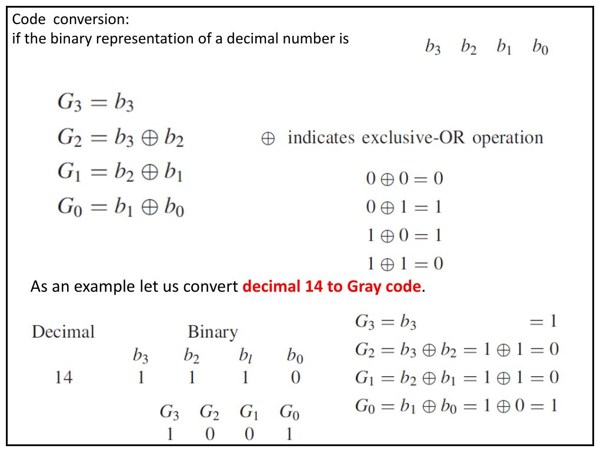
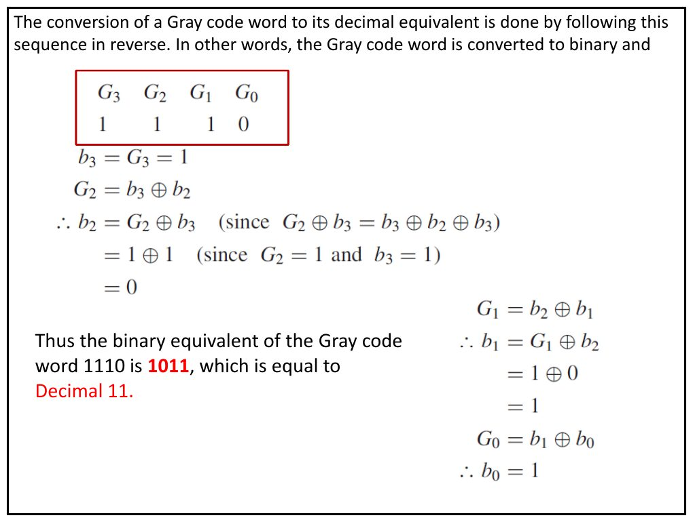

This post covers the lecture slides of the **EEM211 Digital Logic Design** course at Başkent University, dated 5 October 2012 (the PDF's author information names the course instructor, Hamit Erdem). The nine-slide presentation covers two topics: **binary codes and the Gray code**, followed by **the basic theorems of Boolean algebra**. The slides are in English; the tables and formulas are given below as text. The original PDF of the slides can be downloaded at the end of the post.

## Binary-coded decimal (BCD) codes

The first slide of the presentation shows, side by side, different ways of encoding a decimal digit with four bits.

| Decimal digit | (BCD) 8421 | Excess-3 | 84-2-1 | 2421 |
|---|---|---|---|---|
| 0 | 0000 | 0011 | 0000 | 0000 |
| 1 | 0001 | 0100 | 0111 | 0001 |
| 2 | 0010 | 0101 | 0110 | 0010 |
| 3 | 0011 | 0110 | 0101 | 0011 |
| 4 | 0100 | 0111 | 0100 | 0100 |
| 5 | 0101 | 1000 | 1011 | 1011 |
| 6 | 0110 | 1001 | 1010 | 1100 |
| 7 | 0111 | 1010 | 1001 | 1101 |
| 8 | 1000 | 1011 | 1000 | 1110 |
| 9 | 1001 | 1100 | 1111 | 1111 |

## Gray code

In the Gray code, only **one bit** changes between two consecutive numbers. The first table in the slides ("Three bit Gray code") gives a cyclic code for the decimal digits 0–9; the second table shows the four-bit Gray code.

| Decimal | Cyclic |
|---|---|
| 0 | 0000 |
| 1 | 0001 |
| 2 | 0011 |
| 3 | 0010 |
| 4 | 0110 |
| 5 | 0100 |
| 6 | 1100 |
| 7 | 1110 |
| 8 | 1010 |
| 9 | 1000 |

*Note: Although the slide title is "Three bit Gray code", the code words in the table are four bits long. Also, this table is not the standard (reflected) Gray code but a cyclic code for the digits 0–9: adjacent rows (including the wrap-around from 9 to 0) differ in a single bit, but, for example, the standard Gray equivalent of 5 is 0111.*

| Decimal | Binary | Gray |
|---|---|---|
| 0 | 0000 | 0000 |
| 1 | 0001 | 0001 |
| 2 | 0010 | 0011 |
| 3 | 0011 | 0010 |
| 4 | 0100 | 0110 |
| 5 | 0101 | 0111 |
| 6 | 0110 | 0101 |
| 7 | 0111 | 0100 |
| 8 | 1000 | 1100 |
| 9 | 1001 | 1101 |
| 10 | 1010 | 1111 |
| 11 | 1011 | 1110 |
| 12 | 1100 | 1010 |
| 13 | 1101 | 1011 |
| 14 | 1110 | 1001 |
| 15 | 1111 | 1000 |

> Except for the most significant bit position, all columns are "reflected" about the midpoint; in the most significant bit position, the top half is all 0's and the bottom half all 1's.

In other words, except for the most significant bit, all columns are "reflected" about the middle of the table; in the most significant bit column, the upper half is all 0's and the lower half is all 1's.

## Binary-to-Gray code conversion

> A decimal number can be converted to Gray code by first converting it to binary. The binary number is converted to the Gray code by performing a modulo-2 sum of each digit (starting with the least significant digit) with its adjacent digit.

The decimal number is first converted to binary; then each bit, starting from the least significant bit, is modulo-2 added (XORed) with its neighbor. If the binary representation of the number is b3 b2 b1 b0:

- G3 = b3
- G2 = b3 ⊕ b2
- G1 = b2 ⊕ b1
- G0 = b1 ⊕ b0

Here ⊕ is the exclusive-OR operation: 0 ⊕ 0 = 0, 0 ⊕ 1 = 1, 1 ⊕ 0 = 1, 1 ⊕ 1 = 0.

**Example: converting decimal 14 to Gray code.** 14 = (1110)₂, i.e. b3 = 1, b2 = 1, b1 = 1, b0 = 0.

- G3 = b3 = 1
- G2 = b3 ⊕ b2 = 1 ⊕ 1 = 0
- G1 = b2 ⊕ b1 = 1 ⊕ 1 = 0
- G0 = b1 ⊕ b0 = 1 ⊕ 0 = 1

Result: the Gray code of 14 is **1001**.

## Gray-to-binary code conversion

> The conversion of a Gray code word to its decimal equivalent is done by following this sequence in reverse. In other words, the Gray code word is converted to binary and …

The Gray code is first converted to binary. This time, each binary bit is the XOR of the *binary* bit one position above it and the Gray bit at that position. Example: Gray code G3 G2 G1 G0 = 1110.

- b3 = G3 = 1
- Since G2 = b3 ⊕ b2, b2 = G2 ⊕ b3 (because G2 ⊕ b3 = b3 ⊕ b2 ⊕ b3) = 1 ⊕ 1 = 0
- Since G1 = b2 ⊕ b1, b1 = G1 ⊕ b2 = 1 ⊕ 0 = 1
- Since G0 = b1 ⊕ b0, b0 = G0 ⊕ b1 = 0 ⊕ 1 = 1

Result: the binary equivalent of Gray code 1110 is **1011**, i.e. decimal **11**.

## Single-variable theorems

| With constants | With a variable |
|---|---|
| 0 · 0 = 0 | x · 0 = 0 |
| 1 + 1 = 1 | x + 1 = 1 |
| 1 · 1 = 1 | x · 1 = x |
| 0 + 0 = 0 | x + 0 = x |
| 0 · 1 = 1 · 0 = 0 | x · x = x |
| 1 + 0 = 0 + 1 = 1 | x + x = x |
| If x = 0 then x' = 1 | x · x' = 0 |
| If x = 1 then x' = 0 | x + x' = 1 |
| | (x')' = x |

## Commutative, associative, distributive and absorption laws

| Property | Expressions |
|---|---|
| Commutative | x · y = y · x; x + y = y + x |
| Associative | x · (y · z) = (x · y) · z; x + (y + z) = (x + y) + z |
| Distributive | x · (y + z) = x · y + x · z; x + y · z = (x + y) · (x + z) |
| Absorption | x + x · y = x |

## Boolean algebra postulates and theorems (Table 2.2)

Each expression is given alongside its dual: the dual is obtained by interchanging + and · and interchanging 0 and 1.

| | Expression | Dual |
|---|---|---|
| P2 | a + 0 = a | a · 1 = a |
| P3 | a + b = b + a | ab = ba |
| P4 | a + (b + c) = (a + b) + c | a(bc) = (ab)c |
| P5 | a + bc = (a + b)(a + c) | a(b + c) = ab + ac |
| P6 | a + a' = 1 | a · a' = 0 |
| T1 | a + a = a | a · a = a |
| T2 | a + 1 = 1 | a · 0 = 0 |
| T3 | (a')' = a | |
| T4 | a + ab = a | a(a + b) = a |
| T5 | a + a'b = a + b | a(a' + b) = ab |
| T6 | ab + ab' = a | (a + b)(a + b') = a |
| T7 | ab + ab'c = ab + ac | (a + b)(a + b' + c) = (a + b)(a + c) |
| T8 | (a + b)' = a'b' | (ab)' = a' + b' |
| T9 | ab + a'c + bc = ab + a'c | (a + b)(a' + c)(b + c) = (a + b)(a' + c) |
| T10 | f(x1, x2, …, xn) = x1 · f(1, x2, …, xn) + x1' · f(0, x2, …, xn) | f(x1, x2, …, xn) = [x1 + f(0, x2, …, xn)] · [x1' + f(1, x2, …, xn)] |

## Combining, De Morgan's and consensus theorems

**Combining:**

- x · (x + y) = x
- x · y + x · y' = x
- (x + y) · (x + y') = x

**De Morgan's theorem:**

- (x · y)' = x' + y'
- (x + y)' = x' · y'

**Consensus:**

- x + x' · y = x + y
- x · (x' + y) = x · y
- x · y + y · z + x' · z = x · y + x' · z
- (x + y) · (y + z) · (x' + z) = (x + y) · (x' + z)
