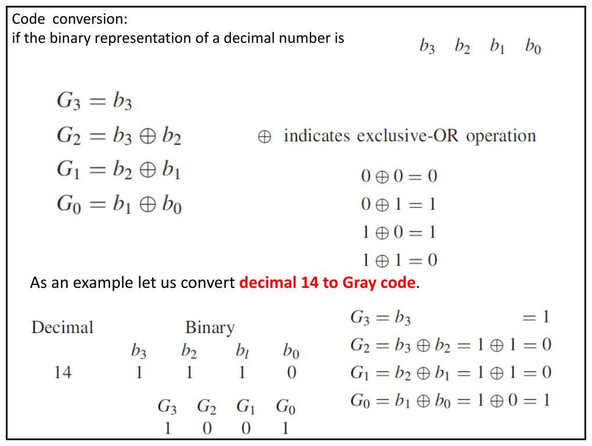
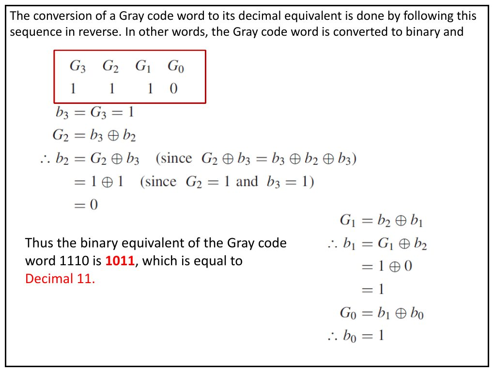

Bu yazı, Başkent Üniversitesi **EEM211 Sayısal Mantık Tasarımı** dersinin 5 Ekim 2012 tarihli sunusudur (PDF'in yazar bilgisinde dersin hocası Hamit Erdem'in adı geçiyor). Dokuz slaytlık sunu iki konuyu kapsıyor: **ikili kodlar ve Gray kodu**, ardından **Boole cebrinin temel teoremleri**. Slaytlar İngilizce; tablolar ve formüller aşağıda metin olarak verildi. Sununun orijinal PDF'i yazının sonunda indirilebilir.

## İkili kodlanmış ondalık (BCD) kodlar

Sununun ilk slaytı, bir ondalık basamağın dört bitle kodlanmasının farklı yollarını yan yana veriyor.

| Decimal digit | (BCD) 8421 | Excess-3 | 84-2-1 | 2421 |
|---|---|---|---|---|
| 0 | 0000 | 0011 | 0000 | 0000 |
| 1 | 0001 | 0100 | 0111 | 0001 |
| 2 | 0010 | 0101 | 0110 | 0010 |
| 3 | 0011 | 0110 | 0101 | 0011 |
| 4 | 0100 | 0111 | 0100 | 0100 |
| 5 | 0101 | 1000 | 1011 | 1011 |
| 6 | 0110 | 1001 | 1010 | 1100 |
| 7 | 0111 | 1010 | 1001 | 1101 |
| 8 | 1000 | 1011 | 1000 | 1110 |
| 9 | 1001 | 1100 | 1111 | 1111 |

## Gray kodu

Gray kodunda ardışık iki sayı arasında yalnızca **bir bit** değişir. Sunudaki ilk tablo ("Three bit Gray code") 0–9 arası ondalık basamaklar için bir döngüsel (cyclic) kod veriyor; ikinci tablo dört bitlik Gray kodunu gösteriyor.

| Decimal | Cyclic |
|---|---|
| 0 | 0000 |
| 1 | 0001 |
| 2 | 0011 |
| 3 | 0010 |
| 4 | 0110 |
| 5 | 0100 |
| 6 | 1100 |
| 7 | 1110 |
| 8 | 1010 |
| 9 | 1000 |

*Not: Slayt başlığı "Three bit Gray code" olsa da tablodaki kod sözcükleri dört bitliktir. Ayrıca bu tablo standart (yansıtılmış) Gray kodu değil, 0–9 basamakları için bir döngüsel koddur: komşu satırlar (9'dan 0'a dönüş dahil) tek bit farklıdır, ama örneğin 5'in standart Gray karşılığı 0111'dir.*

| Decimal | Binary | Gray |
|---|---|---|
| 0 | 0000 | 0000 |
| 1 | 0001 | 0001 |
| 2 | 0010 | 0011 |
| 3 | 0011 | 0010 |
| 4 | 0100 | 0110 |
| 5 | 0101 | 0111 |
| 6 | 0110 | 0101 |
| 7 | 0111 | 0100 |
| 8 | 1000 | 1100 |
| 9 | 1001 | 1101 |
| 10 | 1010 | 1111 |
| 11 | 1011 | 1110 |
| 12 | 1100 | 1010 |
| 13 | 1101 | 1011 |
| 14 | 1110 | 1001 |
| 15 | 1111 | 1000 |

> Except for the most significant bit position, all columns are "reflected" about the midpoint; in the most significant bit position, the top half is all 0's and the bottom half all 1's.

Yani en anlamlı bit dışında bütün sütunlar tablonun ortasına göre "yansıtılmıştır"; en anlamlı bit sütununda üst yarı tamamen 0, alt yarı tamamen 1'dir.

## İkiliden Gray koduna dönüşüm

> A decimal number can be converted to Gray code by first converting it to binary. The binary number is converted to the Gray code by performing a modulo-2 sum of each digit (starting with the least significant digit) with its adjacent digit.

Ondalık sayı önce ikiliye çevrilir; sonra her bit, en anlamsız bitten başlayarak komşusuyla modulo-2 toplanır (XOR). Sayının ikili gösterimi b3 b2 b1 b0 ise:

- G3 = b3
- G2 = b3 ⊕ b2
- G1 = b2 ⊕ b1
- G0 = b1 ⊕ b0

Burada ⊕ özel VEYA (exclusive-OR) işlemidir: 0 ⊕ 0 = 0, 0 ⊕ 1 = 1, 1 ⊕ 0 = 1, 1 ⊕ 1 = 0.

**Örnek: ondalık 14'ü Gray koduna çevirmek.** 14 = (1110)₂, yani b3 = 1, b2 = 1, b1 = 1, b0 = 0.

- G3 = b3 = 1
- G2 = b3 ⊕ b2 = 1 ⊕ 1 = 0
- G1 = b2 ⊕ b1 = 1 ⊕ 1 = 0
- G0 = b1 ⊕ b0 = 1 ⊕ 0 = 1

Sonuç: 14'ün Gray kodu **1001**.

## Gray kodundan ikiliye dönüşüm

> The conversion of a Gray code word to its decimal equivalent is done by following this sequence in reverse. In other words, the Gray code word is converted to binary and …

Gray kodu önce ikiliye çevrilir. Bu kez her ikili bit, bir üstteki *ikili* bit ile o konumdaki Gray bitinin XOR'udur. Örnek: Gray kodu G3 G2 G1 G0 = 1110.

- b3 = G3 = 1
- G2 = b3 ⊕ b2 olduğundan b2 = G2 ⊕ b3 (çünkü G2 ⊕ b3 = b3 ⊕ b2 ⊕ b3) = 1 ⊕ 1 = 0
- G1 = b2 ⊕ b1 olduğundan b1 = G1 ⊕ b2 = 1 ⊕ 0 = 1
- G0 = b1 ⊕ b0 olduğundan b0 = G0 ⊕ b1 = 0 ⊕ 1 = 1

Sonuç: Gray kodu 1110'un ikili karşılığı **1011**, yani ondalık **11**.

## Tek değişkenli teoremler

| Sabitlerle | Bir değişkenle |
|---|---|
| 0 · 0 = 0 | x · 0 = 0 |
| 1 + 1 = 1 | x + 1 = 1 |
| 1 · 1 = 1 | x · 1 = x |
| 0 + 0 = 0 | x + 0 = x |
| 0 · 1 = 1 · 0 = 0 | x · x = x |
| 1 + 0 = 0 + 1 = 1 | x + x = x |
| x = 0 ise x' = 1 | x · x' = 0 |
| x = 1 ise x' = 0 | x + x' = 1 |
| | (x')' = x |

## Değişme, birleşme, dağılma ve yutma

| Özellik | İfadeler |
|---|---|
| Commutative (değişme) | x · y = y · x; x + y = y + x |
| Associative (birleşme) | x · (y · z) = (x · y) · z; x + (y + z) = (x + y) + z |
| Distributive (dağılma) | x · (y + z) = x · y + x · z; x + y · z = (x + y) · (x + z) |
| Absorption (yutma) | x + x · y = x |

## Boole cebri postülaları ve teoremleri (Tablo 2.2)

Her ifadenin yanında ikizi (dual) verilmiştir: ikiz, + ile · ve 0 ile 1 yer değiştirilerek elde edilir.

| | Expression | Dual |
|---|---|---|
| P2 | a + 0 = a | a · 1 = a |
| P3 | a + b = b + a | ab = ba |
| P4 | a + (b + c) = (a + b) + c | a(bc) = (ab)c |
| P5 | a + bc = (a + b)(a + c) | a(b + c) = ab + ac |
| P6 | a + a' = 1 | a · a' = 0 |
| T1 | a + a = a | a · a = a |
| T2 | a + 1 = 1 | a · 0 = 0 |
| T3 | (a')' = a | |
| T4 | a + ab = a | a(a + b) = a |
| T5 | a + a'b = a + b | a(a' + b) = ab |
| T6 | ab + ab' = a | (a + b)(a + b') = a |
| T7 | ab + ab'c = ab + ac | (a + b)(a + b' + c) = (a + b)(a + c) |
| T8 | (a + b)' = a'b' | (ab)' = a' + b' |
| T9 | ab + a'c + bc = ab + a'c | (a + b)(a' + c)(b + c) = (a + b)(a' + c) |
| T10 | f(x1, x2, …, xn) = x1 · f(1, x2, …, xn) + x1' · f(0, x2, …, xn) | f(x1, x2, …, xn) = [x1 + f(0, x2, …, xn)] · [x1' + f(1, x2, …, xn)] |

## Birleştirme, De Morgan ve uzlaşma teoremleri

**Combining (birleştirme):**

- x · (x + y) = x
- x · y + x · y' = x
- (x + y) · (x + y') = x

**De Morgan teoremi:**

- (x · y)' = x' + y'
- (x + y)' = x' · y'

**Consensus (uzlaşma):**

- x + x' · y = x + y
- x · (x' + y) = x · y
- x · y + y · z + x' · z = x · y + x' · z
- (x + y) · (y + z) · (x' + z) = (x + y) · (x' + z)
