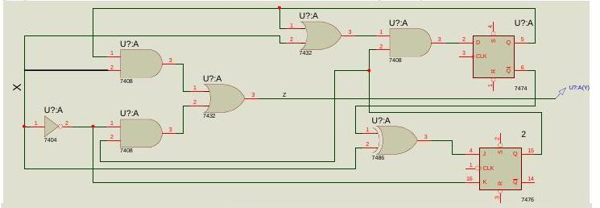
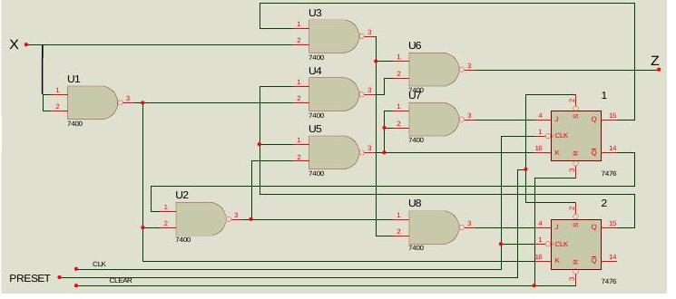

This post presents two English-language lab sheets found in the lab folder of the EEM211 Digital Logic Design course: **Experiment 3: Sequential Circuit Analysis** (November 2009 update) and **Experiment 4: Sequence Detector Analysis** (October 2009 update) from the **Istanbul Kültür University (IKÜ) Department of Electronics Engineering, Logic Circuits II LAB** course. The experiments are built on a breadboard with TTL ICs (7476, 7400, 7402), and the preliminary work is simulated in Proteus. Since the lab sheets are in English, their content has been left in English. The original Word files can be downloaded as a ZIP at the end of the post.

*Note: This content belongs to a third-party source; it is shared for archival and nostalgic purposes with attribution to the source. It will be removed at the request of the rights holder.*

## Experiment 3: Sequential circuit analysis

**Objectives:** Understanding synchronous sequential circuit analysis, Moore and Mealy machines, time diagrams, hazardous and non-hazardous faulty outputs, IC optimization.

**Introduction:** The aim of logic design is to minimize the number of memory elements and minimal-input-span gates. At realization level we have to use commercially available SSI elements. Normally, there exist two memory elements or four two-input gates within each commercially available SSI. Therefore SSIC minimizations are required as well as memory and gate minimization. The logic circuits given in Figure 1 and Figure 2 are equivalent. The first one requires a total of six SSI components: one for the D FF, one for the JK FF, one for EXOR, one for AND and one for OR gates. The second one requires only three SSI components: one for the JK FFs and two for NAND gates. This means three SSI components will be adequate instead of six.





**Preliminary work:** Find the state diagram for the logic circuit given in Figure 2. Simulate this circuit on Proteus for the inputs given on the report page and also for the verification of the state diagram you found.

**Procedure:**

1. Realize the circuit given in Figure 2 on the breadboard.
1. 7476 and 7408 data sheets are available on the course web page.
1. Do not forget power and ground connections.
1. Use standard switches (TTL SWT) for R, S control inputs as required.
1. Use a negative pulsar switch for the clock input.
1. Use LEDs for states and z output observation.
1. Complete the time diagrams of Q1Q2 states and z output for the initial states 00 and 11.

Required components: one 7476 JK FF IC and two 7400 NAND ICs.

**Report questions:**

1. Explain why the circuits given in Figures 1 and 2 are equivalent.
1. How many different output sequences can we observe for the same given input sequence? Why?
1. Why do we observe faulty outputs in this circuit?
1. In which time interval could we observe faulty outputs? Why?
1. In order to see non-hazardous faulty outputs only, what would you do? Why? (Hint: additional FF)
1. Find an initial state and input sequence which gives a hazardous faulty (0) output. Repeat this for hazardous faulty (1).

## Experiment 4: Sequence detector analysis

**Objectives:** Understanding Mealy and Moore machine analysis of a sequence detector and comparing the results.

**Introduction:** A three-input-length (010) sequence detector (as a Moore and also as a Mealy machine) will be examined.

**Preliminary work:** We wish to design a circuit which detects separate (010) sequences in a string of bits coming through an input line (i.e., the input is a serial bit stream). Once the (010) sequence is detected, the output becomes 1, otherwise it stays 0. The first bit coming to the input is the one on the left:

```
Example input stream:  00100101010010
Example output stream: 00010010001001
```

Before coming to the lab, find the state diagrams of this sequence detector a) as a Mealy machine, b) as a Moore machine, and simulate both realizations on Proteus for the example input stream. (In the lab sheet, the circuit diagram of the two realizations is given as an image; this image is not visible when the Word file is converted.)

*Note: In keeping with the word "separate," overlapping sequences are not counted in the example: after the 010 at bits 5–7 is detected, the 010 at bits 7–9, which shares bit 7, is not counted; the next detection is at bits 9–11. The example output was checked against this rule and is correct.*

**Procedure:**

1. Set up the given Mealy machine on your board.
1. Do not forget power and ground connections.
1. Use standard switches (TTL SWT) for preset and clear control inputs as required.
1. Use a standard switch (TTL SWT) for the x input.
1. Use a negative pulsar switch for the clock input.
1. Use LEDs for states and z output observation.
1. Verify your Mealy machine realization on the breadboard with the state diagram you found in the prelab work.
1. Apply the sample input bit stream and observe the output stream. Compare your results with the Proteus graphical result.
1. Draw time diagrams for the x input, the y1, y2 state variables and the z output.

Attention: for each input there should be a clock pulse; the initial state 00 should be arranged with the preset and clear inputs, and the example input stream applied right after the initial state. Required components: 7476 JK FF, 7402 NOR gates IC.

*Note: The lab sheet says "in this case 13 clock pulses are required"; since the example input sequence is 14 bits long, 14 pulses are required.*

**Report questions:**

1. Could there be any unexpected faulty output at the output bit stream of the Mealy machine you realized? a) If yes, give an input sequence which gives an unexpected (hazardous) faulty output (hazardous faulty output). b) If no, is it worth choosing the Moore realization instead of Mealy?
1. If you change the chosen state assignment with another one, will you still have a valid design? Why?
1. How would a state assignment change affect a sequential design? Does it affect the number of FFs? Why?
1. Could we choose any state as the initial state? Why?
1. Can we say a Moore machine is always preferable since there won't be any false outputs?
