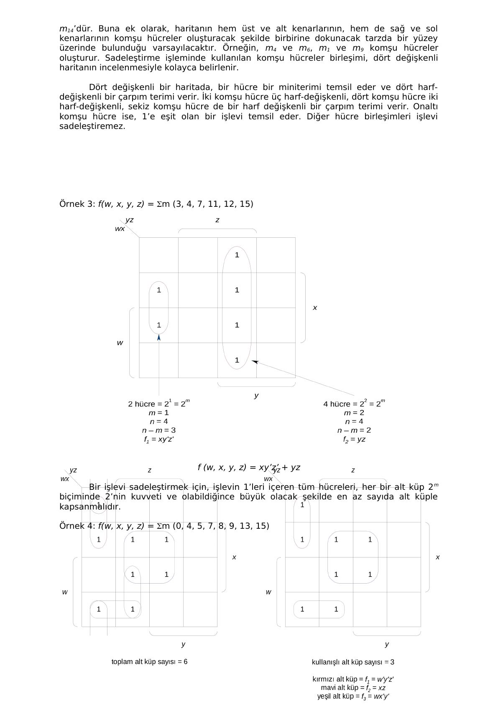
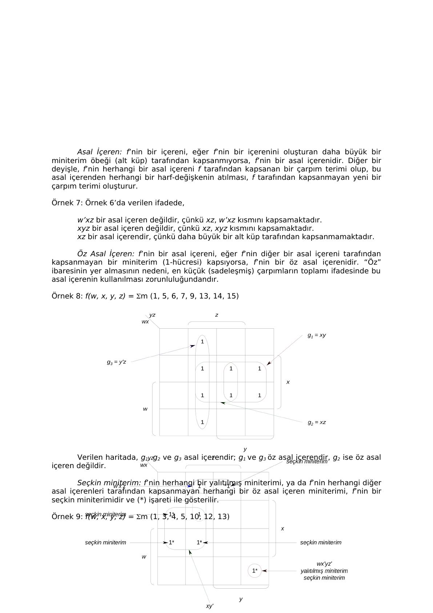
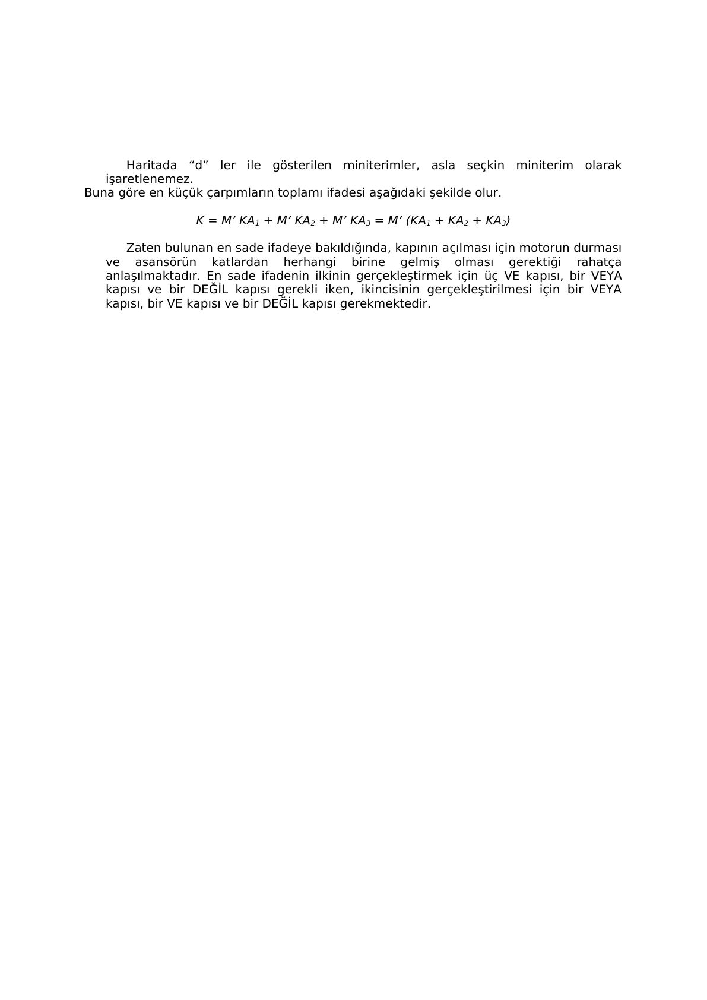

This post is a 12-page Turkish-language lecture note found in the folder of the EEM211 Digital Logic Design course: **"The Karnaugh Map Technique for Simplifying Boolean Functions"**. The author information of the Word document lists the name **Orhan Tuncoz**; the document does not state which institution it was prepared for or when. The text of the note is reproduced below; the pages needed for the map drawings are included as images. The original Word file can be downloaded at the end of the post.

*This content belongs to a third-party source; it is shared for archival and nostalgic purposes with the source credited. It will be removed upon the request of the rights holder.*

## Why simplification?

When evaluating the qualities of a logic circuit during its design, many factors must be taken into account. The most important of these is **cost**: the cost of the components, the design, the installation, and the maintenance. The **reliability** of the circuit (ensured with highly reliable components or redundancy techniques) and its **response time** to changes at the inputs are also important. These three factors are not independent of one another, and there is no single simple design method that achieves all of them at once.

To keep the response time to a minimum, the number of logic levels a signal has to pass through should be reduced. Since every combinational circuit can be described by a canonical formula, under the assumption that both the variables and their complements are available at the input (double-rail logic), every logic circuit can be built with at most **two levels**. For this reason, interest is restricted to normal forms (sum of products, product of sums).

The **component cost** of a normal form can be measured in two ways:

- **Number of gates:** one more than the number of terms in the expression that contain more than one literal (1 if there is a single term).
- **Number of gate inputs:** the number of literals + the number of terms containing more than one literal (only the number of literals if there is a single term).

The problems with algebraic simplification are as follows: there is no specific method to follow; it relies largely on experience; it cannot be certain that the result is the simplest expression; and with more than four or five variables, algebraic manipulations become very difficult and mistakes can be made. The systematic methods used instead are the **Karnaugh map**, **iterated consensus**, and the **Quine-McCluskey tabular method**. The note covers the Karnaugh map up to four variables.

## Karnaugh map

The map method can be thought of as a diagrammatic representation of a truth table. It was first proposed by **E. W. Veitch** and later slightly modified by **M. Karnaugh**; for this reason it is called the "Veitch diagram" or the "Karnaugh map". The map consists of squares (cells); each cell represents a minterm (or maxterm). An n-variable map has 2ⁿ cells.

### Definitions

- **Mod-2 addition (⊕):** 0 ⊕ 0 = 0, 0 ⊕ 1 = 1, 1 ⊕ 0 = 1, 1 ⊕ 1 = 0.
- **Hamming distance:** For binary numbers A = a₁a₂…a_k and B = b₁b₂…b_k, H = Σ (aᵢ ⊕ bᵢ), that is, the number of differing bits (the result is a decimal number). In the note's example, the distance between 10101 and 10011 is 1 + 0 + 0 + 1 + 1 = 3, and the distance between 101010 and 101110 is 1.
- **Adjacent (neighboring) cells:** cells whose Hamming distance is 1, that is, cells that differ in only one bit. In an n-variable map, every cell has n neighbors.
- **Subcube:** a set of 2ᵐ cells in which each cell is adjacent to m others in the set. In an n-variable map, a subcube of order m is expressed by a product term with n − m literals.

### One-, two-, three-, and four-variable maps

- **One-variable map:** two minterms (x' and x). Since n variables can produce 2^(2ⁿ) different Boolean functions, there are four functions with one variable: f = 0, f = 1, f = x, f = x'.
- **Two-variable map:** four minterms, sixteen different functions. x is on the rows, y on the columns; in row/column 0 the variable appears complemented, and in 1 it appears in normal form.
- **Three-variable map:** eight minterms. The columns are in the order 00, 01, 11, 10 (Gray order): only one bit changes between adjacent columns. For example, cell m6 is in row 1, column 10 (110 = 6). Two minterms in adjacent cells simplify to a single term: m5 + m7 = xy'z + xyz = xz(y + y') = xz. The neighbors of m3 are m1, m2, and m7.
- **Four-variable map:** sixteen minterms. The neighbors of m15 are m7, m11, m13, and m14. The top-bottom and left-right edges of the map are considered to touch each other: m4 and m6, and m1 and m9, are adjacent. One cell gives a four-literal term, two adjacent cells give a three-literal term, four adjacent cells give a two-literal term, eight adjacent cells give a one-literal term; sixteen cells mean f = 1.

The note's examples: f(x, y, z) = Σm(2, 3, 6, 7) (a four-cell subcube, f = y); f(w, x, y, z) = Σm(3, 4, 7, 11, 12, 15) = xy'z' + yz; f(w, x, y, z) = Σm(0, 4, 5, 7, 8, 9, 13, 15) and f(x, y, z) = Σm(0, 2, 3, 4, 5, 7), which has two different minimal solutions.

To simplify a function, all cells containing 1 must be covered by as few subcubes as possible, each having 2ᵐ cells and being as large as possible. In simplification with a map, the minimal expression is not necessarily unique.

## Prime implicants

- **Implicant:** For a function f in sum-of-products form, a product term g is an implicant of f if f = 1 for every input for which g = 1. Every term in a sum of products is an implicant of the function.
- **Prime implicant:** An implicant that is not covered by a larger subcube; if a literal is removed from it, a term that is not covered by f is obtained. For example, for f = Σm(5, 7, 13, 15), w'xz and xyz are not prime implicants (xz covers both); xz is a prime implicant.
- **Essential prime implicant:** A prime implicant that covers at least one 1-cell that no other prime implicant covers; it must appear in the minimal expression. In the example f = Σm(1, 5, 6, 7, 9, 13, 14, 15), g1, g2, g3 are prime implicants; g1 and g3 are essential prime implicants, g2 is not.
- **Distinguished minterm:** An isolated minterm, or a minterm of an essential prime implicant that no other prime implicant covers; it is marked with (*) on the map.

Example: f(w, x, y, z) = Σm(1, 3, 4, 5, 10, 12, 13).

- Implicants: wx'yz', w'x'z, w'y'z, w'xy', wxy', xy'z', xy'z, and all minterms.
- Prime implicants: wx'yz', w'x'z, w'y'z, xy'.
- Essential prime implicants: wx'yz', w'x'z, xy'.
- Minimal sum of products: f = wx'yz' + w'x'z + xy'.

The set of prime implicants of a function is unique, but not all of them are necessarily needed for the minimal expression. For example, for f(x, y, z) = Σm(2, 3, 5, 7), x'y, yz, and xz are prime implicants; x'y and xz are essential, and yz is redundant. This can also be seen with the consensus theorem: in the expression x'y + yz + xz, yz is the consensus term, so f = x'y + xz. Similarly, for f(w, x, y, z) = Σm(1, 5, 6, 7, 11, 12, 13, 15), the prime implicants are w'y'z, wxy', w'xy, wyz, and xz'; xz is redundant and f = w'y'z + wxy' + w'xy + wyz.

### Method for finding the minimal sum of products

1. Find and list all prime implicants and essential prime implicants of the function.
1. Add all essential prime implicants to the minimal sum of products.
1. Remove from the list the prime implicants whose 1-cells are covered by the essential prime implicants.
1. If all 1-cells of the function are covered, the expression found is unique.
1. Otherwise, select additional prime implicants so as to cover the function completely.
1. Keep in mind that the minimal sum of products of a function is not always unique.

## Don't cares

Some input combinations never occur; for example, in the four-bit BCD code, the six combinations from 10 to 15 are not used. What the output will be for these combinations is immaterial, and they can be used in simplification. On the map they are marked not with 1 or 0 but with "d". When selecting subcubes, d's are treated as 1 if they help and as 0 if they do not; a d that does not contribute to enlarging a subcube need not be used at all.

### Example: elevator door control

A circuit is to be designed to control the elevator door in a three-story building. Inputs: the elevator motor M (1: moving, 0: stopped) and the floor sensors KA1, KA2, KA3 (normally 0, becoming 1 when the elevator is level with that floor). Output K opens the door (normally 0, becoming 1 when the elevator reaches the desired floor).

- Since the elevator cannot be level with more than one floor at the same time, the cases in which more than one sensor is 1 are impossible and are marked with "d" (eight rows).
- When M = 1, the elevator is moving, so K = 0 must hold; otherwise it is dangerous for human safety.
- If M = 0 and one of the sensors is 1, then K = 1. If M = 0 and all sensors are 0, the elevator has stopped but is not level with a floor; K = 0 must hold in this case as well.

| M | KA1 | KA2 | KA3 | K |
|---|---|---|---|---|
| 0 | 0 | 0 | 0 | 0 |
| 0 | 0 | 0 | 1 | 1 |
| 0 | 0 | 1 | 0 | 1 |
| 0 | 0 | 1 | 1 | d |
| 0 | 1 | 0 | 0 | 1 |
| 0 | 1 | 0 | 1 | d |
| 0 | 1 | 1 | 0 | d |
| 0 | 1 | 1 | 1 | d |
| 1 | 0 | 0 | 0 | 0 |
| 1 | 0 | 0 | 1 | 0 |
| 1 | 0 | 1 | 0 | 0 |
| 1 | 0 | 1 | 1 | d |
| 1 | 1 | 0 | 0 | 0 |
| 1 | 1 | 0 | 1 | d |
| 1 | 1 | 1 | 0 | d |
| 1 | 1 | 1 | 1 | d |

K(M, KA1, KA2, KA3) = Σm(1, 2, 4) + d(3, 5, 6, 7, 11, 13, 14, 15)

The minterms marked with d on the map are never marked as distinguished minterms. The minimal sum of products:

K = M'·KA1 + M'·KA2 + M'·KA3 = M'·(KA1 + KA2 + KA3)

That is, for the door to open, the motor must have stopped and the elevator must have arrived at one of the floors. Implementing the first expression requires three AND gates, one OR gate, and one NOT gate, whereas the second form needs only one OR gate, one AND gate, and one NOT gate.

