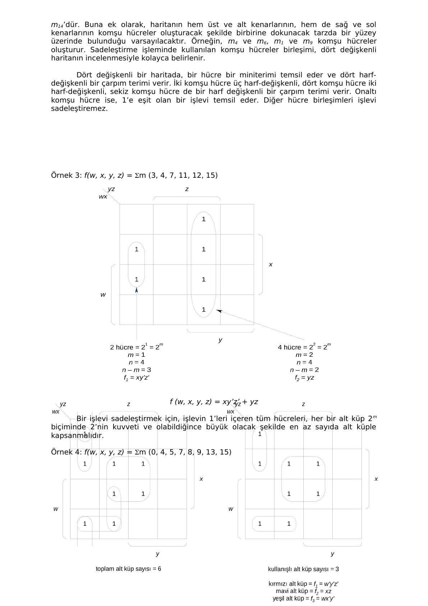
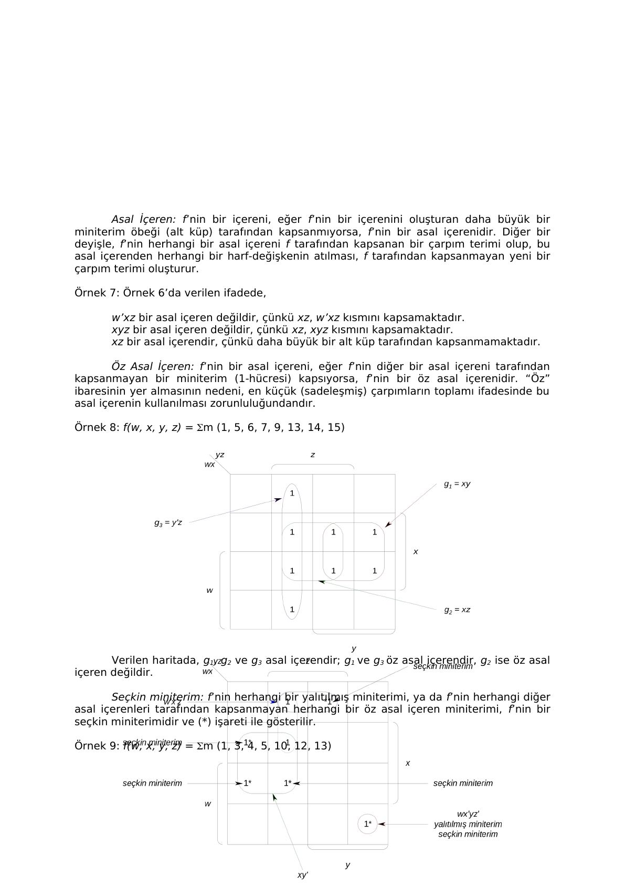
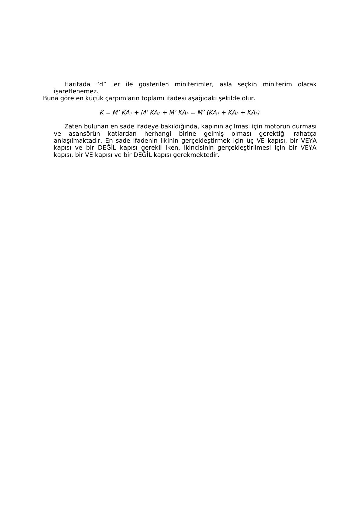

Bu yazı, EEM211 Sayısal Mantık Tasarımı dersinin klasöründe bulunan 12 sayfalık Türkçe bir ders notudur: **"Boole İşlevlerinin Sadeleştirmesinde Karnaugh Haritası Tekniği"**. Word belgesinin yazar bilgisinde **Orhan Tuncoz** adı geçiyor; hangi kurum için ve ne zaman hazırlandığı belgede yazmıyor. Notun metni aşağıda aktarıldı; haritaların çizimleri için gereken sayfalar görsel olarak eklendi. Orijinal Word dosyası yazının sonunda indirilebilir.

*Bu içerik üçüncü taraf bir kaynağa aittir; arşiv ve nostalji amacıyla kaynak belirtilerek paylaşılmıştır. Hak sahibinin talebi hâlinde kaldırılır.*

## Neden sadeleştirme?

Mantık devrelerinin tasarımında bir devrenin iyi niteliklerinin değerlendirilmesi sırasında birçok etken göz önüne alınmalıdır. Bunlardan en önemlisi **maliyettir**: öğelerin, tasarımın, kurulumun ve bakımın maliyeti. Ayrıca devrenin **güvenilirliği** (çok güvenilir öğelerle ya da yedeklilik teknikleriyle sağlanır) ve girişlerdeki değişimlere **yanıt süresi** de önemlidir. Bu üç etken birbirinden bağımsız değildir ve hepsini birden başaran tek bir basit tasarım yöntemi yoktur.

Yanıt süresini en azda tutmak için bir sinyalin geçmesi gereken mantık seviyesi sayısı azaltılmalıdır. Her birleşik devre kanonik bir formülle betimlenebildiğinden, değişkenlerin kendisinin ve tümleyeninin girişte hazır olduğu (çift hatlı mantık) varsayımıyla her mantık devresi en fazla **iki seviyede** kurulabilir. Bu yüzden ilgi normal formüllerle (çarpımların toplamı, toplamların çarpımı) sınırlandırılır.

Bir normal formülün **öğe maliyeti** iki şekilde ölçülebilir:

- **Kapı sayısı:** ifadedeki birden fazla harf-değişkenli terimlerin sayısının bir fazlası (tek terim varsa 1).
- **Kapı girişi sayısı:** harf-değişken sayısı + birden fazla harf-değişken içeren terimlerin sayısı (tek terim varsa yalnızca harf-değişken sayısı).

Cebirsel sadeleştirmenin sorunları şunlardır: izlenecek belirli bir yöntem yoktur; büyük ölçüde deneyime dayanır; sonucun en sade ifade olduğundan emin olunamaz; dört-beş değişkenden fazlasında cebirsel işlemler çok zorlaşır ve hata yapılabilir. Bunun yerine kullanılan sistematik yöntemler **Karnaugh haritası**, **yinelemeli uzlaşma** ve **Quine-McCluskey listeleme yöntemidir**. Notta dört değişkene kadar Karnaugh haritası işleniyor.

## Karnaugh haritası

Harita yöntemi, bir doğruluk tablosunun şemasal gösterimi olarak düşünülebilir. İlk kez **E. W. Veitch** tarafından önerilmiş, sonra **M. Karnaugh** tarafından biraz değiştirilmiştir; bu yüzden "Veitch şeması" ya da "Karnaugh haritası" adını alır. Harita karelerden (hücrelerden) oluşur; her hücre bir miniterimi (ya da maksiterimi) gösterir. n değişkenli bir haritada 2ⁿ hücre vardır.

### Tanımlar

- **Mod-2 toplama (⊕):** 0 ⊕ 0 = 0, 0 ⊕ 1 = 1, 1 ⊕ 0 = 1, 1 ⊕ 1 = 0.
- **Hamming uzaklığı:** A = a₁a₂…a_k ve B = b₁b₂…b_k ikili sayıları için H = Σ (aᵢ ⊕ bᵢ), yani farklı olan bit sayısıdır (sonuç onlu bir sayıdır). Notun örneğinde 10101 ile 10011 arasındaki uzaklık 1 + 0 + 0 + 1 + 1 = 3, 101010 ile 101110 arasındaki uzaklık 1'dir.
- **Bitişik (komşu) hücreler:** aralarındaki Hamming uzaklığı 1 olan, yani yalnızca bir biti farklı hücreler. n değişkenli bir haritada her hücrenin n komşusu vardır.
- **Alt küp:** her biri m hücreye komşu olan 2ᵐ hücreden oluşan küme. n değişkenli haritada m. dereceden bir alt küp, n − m harf-değişkenli bir çarpım terimiyle ifade edilir.

### Bir, iki, üç ve dört değişkenli haritalar

- **Bir değişkenli harita:** iki miniterim (x' ve x). n değişkenle 2^(2ⁿ) farklı Boole işlevi üretilebildiğinden, bir değişkenle dört işlev vardır: f = 0, f = 1, f = x, f = x'.
- **İki değişkenli harita:** dört miniterim, on altı farklı işlev. x satırlarda, y sütunlarda; 0 satırında/sütununda değişken tümleyen, 1'de normal görünür.
- **Üç değişkenli harita:** sekiz miniterim. Sütunlar 00, 01, 11, 10 sırasındadır (Gray sırası): komşu sütunlar arasında yalnızca bir bit değişir. Örneğin m6 hücresi satır 1, sütun 10'dadır (110 = 6). Komşu hücrelerdeki iki miniterim tek bir terime sadeleşir: m5 + m7 = xy'z + xyz = xz(y + y') = xz. m3'ün komşuları m1, m2 ve m7'dir.
- **Dört değişkenli harita:** on altı miniterim. m15'in komşuları m7, m11, m13 ve m14'tür. Haritanın üst-alt ve sağ-sol kenarları birbirine değiyormuş gibi düşünülür: m4 ile m6, m1 ile m9 komşudur. Bir hücre dört harf-değişkenli, iki komşu hücre üç, dört komşu hücre iki, sekiz komşu hücre bir harf-değişkenli terim verir; on altı hücre f = 1 demektir.

Notun örnekleri: f(x, y, z) = Σm(2, 3, 6, 7) (dört hücrelik alt küp, f = y); f(w, x, y, z) = Σm(3, 4, 7, 11, 12, 15) = xy'z' + yz; f(w, x, y, z) = Σm(0, 4, 5, 7, 8, 9, 13, 15) ve iki farklı en sade çözümü olan f(x, y, z) = Σm(0, 2, 3, 4, 5, 7).

Bir işlevi sadeleştirmek için 1 içeren bütün hücreler, her biri 2ᵐ hücreli ve olabildiğince büyük, olabildiğince az sayıda alt küple kapsanmalıdır. Harita ile sadeleştirmede en sade ifade tek olmayabilir.

## Asal içerenler

- **İçeren (implicant):** çarpımların toplamı biçimindeki bir f işlevinde, bir g çarpım terimi, g = 1 olan her girişte f = 1 oluyorsa f'nin bir içerenidir. Çarpımların toplamındaki her terim işlevin bir içerenidir.
- **Asal içeren (prime implicant):** daha büyük bir alt küp tarafından kapsanmayan içeren; ondan bir harf-değişken atılırsa f tarafından kapsanmayan bir terim elde edilir. Örneğin f = Σm(5, 7, 13, 15) için w'xz ve xyz asal içeren değildir (ikisini de xz kapsar); xz asal içerendir.
- **Öz asal içeren (essential prime implicant):** başka hiçbir asal içerenin kapsamadığı en az bir 1-hücresini kapsayan asal içeren; en küçük ifadede bulunmak zorundadır. f = Σm(1, 5, 6, 7, 9, 13, 14, 15) örneğinde g1, g2, g3 asal içerendir; g1 ve g3 öz asal içerendir, g2 değildir.
- **Seçkin miniterim:** yalıtılmış bir miniterim ya da başka hiçbir asal içerenin kapsamadığı, bir öz asal içerene ait miniterim; haritada (*) ile gösterilir.

Örnek: f(w, x, y, z) = Σm(1, 3, 4, 5, 10, 12, 13).

- İçerenler: wx'yz', w'x'z, w'y'z, w'xy', wxy', xy'z', xy'z ve bütün miniterimler.
- Asal içerenler: wx'yz', w'x'z, w'y'z, xy'.
- Öz asal içerenler: wx'yz', w'x'z, xy'.
- En küçük çarpımların toplamı: f = wx'yz' + w'x'z + xy'.

Bir işlevin asal içerenler kümesi tektir; ama en küçük ifade için hepsi gerekmeyebilir. Örneğin f(x, y, z) = Σm(2, 3, 5, 7) için x'y, yz ve xz asal içerendir; x'y ile xz özdür, yz gereksizdir. Bu, uzlaşma teoremiyle de görülür: x'y + yz + xz ifadesinde yz uzlaşma terimidir, dolayısıyla f = x'y + xz. Benzer şekilde f(w, x, y, z) = Σm(1, 5, 6, 7, 11, 12, 13, 15) için asal içerenler w'y'z, wxy', w'xy, wyz ve xz'dir; xz gereksizdir ve f = w'y'z + wxy' + w'xy + wyz olur.

### En küçük çarpımların toplamını bulma yöntemi

1. İşlevin bütün asal içerenlerini ve öz asal içerenlerini bulup listeleyin.
1. En küçük çarpımların toplamına bütün öz asal içerenleri ekleyin.
1. 1-hücreleri öz asal içerenlerce kapsanan asal içerenleri listeden çıkarın.
1. İşlevin bütün 1-hücreleri kapsanıyorsa bulunan ifade tektir.
1. Aksi hâlde işlevi tümüyle kapsayacak şekilde ek asal içerenler seçin.
1. İşlevin en küçük çarpımlar toplamının her zaman tek olmayabileceğini unutmayın.

## Dikkate alınmayanlar (don't care)

Bazı giriş birleşimleri hiçbir zaman oluşmaz; örneğin dört bitlik BCD kodunda 10–15 arasındaki altı birleşim kullanılmaz. Bu birleşimlerde çıkışın ne olacağı önemsizdir ve sadeleştirmede kullanılabilir. Haritada bunlar 1 ya da 0 ile değil "d" ile işaretlenir. Alt küpler seçilirken d'ler işe yarıyorsa 1, yaramıyorsa 0 sayılır; bir alt küpü büyütmeye katkı yapmayan d hiç kullanılmayabilir.

### Örnek: asansör kapısı denetimi

Üç katlı bir binada asansör kapısını denetleyecek bir devre tasarlanacak. Girişler: asansör motoru M (1: hareket ediyor, 0: duruyor) ve kat algılayıcıları KA1, KA2, KA3 (normalde 0, asansör o katın hizasına gelince 1). Çıkış K kapıyı açar (normalde 0, asansör istenen kata gelince 1).

- Asansör aynı anda birden fazla katın hizasında olamayacağı için birden fazla algılayıcının 1 olduğu durumlar olanaksızdır ve "d" ile işaretlenir (sekiz satır).
- M = 1 iken asansör hareket ettiğinden K = 0 olmalıdır; aksi can güvenliği açısından tehlikelidir.
- M = 0 ve algılayıcılardan biri 1 ise K = 1'dir. M = 0 ve bütün algılayıcılar 0 ise asansör durmuş ama bir katın hizasında değildir; yine K = 0 olmalıdır.

| M | KA1 | KA2 | KA3 | K |
|---|---|---|---|---|
| 0 | 0 | 0 | 0 | 0 |
| 0 | 0 | 0 | 1 | 1 |
| 0 | 0 | 1 | 0 | 1 |
| 0 | 0 | 1 | 1 | d |
| 0 | 1 | 0 | 0 | 1 |
| 0 | 1 | 0 | 1 | d |
| 0 | 1 | 1 | 0 | d |
| 0 | 1 | 1 | 1 | d |
| 1 | 0 | 0 | 0 | 0 |
| 1 | 0 | 0 | 1 | 0 |
| 1 | 0 | 1 | 0 | 0 |
| 1 | 0 | 1 | 1 | d |
| 1 | 1 | 0 | 0 | 0 |
| 1 | 1 | 0 | 1 | d |
| 1 | 1 | 1 | 0 | d |
| 1 | 1 | 1 | 1 | d |

K(M, KA1, KA2, KA3) = Σm(1, 2, 4) + d(3, 5, 6, 7, 11, 13, 14, 15)

Haritada d ile gösterilen miniterimler hiçbir zaman seçkin miniterim olarak işaretlenmez. En küçük çarpımların toplamı:

K = M'·KA1 + M'·KA2 + M'·KA3 = M'·(KA1 + KA2 + KA3)

Yani kapının açılması için motorun durmuş ve asansörün katlardan birine gelmiş olması gerekir. İlk ifadeyi gerçekleştirmek için üç VE, bir VEYA ve bir DEĞİL kapısı gerekirken, ikinci biçim için bir VEYA, bir VE ve bir DEĞİL kapısı yeter.

