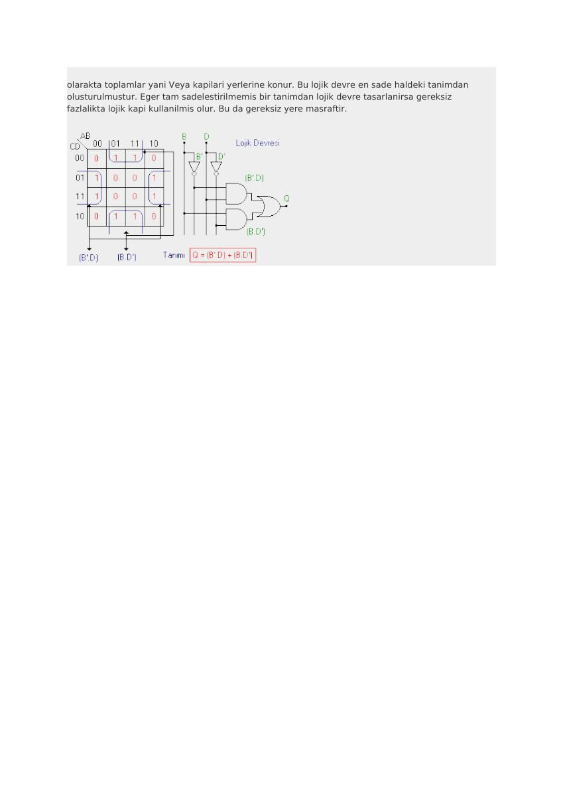

Two web texts titled "Karnaugh Map" and "LOGIC FAMILY", stored in the EEM211 folder. The first text carries the date 19 August 2006; the second file's archive date is 7 November 2006. The saved documents do not state the original site or author name explicitly, so this information could not be verified. PDF copies can be downloaded together at the end of the post.

*Note: This content belongs to a third-party source; it is shared for archival and nostalgic purposes with attribution. It will be removed at the request of the rights holder.*

## Constructing the Karnaugh map

The text explains that a function of n variables requires 2ⁿ cells. Each cell corresponds to one input combination in the truth table. For two, three, and four variables there are 4, 8, and 16 cells, respectively; five- and six-variable maps are also shown.

Rows and columns are ordered so that only one variable changes between adjacent cells. The combinations for which the output is 1 in the truth table are written into the corresponding cells. For a sum-of-products expression, these 1s are grouped.

## Grouping rules

- Groups contain a power-of-two number of cells: 1, 2, 4, 8, and so on.
- Horizontal and vertical adjacency are used; diagonal adjacency is not.
- Opposite edges of the map are also adjacent; groups can wrap around the edges.
- A cell may belong to more than one group.
- Larger groups yield terms with fewer variables.
- Variables that change within a group are eliminated; variables that remain constant are kept in the term.

In the source's example, the simplified expression is Q=B′D+BD′. The two product terms are formed with AND gates and their sum with an OR gate; inverters are used for the complements of B and D. The expression is the XOR function of B and D.

## Logic families

The second text, in English, describes the families used to implement logic gates in a historical framework. The basic distinction is that gates that perform the same Boolean function externally can have different internal circuit structures.

| Abbreviation | Expansion |
| --- | --- |
| DL | Diode logic |
| RTL | Resistor-transistor logic |
| DTL | Diode-transistor logic |
| ECL | Emitter-coupled logic |
| TTL | Transistor-transistor logic |
| PMOS / NMOS | P-channel / N-channel MOS logic |
| CMOS | Complementary MOS logic |
| BiCMOS | Combination of bipolar and CMOS structures |
| I²L | Integrated injection logic |

The text compares bipolar families with MOS-based families in terms of power consumption and switching behavior. In a CMOS circuit, the steady state in which the input is stable is distinguished from the switching instant; the charging/discharging of capacitances determines the dynamic power consumption. Increasing the operating frequency and the load capacitance increases consumption; the supply voltage is also a determining factor.

Different subfamilies exist under the names TTL and CMOS. The same logic function or a similar part number does not by itself imply electrical compatibility; input and output levels depend on the family.

*Note: The technology and prevalence assessments in this text are archived content from the 2006 period.*
