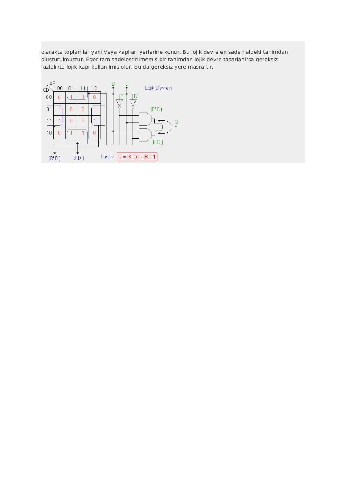

EEM211 klasöründe saklanan “Karno Haritası” ve “LOGIC FAMILY” adlı iki internet metni. İlk metinde 19 Ağustos 2006 tarihi bulunuyor; ikinci dosyanın arşiv tarihi 7 Kasım 2006. Kaydedilmiş belgelerde özgün site ve yazar adı açıkça belirtilmediğinden bu bilgiler doğrulanamadı. PDF kopyaları birlikte yazının sonunda indirilebilir.

*Bu içerik üçüncü taraf bir kaynağa aittir; arşiv ve nostalji amacıyla kaynak belirtilerek paylaşılmıştır. Hak sahibinin talebi hâlinde kaldırılır.*

## Karno haritasının kurulması

Metin, n değişkenli bir fonksiyon için 2ⁿ hücre gerektiğini anlatır. Her hücre doğruluk tablosundaki bir giriş birleşimine karşılık gelir. İki, üç ve dört değişken için sırasıyla 4, 8 ve 16 hücre bulunur; beş ve altı değişkenli haritalar da gösterilir.

Satır ve sütunlar komşu hücrelerde yalnız bir değişken değişecek biçimde sıralanır. Doğruluk tablosunda çıkışın 1 olduğu birleşimler ilgili hücreye yazılır. Toplam-çarpım ifadesi için bu 1'ler gruplandırılır.

## Gruplama kuralları

- Gruplar 1, 2, 4, 8 gibi ikinin kuvveti sayıda hücre içerir.
- Yatay ve düşey komşuluk kullanılır; köşegen komşuluk kullanılmaz.
- Haritanın karşı kenarları da komşudur; kenardan taşan gruplar kurulabilir.
- Bir hücre birden fazla gruba girebilir.
- Büyük gruplar daha az değişken içeren terimler verir.
- Grup içinde değişen değişkenler elenir; sabit kalan değişkenler terime alınır.

Kaynağın örneğinde sadeleşmiş ifade Q=B′D+BD′ olur. İki çarpım terimi VE kapılarıyla, toplamı VEYA kapısıyla oluşturulur; B ve D'nin tümleyenleri için eviriciler kullanılır. İfade B ile D'nin XOR işlevidir.

## Logic families

İngilizce ikinci metin, mantık kapılarının gerçeklenmesinde kullanılan aileleri tarihsel bir çerçevede tanımlar. Temel ayrım, dışarıdan aynı Boolean işlevini gerçekleştiren kapıların iç devre yapısının farklı olabilmesidir.

| Kısaltma | Açılım |
| --- | --- |
| DL | Diode logic |
| RTL | Resistor-transistor logic |
| DTL | Diode-transistor logic |
| ECL | Emitter-coupled logic |
| TTL | Transistor-transistor logic |
| PMOS / NMOS | P-channel / N-channel MOS logic |
| CMOS | Complementary MOS logic |
| BiCMOS | Bipolar ve CMOS yapılarının birleşimi |
| I²L | Integrated injection logic |

Metin, bipolar aileler ile MOS tabanlı aileleri, güç tüketimi ve anahtarlama davranışı üzerinden karşılaştırır. CMOS devrede girişin kararlı olduğu durum ile anahtarlama anı ayrılır; kapasitelerin şarj/deşarjı dinamik güç tüketimini belirler. Çalışma frekansının ve yük kapasitesinin artması tüketimi artırır; besleme gerilimi de belirleyicidir.

TTL ve CMOS adlarının altında farklı alt aileler bulunur. Aynı mantık işlevi ya da benzer parça numarası tek başına elektriksel uyumluluk anlamına gelmez; giriş ve çıkış seviyeleri aileye bağlıdır.

*Not: Bu metindeki teknoloji ve yaygınlık değerlendirmeleri 2006 döneminin arşiv içeriğidir.*
