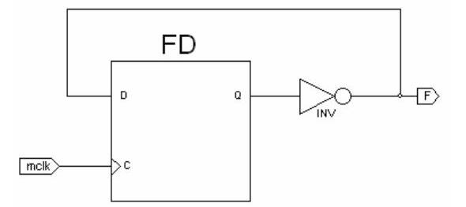
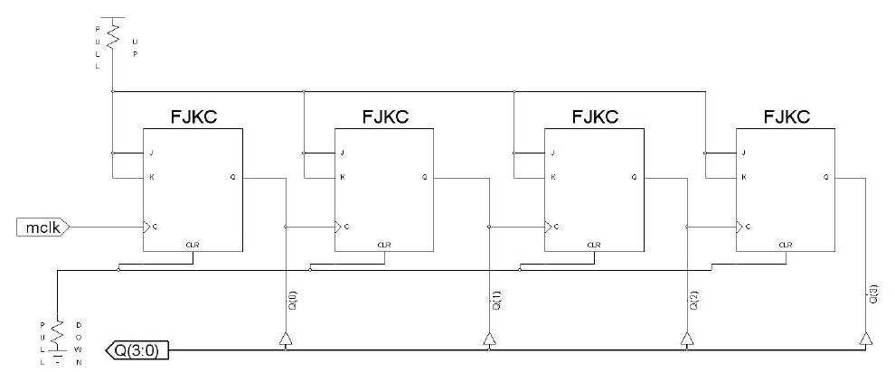

This post collects older handouts from the **EEM211 Digital Logic Design** laboratory at Başkent University that are not included in the archived post *Laboratory Experiment Handouts (2012)*: the **Experiment 8** handout, last revised in **2005**, and the **Experiment 1** handout from the **fall 2011** semester (two separate handouts for the two groups) together with the **hardware experiment** handout (the PDFs' author metadata names laboratory assistant Gencer Tulay). In the student-group-topic list in the hardware experiment handout, the student names have been redacted. The handouts can be downloaded as a ZIP at the end of the post.

## Experiment 8: Flip-Flops and Circuit Design (2005)

**Objective:** to design registers and counters using flip-flops. At the bottom of the handout it says "Last revised 2005 • www.baskent.edu.tr/~engcif".

1. What operation does the circuit in Figure 1 perform? Explain. What is the relationship between the input frequency and the output frequency? For what purpose is this circuit used? Draw the circuit in the Xilinx WebPack program using the schematic editor. In the drawing, use the block named `fd` for the D flip-flop block; name the clock input `mclk` and the output `F`. Verify your design and your predictions with the ModelSim simulator. In the test file, apply the parameters given in Figure 2 (ModelSim timing window: single clock `mclk`, rising edge, clock high and low times 100 ns, input setup time 15 ns, output valid delay 15 ns, test bench length 1000 ns). Create a list file and include the results in your report along with your explanations.

2. Figure 3 shows a 4-bit counter circuit with an asynchronous clear input that counts down from 1111 to 0000. Create the circuit using the editor, verify its operation with ModelSim, and include the list file in your report. To group the Q outputs, use the bus tap tool in the WebPack schematic editor; note that the Q group must be an output. Name the wires carrying single-bit signals Q(0), Q(1), and so on; regular parentheses must be used instead of square brackets.

3. Modify the circuit in Figure 3 so that it counts upward from 000. Draw your circuit, adding the necessary gates and making the necessary changes, verify it with ModelSim, and include it in your report together with your drawing. (You can copy the drawing in WebPack using Copy from the Edit menu and paste it into your report.)
4. Can you perform the operation carried out by the circuit in Figure 1 using the circuit in Figure 3 without modifying it? Explain.

The archived post *2006 Fall Laboratory Reports* contains summaries of two student reports answering the questions in this handout.

## Experiment 1: Program Development Environment – Xilinx ISE WebPack and Xilinx ISE Simulator (October 2011)

The handout was prepared separately for two laboratory groups: EEM211/01 (Friday) and EEM211/02 (Thursday).

1. Listen to the laboratory assistants' presentation on creating schematic and Verilog design files in the Xilinx ISE program development environment and on using the Xilinx ISE Simulator.
1. Prepare the following task as a schematic: A student takes three courses, A, B, and C. The cases in which the student passes a course are denoted by 1, and the cases in which the student fails are denoted by 0. The pass status is F, and to be considered successful the student must pass at least two courses; one of the courses passed must necessarily be course **B** (group 01) / course **A** (group 02). Obtain the output expression of the function.
1. Write the **behavioral** (group 01) / **structural** (group 02) design code for the function you obtained in the second question.

*Note: Under these conditions, F = B·(A + C) for group 01 and F = A·(B + C) for group 02.*

## Hardware Experiment (November 2011)

The "EEM211 Course Laboratory Hardware Experiment" handout contains 16 design topics; each topic was assigned at random to a group of two students. According to the warnings in the handout, for topics where the use of a ready-made integrated circuit is not specified, the internal structure of the circuit is to be designed by the students using gates.

1. A student takes courses A, B, and C. To be considered successful, a) the student must pass at least two courses, and b) one of the courses passed must necessarily be B. Obtain the pass status as a function and implement it using gates only.
1. Implement the given function F using a 3x8 decoder (the decoder is to be designed with gates). F(X, Y, Z) = Σ(1, 4, 6, 7).
1. Implement the given function F using a 4x1 MUX with select inputs X and Y (the MUX is to be designed with gates). F(X, Y, Z) = Σ(0, 3, 5, 7).
1. Design a three-bit half adder circuit.
1. Design a two-bit full adder circuit.
1. Design a two-bit multiplier circuit.
1. Design the circuit that takes the two's complement of a three-bit number.
1. Design the circuit that converts three-bit data entered in Gray code to binary code.
1. Design the circuit that converts three-bit data entered in binary code to Gray code.
1. Design the circuit that generates the odd parity bit for a three-bit binary code.
1. Design the circuit that generates the even parity bit for a three-bit binary code.
1. Design a priority encoder with four inputs and two outputs.
1. Design a two-bit comparator circuit.
1. Obtain the XOR function using a 2x4 decoder (a ready-made integrated circuit is to be used).
1. Obtain the XNOR function using a 2x4 decoder (a ready-made integrated circuit is to be used).
1. Obtain the OR function with input A and output F using a 2x1 MUX (a ready-made integrated circuit is to be used).

### Integrated circuits that can be used in the experiment

| IC | Description |
|---|---|
| 7400 | Quad 2-input NAND |
| 7402 | Quad 2-input NOR |
| 7404 | Hex inverter |
| 7408 | Quad 2-input AND |
| 7410 | Triple 3-input NAND |
| 7420 | Dual 4-input NAND |
| 7430 | Single 8-input NAND |
| 7432 | Quad 2-input OR |
| 7437 | Quad 2-input NAND buffer |
| 7483 | 4-bit full adder |
| 7485 | 4-bit magnitude comparator |
| 7486 | Quad XOR |
| 74139 | Dual 2-to-4 decoder |
| 74138 | 3-to-8 decoder |
| 74157 | Quad 2-to-1 MUX |
| 74153 | Dual 4-to-1 MUX |

### Points to note in the experiment

1. Each student is responsible for bringing to the laboratory the datasheet of the integrated circuit they will use in the experiment.
1. During the experiment, the laboratory assistants will give general information about the materials to be used.
1. Each student's group partner and experiment topic are specified on the third page of the handout. For students who did not notify their group partner in advance, groups were assigned according to the order on the attendance list and topics were assigned at random; groups and topics will not be changed.
1. No preliminary work documents will be submitted to the laboratory assistants; even so, designing, testing, and simulating with the Xilinx program before running the experiments on the hardware is more appropriate both as an engineering approach and for saving time.
1. Each student is obliged to return the materials and experiment sets they use in the condition in which they received them; before starting the experiment, they should check that these are in working order and alert the assistants if there is a problem.
