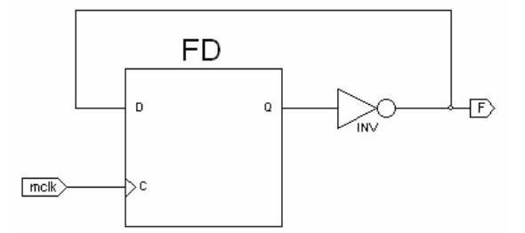
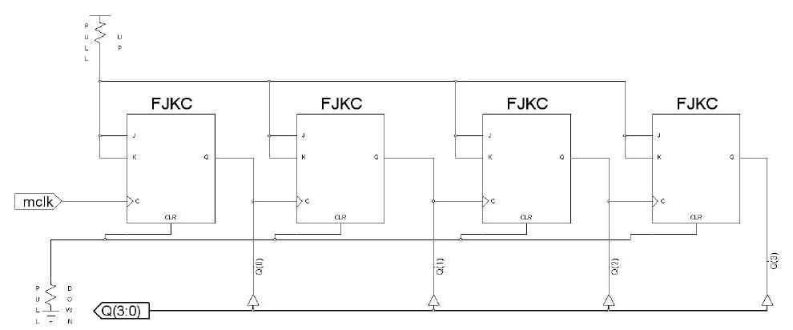

Bu yazı, Başkent Üniversitesi **EEM211 Sayısal Mantık Tasarımı** laboratuvarının arşivdeki *Laboratuvar Deney Föyleri (2012)* yazısında bulunmayan, daha eski föylerini bir araya getiriyor: **2005**'te son kez gözden geçirilmiş **Deney 8** föyü ve **2011 güz** dönemine ait **Deney 1** (iki grup için iki ayrı föy) ile **donanım deneyi** föyü (PDF'lerin yazar bilgisinde laboratuvar asistanı Gencer Tulay'ın adı geçiyor). Donanım deneyi föyündeki öğrenci-grup-konu listesinde öğrenci adları kapatıldı. Föyler yazının sonunda ZIP olarak indirilebilir.

## Deney 8: Flip-floplar ve devre tasarımı (2005)

**Deneyin amacı:** flip-flopları kullanarak kaydedici ve sayıcı tasarlamak. Föyün altında "Son gözden geçirme 2005 • www.baskent.edu.tr/~engcif" yazıyor.

1. Şekil 1'deki devre hangi işlemi yerine getirmektedir? Açıklayın. Giriş frekansı ile çıkış frekansı arasındaki bağlantı nedir? Bu devre hangi amaçla kullanılır? Devreyi Xilinx WebPack programında şematik editör yardımıyla çizin. Çizimde D flip-flop bloğu için `fd` isimli bloğu kullanın; saat girişini `mclk`, çıkışı `F` olarak isimlendirin. Tasarımı ve öngörülerinizi ModelSim benzetimcisiyle doğrulayın. Test dosyasında Şekil 2'de verilen parametreleri uygulayın (ModelSim zamanlama penceresi: tek saat `mclk`, yükselen kenar, saat yüksek ve düşük süresi 100 ns, giriş kurulum süresi 15 ns, çıkış geçerlilik gecikmesi 15 ns, test tezgâhı uzunluğu 1000 ns). Liste dosyası oluşturun ve sonuçları raporunuza açıklamalarınızla ekleyin.

2. Şekil 3'te 4 bitlik, senkron olmayan sil (clear) girişli, 1111 değerinden 0000'a kadar azalarak sayabilen bir sayıcı devresi verilmiştir. Devreyi editör yardımıyla oluşturun, ModelSim ile çalışmasını doğrulayın, liste dosyasını raporunuza ekleyin. Q çıkışlarını gruplamak için WebPack şema editöründeki grup aracını (bus tap) kullanın; Q grubunun çıkış olması gerektiğine dikkat edin. Tek bitlik işaretleri taşıyan telleri Q(0), Q(1) şeklinde isimlendirin; köşeli parantez yerine normal parantez kullanılmalıdır.

3. Şekil 3'teki devreyi 000'dan ileriye doğru sayacak biçimde değiştirin. Gereken kapı ve değişiklikleri yaparak devrenizi çizin, ModelSim ile doğrulayın ve çiziminizle birlikte raporunuza ekleyin. (Çizimi WebPack'te Edit menüsünden Copy ile kopyalayıp raporunuza yapıştırabilirsiniz.)
4. Şekil 1'deki devrenin gerçekleştirdiği işlemi Şekil 3'teki devreyle değişiklik yapmadan gerçekleştirebilir misiniz? Açıklayın.

Arşivdeki *2006 Güz Laboratuvar Raporları* yazısında bu föyün sorularına verilmiş iki öğrenci raporunun özetleri var.

## Deney 1: Program geliştirme ortamı – Xilinx ISE WebPack ve Xilinx ISE Simulator (Ekim 2011)

Föy iki laboratuvar grubu için ayrı hazırlanmış: EEM211/01 (Cuma) ve EEM211/02 (Perşembe).

1. Laboratuvar asistanlarının Xilinx ISE program geliştirme ortamında şematik ve Verilog tasarım dosyalarının oluşturulması ve Xilinx ISE Simulator kullanımı hakkındaki anlatımını dinleyiniz.
1. Aşağıdaki çalışmayı şema olarak hazırlayınız: Bir öğrenci A, B ve C olmak üzere üç ders almaktadır. Öğrencinin derste başarılı olduğu durumlar 1, başarısız olduğu durumlar 0 ile gösterilmektedir. Başarı durumu F'dir ve başarılı sayılması için en az iki dersten başarılı olmalıdır; başarılı olduğu derslerden biri mutlaka **B** dersi (01 grubu) / **A** dersi (02 grubu) olmalıdır. Fonksiyonun çıkış ifadesini elde ediniz.
1. İkinci soruda elde ettiğiniz fonksiyon için **davranışsal** (01 grubu) / **yapısal** (02 grubu) tasarım kodunu yazınız.

*Not: Bu koşullarla 01 grubu için F = B·(A + C), 02 grubu için F = A·(B + C) olur.*

## Donanım deneyi (Kasım 2011)

"EEM211 Dersi Laboratuar Donanım Deneyi" föyünde 16 tasarım konusu var; her konu iki kişilik bir gruba rastgele atanmış. Föydeki uyarılara göre hazır entegre kullanılması belirtilmeyen konularda devrenin iç yapısı kapılarla öğrenciler tarafından tasarlanacak.

1. Bir öğrenci A, B ve C derslerini almaktadır. Başarılı sayılması için a) en az iki dersten başarılı olmalı, b) başarılı olduğu derslerden biri mutlaka B olmalıdır. Başarı durumunu fonksiyon olarak elde edip yalnız kapılarla gerçekleştiriniz.
1. Verilen F fonksiyonunu 3x8 kod çözücü kullanarak gerçekleştiriniz (kod çözücü kapılarla tasarlanacak). F(X, Y, Z) = Σ(1, 4, 6, 7).
1. Verilen F fonksiyonunu X ve Y seçme girişli 4x1 MUX ile gerçekleştiriniz (MUX kapılarla tasarlanacak). F(X, Y, Z) = Σ(0, 3, 5, 7).
1. Üç bitlik yarım toplayıcı devre tasarlayınız.
1. İki bitlik tam toplayıcı devre tasarlayınız.
1. İki bitlik çarpıcı devre tasarlayınız.
1. Üç bitlik bir sayının ikiye tümleyenini alan devreyi tasarlayınız.
1. Gray kodda girilen üç bitlik veriyi ikilik koda çeviren devreyi tasarlayınız.
1. İkilik kodda girilen üç bitlik veriyi Gray koda çeviren devreyi tasarlayınız.
1. Üç bitlik ikilik kod için tek eşlik bitini üreten devreyi tasarlayınız.
1. Üç bitlik ikilik kod için çift eşlik bitini üreten devreyi tasarlayınız.
1. Dört girişli, iki çıkışlı öncelikli kodlayıcı (priority encoder) tasarlayınız.
1. İki bitlik karşılaştırıcı devre tasarlayınız.
1. XOR fonksiyonunu 2x4 kod çözücüyle elde ediniz (hazır entegre kullanılacak).
1. XNOR fonksiyonunu 2x4 kod çözücüyle elde ediniz (hazır entegre kullanılacak).
1. Girişi A, çıkışı F olan OR fonksiyonunu 2x1 MUX ile elde ediniz (hazır entegre kullanılacak).

### Deneyde kullanılabilecek entegre devreler

| Entegre | Özellik |
|---|---|
| 7400 | Dörtlü 2 girişli NAND |
| 7402 | Dörtlü 2 girişli NOR |
| 7404 | Altılı tümleyici |
| 7408 | Dörtlü 2 girişli AND |
| 7410 | Üçlü 3 girişli NAND |
| 7420 | İkili 4 girişli NAND |
| 7430 | Tek 8 girişli NAND |
| 7432 | Dörtlü 2 girişli OR |
| 7437 | Dörtlü 2 girişli NAND tamponu |
| 7483 | 4 bitlik tam toplayıcı |
| 7485 | 4 bitlik büyüklük karşılaştırıcı |
| 7486 | Dörtlü XOR |
| 74139 | İkili 2'ye 4 kod çözücü |
| 74138 | 3'e 8 kod çözücü |
| 74157 | Dörtlü 2'ye 1 MUX |
| 74153 | İkili 4'e 1 MUX |

### Deneyde dikkat edilmesi gereken hususlar

1. Her öğrenci deneyde kullanacağı entegre devrenin veri kâğıdını (datasheet) laboratuvara getirmekten kendisi sorumludur.
1. Deney sırasında laboratuvar asistanları kullanılacak malzemeler hakkında genel bilgi verecektir.
1. Her öğrencinin grup arkadaşı ve deney konusu föyün üçüncü sayfasında belirtilmiştir. Grup arkadaşını önceden bildirmeyen öğrencilerin grupları yoklama listesindeki sıraya göre verilmiş, deney konuları rastgele atanmıştır; gruplar ve konular değiştirilmeyecektir.
1. Laboratuvar asistanlarına ön çalışma belgesi teslim edilmeyecektir; yine de deneyleri donanımda çalıştırmadan önce Xilinx programıyla tasarım, test ve benzetim yapmanız hem mühendislik yaklaşımı hem zaman kazanmak açısından daha uygundur.
1. Her öğrenci kullandığı malzemeleri ve deney setlerini aldığı şekilde teslim etmekle yükümlüdür; deneye başlamadan çalışır durumda olduklarını kontrol edip sorun varsa asistanları uyarmalıdır.
