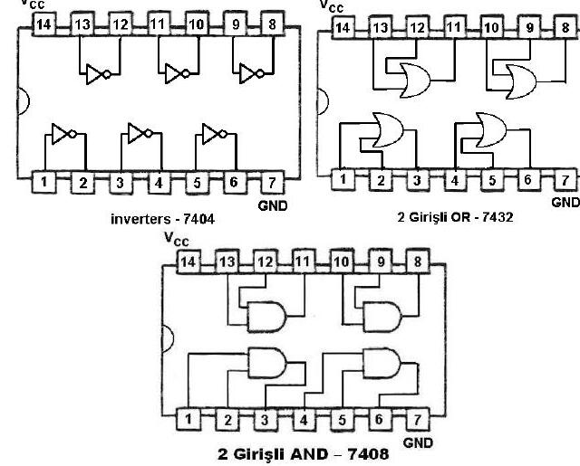
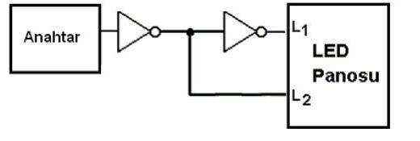

This post brings together two introductory documents from the digital logic laboratories at Başkent University: the **EEM211 Digital Logic Design Course Laboratory Software Installation Guide** (October 2011; prepared by Assoc. Prof. Dr. Hamit Erdem and Research Assistant Gencer Tulay) and the "Demo – Introduction to the Lab Equipment" experiment sheet of the **BİL 275 Digital Logic Design** course of the Department of Computer Engineering (October 2010; the PDF's author metadata lists K. Yıldız). Both PDFs can be downloaded as a ZIP at the end of the post.

## Installing the laboratory software (EEM211, 2011)

### Registration

1. To install the Xilinx software, you must first register a user account on the program's website: on www.xilinx.com, click the "Downloads" link at the top right.
1. From the "Version" link on the left, select **10.1**.
1. Under "ISE Foundation WebPACK – 10.1 Full Product Installation", click the "Obtain a v10.1 Registration ID" link.
1. On the page that opens, click "Create Account".
1. Enter your information (do not use Turkish characters); an activation email will be sent to your account.
1. Click the link in the email and fill in the page that opens with your own information.
1. Click the "Obtain a Registration ID for 9.2 and 9.1" link and complete the page; when you click "Next", your registration number will be sent to your email.

### Installing the Xilinx software

1. Run the setup file in the "webpack 10.1" folder.
1. On the page that opens, enter the registration number sent to your email in the Registration ID field.

Depending on the state of the computer, the installation may take a long time; do not interfere in any way until it is complete.

### Installing the Digilent software

To see how the designs you create in Xilinx actually work, you need to download the program to the FPGA; for this, the Digilent software must be installed. Double-click the **digilent.adept.system_v2.5.1** file in the "EEM211_yukleme" folder to install it.

## Introduction to the lab equipment (BİL 275, 2010)

**Materials used in the experiment:** a 7404 inverter, a 7408 AND gate, a 7432 OR gate, and the **Wish-Maker** trainer kit. In the photograph of the trainer kit in the experiment sheet, the switches (sw1 … sw8), LEDs, GND and +5 V terminals are marked, and the section that must absolutely not be used is also indicated.

### Tasks

1. Place the 7404 IC on the trainer kit; connect +5 V to pin 14 and GND to pin 7. Pins 1 and 2 are the input and output of one inverter: connect pin 1 to switch sw1 and pin 2 to one of the inputs on the LED panel. Set the switch to the 1 and 0 positions and observe the change on the LED (red for 1, green for 0).
1. Build the circuit in Figure 4 (switch → inverter → L2, then second inverter → L1) using the gates on the IC and the switch and LEDs on the kit; change the position of the switch and observe L1 and L2.
1. Place the 7432 IC and make the Vcc and GND connections. Unlike the 7404, this IC contains 4 OR gates; the inputs of one of them are pins 1 and 2, and its output is pin 3. Connect pins 1 and 2 to switches SW1 and SW2 and pin 3 to LED1; change the switches and observe the output of the gate.
1. Place the 7408 IC. This IC has 4 AND gates instead of 4 OR gates; the connections are the same as for the OR gate. Change the switches and observe the output of the AND gate on the LED.

*Note: In this connection, L2 shows the inverse of the switch and L1 shows the switch itself; that is, the two LEDs are always in opposite states.*
