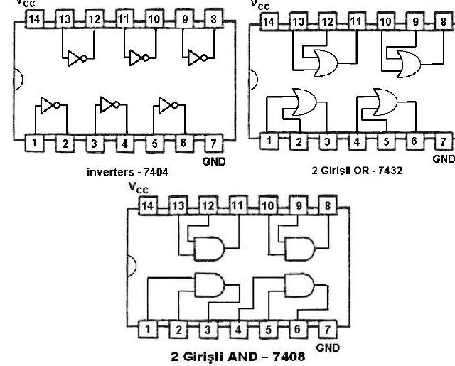
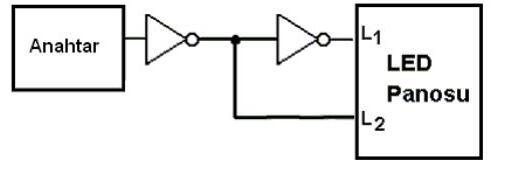

Bu yazı, Başkent Üniversitesi sayısal mantık laboratuvarlarının iki başlangıç belgesini bir araya getiriyor: **EEM211 Sayısal Mantık Tasarımı Dersi Laboratuvar Programı Kurulum Belgesi** (Ekim 2011; hazırlayanlar Doç. Dr. Hamit Erdem ve Araş. Gör. Gencer Tulay) ve Bilgisayar Mühendisliği Bölümü'nün **BİL 275 Sayısal Mantık Tasarımı** dersinin "Demo – Lab Cihazlarının Tanıtımı" deney föyü (Ekim 2010; PDF'in yazar bilgisinde K. Yıldız). İki PDF yazının sonunda ZIP olarak indirilebilir.

## Laboratuvar programının kurulumu (EEM211, 2011)

### Kayıt işlemi

1. Xilinx programını kurabilmek için önce programın web sayfasında kullanıcı kaydı yaptırılmalı: www.xilinx.com sitesinde sağ üstteki "Downloads" bağlantısına tıklayın.
1. Soldaki "Version" bağlantısından **10.1**'i seçin.
1. "ISE Foundation WebPACK – 10.1 Full Product Installation" altındaki "Obtain a v10.1 Registration ID" bağlantısına tıklayın.
1. Açılan sayfada "Create Account"a tıklayın.
1. Bilgilerinizi girin (Türkçe karakter kullanmayın); hesabınıza bir etkinleştirme e-postası gelir.
1. E-postadaki bağlantıya tıklayıp açılan sayfayı kendi bilgilerinizle doldurun.
1. "Obtain a Registration ID for 9.2 and 9.1" bağlantısına tıklayıp sayfayı düzenleyin; "Next"e bastığınızda kayıt numaranız e-postanıza gelir.

### Xilinx programının kurulması

1. "webpack 10.1" klasöründeki setup dosyasını çalıştırın.
1. Açılan sayfada Registration ID bölümüne e-postanıza gelen kayıt numarasını girin.

Kurulum, bilgisayarın durumuna göre uzun sürebilir; tamamlanmadan hiçbir müdahalede bulunmayın.

### Digilent programının kurulması

Xilinx'te yaptığınız tasarımların gerçekte nasıl çalıştığını görmek için FPGA'e program yüklemek gerekir; bunun için Digilent programı kurulu olmalıdır. "EEM211_yukleme" klasöründeki **digilent.adept.system_v2.5.1** dosyasına çift tıklayıp kurun.

## Lab cihazlarının tanıtımı (BİL 275, 2010)

**Deneyde kullanılan malzemeler:** 7404 tersleyici (inverter), 7408 VE kapısı, 7432 VEYA kapısı ve **Wish-Maker** deney seti. Föyde deney setinin fotoğrafında anahtarlar (sw1 … sw8), LED'ler, GND ve +5 V uçları işaretlenmiş, kesinlikle kullanılmaması gereken bölüm de gösterilmiş.

### Yapılacak çalışmalar

1. 7404 entegresi deney setine yerleştirilir; 14 numaralı bacağa +5 V, 7 numaralı bacağa GND bağlanır. 1 ve 2 numaralı bacaklar bir tersleyicinin giriş ve çıkışıdır: 1 numaralı bacak sw1 anahtarına, 2 numaralı bacak LED panelindeki girişlerden birine bağlanır. Anahtar 1-0 konumlarına getirilerek LED'deki değişim gözlenir (1 için kırmızı, 0 için yeşil).
1. Şekil 4'teki devre (anahtar → tersleyici → L2, ardından ikinci tersleyici → L1) entegredeki kapılar, setteki anahtar ve LED'lerle kurulur; anahtarın konumu değiştirilerek L1 ve L2 gözlenir.
1. 7432 entegresi yerleştirilir ve Vcc, GND bağlantıları yapılır. Entegrede, 7404'ten farklı olarak 4 adet OR kapısı vardır; bunlardan birinin girişleri 1 ve 2, çıkışı 3 numaralı bacaktır. 1 ve 2 numaralı bacaklar SW1 ve SW2 anahtarlarına, 3 numaralı bacak LED1'e bağlanır; anahtarlar değiştirilerek kapının çıkışı gözlenir.
1. 7408 entegresi yerleştirilir. Bu entegrede 4 adet OR yerine 4 adet AND kapısı vardır; bağlantılar OR'dakiyle aynıdır. Anahtarlar değiştirilerek AND kapısının çıkışı LED'den gözlenir.

*Not: Bu bağlantıda L2 anahtarın tersini, L1 ise anahtarın kendisini gösterir; yani iki LED her zaman zıt durumdadır.*
