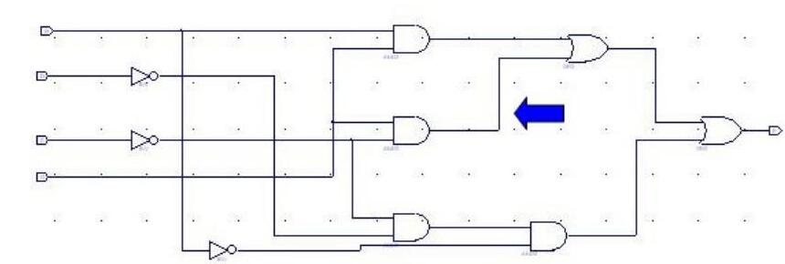
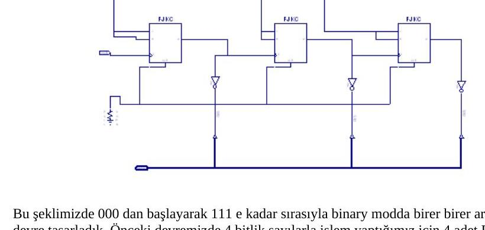
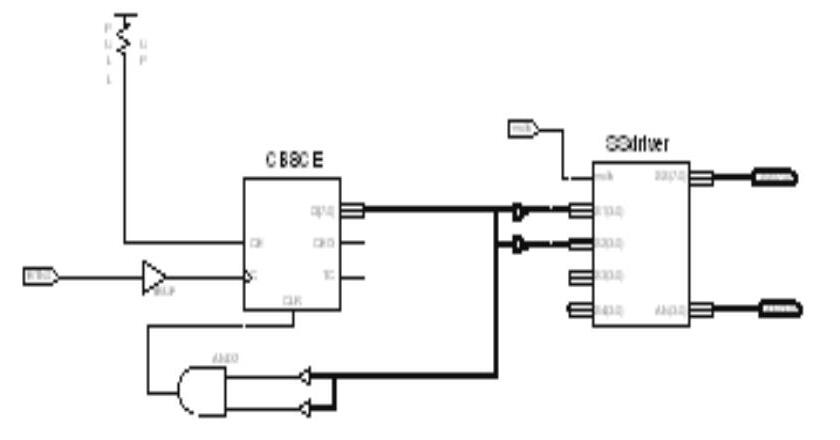
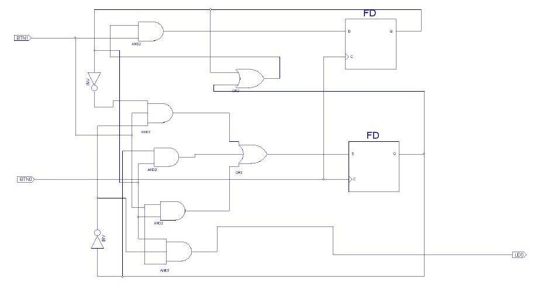

This post collects the reports and preliminary work that classmates prepared for the **Fall 2006** experiments of the **EEM211 Digital Logic Design** laboratory at Başkent University (October–December 2006). The experiments were designed in the **Xilinx ISE WebPack** environment using schematics or Verilog, verified with **ModelSim** simulation, and then loaded onto the Pegasus FPGA board. Most of the reports consist of a short results note and a simulation listing. Student names, numbers, and personal information in file names have been removed from the reports; the masked reports (A, B, and C denote the reports of three different classmates) can be downloaded as a ZIP at the end of the post.

## Experiment 2: First circuit with Xilinx

The gate circuit in Figure 1 of the handout was drawn as a schematic in Xilinx and its waveform was examined by simulation; then the switches were assigned as inputs and an LED as the output, and the circuit was loaded onto the board. When output F is 1 the LED lights red, and when it is 0 the LED stays off. Finally, the Lab02.bit file was compiled and a different logic was tried: the input is a button and the output is an LED; the LED lights when the button is pressed.

## Experiment 4: 4-bit adders (Verilog)

- **Lab04a:** The full adder module `fadder` is defined behaviorally with the `^`, `|`, `~`, `&` operators; the `fourbitadder1` module is built hierarchically using four `fadder` instances.
- **Lab04b:** The AND, OR, and complement (inverter) gates are written as separate modules, `fadderStr`, which does the same job, is rebuilt with these three gates, and `fourbitadder2` is constructed with it.

Both designs worked as 4-bit binary adders when loaded onto the board.

## Experiment 5: Prime number indicator and 2-bit comparator

1. A circuit whose LED lights when the 4-bit number (1–15) entered with 4 switches **is prime**.
1. A circuit that compares two 2-bit numbers (A and B): LD0 lights if B is greater, LD2 if B is smaller, and LD1 if A = B.

Both circuits were drawn as Xilinx schematics, their inputs and outputs were assigned, and they were tested on the Pegasus board.

## Experiment 6: Adders and parity generators (with gate delays)

1. A one-bit full adder was defined at the gate level with gate delays specified (a, b, cin → s, cout).
1. A **ripple carry** adder that adds two 4-bit numbers was built with gate delays.
1. A **carry-lookahead** adder was implemented structurally: the `PGgen` and `carrygen` modules and the `fourbitscarrylookahead` top module that uses them.

The report's answers to the questions:

- Since the number of gates performing the logical operations in the adders is the same, the delay is also the same (1a).
- If a 16-bit ripple carry adder were designed instead of a 4-bit one, the delay would increase 4 times (1b).
- The delays in the simulation results are different; the carry-lookahead design (lab06-3) works faster (2a).

According to Xilinx's timing report, the longest path is **13.454 ns** from cin to cout in the carry-lookahead design (6 logic levels; 7.640 ns logic, 5.814 ns route), and **13.499 ns** from A<0> to cout in the ripple carry design (6 levels; 7.640 ns logic, 5.859 ns route). From this, the report concludes that carry-lookahead is faster.

*Note: The difference between the delays of the two 4-bit designs is only 0.045 ns; the difference comes from placement in the FPGA (route delay), while the logic delays are the same. The advantage of carry-lookahead becomes more pronounced in wider adders.*

## Experiment 7: Faulty circuit, MUX-based design, and equality checker

There are three questions in the preliminary work and the report:

1. In the given circuit, one wire was not making contact, so the circuit was producing a wrong signal. In the preliminary work, F' = a'c + bd' + ad' was found using a Karnaugh map; the corrected function is **F = ad + c'd + a'b'c'**. F is 1 for abcd = 0000, 0001, 0101, 1001, 1011, 1101, 1111.
1. A function was implemented with **three 2x1 MUXes**: the circuit is both simpler and faster compared to the version built with gates. The report states that the circuit gives 1 for the inputs 0000, 0001, 0101, 1000, 1001, 1010, 1011, and produces an undefined signal at abcd = 1101.
1. A circuit that outputs 1 if the two-bit numbers ab and cd are **equal**: F = a'b'c'd' + a'bc'd + ab'cd' + abcd (1 in only 4 of the 16 cases).

## Experiment 8: Flip-flops and counters

The questions are the same as those of the handout "EEM 211 Experiment No: 8 – Flip-flops and circuit design" (last revised 2005), which is also in the laboratory folder. The answers in the two reports (A and B) are as follows:

1. **Frequency divider with a D flip-flop:** Since the complement of the output is fed back to the D input, the output changes on every clock pulse; the output frequency is **half** of the input frequency. It can be used wherever the frequency needs to be halved.
1. **4-bit asynchronous down counter:** JK flip-flops (J = K = 1, pull-up) are chained together; the Q output of each flip-flop drives the clock input of the next. The frequency of each output from Q(0) to Q(3) is half that of the previous one; the circuit counts down from 1111 to 0000, decrementing by one. The CLR inputs are held at 0 with pull-downs.
1. When inverters are placed between the Q outputs and the clock inputs, the circuit **counts up**; in report A, a counter counting from 000 to 111 was built with 3 flip-flops.
1. The frequency division task in Figure 1 can be accomplished without modification by taking the output from the Q(0) output of the counter in Figure 3.

## Experiment 9: Latches and flip-flops (20 December 2006)

1. The counter output was connected to the seven-segment display driver (SSdriver); numbers increasing from 0 to 9 are seen on the display.
1. When the AND gate was removed, a count decreasing from 9 to 0 is seen in the simulation.

In the conclusion of the report: when all connections of the AND gate are cut, the circuit counts from 0 to 99.

## Experiment 10: Finite state machines (26–27 December 2006)

Two reports (B and C) describe the same circuit: the circuit produces a 1 output when it finds **1011** in the sequence sent to it; overlapping sequences are allowed. The circuit is built with two D flip-flops (FD), AND-OR gates, and two button inputs (BTN0, BTN1); report C also includes ModelSim's list output.

