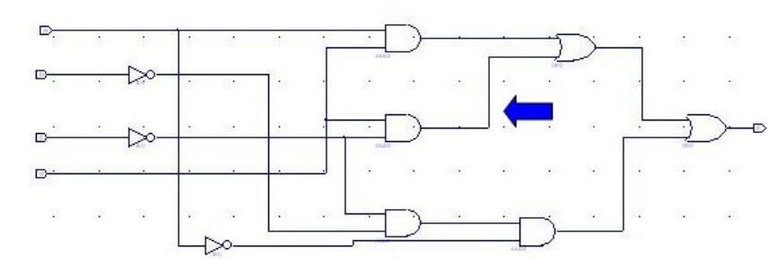
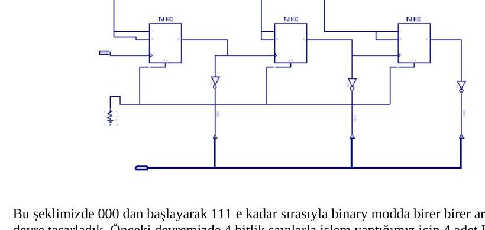
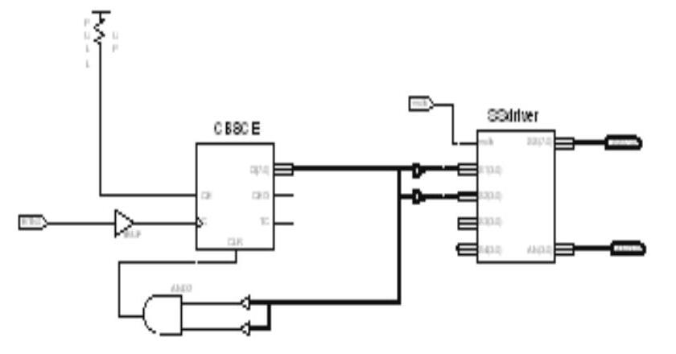
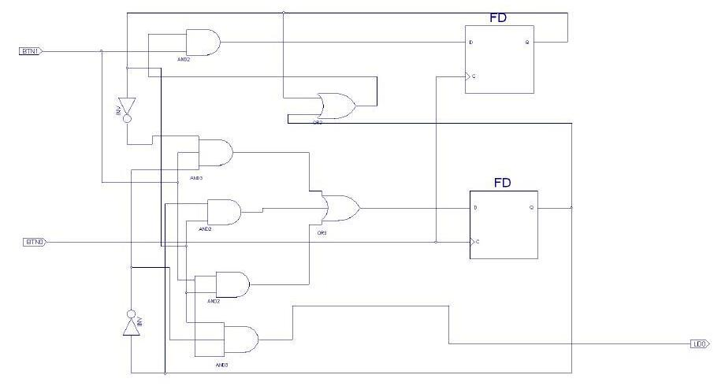

Bu yazı, Başkent Üniversitesi **EEM211 Sayısal Mantık Tasarımı** laboratuvarının **2006 güz dönemi** deneyleri için arkadaşların hazırladığı rapor ve ön çalışmaları bir araya getiriyor (Ekim–Aralık 2006). Deneyler **Xilinx ISE WebPack** ortamında şematik ya da Verilog ile tasarlanıp **ModelSim** benzetimiyle doğrulanıyor, ardından Pegasus FPGA kartına yükleniyordu. Raporların çoğu kısa birer sonuç notu ve benzetim listesinden oluşuyor. Raporlardaki öğrenci adları, numaraları ve dosya adlarındaki kişisel bilgiler çıkarıldı; maskelenmiş raporlar (A, B, C üç farklı arkadaşın raporlarını gösteriyor) yazının sonunda ZIP olarak indirilebilir.

## Deney 2: Xilinx ile ilk devre

Föydeki Şekil 1'deki kapı devresi Xilinx'te şematik olarak çizilip benzetimle dalga biçimi incelenmiş; sonra anahtarlar (switch) giriş, bir LED çıkış olarak atanıp devre karta yüklenmiş. F çıkışı 1 iken LED kırmızı yanıyor, 0 iken sönük kalıyor. Son olarak Lab02.bit dosyası derlenip başka bir mantık denenmiş: giriş bir buton, çıkış bir LED; butona basılınca LED yanıyor.

## Deney 4: 4 bitlik toplayıcılar (Verilog)

- **Lab04a:** tam toplayıcı modülü `fadder`, davranışsal olarak `^`, `|`, `~`, `&` operatörleriyle tanımlanmış; `fourbitadder1` modülü dört `fadder` kullanılarak hiyerarşik biçimde kurulmuş.
- **Lab04b:** AND, OR ve tümleyici kapıları ayrı modüller olarak yazılmış, aynı işi yapan `fadderStr` bu üç kapıyla yeniden kurulmuş ve `fourbitadder2` bununla oluşturulmuş.

İki tasarım da karta yüklendiğinde 4 bitlik ikili toplayıcı olarak çalışmış.

## Deney 5: Asal sayı göstergesi ve 2 bitlik karşılaştırıcı

1. 4 anahtarla girilen 4 bitlik sayı (1–15) **asal ise** LED yanan devre.
1. İki adet 2 bitlik sayıyı (A ve B) karşılaştıran devre: B büyükse LD0, küçükse LD2, A = B ise LD1 yanıyor.

İki devre Xilinx şematikte çizilip giriş-çıkışları atanmış ve Pegasus kartında denenmiş.

## Deney 6: Toplayıcılar ve eşlik üreticileri (kapı gecikmeleriyle)

1. Bir bitlik tam toplayıcı, kapı gecikmeleri verilerek kapı düzeyinde tanımlanmış (a, b, cin → s, cout).
1. İki 4 bitlik sayıyı toplayan **dalgacık eldeli (ripple carry)** toplayıcı kapı gecikmeleriyle kurulmuş.
1. **Carry-lookahead** toplayıcı yapısal olarak gerçekleştirilmiş: `PGgen` ve `carrygen` modülleri ve bunları kullanan `fourbitscarrylookahead` üst modülü.

Raporun soru cevapları:

- Toplayıcılardaki mantıksal işlemleri yapan kapı sayısı aynı olduğundan gecikme de aynıdır (1a).
- 4 bit yerine 16 bitlik dalgacık eldeli toplayıcı tasarlansaydı gecikme 4 kat artardı (1b).
- Benzetim sonuçlarındaki gecikmeler farklıdır; carry-lookahead tasarımı (lab06-3) daha hızlı çalışır (2a).

Xilinx'in zamanlama raporuna göre en uzun yol, carry-lookahead tasarımında cin'den cout'a **13,454 ns** (6 mantık seviyesi; 7,640 ns mantık, 5,814 ns yol), dalgacık eldeli tasarımda A<0>'dan cout'a **13,499 ns** (6 seviye; 7,640 ns mantık, 5,859 ns yol). Rapor bundan carry-lookahead'in daha hızlı olduğu sonucunu çıkarıyor.

*Not: 4 bitlik iki tasarımın gecikmeleri arasındaki fark yalnızca 0,045 ns; fark FPGA'daki yerleşimden (yol gecikmesinden) kaynaklanıyor, mantık gecikmeleri aynı. Carry-lookahead'in üstünlüğü daha geniş toplayıcılarda belirginleşir.*

## Deney 7: Hatalı devre, MUX'lu tasarım ve eşitlik denetleyicisi

Ön çalışmada ve raporda üç soru var:

1. Verilen devrede bir kablo temas etmediği için devre yanlış sinyal üretiyormuş. Ön çalışmada Karnaugh haritasıyla F' = a'c + bd' + ad' bulunmuş; düzeltilmiş fonksiyon **F = ad + c'd + a'b'c'**. F, abcd = 0000, 0001, 0101, 1001, 1011, 1101, 1111 için 1'dir.
1. Bir fonksiyon **üç adet 2x1 MUX** ile gerçekleştirilmiş: devre kapılarla kurulacak hâline göre hem sadeleşmiş hem hızlanmış. Raporda devrenin 0000, 0001, 0101, 1000, 1001, 1010, 1011 girişlerinde 1, abcd = 1101'de belirsiz sinyal ürettiği yazıyor.
1. İki bitlik ab ve cd sayıları **eşitse** 1 veren devre: F = a'b'c'd' + a'bc'd + ab'cd' + abcd (16 durumun yalnızca 4'ünde 1).

## Deney 8: Flip-floplar ve sayıcılar

Sorular, laboratuvar klasöründe de bulunan "EEM 211 Deney No: 8 – Flip floplar ve devre tasarımı" föyünün (son gözden geçirme 2005) sorularıyla aynı. İki raporda (A ve B) cevaplar şöyle:

1. **D flip-flop ile frekans bölücü:** çıkışın tersi D girişine geri bağlandığından her saat darbesinde çıkış değişir; çıkış frekansı giriş frekansının **yarısıdır**. Frekansı yarıya indirmek gereken her yerde kullanılabilir.
1. **4 bitlik asenkron geri sayıcı:** JK flip-floplar (J = K = 1, pull-up) zincirleme bağlanmış; her flip-flopun Q çıkışı bir sonrakinin saat girişini sürüyor. Q(0)'dan Q(3)'e her çıkışın frekansı bir öncekinin yarısı; devre 1111'den 0000'a birer azalarak sayıyor. Pull-down ile CLR girişleri 0'da tutuluyor.
1. Q çıkışlarıyla saat girişleri arasına tümleyici konunca devre **ileri sayıyor**; rapor A'da 3 flip-flopla 000'dan 111'e sayan sayıcı kurulmuş.
1. Şekil 1'deki frekans bölme işi, Şekil 3'teki sayıcının Q(0) çıkışından alınarak değişiklik yapmadan gerçekleştirilebilir.

## Deney 9: Mandallar ve flip-floplar (20 Aralık 2006)

1. Sayıcı çıkışı yedi parçalı gösterge sürücüsüne (SSdriver) bağlanmış; göstergede 0'dan 9'a artan sayılar görülüyor.
1. AND kapısı kaldırıldığında benzetimde 9'dan 0'a azalan bir sayma görülüyor.

Raporun sonuç kısmında: AND kapısının bütün bağlantıları kesildiğinde devre 0'dan 99'a kadar sayıyor.

## Deney 10: Sonlu durum makineleri (26–27 Aralık 2006)

İki rapor (B ve C) aynı devreyi anlatıyor: devre kendisine gönderilen dizide **1011** bulduğunda 1 çıkışı üretiyor; iç içe geçen dizilere (overlapping) izin veriliyor. Devre iki D flip-flop (FD), AND-OR kapıları ve iki buton girişiyle (BTN0, BTN1) kurulmuş; rapor C'de ModelSim'in liste çıktısı da var.

