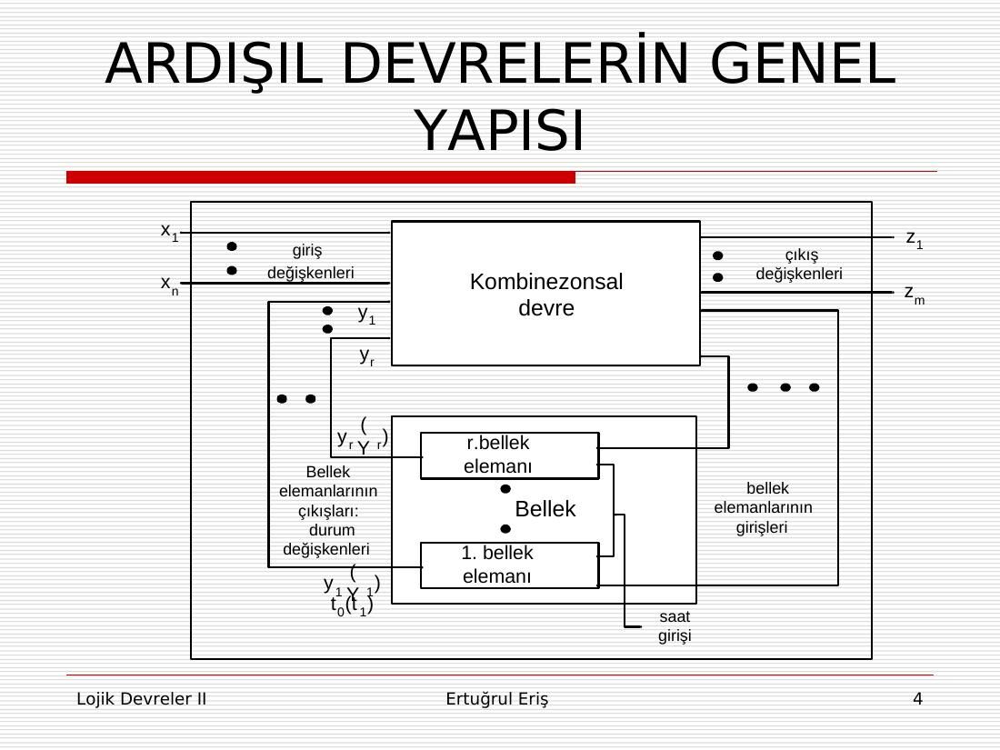
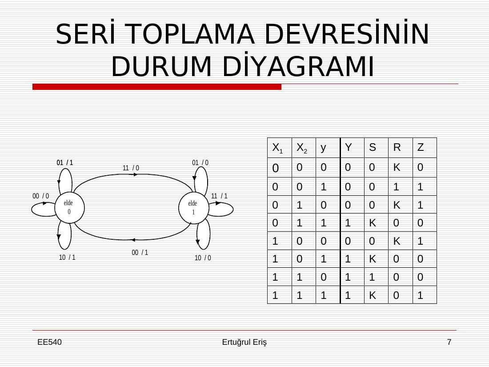
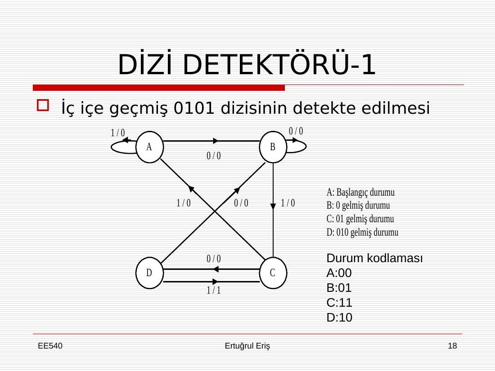

This post presents the **Logic Circuits II** (course code EE540) lecture material by **Ertuğrul Eriş**, found in the EEM211 Digital Logic Design course folder as a supplementary resource. It consists of three slide decks (*Sequential Circuit Modeling and Memory Elements*, *Sequential Circuit Analysis*, *Sequential Circuit Synthesis*; the first deck was last updated on 8 October 2009) and a "Read Me" document written for the course web page (updated September 2010). The documents do not state which university the course was given at. The slides also use figures taken from Mano's *Digital Design*. The main content of the slides is summarized below as text; the four original files can be downloaded as a ZIP at the end of the post.

*This content belongs to a third-party source; it is shared for archival and nostalgic purposes with the source credited. It will be removed at the request of the rights holder.*

## The "Read Me" document

The document explains that the materials on the course web page are grouped under five headings:

1. **General:** Lecture notes covering the Logic Circuits I–II courses, the learning outcomes of Logic Circuits II (what a student who successfully completes the course will learn and which skills they will gain), and student survey questions. The survey questions fall into three groups: what was learned in the course, the competencies gained, and evaluation of the instructor.
1. **Slides:** the PowerPoint slides used in class. The purpose of the slides is to minimize writing on the board and in notebooks, so that the class can proceed in a question-and-answer format. Students are advised to use the course textbook alongside the slides, and, rather than studying solved problems, to try to solve a problem on their own with the knowledge they have learned.
1. **Laboratory:** experiment sheets and reminders about the **Proteus** simulation software used in the laboratory. The correctness of the answer to a question can be checked by simulating the circuit in Proteus.
1. **Exams:** previously asked questions and their answers (some with Proteus simulations), common mistakes made in exams, and midterm results.
1. **Higher education:** articles the instructor has written on higher education (the blog address is given in the document).

## Slides 1: Sequential circuit modeling and memory elements

### Combinational and sequential circuits

The slides begin with the example of a **serial adder**: the numbers x1 = 12 (01100) and x2 = 14 (01110) are input bit by bit, starting from the least significant bit, and at each step the carry of the previous step must be remembered; the output is z = 26 (11010). The need to remember the carry makes the circuit **sequential** rather than combinational.

Sequential circuits are modeled in three ways: a **mathematical model**, a **state table**, and a **state diagram**.



### Mathematical model

- Independent variables: the inputs (x1, …, xn) and the state variables (y1, …, yr). If N is the number of states and n is the number of state variables, then N = 2ⁿ, n = log₂N.
- Dependent variables: the next-state functions (Y1, …, Yr) and the output functions (z1, …, zm).
- For the serial adder (y is the carry bit): Y = y'x1x2 + y·x1'x2 + y·x1x2' + y·x1x2 (that is, Y = x1x2 + y·x1 + y·x2) and z = x1 ⊕ x2 ⊕ y.

### Memory elements

- **SR memory element:** Y = S + R'y (S = R = 1 is not used). The analysis of the circuit built with two NOR gates shows that if both inputs change simultaneously, two different results (01 or 10) may occur depending on the gate delays, that is, the outcome is indeterminate. The NAND-gate version is called the S*R* latch.
- **Problems and solutions:** if both inputs change at the same time (such as from 01 to 10), the unwanted inputs 00 or 11 may be applied as an intermediate state. Solution: apply an intermediate input that does not change the state, or use a level-type clock (enable) input.
- **D (delay) latch:** Y = D.
- **JK latch:** Y = Jy' + K'y.
- **T latch:** Y = Ty' + T'y.
- **Continuous toggling problem:** when 1 is applied to a T element or 11 to a JK element, the output keeps changing as long as the clock level persists; a level-type clock does not solve this. The solution is **edge-triggered memory elements**. In synchronous circuits, if a level-type clock is used and the clock pulse is longer than the sum of the memory and combinational circuit delays (ts > tb + tc), two state changes can occur within one clock pulse.
- **Difference between latches and flip-flops:** latches either have no clock or have a level-type clock (enable); flip-flops have only edge-triggered clock inputs.
- The remainder of the slides covers characteristic tables, **master-slave** D and SR elements, the analysis of a **positive-edge-triggered D flip-flop** for the four cases of CLK and D, **setup and hold times** (the time interval during which the input must not change), a D flip-flop with asynchronous reset, and a JK integrated circuit with preset/clear inputs in a practical application.
- **Classification of sequential circuits:** synchronous and asynchronous machines; asynchronous machines operate in fundamental mode or pulse mode.

The final slides (developing the curriculum, Bloom's taxonomy, the Turkish Higher Education Qualifications Framework, and the course assessment matrix) are common to all three decks.

## Slides 2: Sequential circuit analysis

The first slides give Turkish-English term equivalents: sequential circuit (finite state machine), memory element (storage element), level-clocked element (latch), edge-triggered flip-flop, characteristic table, characteristic equation (next-state function), state table, state diagram, excitation table. The number of state variables n needed to encode N states is the smallest integer satisfying n ≥ log₂N.

Analysis examples:

- A synchronous **Moore** circuit with JK flip-flops, two state variables, and four states: state table, state diagram, Proteus implementation, and timing diagrams.
- A Moore circuit with T flip-flops and another Moore example with D flip-flops.
- A **Mealy** circuit with D flip-flops and two state variables: state table (in two forms), state diagram, timing diagrams, and Proteus simulation.
- The state table and diagram of a Mealy machine with D and JK flip-flops, followed by **erroneous outputs**: since the output of a Mealy machine depends directly on the input, when the input changes between clock edges, brief incorrect values appear at the output. In the timing diagram these pulses are marked as "harmful" and "harmless"; the Proteus implementation of a circuit with erroneous outputs is also given.

## Slides 3: Sequential circuit synthesis

### Steps of synthesis

1. Going from the word description to the state diagram.
1. State reduction (what is its effect on the resulting circuit?).
1. State assignment (what happens if it is chosen arbitrarily?).
1. Determining and minimizing the output functions.
1. Selecting the memory elements.
1. Determining and minimizing the input functions using the memory elements' **excitation tables**.
1. Drawing the circuit.

### Excitation tables

| y → Y | D | T | SR | JK |
|---|---|---|---|---|
| 0 → 0 | 0 | 0 | 0K | 0K |
| 0 → 1 | 1 | 1 | 10 | 1K |
| 1 → 0 | 0 | 1 | 01 | K1 |
| 1 → 1 | 1 | 0 | K0 | K0 |

(K: arbitrary, i.e., "don't care".)

### Serial adder circuit

Two serial inputs (the numbers X and Y to be added, least significant bit first, one clock pulse per bit) and one serial output (the sum). There are two states: carry 0 and carry 1; therefore a single state variable is sufficient. Synthesis with an SR memory element:

| X1 | X2 | y | Y | S | R | Z |
|---|---|---|---|---|---|---|
| 0 | 0 | 0 | 0 | 0 | K | 0 |
| 0 | 0 | 1 | 0 | 0 | 1 | 1 |
| 0 | 1 | 0 | 0 | 0 | K | 1 |
| 0 | 1 | 1 | 1 | K | 0 | 0 |
| 1 | 0 | 0 | 0 | 0 | K | 1 |
| 1 | 0 | 1 | 1 | K | 0 | 0 |
| 1 | 1 | 0 | 1 | 1 | 0 | 0 |
| 1 | 1 | 1 | 1 | K | 0 | 1 |

Result: S = x1x2, R = x1'x2', z = y ⊕ x1 ⊕ x2.



### Modulo-8 counter

A three-bit counter that advances to the next state at each clock pulse when input X is 1 (S0 → S1 → … → S7 → S0) and holds when X = 0. The input functions with T memory elements:

T1 = x·y2·y3, T2 = x·y3, T3 = x

To count clock pulses directly (x = 1): T1 = y2y3, T2 = y3, T3 = 1.

### Counter that counts 0, 2, 4, 7

A counter that counts in the sequence 000 → 010 → 100 → 111 → 000 with three JK memory elements (the outputs are the states themselves, a Moore machine). Taking the four unused states as don't-cares (K):

J1 = y2, K1 = y2; J2 = 1, K2 = 1; J3 = y1, K3 = 1

The slides also discuss how the same counter could be built with two JK elements (four states A = 00, B = 01, C = 10, D = 11 and an output decoder): is the number of states minimal, Moore or Mealy, which synthesis is better?

*Note: The given J/K functions were checked; they correctly produce the sequence 000 → 010 → 100 → 111 → 000.*

### Sequence detector

Three different definitions for a circuit that detects the sequence 0101, and the outputs for the same input:

```
Giriş:                       100101010111001000101
İç içe dizileri de algılasın: 000001010100000000001
İç içe olanları algılamasın:  000001000100000000001
Dörtlü paketlere göre:        000000010000000000000
```

The Mealy machine that detects overlapping 0101 sequences: A is the initial state, B "0 received", C "01 received", D "010 received"; state assignment A = 00, B = 01, C = 11, D = 10. Transitions: A –0/0→ B, A –1/0→ A; B –0/0→ B, B –1/0→ C; C –0/0→ D, C –1/0→ A; D –1/1→ C, D –0/0→ B. In the non-overlapping version, when a 1 arrives in D the output is 1 and the machine returns to the initial state (A).



Finally, the state diagram and logic circuit of a four-state detector (S0 = 00 … S3 = 11) that detects the sequence 111 are given; the slide asks "Would three states have been sufficient for this sequence? Mealy or Moore?"
