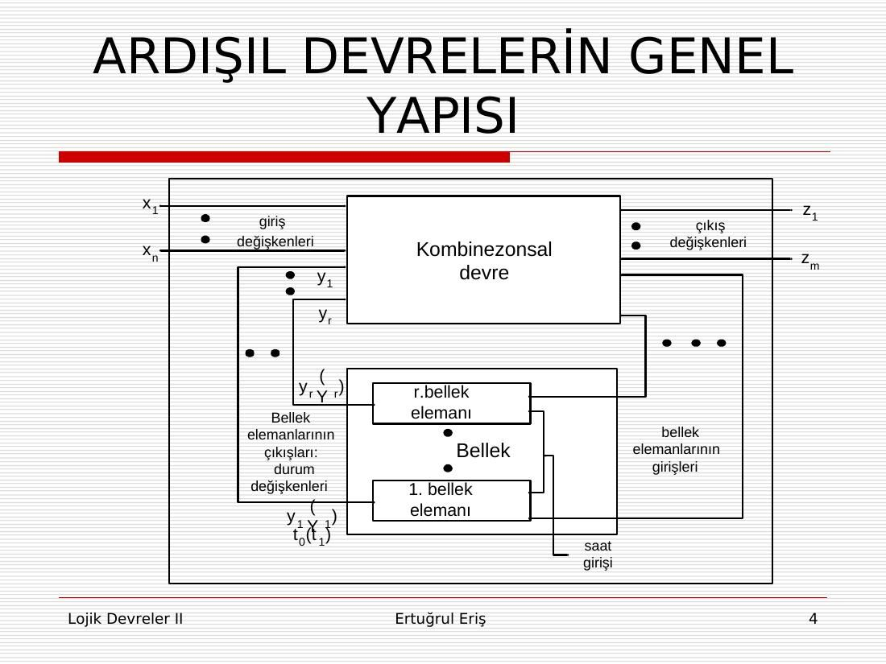
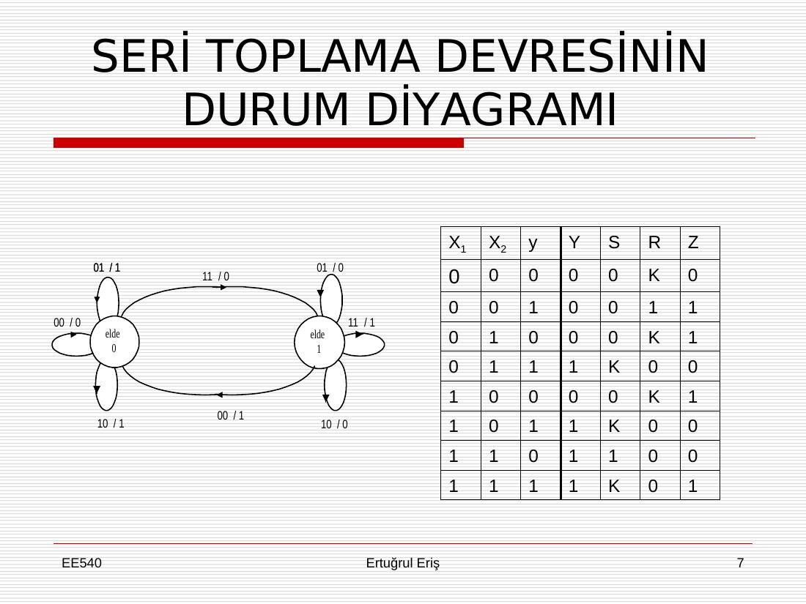
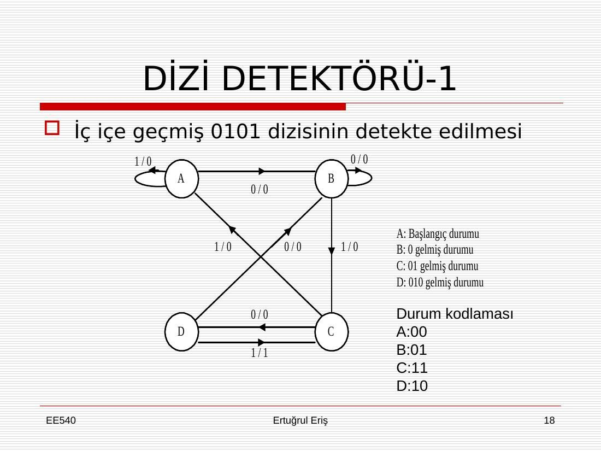

Bu yazı, EEM211 Sayısal Mantık Tasarımı dersinin klasöründe yardımcı kaynak olarak bulunan, **Ertuğrul Eriş**'e ait **Lojik Devreler II** (ders kodu EE540) ders materyalini tanıtıyor: üç sunu (*Ardışıl Devre Modellemesi ve Bellek Elemanları*, *Ardışıl Devre Analizi*, *Ardışıl Devre Sentezi*; ilk sununun güncelleme tarihi 8 Ekim 2009) ve dersin web sayfası için yazılmış "Beni Oku" belgesi (Eylül 2010 güncellemesi). Belgelerde hangi üniversitede verildiği yazmıyor. Sunularda Mano'nun *Digital Design* kitabından alınmış şekiller de kullanılmış. Sunuların ana içeriği aşağıda metin olarak özetlendi; dört orijinal dosya yazının sonunda ZIP olarak indirilebilir.

*Bu içerik üçüncü taraf bir kaynağa aittir; arşiv ve nostalji amacıyla kaynak belirtilerek paylaşılmıştır. Hak sahibinin talebi hâlinde kaldırılır.*

## "Beni Oku" belgesi

Belge, dersin web sayfasındaki belgelerin beş başlık altında toplandığını anlatıyor:

1. **Genel:** Lojik Devreler I–II derslerini kapsayan ders notları, Lojik Devreler II öğrenim çıktıları (dersi başarıyla bitiren öğrencinin neyi öğreneceği ve hangi becerileri kazanacağı) ve öğrenci anket soruları. Anket soruları üç grupta: derste öğrenilenler, kazandırılan yetkinlikler ve öğretim üyesinin değerlendirilmesi.
1. **Sunular:** derste kullanılan PowerPoint sunuları. Sunuların amacı tahtaya ve deftere yazmayı en aza indirip dersin soru-cevap biçiminde geçmesini sağlamak. Öğrencilere sunuların yanında dersin kitabını kullanmaları, çözülmüş problemlerle çalışmak yerine bir problemi öğrendikleri bilgilerle kendileri çözmeye çalışmaları öneriliyor.
1. **Laboratuvar:** deney föyleri ve laboratuvarda kullanılan **Proteus** benzetim yazılımıyla ilgili hatırlatmalar. Bir sorunun cevabının doğruluğu devre Proteus'ta simüle edilerek denetlenebilir.
1. **Sınavlar:** daha önce sorulmuş sorular ve cevapları (bazılarının Proteus simülasyonlarıyla), sınavlarda sık yapılan hatalar ve ara sınav sonuçları.
1. **Yüksek öğretim:** hocanın yüksek öğretim üzerine yazdığı makaleler (blog adresi belgede verilmiş).

## Sunu 1: Ardışıl devre modellemesi ve bellek elemanları

### Kombinezonsal ve ardışıl devreler

Sunu, **seri toplayıcı** örneğiyle başlıyor: x1 = 12 (01100) ve x2 = 14 (01110) sayıları en anlamlı olmayan bitten başlayarak bit bit girilir, her adımda önceki adımın eldesi hatırlanmak zorundadır; çıkış z = 26 (11010) olur. Eldeyi hatırlama gereği, devreyi kombinezonsal değil **ardışıl** yapar.

Ardışıl devreler üç yolla modellenir: **matematiksel model**, **durum tablosu** ve **durum diyagramı**.



### Matematiksel model

- Bağımsız değişkenler: girişler (x1, …, xn) ve durum değişkenleri (y1, …, yr). N durum sayısı, n durum değişkeni sayısı ise N = 2ⁿ, n = log₂N.
- Bağımlı değişkenler: bir sonraki durum fonksiyonları (Y1, …, Yr) ve çıkış fonksiyonları (z1, …, zm).
- Seri toplayıcı için (y elde biti): Y = y'x1x2 + y·x1'x2 + y·x1x2' + y·x1x2 (yani Y = x1x2 + y·x1 + y·x2) ve z = x1 ⊕ x2 ⊕ y.

### Bellek elemanları

- **SR bellek elemanı:** Y = S + R'y (S = R = 1 kullanılmaz). İki NOR (TÜVEYA) kapısıyla yapılan devrenin analizinde, iki girişin aynı anda değişmesi hâlinde kapı gecikmelerine bağlı olarak iki farklı sonuç (01 ya da 10) oluşabileceği, yani belirsizlik olduğu gösteriliyor. NAND kapılı sürüm S*R* latch olarak adlandırılıyor.
- **Sorunlar ve çözümleri:** iki giriş aynı anda değişirse (01'den 10'a gibi) istenmeyen 00 ya da 11 girişleri ara durum olarak uygulanmış olabilir. Çözüm: arada durum değiştirmeyen girişi uygulamak ya da seviye biçiminde saat (enable) girişi kullanmak.
- **D (gecikme) latch:** Y = D.
- **JK latch:** Y = Jy' + K'y.
- **T latch:** Y = Ty' + T'y.
- **Sürekli değişme (toggling) sorunu:** T elemanına 1, JK elemanına 11 girişi uygulandığında saat seviyesi sürdükçe çıkış sürekli değişir; seviye biçiminde saat bunu çözmez. Çözüm **kenar tetiklemeli bellek elemanlarıdır**. Senkron devrelerde seviye biçiminde saat kullanılırsa, saat darbesi bellek ve kombinezonsal devre gecikmelerinin toplamından uzun olduğunda (ts > tb + tc) bir saat darbesinde iki durum değişimi olabilir.
- **Latch ve flip-flop farkı:** latch'larda ya saat yoktur ya da saat seviye olarak (enable) vardır; flip-floplarda yalnızca kenar tetiklemeli saat girişleri vardır.
- Sununun devamında karakteristik tablolar, **ana-bağımlı (master-slave)** D ve SR elemanları, **pozitif kenar tetiklemeli D flip-flop**un CLK ve D'nin dört durumu için analizi, **oturma (setup) ve tutma (hold) zamanları** (girişin değişmemesi gereken zaman aralığı), asenkron resetli D flip-flop ve preset/clear girişli uygulamadaki JK tümdevresi yer alıyor.
- **Ardışıl devrelerin sınıflandırılması:** senkron ve asenkron makineler; asenkron makineler temel modda ya da darbe modunda çalışır.

Sununun sonundaki slaytlar (öğrenim programının oluşturulması, Bloom taksonomisi, Türkiye Yükseköğretim Ulusal Yeterlilikler Çerçevesi ve ders değerlendirme matrisi) üç sunuda da ortak.

## Sunu 2: Ardışıl devre analizi

İlk slaytlar Türkçe-İngilizce terim karşılıklarını veriyor: ardışıl devre (sequential circuit, finite state machine), bellek elemanı (memory/storage element), seviye saatli eleman (latch), kenar tetiklemeli flip-flop (edge triggered flip-flop), tanım bağıntısı (characteristic table), bir sonraki durum fonksiyonu (characteristic equation), durum tablosu (state table), durum diyagramı (state diagram), ters tanım bağıntısı (excitation table). N durumu kodlamak için gereken durum değişkeni sayısı n, n ≥ log₂N koşulunu sağlayan en küçük tamsayıdır.

Analiz örnekleri:

- JK flip-floplu, iki durum değişkenli, dört durumlu senkron **Moore** devresi: durum tablosu, durum diyagramı, Proteus uygulaması ve zaman diyagramları.
- T flip-floplu Moore devresi ve D flip-floplu bir başka Moore örneği.
- D flip-floplu, iki durum değişkenli **Mealy** devresi: durum tablosu (iki biçimde), durum diyagramı, zaman diyagramları ve Proteus simülasyonu.
- D ve JK flip-floplu bir Mealy makinesinin durum tablosu ve diyagramı, ardından **hatalı çıkışlar**: Mealy makinesinde çıkış girişe doğrudan bağlı olduğundan, giriş saat kenarları arasında değişince çıkışta kısa süreli yanlış değerler görülür. Zaman diyagramında bu darbeler "zararlı" ve "zararsız" olarak işaretlenmiş; hatalı çıkışı olan devrenin Proteus uygulaması da verilmiş.

## Sunu 3: Ardışıl devre sentezi

### Sentezin adımları

1. Sözle tanımdan (word description) durum diyagramına geçiş.
1. Durum indirgemesi (sonuç devreye etkisi nedir?).
1. Durum kodlaması (rastgele seçilse ne olur?).
1. Çıkış fonksiyonlarının saptanması ve indirgenmesi.
1. Bellek elemanı seçimi.
1. Bellek elemanlarının **ters tanım bağıntılarıyla** (excitation table) giriş fonksiyonlarının saptanması ve indirgenmesi.
1. Devrenin çizimi.

### Ters tanım bağıntıları

| y → Y | D | T | SR | JK |
|---|---|---|---|---|
| 0 → 0 | 0 | 0 | 0K | 0K |
| 0 → 1 | 1 | 1 | 10 | 1K |
| 1 → 0 | 0 | 1 | 01 | K1 |
| 1 → 1 | 1 | 0 | K0 | K0 |

(K: keyfi, yani "don't care".)

### Seri toplama devresi

İki seri giriş (toplanacak X ve Y sayıları, en az anlamlı bit önce, her bit için bir saat darbesi), bir seri çıkış (toplam). İki durum vardır: elde 0 ve elde 1; bu yüzden tek durum değişkeni yeter. SR bellek elemanıyla sentez:

| X1 | X2 | y | Y | S | R | Z |
|---|---|---|---|---|---|---|
| 0 | 0 | 0 | 0 | 0 | K | 0 |
| 0 | 0 | 1 | 0 | 0 | 1 | 1 |
| 0 | 1 | 0 | 0 | 0 | K | 1 |
| 0 | 1 | 1 | 1 | K | 0 | 0 |
| 1 | 0 | 0 | 0 | 0 | K | 1 |
| 1 | 0 | 1 | 1 | K | 0 | 0 |
| 1 | 1 | 0 | 1 | 1 | 0 | 0 |
| 1 | 1 | 1 | 1 | K | 0 | 1 |

Sonuç: S = x1x2, R = x1'x2', z = y ⊕ x1 ⊕ x2.



### Modulo 8 sayıcı

X girişi 1 iken her saat darbesinde bir sonraki duruma geçen (S0 → S1 → … → S7 → S0), X = 0 iken bekleyen üç bitlik sayıcı. T bellek elemanlarıyla giriş fonksiyonları:

T1 = x·y2·y3, T2 = x·y3, T3 = x

Saat darbelerini doğrudan saymak için (x = 1): T1 = y2y3, T2 = y3, T3 = 1.

### 0, 2, 4, 7 biçiminde sayan sayıcı

Üç JK bellek elemanıyla 000 → 010 → 100 → 111 → 000 sırasında sayan sayıcı (çıkışlar doğrudan durumlar, Moore makinesi). Kullanılmayan dört durum keyfi (K) alınarak:

J1 = y2, K1 = y2; J2 = 1, K2 = 1; J3 = y1, K3 = 1

Sunu, aynı sayıcının iki JK elemanıyla (dört durum A = 00, B = 01, C = 10, D = 11 ve çıkış kod çözücüsüyle) nasıl yapılabileceğini de tartışıyor: durum sayısı minimum mu, Moore mu Mealy mi, hangi sentez daha iyi?

*Not: Verilen J/K fonksiyonları kontrol edildi; 000 → 010 → 100 → 111 → 000 sırasını doğru üretiyor.*

### Dizi detektörü

0101 dizisini algılayan devre için üç farklı tanım ve aynı giriş için çıkışlar:

```
Giriş:                       100101010111001000101
İç içe dizileri de algılasın: 000001010100000000001
İç içe olanları algılamasın:  000001000100000000001
Dörtlü paketlere göre:        000000010000000000000
```

İç içe geçmiş 0101 dizilerini algılayan Mealy makinesi: A başlangıç, B "0 gelmiş", C "01 gelmiş", D "010 gelmiş" durumu; durum kodlaması A = 00, B = 01, C = 11, D = 10. Geçişler: A –0/0→ B, A –1/0→ A; B –0/0→ B, B –1/0→ C; C –0/0→ D, C –1/0→ A; D –1/1→ C, D –0/0→ B. İç içe olmayan sürümde D'den 1 gelince çıkış 1 olur ve başlangıç durumuna (A) dönülür.



Son olarak 111 dizisini algılayan, dört durumlu (S0 = 00 … S3 = 11) bir detektörün durum diyagramı ve lojik devresi veriliyor; slaytta "Bu dizi için üç durum yeterli olur muydu? Mealy mi Moore mu?" soruları soruluyor.
