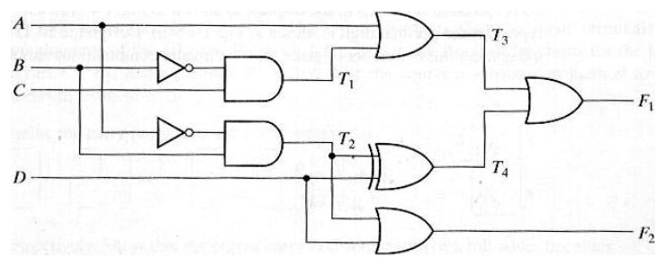

This post is the **Homework 2** sheet of the Başkent University course **EEM 211 Digital Logic Design**, dated December 2006 (the file properties list Evren Ferhat as its author). The homework covers **multiplexers and decoders** and combinational circuit analysis. It consists of six questions; the solutions are not included in this document. The original PDF of the homework can be downloaded at the end of the post.

## Submission information

> READ THE INFORMATION PART FIRST!!!

- You can hand in your assignments until Monday, December 18th 2006 no later than 17.00 to office A301 (section 01) or C302B (section 02).
- Prepare your assignments on white A4 paper (torn papers from notebooks or any media other than white A4 papers will not be accepted) and indicate your section number. Use staples if needed, plastic pockets will not be accepted.
- SECTION 02: When writing the final draft of your work, write your answers in order. Answers without order will not be graded.

## Question 1 (16 points)

> Find the minterm list of the function f(A,B,C,D) realized by the following circuit. Express f(A,B,C,D) in standard and canonical SOP form. (in the 4x1 mux components B and A represents MSB and LSB respectively)

The circuit contains two 4-to-1 multiplexers and one 2-to-1 multiplexer. In the figure, the select inputs (B and A) of the 4-to-1 multiplexers appear to be connected to the circuit's B and C signals. The data inputs are:

| Input | Upper 4-to-1 | Lower 4-to-1 |
|---|---|---|
| D0 | A' ⊕ 0 | A ⊕ A' |
| D1 | A' | 1 |
| D2 | A | 0 |
| D3 | A ⊕ 1 | 1 ⊕ A' |

The Y outputs of the two multiplexers are connected to the D0 and D1 inputs of the 2-to-1 multiplexer; the select input of the 2-to-1 multiplexer is S = D, and its output is f(A, B, C, D).

")

## Question 2 (20 points)

> Implement the Boolean function F(A,B,C,D)=Σ(0,1,3,4,8,9,15) with a multiplexer.

## Question 3 (10 points)

> Implement a full adder with two 4x1 multiplexers.

## Question 4 (20 points)

> Design a 4x16 decoder by using 74138 decoders. Designs involving any other decoders than 74138 will not be graded. (HINT: You are expected to search for 74138 datasheet.)

## Question 5 (20 points: 6, 7, 7)

> Consider the combinatorial circuit given below:
> a) Derive the Boolean expressions for T1 through T4. Evaluate the outputs F1 and F2 as a function of the four inputs.
> b) List the truth table with 16 binary combinations of the four input variables. Then list the binary values for T1 through T4 and outputs F1 and F2 in the table.
> c) Plot the output Boolean functions obtained in part (b) on maps and show that the simplified Boolean expressions are equivalent to the ones obtained in part (a).

## Question 6 (14 points)

> Given the circuit below, with the decoder having active-low outputs as shown, find the minimum Boolean expressions for f(W,X,Y,Z) in standard and canonical SOP forms.

The circuit uses a 74154 (4-to-16 decoder): Z is connected to input A, Y to B, X to C, and W to D; the enable inputs G1 and G2 are tied to ground. Some of the decoder's active-low outputs feed two AND gates, and the outputs of the two AND gates are combined in a NOR gate to give the output f(W, X, Y, Z).

 with a 74154 4-to-16 decoder")

## Grading

| Question | Points |
|---|---|
| Q1 | 16 |
| Q2 | 20 |
| Q3 | 10 |
| Q4 | 20 |
| Q5 | 20 (6, 7, 7) |
| Q6 | 14 |
