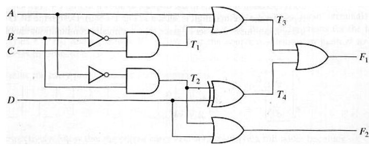

Bu yazı, Başkent Üniversitesi **EEM 211 Digital Logic Design (Sayısal Mantık Tasarımı)** dersinin **Homework 2** ödev kâğıdıdır (Aralık 2006; dosya bilgisinde hazırlayan: Evren Ferhat). Ödevin konusu **çoklayıcılar (multiplexer) ve kod çözücüler (decoder)** ile birleşimsel devre analizi. Altı sorudan oluşuyor; çözümleri bu belgede yok. Ödevin orijinal PDF'i yazının sonunda indirilebilir.

## Teslim bilgileri

> READ THE INFORMATION PART FIRST!!!

- You can hand in your assignments until Monday, December 18th 2006 no later than 17.00 to office A301 (section 01) or C302B (section 02).
- Prepare your assignments on white A4 paper (torn papers from notebooks or any media other than white A4 papers will not be accepted) and indicate your section number. Use staples if needed, plastic pockets will not be accepted.
- SECTION 02: When writing the final draft of your work, write your answers in order. Answers without order will not be graded.

## Soru 1 (16 puan)

> Find the minterm list of the function f(A,B,C,D) realized by the following circuit. Express f(A,B,C,D) in standard and canonical SOP form. (in the 4x1 mux components B and A represents MSB and LSB respectively)

Devrede iki adet 4'e-1 çoklayıcı ve bir 2'ye-1 çoklayıcı var. Şekilde 4'e-1 çoklayıcıların seçme girişleri (B ve A) devrenin B ve C sinyallerine bağlı görünüyor. Veri girişleri:

| Giriş | Üstteki 4-to-1 | Alttaki 4-to-1 |
|---|---|---|
| D0 | A' ⊕ 0 | A ⊕ A' |
| D1 | A' | 1 |
| D2 | A | 0 |
| D3 | A ⊕ 1 | 1 ⊕ A' |

İki çoklayıcının Y çıkışları 2'ye-1 çoklayıcının D0 ve D1 girişlerine bağlı; 2'ye-1 çoklayıcının seçme girişi S = D, çıkışı f(A, B, C, D).

 fonksiyonunu gerçekleştiren çoklayıcı devresi")

## Soru 2 (20 puan)

> Implement the Boolean function F(A,B,C,D)=Σ(0,1,3,4,8,9,15) with a multiplexer.

## Soru 3 (10 puan)

> Implement a full adder with two 4x1 multiplexers.

## Soru 4 (20 puan)

> Design a 4x16 decoder by using 74138 decoders. Designs involving any other decoders than 74138 will not be graded. (HINT: You are expected to search for 74138 datasheet.)

## Soru 5 (20 puan: 6, 7, 7)

> Consider the combinatorial circuit given below:
> a) Derive the Boolean expressions for T1 through T4. Evaluate the outputs F1 and F2 as a function of the four inputs.
> b) List the truth table with 16 binary combinations of the four input variables. Then list the binary values for T1 through T4 and outputs F1 and F2 in the table.
> c) Plot the output Boolean functions obtained in part (b) on maps and show that the simplified Boolean expressions are equivalent to the ones obtained in part (a).

## Soru 6 (14 puan)

> Given the circuit below, with the decoder having active-low outputs as shown, find the minimum Boolean expressions for f(W,X,Y,Z) in standard and canonical SOP forms.

Devrede 74154 (4'e-16 kod çözücü) kullanılıyor: Z → A, Y → B, X → C, W → D girişlerine bağlı; G1 ve G2 etkinleştirme girişleri toprağa bağlı. Kod çözücünün etkin-düşük çıkışlarından bazıları iki AND kapısına gidiyor, iki AND kapısının çıkışı da bir NOR kapısında birleşerek f(W, X, Y, Z) çıkışını veriyor.

")

## Puanlama

| Soru | Puan |
|---|---|
| Q1 | 16 |
| Q2 | 20 |
| Q3 | 10 |
| Q4 | 20 |
| Q5 | 20 (6, 7, 7) |
| Q6 | 14 |
