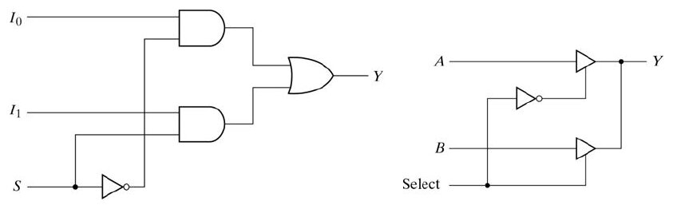
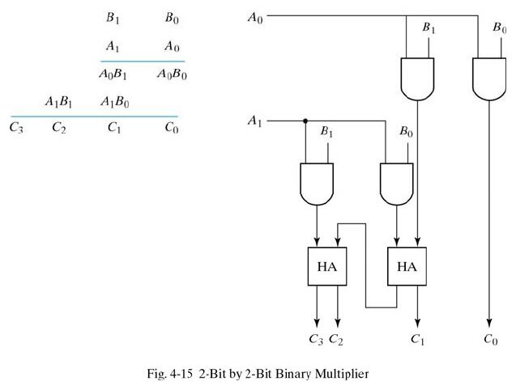
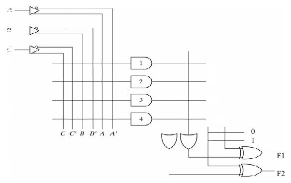
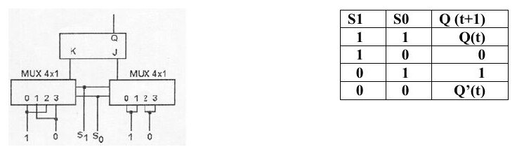
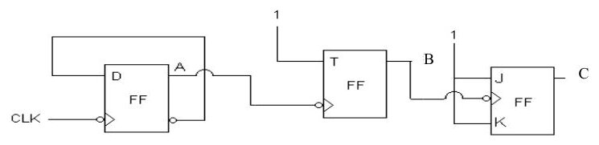
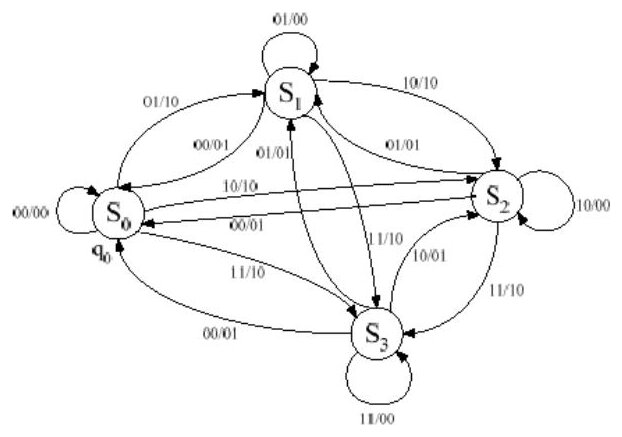
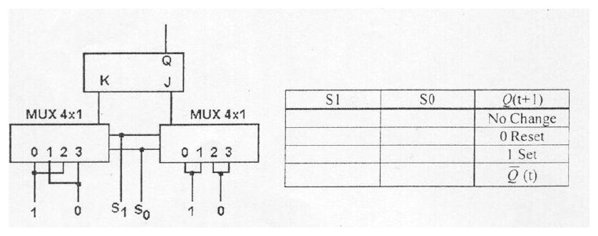
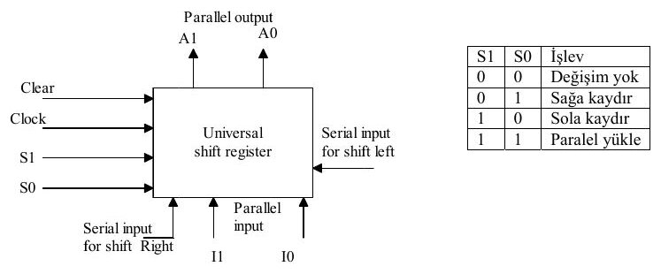
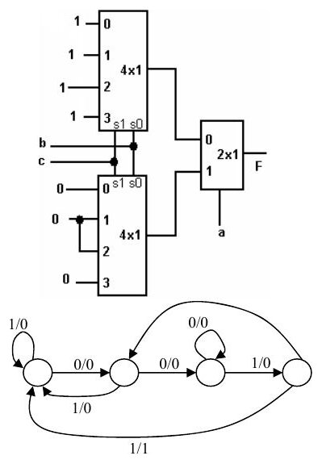

This post contains sample questions shared in December 2012 for the **EEM211 Digital Logic Design** course at Başkent University (the PDF's author metadata names the course instructor, Hamit Erdem). The document has two parts: the first four pages contain **ten questions with their point values and answers**, and the last two pages are a **mock exam with twelve questions and no answers**, prepared for students to fill in. The scope covers the whole semester: number systems and Boolean algebra, multiplexers, PLAs, flip-flops, and state machines. The original PDF can be downloaded at the end of the post.

## Part one: sample questions with answers

### 1) r's complement signed system (6 P)

> Express the number (−13), given in decimal, in the binary system using 8 bits according to the r's complement signed system.

Answer: **11110011**

### 2) Conversion to base 8 and base 16 (5 P)

> Write the number given in binary in base 8 and base 16.

(1010 1111.0001 0110 1100)₂ = **(257.0554)₈** = **(AF.16C)₁₆**

### 3) Boolean simplification (5 P)

> Simplify the given expression using Boolean rules: X'Z + XY'Z + XYZ

Answer: **Z**

### 4) 2x1 MUX (11 P)

> Build a 2x1 mux circuit in two different ways using the minimum number of logic gates. a) Using NOT and three-state gates, b) Using AND, OR, NOT gates.

Two circuits are drawn in the answer. In the AND-OR-NOT solution, the select input S is inverted by a NOT gate and fed to the AND gate of I0, while S itself goes to the AND gate of I1; the two AND outputs are combined in an OR gate (Y = S'·I0 + S·I1). In the three-state solution, inputs A and B each pass through a three-state buffer and are connected to the same line Y; the Select signal enables one buffer directly and the other through a NOT gate.

### 5) Binary multiplier (8 P)

> Draw the logic structure required to perform the given multiplication.

The two-bit B1B0 is multiplied by A1A0: the partial products are A0B1, A0B0 and A1B1, A1B0; the result is C3 C2 C1 C0. The answer given is a "2-Bit by 2-Bit Binary Multiplier" circuit made up of four AND gates and two half adders (HA): C0 = A0B0; C1 is the sum of A0B1 and A1B0 in the half adder; C2 and C3 come out of the second half adder.

### 6) Implementation with a PLA (12 P)

> Implement the functions F1 and F2 using a PLA circuit and mark the required terms on the given PLA.
> F1(A, B, C) = Σ(0, 1, 6, 7)
> F2(A, B, C) = Σ(1, 2, 3, 5, 7)

Karnaugh maps (rows A, columns BC = 00, 01, 11, 10):

| | 00 | 01 | 11 | 10 |
|---|---|---|---|---|
| F2, A = 0 | 0 | 1 | 1 | 1 |
| F2, A = 1 | 0 | 1 | 1 | 0 |
| F1, A = 0 | 1 | 1 | 0 | 0 |
| F1, A = 1 | 0 | 0 | 1 | 1 |

> Simplification with K-maps gives **F1 = AB + A'B'**, **F1' = AB' + A'B** and **F2 = C + A'B**, **F2' = B'C' + AC'**

The PLA has four product terms (AND), two OR gates, and XOR gates that can be tied to 0 or 1 so the outputs can be inverted when needed.

### 7) Hamming code (12 P)

> Binary data was encoded according to the Hamming coding system and sent from one system to another. The encoded data obtained at the receiving system is 011111. Write the original data that was sent.

- C1 = XOR(1, 3, 5) = XOR(0, 1, 1) = 0
- C2 = XOR(2, 3, 6) = XOR(1, 1, 1) = 1
- C4 = XOR(4, 5, 6) = XOR(0, 1, 1) = 1

C4C2C1 = 110 = bit 6 must be 0. Accordingly, the actual data should be **110**.

*Note: Since the 4th bit of the received word 011111 is 1, the C4 line should be XOR(1, 1, 1) = 1; the document writes XOR(0, 1, 1). The result (C4 = 1, erroneous bit 6, data 110) does not change.*

### 8) JK flip-flop and multiplexer (13 P)

> In the figure, the inputs of the J/K FF are provided through 4x1 multiplexers. Write the values of S1 and S0 needed to obtain the Q(t+1) values shown in the table. S1 is the most significant bit and S0 is the least significant bit.

| S1 | S0 | Q(t+1) |
|---|---|---|
| 1 | 1 | Q(t) |
| 1 | 0 | 0 |
| 0 | 1 | 1 |
| 0 | 0 | Q'(t) |

### 9) Asynchronous counter (13 P)

> In the given counter circuit the present state is 100; write the next states for the 4 incoming clock pulses. A represents the least significant bit and C represents the most significant bit.

In the circuit, a D, a T (T = 1) and a JK (J = K = 1) flip-flop, all falling-edge triggered, are connected in a chain.

Answer (CBA): **100 → 101 → 110 → 111 → 000**

### 10) Mealy state machine (15 P)

> The state table of a sequential circuit is given below (S0 = 00, S1 = 01, S2 = 10, S3 = 11). a) Draw the state diagram on the states at the right. b) Design the Mealy FSM circuit using T FFs. c) Explain the operation this circuit performs (Bonus 5 P).

Next state (NS) and output (z1z2), according to input x1x2:

| PS | NS, x1x2 = 00 | 01 | 10 | 11 | z1z2, x1x2 = 00 | 01 | 10 | 11 |
|---|---|---|---|---|---|---|---|---|
| S0 | S0 | S1 | S2 | S3 | 00 | 10 | 10 | 10 |
| S1 | S0 | S1 | S2 | S3 | 01 | 00 | 10 | 10 |
| S2 | S0 | S1 | S2 | S3 | 01 | 01 | 00 | 10 |
| S3 | S0 | S1 | S2 | S3 | 01 | 01 | 01 | 00 |

Expressions found from the Karnaugh maps for the T flip-flop inputs and outputs (y1y2 present state, x1x2 input):

- T1 = x1'·y1 + x1·y1' = **x1 ⊕ y1**
- T2 = x2'·y2 + y2'·x2 = **x2 ⊕ y2**
- **Z1 = x1·y1' + x2·y1'·y2' + x1·x2·y2'**
- **Z2 = x1'·y1 + x1'·x2'·y2 + x2'·y1·y2**

| y1y2 \ x1x2 | 00 | 01 | 11 | 10 |
|---|---|---|---|---|
| **Z1:** 00 | 0 | 1 | 1 | 1 |
| 01 | 0 | 0 | 1 | 1 |
| 11 | 0 | 0 | 0 | 0 |
| 10 | 0 | 0 | 1 | 0 |
| **Z2:** 00 | 0 | 0 | 0 | 0 |
| 01 | 1 | 0 | 0 | 0 |
| 11 | 1 | 1 | 0 | 1 |
| 10 | 1 | 1 | 0 | 0 |

## Part two: mock exam (without answers)

The last two pages of the document are an exam sheet with a "Name-Surname / Section" field and empty answer boxes.

1. Simplify the given expression using Boolean logic rules: X'Z + XY'Z + XYZ (5 P)
1. Express the number (−13), given in decimal, in the binary system using 8 bits according to the **r's complement signed system**. (5 P)
1. What is the **smallest number** that can be represented in 5-bit "signed-2's complement" notation? (5 P)
1. Perform the given additions and state the final carry (Carry) and the overflow (Overflow) according to the result (present or absent): a) 1110 + 1101, b) 1101 + 1010. (6 P)
1. In the figure, the inputs of the J/K FF are provided through multiplexers. Write the values of S1 and S0 needed to obtain the Q(t+1) values shown in the table (No Change, 0 Reset, 1 Set, Q'(t)). (10 P)
1. The block structure of a **2-bit** universal shift register (universal right-left shift register) is given. Draw the internal structure of this block taking the relevant inputs into account; D flip-flops will be used. S1S0 = 00: no change, 01: shift right, 10: shift left, 11: parallel load. (10 P)
1. Design a PLA circuit that can produce the functions F1 = Σ(0, 1, 3, 6) and F2 = Σ(3, 5, 7) and mark it on the given figure. The number of product terms you use must be minimal. (10 P)
1. Using one each of falling-edge-triggered (low edge trigger) D, JK and T FFs, design a 3-bit ripple (asynchronous) counter. The JK will count the most significant bit, and the D FF will count the least significant bit. (10 P)
1. In the function F(a, b, c) given in the figure, "a" is the most significant bit. Build the equivalent of the function in its simplest form using only one 2x1 multiplexer. (10 P)
1. A receiver receives data sent from the transmitter, encoded with the Hamming coding method, as **1001010**. Write the unencoded data. (10 P)
1. The state diagram for a flip-flop-based circuit with one input (X) and one output (Z) is given in the figure. State the output sequence for the applied input (X) sequence, and state which input sequence the circuit detects. X = 11010010001111011001100 (10 P)
1. The given memory circuit has a 20-bit address input (address bus = 20). The length of the data stored in the memory is 16 bits. Write the total capacity of the memory in bytes, kbytes and megabytes. (10 P)

