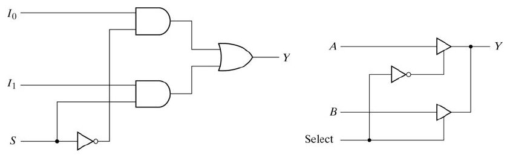
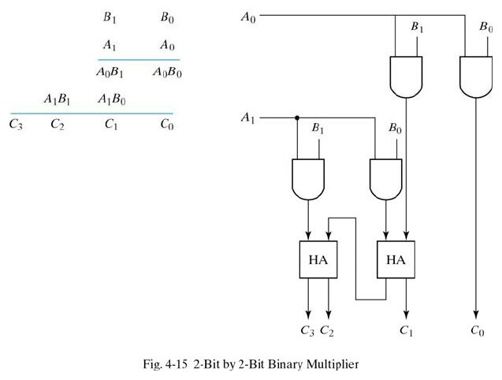
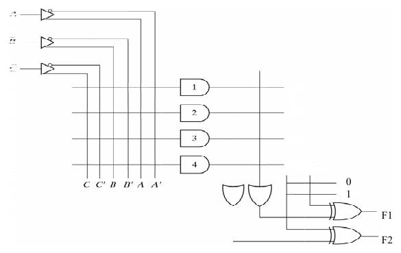
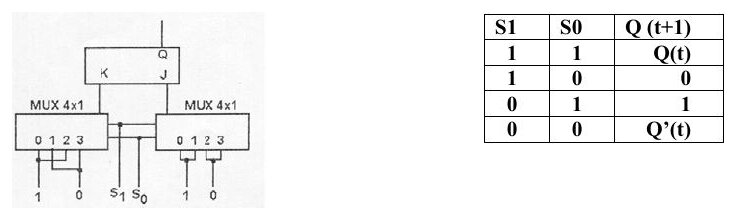
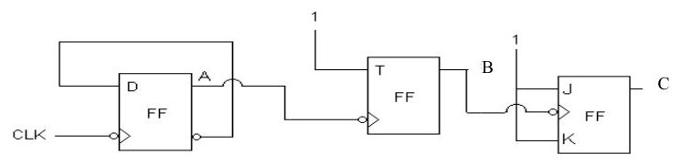
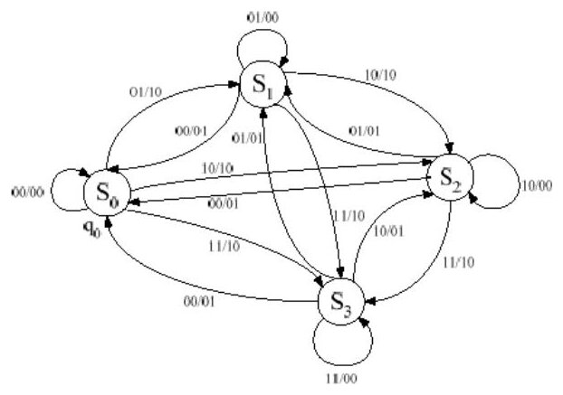
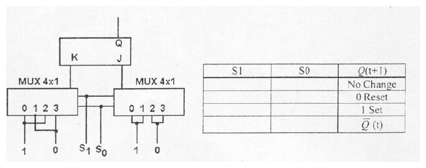
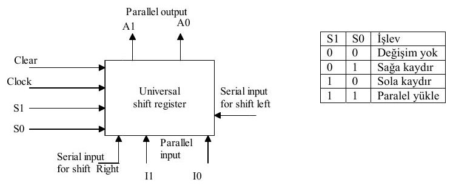
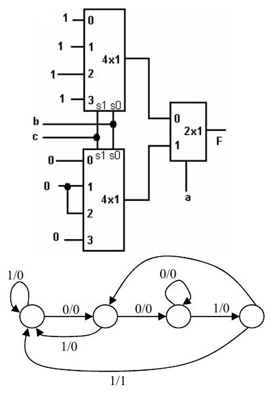

Bu yazı, Başkent Üniversitesi **EEM211 Sayısal Mantık Tasarımı** dersi için Aralık 2012'de paylaşılan örnek sorulardır (PDF'in yazar bilgisinde dersin hocası Hamit Erdem'in adı geçiyor). Belge iki bölümden oluşuyor: ilk dört sayfada **puanlarıyla birlikte on soru ve cevapları**, son iki sayfada ise öğrencinin doldurması için hazırlanmış, **cevapsız on iki soruluk bir deneme sınavı**. Kapsam, dönemin tamamı: sayı sistemleri ve Boole cebrinden çoklayıcılara, PLA'ya, flip-flop'lara ve durum makinelerine. Orijinal PDF yazının sonunda indirilebilir.

## Birinci bölüm: cevaplı örnek sorular

### 1) r tümleyen işaretli sistem (6 P)

> Ondalık tabanında verilen (−13) sayısını ikili (binary) sistemde r tümleyen işaretli sisteme göre 8 bitle ifade ediniz.

Cevap: **11110011**

### 2) 8 ve 16 tabanına çevirme (5 P)

> İkili tabanında verilen sayıyı 8 ve 16 tabanına göre yazınız.

(1010 1111.0001 0110 1100)₂ = **(257.0554)₈** = **(AF.16C)₁₆**

### 3) Boole sadeleştirme (5 P)

> Verilen ifadeyi Boole kurallarını kullanarak sadeleştiriniz: X'Z + XY'Z + XYZ

Cevap: **Z**

### 4) 2x1 MUX (11 P)

> 2x1 mux devresini iki farklı şekilde minimum sayıda lojik kapı kullanarak oluşturunuz. a) NOT ve üç durumlu kapı (three state) kullanarak, b) AND, OR, NOT kapıları kullanarak.

Cevapta iki devre çizilmiş: AND-OR-NOT çözümünde S seçme girişi bir NOT kapısıyla terslenip I0'ın AND kapısına, kendisi I1'in AND kapısına gidiyor, iki AND çıkışı OR kapısında birleşiyor (Y = S'·I0 + S·I1). Üç durumlu çözümde A ve B girişleri birer üç durumlu tampondan geçip aynı Y hattına bağlanıyor; Select sinyali bir tamponu doğrudan, diğerini NOT kapısı üzerinden etkinleştiriyor.

### 5) İkili çarpıcı (8 P)

> Verilen çarpma işlemini gerçekleştirmek için gereken lojik yapıyı çiziniz.

İki bitlik B1B0 ile A1A0 çarpılıyor: kısmi çarpımlar A0B1, A0B0 ve A1B1, A1B0; sonuç C3 C2 C1 C0. Cevap olarak dört AND kapısı ve iki yarım toplayıcıdan (HA) oluşan "2-Bit by 2-Bit Binary Multiplier" devresi veriliyor: C0 = A0B0; C1, A0B1 ile A1B0'ın yarım toplayıcıdaki toplamı; C2 ve C3 ikinci yarım toplayıcıdan çıkıyor.

### 6) PLA ile gerçekleştirme (12 P)

> F1 ve F2 fonksiyonlarını PLA devresi kullanarak gerçekleştiriniz ve verilen PLA üzerinde gereken terimleri işaretleyiniz.
> F1(A, B, C) = Σ(0, 1, 6, 7)
> F2(A, B, C) = Σ(1, 2, 3, 5, 7)

Karnaugh haritaları (satırlar A, sütunlar BC = 00, 01, 11, 10):

| | 00 | 01 | 11 | 10 |
|---|---|---|---|---|
| F2, A = 0 | 0 | 1 | 1 | 1 |
| F2, A = 1 | 0 | 1 | 1 | 0 |
| F1, A = 0 | 1 | 1 | 0 | 0 |
| F1, A = 1 | 0 | 0 | 1 | 1 |

> K.map ile sadeleştirme sonucu **F1 = AB + A'B'**, **F1' = AB' + A'B** ve **F2 = C + A'B**, **F2' = B'C' + AC'**

PLA'da dört çarpım terimi (AND), iki OR kapısı ve çıkışları gerektiğinde tersleyebilmek için 0 ya da 1'e bağlanabilen XOR kapıları bulunuyor.

### 7) Hamming kodu (12 P)

> Binary veri, Hamming kodlama sistemine göre kodlanarak bir sistemden diğer sisteme gönderilmiştir. Alıcı sistemde kodlanmış veri 011111 biçiminde elde edilmiştir. Gönderilen orijinal verinin ne olduğunu yazınız.

- C1 = XOR(1, 3, 5) = XOR(0, 1, 1) = 0
- C2 = XOR(2, 3, 6) = XOR(1, 1, 1) = 1
- C4 = XOR(4, 5, 6) = XOR(0, 1, 1) = 1

C4C2C1 = 110 = 6'ncı bitin 0 olması gerekir. Buna göre gerçek veri **110** olmalıdır.

*Not: Alınan 011111 sözcüğünde 4. bit 1 olduğu için C4 satırı XOR(1, 1, 1) = 1 olmalı; belgede XOR(0, 1, 1) yazılmış. Sonuç (C4 = 1, hatalı bit 6, veri 110) değişmiyor.*

### 8) JK flip-flop ve çoklayıcı (13 P)

> Şekilde J/K FF'un girişleri 4x1 multiplexer üzerinden verilmektedir. Tabloda görülen Q(t+1) değerini elde etmek için S1 ve S0 değerlerini yazınız. S1 en değerli bit ve S0 en değersiz bittir.

| S1 | S0 | Q(t+1) |
|---|---|---|
| 1 | 1 | Q(t) |
| 1 | 0 | 0 |
| 0 | 1 | 1 |
| 0 | 0 | Q'(t) |

### 9) Asenkron sayaç (13 P)

> Verilen sayaç devresinde şimdiki durum 100'dür; gelen 4 saat darbesi (clock pulse) için bir sonraki durumları yazınız. A en değersiz bit ve C en değerli biti ifade etmektedir.

Devrede düşen kenarla tetiklenen bir D, bir T (T = 1) ve bir JK (J = K = 1) flip-flop zincir hâlinde bağlı.

Cevap (CBA): **100 → 101 → 110 → 111 → 000**

### 10) Mealy durum makinesi (15 P)

> Bir ardışık sıralı devrenin durum tablosu aşağıdaki gibi verilmiştir (S0 = 00, S1 = 01, S2 = 10, S3 = 11). a) Durum diyagramını sağdaki durumlar üzerine çiziniz. b) Mealy yapıdaki FSM devreyi T FF kullanarak tasarlayınız. c) Bu devrenin gerçekleştirdiği işlemi açıklayınız (Bonus 5 P).

Sonraki durum (NS) ve çıkış (z1z2), x1x2 girişine göre:

| PS | NS, x1x2 = 00 | 01 | 10 | 11 | z1z2, x1x2 = 00 | 01 | 10 | 11 |
|---|---|---|---|---|---|---|---|---|
| S0 | S0 | S1 | S2 | S3 | 00 | 10 | 10 | 10 |
| S1 | S0 | S1 | S2 | S3 | 01 | 00 | 10 | 10 |
| S2 | S0 | S1 | S2 | S3 | 01 | 01 | 00 | 10 |
| S3 | S0 | S1 | S2 | S3 | 01 | 01 | 01 | 00 |

T flip-flop girişleri ve çıkışlar için Karnaugh haritalarından (y1y2 şimdiki durum, x1x2 giriş) bulunan ifadeler:

- T1 = x1'·y1 + x1·y1' = **x1 ⊕ y1**
- T2 = x2'·y2 + y2'·x2 = **x2 ⊕ y2**
- **Z1 = x1·y1' + x2·y1'·y2' + x1·x2·y2'**
- **Z2 = x1'·y1 + x1'·x2'·y2 + x2'·y1·y2**

| y1y2 \ x1x2 | 00 | 01 | 11 | 10 |
|---|---|---|---|---|
| **Z1:** 00 | 0 | 1 | 1 | 1 |
| 01 | 0 | 0 | 1 | 1 |
| 11 | 0 | 0 | 0 | 0 |
| 10 | 0 | 0 | 1 | 0 |
| **Z2:** 00 | 0 | 0 | 0 | 0 |
| 01 | 1 | 0 | 0 | 0 |
| 11 | 1 | 1 | 0 | 1 |
| 10 | 1 | 1 | 0 | 0 |

## İkinci bölüm: deneme sınavı (cevapsız)

Belgenin son iki sayfası "Ad-Soyadı / Şube" alanı olan, cevap kutuları boş bir sınav kâğıdı.

1. Verilen ifadeyi Boole mantık kurallarını kullanarak sadeleştiriniz: X'Z + XY'Z + XYZ (5 P)
1. Ondalık tabanında verilen (−13) sayısını ikili (binary) sistemde **r tümleyen işaretli sisteme** göre 8 bitle ifade ediniz. (5 P)
1. 5 bit "signed-2's complement" gösterimde ifade edilebilecek **en küçük sayı** nedir? (5 P)
1. Verilen toplama işlemlerini yapınız, işlem sonucuna göre en son eldeyi (Carry) ve taşmayı (Overflow) belirtiniz (var veya yok): a) 1110 + 1101, b) 1101 + 1010. (6 P)
1. Şekilde J/K FF'un girişleri multiplexer üzerinden verilmektedir. Tabloda görülen Q(t+1) değerini (No Change, 0 Reset, 1 Set, Q'(t)) elde etmek için S1 ve S0 değerlerini yazınız. (10 P)
1. **2 bitlik** evrensel kaydırma yazmacının (universal right-left shift register) blok yapısı verilmiştir. Bu bloğun iç yapısını ilgili girişleri dikkate alarak çiziniz; D flip-flop kullanılacaktır. S1S0 = 00: değişim yok, 01: sağa kaydır, 10: sola kaydır, 11: paralel yükle. (10 P)
1. F1 = Σ(0, 1, 3, 6) ve F2 = Σ(3, 5, 7) işlevlerini elde edebileceğiniz PLA devresini tasarlayınız ve verilen şekil üzerinde işaretleyiniz. Kullanacağınız çarpım terimlerinin (product terms) sayısı minimal olmalıdır. (10 P)
1. Birer adet düşen kenar tetiklemeli (low edge trigger) D, JK ve T FF kullanarak 3 bitlik ripple (asenkron) sayaç tasarlayınız. JK en değerli biti, D FF ise en değersiz biti sayacaktır. (10 P)
1. Şekilde verilen F(a, b, c) fonksiyonunda "a" en değerli bittir. Fonksiyonun eşdeğerini en basit biçimde, sadece bir adet 2x1 multiplexer kullanarak oluşturunuz. (10 P)
1. Bir alıcıda, vericiden Hamming kodlama yöntemiyle kodlanarak gönderilen veri **1001010** olarak alınmıştır. Kodlanmamış veriyi yazınız. (10 P)
1. Bir girişli (X), bir çıkışlı (Z) flip-flop tabanlı devre için durum diyagramı şekilde verilmiştir. Uygulanan giriş (X) dizisine göre çıkış dizisini ve devrenin hangi giriş dizisini algıladığını belirtiniz. X = 11010010001111011001100 (10 P)
1. Verilen bellek devresinde 20 bitlik adres girişi vardır (adres yolu = 20). Belleğe kayıt edilen veri uzunluğu 16 bittir. Belleğin toplam kapasitesini byte, kbyte ve Megabyte olarak yazınız. (10 P)

