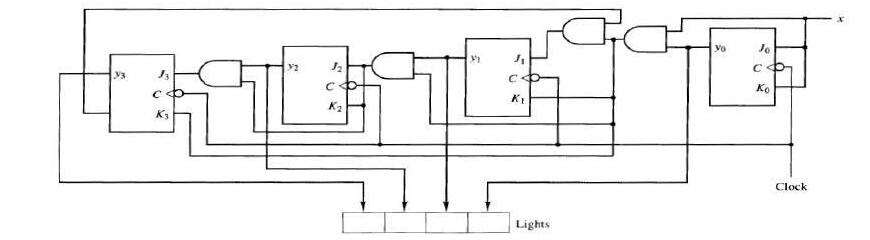
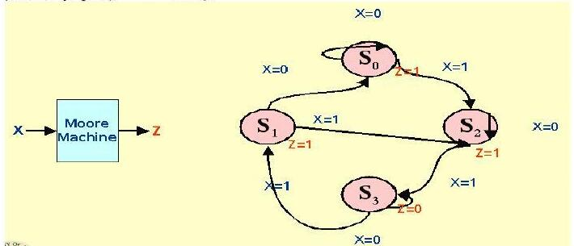
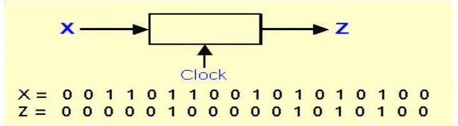
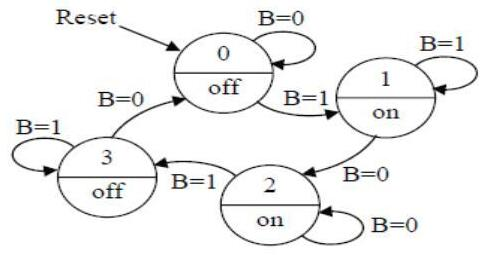
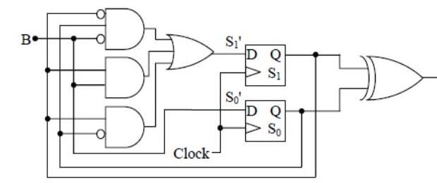
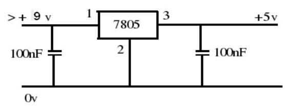

This post brings together the **term project topics** given in two different semesters of the **EEM211 Digital Logic Design** course at Başkent University: the "EEM211 projects" list distributed in December 2012 (the PDF's author metadata contains the username of the course instructor, Hamit Erdem) and the "EEM 211 Term Project Topics and Groups" document of the 2006–2007 academic year (8 December 2006). In both lists, the names of the students who took each project were written under the topics; these names and group details have been removed, and only the project topics are reproduced. The two PDFs with names redacted can be downloaded as a ZIP at the end of the post.

## 2012 projects

The number in parentheses indicates how many people the project group consists of.

1. Design a circuit with three inputs and two outputs. The operating conditions are as follows: the inputs are A, B, C. If A = 1 the red LED turns on, if B = 1 the green LED turns on, if C = 1 the lit LED turns off; the two LEDs cannot be on together, and one LED cannot turn on without the other being turned off first. (3 people)
1. A counter with one input (X) will be designed. This counter will count odd numbers when X = 0 and even numbers when X = 1, and the result will be displayed on a 7-segment display. (3 people)
1. A counter with one input (X) will be designed. This will be a 3-bit counter that counts up when X = 0 and down when X = 1, and the result will be displayed on a 7-segment display. (3 people)
1. Design a circuit that detects the sequence 101 using D flip-flops. (3 people)
1. Circuit design to capture priority at a quiz-show table (a circuit with two inputs and two outputs): depending on which button (momentary pushbutton) is pressed first, only one of the LEDs turns on and the other does not. (2 people)
1. Circuit design for counting people passing through a door: it will be able to count up to 15 (F) at most, and a Reset input will be used to clear it. The result will be displayed on a 7-segment display. (3 people)
1. **Programmable modulus counter design:** the counting limit is set, and the counter resets to zero when it reaches that number. The result will be displayed on a 7-segment display. (3 people)
1. Design a 3-bit Gray code counter (D flip-flops). (3 people)
1. Design a 2-bit Gray code counter that can count up and down depending on input X. (2 people)
1. Design a three-bit Johnson counter. (3 people)
1. **Parity bit checker:** design a system that produces an output when the number of ones in the incoming sequence is odd (example: 1001101110). (2 people)
1. **Minutes and seconds display:** a circuit will be implemented that displays the minutes and seconds of a clock, built from clock signals taken from a signal generator, on two 7-segment displays. (3 people)
1. Analyze the given circuit and rebuild it using D flip-flops. (3 people)
1. A circuit has two momentary switches (start, stop). Two LEDs are connected to the output of the circuit. When power is applied, both LEDs are off. When the start button is pressed, the red LED turns on immediately and the green LED turns on after a short delay. When the stop button is pressed, both LEDs turn off together (delay, timer). (2 people)
1. An FSM circuit that detects the sequence 110 will be designed using D or T flip-flops. (3 people)
1. A system with one input and one output will be designed. When the button at the input is pressed once, the LED at the output turns on; when it is pressed a second time it turns off; and when pressed again it turns on again (D flip-flop). (4 people)
1. Ring counter design: the counter will be designed using D flip-flops. (2 people)
1. Implement the circuit for the given state diagram using D flip-flops (Moore structure). (1 person)
1. The same as project 16, but with J-K flip-flops: when the button is pressed once the LED turns on, when pressed a second time it turns off, and when pressed again it turns on. (4 people)
1. Implement an FSM circuit with Mealy structure that detects the sequence 101 using D flip-flops. (2 people)
1. In a circuit with one input, when the button is pressed an LED will turn on for a while and then turn off. A counter will be used for the on-time. (2 people)
1. BCD counter design using D flip-flops. (2 people)
1. Design the given circuit (state diagram) using T flip-flops. (1 person)
1. Analyze the given circuit and rebuild it using JK flip-flops. (2 people)

*Note: In project 2, the document says "a counter that can count even numbers, -bit"; the number of bits of the counter is not specified.*

### Figures in the projects

The circuit to be analyzed and rebuilt with D flip-flops in project 13: four JK flip-flops, gates between them, and "Lights" indicators at the output.



The Moore machine of project 18: a state diagram with input X, output Z, and states S0–S3 (Z = 1 in S0, Z = 1 in S1, Z = 1 in S2, Z = 0 in S3).



An example input-output sequence for the 101 sequence detector required in project 20 (sequences may overlap):

```
X = 0 0 1 1 0 1 1 0 0 1 0 1 0 1 0 1 0 0
Z = 0 0 0 0 0 1 0 0 0 0 0 1 0 1 0 1 0 0
```



The four-state machine to be built with T flip-flops in project 23: input B, with Reset returning to state 0; 0 (off) → state 1 (on) when B = 1, 1 → state 2 (on) when B = 0, 2 → state 3 (off) when B = 1, 3 → state 0 when B = 0. In every state, the machine stays in the same state for the other input value. This is the state diagram of a circuit that turns an LED on when a button is pressed and released, and turns it off when pressed and released again.



The circuit to be analyzed and rebuilt with JK flip-flops in project 24: input B, two D flip-flops (S1, S0), next states S1' and S0' computed with AND-OR gates, and an XOR output L.



### ICs that can be used in the project

| IC | Description |
|---|---|
| 7400 | Quad 2-input NAND gate |
| 7402 | Quad 2-input NOR gate |
| 7404 | Hex inverter (NOT) |
| 7408 | Quad 2-input AND gate |
| 7410 | Triple 3-input NAND gate |
| 7420 | Dual 4-input NAND gate |
| 7430 | Single 8-input NAND gate |
| 7432 | Quad 2-input OR gate |
| 7437 | Quad 2-input NAND buffer |
| 7486 | Quad XOR gate |
| 74139 | Dual 2-to-4 decoder |
| 74138 | 3-to-8 decoder |
| 74157 | Quad 2-to-1 multiplexer (MUX) |
| 74153 | Dual 4-to-1 multiplexer (MUX) |
| 555 | Timer |
| 7476 | Dual JK flip-flop, level-triggered (with preset and clear inputs) |
| 7474 | Dual D flip-flop, edge-triggered (with preset and clear inputs) |

### Obtaining the +5 V supply for the ICs

The ICs can be powered from the power supplies in the laboratories, or the supply can be obtained by taking a 9 V battery and building a circuit with a 7805 regulator: the + terminal of the battery is connected to pin 1 of the 7805, +5 V is taken from pin 3, and pin 2 is connected to ground (0 V); there is a 100 nF capacitor to ground at both the input and the output.



### Points to consider when preparing the project

- Grade breakdown of the EEM211 term project (11% of the total grade): system design on paper 40%, verification of the system's operation with a simulation program 40%, operation of the system on hardware 20%. A student who leaves out one of these stages is graded on the parts they have completed (for example, a student who completes the paper design and simulation verification fully but does no hardware work receives 70 out of 100).
- Xilinx ISE Simulator, Logicsim and Proteus can be used as simulation programs. A student who wishes to use a program other than these must obtain the approval of the course instructor.
- In the stage of running the project on hardware, students may work with the FPGA boards used in the course laboratory or with external ICs (for example, 7404 for an inverter, 7400 for NAND). They can get help on this from the course instructor, the laboratory assistants and the university's technical staff.
- Students may propose their own project topic and take the project they propose with the approval of the course instructor.
- For projects that require a clock signal, the signals can be obtained from the signal generator in the laboratory or from an external IC (a signal generator such as a 555).

## 2006–2007 projects

In the 2006–2007 academic year, the projects were distributed to 26 groups, with two people in each group. The group members have been removed; the numbers are the group numbers in the document.

### 1. Hexadecimal – 7 segment converter

A 4-bit binary number entered with 4 two-position switches will be displayed in hexadecimal on a 7-segment display. Entering the number will be done by pressing a separate switch (push-button).

### 2. Apartment building automation

The apartment building automation of a three-story building will be simulated. In a circuit built with 3 push-button switches and one LED, the LED will turn on when any button is pressed and will turn off after a certain time. If a button is pressed while the LED is on, the remaining on-time will not change.

### 3. Car signal control

The signal control of a car will be simulated. Using a 3-position switch, the LEDs indicating the right and left signals will be made to blink. The hazard signal will be controlled with a second switch (while the hazard signal is active, the position of the other switch will have no effect).

### 4. Multi-switch LED control (turn on from three places)

An LED can be turned on with push-button switches at three different places, but can be turned off only with a push-button switch at a fourth place.

### 5. Multi-switch LED control (turn off from three places)

An LED can be turned on from only one place with a push-button switch and can be turned off with push-button switches at three different places.

### 6. Multi-switch multi-LED control for a quiz show

In a quiz show with 3 contestants, each table has a separate LED. To answer a question, the contestants press the buttons at their own tables, turning on the LEDs at their own tables. If the buttons are pressed together, only the LED that was triggered first will turn on. After each question, the host will be able to turn off the lit LED by pressing a special switch.

### 7. Serial-parallel-serial converter

8-bit data entered serially will be converted to parallel and back to serial. One LED each at the input and output will be used to observe the serial data, and 8 LEDs will be used to observe the parallel form of the data. In the first part of the circuit, one 2-position switch and one push-button switch will be used to enter the serial data. The parallel form of the entered data will be seen on the group of 8 LEDs. For the conversion back to serial, the required CLOCK signal will be generated with a separate push-button switch, and this data will be observed on the output LED.

### 8. Priority encoder

A 4-input priority encoder will be designed. 4 switches will be used for the inputs and 2 LEDs for the outputs. A third LED at the output will be the NR (no input) indicator. The design will be implemented with logic circuit elements other than ready-made priority encoder ICs.

### 9. Conveyor belt simulation

A two-stage conveyor belt in a factory will be simulated. Two push-button switches will represent the detectors (sensors), and two LEDs will represent the motors. When a product is placed at the start of the first belt, the belt will start moving, that is, the first LED will turn on when the first switch is pressed. When the product reaches the end of the first belt and moves onto the second belt, the first belt will stop and the second belt will run for a predetermined time to carry the product to the desired place. In the circuit, this will be simulated by the first LED turning off and the second LED turning on when the second switch is pressed, and turning off after being on for a certain time.

### 10. 16-LED forward-backward flasher circuit

By incrementing and decrementing a counter in the circuit, the light will move left and right across the 16 LEDs connected to the circuit. The LEDs will be turned on and off in the appropriate order, and this will repeat as long as counting continues. Counting will continue automatically, reversing direction at the lower and upper limits. The required clock pulses will be taken externally from a signal generator.

### 11. Hexadecimal keypad encoder circuit

With a suitable encoder circuit (hexadecimal keypad encoder) connected to a 16-switch keypad, the value of the pressed key will be read on a 7-segment display. The encoder will be designed with basic logic circuits; no ready-made encoder will be used.

### 12. Load/count up-down counter

The desired 4-bit number can be loaded into a counter using 4 two-position switches and a push-button switch, and the circuit will count up or down starting from this value. The counting direction will be set with a separate two-position switch, and the clock pulses required for counting will be obtained with a separate push-button switch.

### 13. 4-bit combination lock

A circuit will be designed that checks whether a 4-bit password entered serially from the user panel matches a 4-bit password entered from the control panel. When a match is achieved the green LED turns on, and in all other cases the red LED turns on. The user panel will consist of two push-button switches (1 and 0), and the control panel will consist of 4 two-position switches.

### 14. Real-time seconds counter

After the 50 Hz signal taken from a signal generator is raised to 100 Hz and the required CLOCK pulses are obtained, a circuit that counts from 0 to 60 seconds (real time) will be implemented. Counting will continue repeatedly.

### 15. Minutes and seconds display

A circuit will be implemented that displays the minutes and seconds of a clock, built from the counter signals taken from the real-time seconds counter project, on two 7-segment displays.

### 16. Parity bit generator

A circuit will be designed that adds a parity bit to the 4-bit word at the input and outputs it as 5 bits. The input word will be set with 4 two-position switches, and the 5 output bits will be shown with LEDs. Whether the parity bit is odd or even parity will be selected with a separate two-position switch. The operation will be triggered with a push-button switch.

### 17. Parity bit checker

The 5-bit word at the input will be checked according to the odd or even parity mode determined by a two-position switch, and whether this word contains an error will be shown by an LED at the output (the LED will turn on if there is an error). The 5-bit word may be supplied with 5 two-position switches or through 5 connection pins. The operation will be triggered with a push-button switch.

### 18. Hamming code generator

A circuit will be designed that encodes the 4-bit word at the input with a Hamming code and outputs it as 7 bits. The input word will be set with 4 two-position switches, and the 7 output bits will be shown with LEDs. The operation will be triggered with a push-button switch.

### 19. Hamming code checker / error corrector

The 7-bit word at the input will be checked according to the Hamming code structure, the 4-bit message part of the word will be output after correcting a possible 1-bit error, and it will be shown with 4 LEDs. The operation will be triggered with a push-button switch.

### 20. Serial 2's complementer

A circuit will be designed that takes a binary number serially at its input, starting from the least significant bit, and gives the 2's complement of this number serially at its output. The input bits will be set with a two-position switch, and the input operation will be performed with a push-button switch.

### 21. Serial adder

A circuit will be designed that serially adds the numbers placed in two 8-bit shift registers named Register-A and Register-B, and stores the bits of the sum, again serially, in register A. The 8-bit numbers will be loaded into the registers with 8 two-position switches (the number to be entered) and 1 two-position switch (load register A / load register B), and a push-button switch will be used as the clock generator. The numbers in the registers can be read on 8 LEDs; which register is being read will be determined by the position of the "load register A / load register B" switch.

### 22. Sequence detector

A sequence detector will be designed that outputs 1 each time the sequence 0101 (arrival order from left to right) is detected at its input, and 0 otherwise. Sequences may overlap. The input bits will be set with a two-position switch, and the input operation will be performed with a push-button switch. The output will be read with an LED. The circuit must be designed as a sequential machine.

### 23. Multiplexed communication channel

4-bit parallel data will be transmitted serially over a 1-bit transmission channel using a 4x1 MUX and a 1x4 DEMUX. The 4-bit input data will be set with 4 two-position switches, and on the receiver side it will be shown on 8 LEDs. The clock pulses that time the transmission will be generated with a push-button switch.

*Note: The document says the 4-bit data will be displayed at the receiver on "8 LEDs"; this is as it appears in the document.*

### 24. Limited up-down counter

A counter that can count up and down and can be stopped at a desired value will be designed. The output will be displayed on a 7-segment display in the range 0–FF. Commands will be given to the system with six push-button switches:

| Switch | Function |
|---|---|
| Start | When pressed, the counter starts counting down. |
| Stop | When pressed, counting stops (regardless of whether counting down or up). |
| Up | When pressed, if the counter is not counting down, it starts counting up. |
| Down | When pressed, if the counter is not counting up, it starts counting down. |
| Upper Limit | When pressed, if the counter is counting up, counting stops. |
| Lower Limit | When pressed, if the counter is counting down, counting stops. |

### 25. Directional counter

A counter that counts by one going up and by two going down will be designed. The output will be displayed on a 7-segment display in the range 0–FF. Commands will be given to the system with one push-button and two two-position switches. When the system is counting up it cannot immediately switch to counting down; it must first be reset. The same rule applies when switching from counting down to counting up.

- Up (two-position switch): when closed, the system counts up by one.
- Down (two-position switch): when closed, the system counts down by two.
- Reset (push-button switch): resets the system.

### 26. Time-dependent sequential operation circuit

The circuit to be designed controls two outputs depending on time; two LEDs connected to the circuit show these two outputs. When the momentary start command is given to the circuit, LED1 turns on immediately. LED2 turns on after a certain (fixed) time and stays on for a while; the on-time of LED2 will be adjustable. When LED2 turns on, LED1 turns off. The process repeats continuously. When the stop command is given with a second push-button switch, both LEDs turn off.

### Notes

1. In all designs, care must be taken to make the circuits "minimal" and to avoid unnecessary costs.
1. The design work done must be documented on paper with the relevant drawings and necessary notes.
1. The projects will be shown completed and working at the end of the semester, and the project groups will be given an oral exam about the work they have done.
