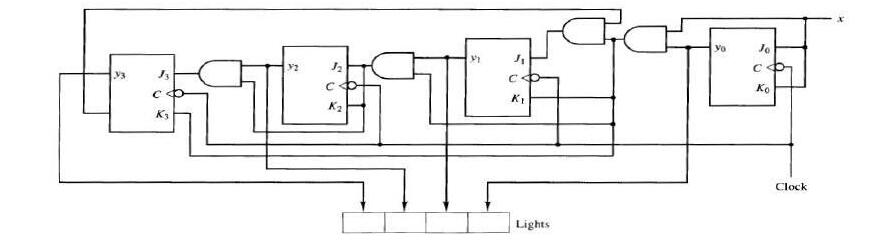
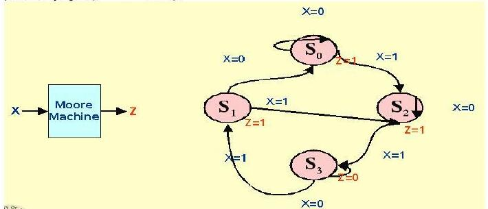
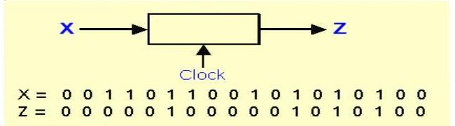
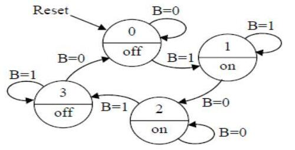
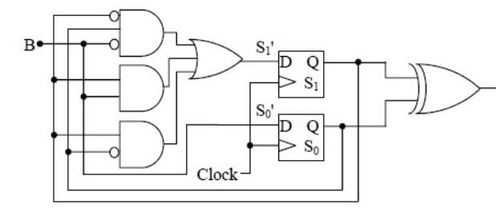
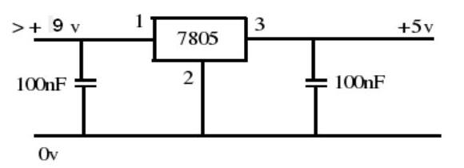

Bu yazı, Başkent Üniversitesi **EEM211 Sayısal Mantık Tasarımı** dersinde iki farklı dönemde verilen **dönem projesi konularını** bir araya getiriyor: Aralık 2012'de dağıtılan "EEM211 projeler" listesi (PDF'in yazar bilgisinde dersin hocası Hamit Erdem'in kullanıcı adı geçiyor) ve 2006–2007 öğrenim yılının "EEM 211 Dönem Projesi Konuları ve Grupları" belgesi (8 Aralık 2006). Her iki listede de konuların altında projeyi alan öğrencilerin adları yazıyordu; bu adlar ve grup bilgileri çıkarıldı, yalnızca proje konuları aktarıldı. Adları kapatılmış iki PDF yazının sonunda ZIP olarak indirilebilir.

## 2012 projeleri

Parantez içindeki sayı, projeyi kaç kişilik bir grubun yapacağını gösteriyor.

1. Üç girişli, iki çıkışlı bir devre tasarlayınız. Çalışma koşulları şöyle olacaktır: girişler A, B, C'dir. A = 1 ise kırmızı LED yanar, B = 1 ise yeşil LED yanar, C = 1 ise yanan LED söner; iki LED birlikte yanamaz, bir LED söndürülmeden diğeri yanmaz. (3 kişi)
1. Bir girişi (X) olan bir sayaç tasarlanacaktır. Bu sayaç X = 0 iken tek, X = 1 olunca çift sayıları sayabilen bir sayaç olacak ve sonuç 7 parçalı göstergede gösterilecektir. (3 kişi)
1. Bir girişi (X) olan bir sayaç tasarlanacaktır. Bu sayaç X = 0 iken ileri yönde, X = 1 iken ters yönde sayabilen 3 bitlik bir sayaç olacak ve sonuç 7 parçalı göstergede gösterilecektir. (3 kişi)
1. D flip-flop kullanarak 101 dizisini yakalayan bir devre tasarlayınız. (3 kişi)
1. Yarışma masasındaki önceliği yakalayan devre tasarımı (iki girişli, iki çıkışlı devre): önce basılan butona (anlık buton) göre LED'lerden yalnızca biri yanar, diğeri yanmaz. (2 kişi)
1. Kapıdan geçenleri sayan devre tasarımı: en fazla 15'e (F) kadar sayabilecek, sıfırlamak için Reset girişi kullanılacaktır. Sonuç 7 parçalı göstergede gösterilecektir. (3 kişi)
1. **Programlanabilen mod sayacı tasarımı:** saymanın limiti belirlenir, sayaç o sayıya gelince sıfırlanır. Sonuç 7 parçalı göstergede gösterilecektir. (3 kişi)
1. 3 bitlik Gray kod sayacı tasarlayınız (D flip-flop). (3 kişi)
1. X girişine bağlı olarak ileri ve geri sayabilen 2 bitlik Gray kod sayacı tasarlayınız. (2 kişi)
1. Üç bitlik Johnson sayacı tasarlayınız. (3 kişi)
1. **Eşlik biti denetleyici:** gelen dizide birlerin sayısı tek olunca çıkış veren sistem tasarımı (örnek: 1001101110). (2 kişi)
1. **Dakika ve saniye görüntüleyici:** sinyal üretecinden alınacak saat sinyalleri kullanılarak oluşturulacak bir saatin dakika ve saniye bilgisini iki adet 7 parçalı göstergede gösteren devre gerçekleştirilecektir. (3 kişi)
1. Verilen devreyi analiz ediniz ve D flip-flop ile yeniden oluşturunuz. (3 kişi)
1. Bir devrede iki anlık anahtar bulunmaktadır (start, stop). Devrenin çıkışına iki LED bağlanmıştır. Devreye enerji verilince iki LED de sönüktür. Start butonuna basılınca kırmızı LED hemen yanar, yeşil LED biraz gecikmeli yanar. Stop butonuna basılınca iki LED birlikte söner (gecikme, timer). (2 kişi)
1. 110 dizisini yakalayan FSM devresi D veya T flip-flop kullanılarak tasarlanacaktır. (3 kişi)
1. Bir girişli, bir çıkışlı sistem tasarlanacaktır. Girişteki butona bir kez basılınca çıkıştaki LED yanacak, ikinci kez basılınca sönecek, tekrar basılınca yine yanacaktır (D flip-flop). (4 kişi)
1. Halka (ring) sayaç tasarımı: sayaç D flip-flop kullanılarak tasarlanacaktır. (2 kişi)
1. Verilen durum diyagramına göre devreyi D flip-flop kullanarak gerçekleştiriniz (Moore yapısı). (1 kişi)
1. 16. projenin aynısı, J-K flip-flop ile: butona bir kez basılınca LED yanar, ikinci kez basılınca söner, tekrar basılınca yanar. (4 kişi)
1. 101 dizisini algılayan, Mealy yapısındaki FSM devresini D flip-flop kullanarak gerçekleştiriniz. (2 kişi)
1. Bir girişli devrede butona basılınca bir LED bir süre yanacak, sonra sönecektir. Yanma süresi için bir sayaç kullanılacaktır. (2 kişi)
1. D flip-flop kullanarak BCD sayaç tasarımı. (2 kişi)
1. Verilen devreyi (durum diyagramını) T flip-flop kullanarak tasarlayınız. (1 kişi)
1. Verilen devreyi analiz ediniz ve JK flip-flop ile yeniden oluşturunuz. (2 kişi)

*Not: Belgede 2. projede "çift sayıları sayabilen bitlik sayaç" yazıyor; sayacın kaç bitlik olacağı belirtilmemiş.*

### Projelerdeki şekiller

13 numaralı projede analiz edilip D flip-flop ile yeniden kurulacak devre: dört JK flip-flop, aralarında kapılar ve çıkışta "Lights" ışıkları.



18 numaralı projenin Moore makinesi: X girişli, Z çıkışlı, S0–S3 durumlu durum diyagramı (S0'da Z = 1, S1'de Z = 1, S2'de Z = 1, S3'te Z = 0).



20 numaralı projede istenen 101 dizi algılayıcısının örnek giriş-çıkış dizisi (diziler iç içe geçebiliyor):

```
X = 0 0 1 1 0 1 1 0 0 1 0 1 0 1 0 1 0 0
Z = 0 0 0 0 0 1 0 0 0 0 0 1 0 1 0 1 0 0
```



23 numaralı projede T flip-flop ile kurulacak dört durumlu makine: B girişi, Reset ile 0 durumuna dönülüyor; 0 (off) → B = 1 ile 1 (on), 1 → B = 0 ile 2 (on), 2 → B = 1 ile 3 (off), 3 → B = 0 ile 0. Her durumda öbür giriş değerinde aynı durumda kalınıyor. Bu, butona basıp bırakınca LED'i yakan, tekrar basıp bırakınca söndüren bir devrenin durum diyagramı.



24 numaralı projede analiz edilip JK flip-flop ile yeniden kurulacak devre: B girişi, iki D flip-flop (S1, S0), AND-OR kapılarıyla hesaplanan S1' ve S0' sonraki durumları ve XOR çıkışı L.



### Projede kullanılabilecek entegre devreler

| Entegre | Özellik |
|---|---|
| 7400 | Dörtlü 2 girişli NAND kapısı |
| 7402 | Dörtlü 2 girişli NOR kapısı |
| 7404 | Altılı tümleyici (NOT) |
| 7408 | Dörtlü 2 girişli AND kapısı |
| 7410 | Üçlü 3 girişli NAND kapısı |
| 7420 | İkili 4 girişli NAND kapısı |
| 7430 | Tek 8 girişli NAND kapısı |
| 7432 | Dörtlü 2 girişli OR kapısı |
| 7437 | Dörtlü 2 girişli NAND tamponu |
| 7486 | Dörtlü XOR kapısı |
| 74139 | İkili 2'ye 4 kod çözücü |
| 74138 | 3'e 8 kod çözücü |
| 74157 | Dörtlü 2'ye 1 çoklayıcı (MUX) |
| 74153 | İkili 4'e 1 çoklayıcı (MUX) |
| 555 | Zamanlayıcı (timer) |
| 7476 | İkili JK flip-flop, seviye tetiklemeli (preset ve clear girişli) |
| 7474 | İkili D flip-flop, kenar tetiklemeli (preset ve clear girişli) |

### Entegreleri besleyecek +5 V gerilimin elde edilmesi

Entegrelerin beslemesi laboratuvarlardaki güç kaynaklarından sağlanabilir ya da 9 V'luk bir pil alınıp 7805 regülatörlü devre kurularak elde edilebilir: pilin + ucu 7805'in 1. bacağına, 3. bacaktan +5 V alınır, 2. bacak toprağa (0 V) bağlanır; giriş ve çıkışta toprağa birer 100 nF kondansatör vardır.



### Proje hazırlanırken dikkat edilecek noktalar

- EEM211 dönem projesinin not dağılımı (toplam notun %11'i): kâğıt üzerinde sistem tasarımı %40, benzetim programıyla sistemin çalışmasının doğrulanması %40, donanım üzerinde sistemin çalışması %20. Bu aşamalardan birini eksik yapan öğrencinin çalışması yaptığı bölümler üzerinden değerlendirilir (örneğin kâğıt üzerinde tasarımı ve benzetimle doğrulamayı tam yapıp donanımla ilgili hiçbir çalışma yapmayan öğrenci 100 üzerinden 70 alır).
- Benzetim programları olarak Xilinx ISE Simulator, Logicsim ve Proteus kullanılabilir. Bunların dışında bir program kullanmak isteyen öğrenci ders sorumlusunun onayını almalıdır.
- Projenin donanım olarak çalıştırılması aşamasında öğrenciler ders laboratuvarında kullanılan FPGA kartlarıyla ya da harici entegrelerle (örneğin tümleyici için 7404, NAND için 7400) çalışabilirler. Bu konuda ders sorumlusundan, laboratuvar asistanlarından ve okulun teknik personelinden yardım alabilirler.
- Öğrenciler isterlerse kendileri proje konusu önerip ders sorumlusunun onayıyla önerdikleri projeyi alabilirler.
- Saat sinyali gereken projelerde sinyaller laboratuvardaki sinyal üretecinden ya da harici bir entegreyle (555 gibi bir sinyal üreteci) elde edilebilir.

## 2006–2007 projeleri

2006–2007 öğrenim yılında projeler 26 gruba, her grupta iki kişi olacak şekilde dağıtılmıştı. Grupların üyeleri çıkarıldı; numaralar belgedeki grup numaralarıdır.

### 1. Hexadecimal – 7 segment çevirici

4 adet 2 konumlu anahtardan girilen 4 bitlik ikili sayı, onaltılık (hexadecimal) olarak 7 segment göstergede gösterilecektir. Sayı girme işlemi ayrı bir anahtara (push-button) basılarak gerçekleştirilecektir.

### 2. Apartman otomatiği

Üç katlı bir binanın apartman otomatiğinin benzetimi (simülasyonu) yapılacaktır. 3 tane basmalı anahtar (push-button) ve bir LED ile gerçekleştirilen devrede herhangi bir düğmeye basıldığında LED yanacak ve belirli bir süre sonra sönecektir. LED yanarken düğmeye basılırsa kalan yanma süresi değişmeyecektir.

### 3. Araba sinyal kontrolü

Bir arabanın sinyal kontrolünün benzetimi yapılacaktır. 3 konumlu bir anahtar kullanılarak sağ ve sol sinyali gösteren LED'lerin yanıp sönmesi sağlanacaktır. İkinci bir anahtar ile acil durum sinyali kontrol edilecektir (acil durum sinyali çalışırken diğer anahtarın konumunun bir etkisi olmayacaktır).

### 4. Çok anahtarlı LED kontrolü (üç yerden yakma)

Bir LED üç farklı yerdeki basmalı anahtarla yakılabilecek, ancak dördüncü bir yerdeki basmalı anahtarla söndürülebilecektir.

### 5. Çok anahtarlı LED kontrolü (üç yerden söndürme)

Bir LED yalnızca bir yerden, basmalı anahtarla yakılabilecek ve üç farklı yerdeki basmalı anahtarla söndürülebilecektir.

### 6. Bilgi yarışması için çok anahtarlı çoklu LED kontrolü

3 yarışmacılı bir yarışmada her masa için ayrı bir LED bulunmaktadır. Yarışmacılar soruya yanıt verebilmek için kendi masalarındaki düğmelere basarak yine kendi masalarındaki LED'leri yakarlar. Düğmelere birlikte basılırsa yalnızca ilk tetiklenen LED yanacaktır. Yönetmen her sorunun ardından özel bir anahtara basarak yanan LED'i söndürebilecektir.

### 7. Seri-paralel-seri dönüştürücü

Seri olarak girilecek 8 bitlik verinin paralele ve tekrar seriye dönüştürülmesi gerçekleştirilecektir. Giriş ve çıkışta seri veriyi görebilmek için birer LED, verinin paralel hâlini görebilmek için 8 adet LED kullanılacaktır. Devrenin ilk kısmında seri bilgi girilebilmesi için bir adet 2 konumlu anahtar ve bir basmalı anahtar kullanılacaktır. Girilen verinin paralel biçimi 8'li LED grubundan görülecektir. Tekrar seriye dönüşüm için ayrı bir basmalı anahtarla gereken CLOCK sinyali üretilip, çıkıştaki LED'de bu veri izlenecektir.

### 8. Öncelikli kodlayıcı (priority encoder)

4 girişli bir öncelikli kodlayıcı tasarlanacaktır. Giriş için 4 anahtar, çıkış için 2 LED kullanılacaktır. Çıkıştaki üçüncü bir LED, NR (hiçbir giriş yok) göstergesi olacaktır. Tasarım, hazır öncelikli kodlayıcı entegreleri dışındaki mantık devre elemanlarıyla gerçekleştirilecektir.

### 9. Ürün bandı benzetimi

Bir fabrikadaki iki aşamalı bir ürün bandının benzetimi yapılacaktır. İki basmalı anahtar algılayıcıları (sensörleri), iki LED ise motorları simgeleyecektir. İlk bandın başına bir ürün konduğunda bant hareket etmeye başlayacak, yani ilk anahtara basılınca birinci LED yanacaktır. Ürün birinci bandın sonuna gelip ikinci banda geçince birinci bant duracak ve ikinci bant önceden belirlenen süre boyunca çalışarak ürünü istenen yere götürecektir. Devrede bu, ikinci anahtara basılınca birinci LED'in sönüp ikinci LED'in yanması ve belirli bir süre yandıktan sonra sönmesiyle benzetilecektir.

### 10. 16 LED'li ileri-geri flaşör devresi

Devredeki bir sayacın artırılıp azaltılmasıyla, devreye bağlanan 16 LED üzerinde ışık sağa sola hareket edecektir. LED'ler uygun sırayla yakılıp söndürülecek ve bu, sayma sürdükçe yinelenecektir. Sayma, alt ve üst sınırlarda yön değiştirerek otomatik olarak sürecektir. Gerekli saat vuruları dışarıdan bir sinyal üretecinden alınacaktır.

### 11. Onaltılık tuş takımı kodlayıcı devresi

16 anahtarlı bir tuş takımına bağlanacak uygun bir kodlayıcı devre (hexadecimal keypad encoder) ile basılan tuşun değeri bir 7 segment göstergede okunacaktır. Kodlayıcı temel mantık devreleriyle tasarlanacak, hazır kodlayıcı kullanılmayacaktır.

### 12. Yükle/say yukarı-aşağı sayıcı (load/count up-down counter)

Bir sayaca istenen 4 bitlik sayı, 4 adet iki konumlu ve bir basmalı anahtar aracılığıyla yüklenebilecek, devre bu değerden başlayarak yukarı ya da aşağı sayacaktır. Sayma yönü ayrı bir iki konumlu anahtarla belirlenecek, sayma için gerekli saat vuruları da ayrı bir basmalı anahtarla elde edilecektir.

### 13. 4 bitlik şifreli kilit

Kullanıcı panelinden seri biçimde girilecek 4 bitlik şifrenin, kontrol panelinden girilen 4 bitlik şifreyle uyumunu denetleyen bir devre tasarlanacaktır. Eşleşme sağlandığında yeşil, diğer durumlarda kırmızı LED yanacaktır. Kullanıcı paneli iki basmalı anahtardan (1 ve 0), kontrol paneli 4 adet iki konumlu anahtardan oluşacaktır.

### 14. Gerçek zamanlı saniye sayacı

Bir sinyal üretecinden alınacak 50 Hz'lik sinyal 100 Hz'e çıkarılıp gereken CLOCK vuruları elde edildikten sonra, 0–60 saniye (gerçek zaman) arasında sayan devre gerçekleştirilecektir. Sayma işlemi yinelenerek sürecektir.

### 15. Dakika ve saniye görüntüleyici

Gerçek zamanlı saniye sayacı projesinden alınacak sayaç sinyalleriyle oluşturulacak bir saatin dakika ve saniye bilgisini iki adet 7 segment göstergede gösteren devre gerçekleştirilecektir.

### 16. Eşlik biti üreteci

Girişteki 4 bitlik sözcüğe bir eşlik biti ekleyip çıkışa 5 bit olarak aktaran bir devre tasarlanacaktır. Giriş sözcüğü 4 adet iki konumlu anahtarla belirlenecek, çıkıştaki 5 bit LED'lerle gösterilecektir. Eşlik bitinin tek ya da çift eşlikli olacağı ayrı bir iki konumlu anahtarla seçilecektir. İşlem bir basmalı anahtarla tetiklenecektir.

### 17. Eşlik biti denetleyici

Girişteki 5 bitlik sözcük, iki konumlu bir anahtarın belirlediği tek ya da çift eşlik durumuna göre denetlenecek ve bu sözcükte hata olup olmadığı çıkıştaki bir LED ile gösterilecektir (hata varsa LED yanacak). 5 bitlik sözcük 5 adet iki konumlu anahtarla ya da 5 bağlantı pini üzerinden verilebilecektir. İşlem bir basmalı anahtarla tetiklenecektir.

### 18. Hamming kod üreteci

Girişteki 4 bitlik sözcüğü Hamming koduyla kodlayıp çıkışa 7 bit olarak aktaran bir devre tasarlanacaktır. Giriş sözcüğü 4 adet iki konumlu anahtarla belirlenecek, çıkıştaki 7 bit LED'lerle gösterilecektir. İşlem bir basmalı anahtarla tetiklenecektir.

### 19. Hamming kod denetleyici / hata düzeltici

Girişteki 7 bitlik sözcük Hamming kodu yapısına göre denetlenecek, sözcüğün 4 bitlik mesaj bölümü olası 1 bitlik hata düzeltilerek çıkışa aktarılacak ve 4 LED ile gösterilecektir. İşlem bir basmalı anahtarla tetiklenecektir.

### 20. Seri 2'ye tümleyici

Girişinde bir ikili sayıyı en az anlamlı bitten başlayarak seri biçimde alan, çıkışında bu sayının 2'ye tümleyenini yine seri biçimde veren bir devre tasarlanacaktır. Giriş bitleri bir iki konumlu anahtarla belirlenecek, giriş işlemi bir basmalı anahtarla yapılacaktır.

### 21. Seri toplayıcı

Yazmaç-A ve Yazmaç-B adlı iki adet 8 bitlik kaymalı yazmaca (shift register) yerleştirilmiş sayıları seri biçimde toplayan ve toplamın bitlerini yine seri biçimde A yazmacına depolayan bir devre tasarlanacaktır. 8 bitlik sayılar yazmaçlara 8 adet iki konumlu anahtar (girilecek sayı) ve 1 adet iki konumlu anahtar (A yazmacını yükle / B yazmacını yükle) ile yüklenecek, saat üreteci olarak bir basmalı anahtar kullanılacaktır. Yazmaçlardaki sayılar 8 LED üzerinde okunabilecek; hangi yazmacın okunduğu "A yazmacını yükle / B yazmacını yükle" anahtarının konumuyla belirlenecektir.

### 22. Dizi algılayıcı

Girişinde her 0101 dizisi (geliş sırası soldan sağa) algılandığında 1, bunun dışında 0 çıktısı veren bir dizi algılayıcı (sequence detector) tasarlanacaktır. Diziler iç içe geçebilir (overlapping). Giriş bitleri bir iki konumlu anahtarla belirlenecek, giriş işlemi bir basmalı anahtarla yapılacaktır. Çıktı bir LED ile okunacaktır. Devre bir ardışıl makine (sequential machine) olarak tasarlanmalıdır.

### 23. Çoklanmış iletişim kanalı

4 bitlik paralel veri, 4x1 MUX ve 1x4 DEMUX kullanılarak 1 bitlik bir iletim kanalından seri biçimde iletilecektir. 4 bitlik giriş verisi 4 adet iki konumlu anahtarla belirlenecek, alıcı tarafında da 8 adet LED üzerinde gösterilecektir. İletimi zamanlayacak saat vuruları bir basmalı anahtarla üretilecektir.

*Not: 4 bitlik verinin alıcıda "8 adet LED" ile gösterileceği yazıyor; belgede böyle.*

### 24. Sınırlandırılmış ileri-geri sayaç

İleri ve geri sayabilen, istenen değerde durdurulabilen bir sayaç tasarlanacaktır. Çıkış 0–FF aralığında 7 parçalı gösterge üzerinde gösterilecektir. Sisteme altı basmalı anahtarla komut verilecektir:

| Anahtar | İşlevi |
|---|---|
| Başla | Basıldığında sayaç aşağı doğru saymaya başlar. |
| Dur | Basıldığında sayma durur (aşağı ya da yukarı saymadan bağımsız). |
| Yukarı | Basıldığında sayaç aşağı doğru saymıyorsa yukarı doğru saymaya başlar. |
| Aşağı | Basıldığında sayaç yukarı doğru saymıyorsa aşağı doğru saymaya başlar. |
| Üst Sınır | Basıldığında sayaç yukarı doğru sayıyorsa sayma durur. |
| Alt Sınır | Basıldığında sayaç aşağı doğru sayıyorsa sayma durur. |

### 25. Yönlü sayaç

İleri doğru birer, geri doğru ikişer sayan bir sayaç tasarlanacaktır. Çıkış 0–FF aralığında 7 parçalı gösterge üzerinde gösterilecektir. Sisteme bir basmalı ve iki adet iki konumlu anahtarla komut verilecektir. Sistem artarak sayarken azalarak saymaya hemen geçemeyecek; bunun için önce sıfırlanması gerekecektir. Aynı kural azalarak saymadan artarak saymaya geçerken de geçerlidir.

- Yukarı (iki konumlu anahtar): kapatılınca sistem birer artarak sayar.
- Aşağı (iki konumlu anahtar): kapatılınca sistem ikişer azalarak sayar.
- Sıfırla (basmalı anahtar): sistemi sıfırlar.

### 26. Zamana bağlı sıralı işlem devresi

Tasarlanacak devre iki çıkışı zamana bağlı olarak denetler; devreye bağlanan iki LED bu iki çıkışı gösterir. Devreye anlık başlat komutu verilince LED1 hemen yanar. LED2 belirli (sabit) bir süre sonra yanar ve bir süre yanık kalır; LED2'nin yanık kalma süresi ayarlanabilir olacaktır. LED2 yanınca LED1 söner. İşlem sürekli tekrarlanır. İkinci bir basmalı anahtarla dur komutu verilince iki LED de söner.

### Notlar

1. Tüm tasarımlarda devrelerin "minimal" olmasına, gereksiz maliyetlerden kaçınılmasına özen gösterilmelidir.
1. Yapılan tasarım çalışmaları, ilgili çizimler ve gerekli notlarla kâğıt üzerinde belgelenmiş olmalıdır.
1. Projeler dönem sonunda bitmiş ve çalışır biçimde gösterilecek, proje grupları yaptıkları çalışmayla ilgili sözlü sınava alınacaktır.
