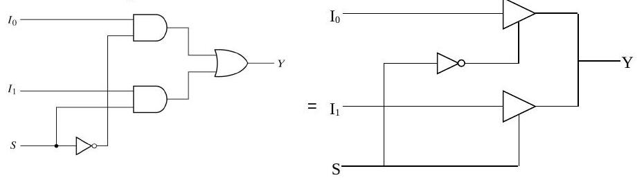
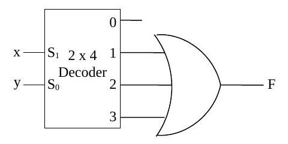

This post contains the questions and the instructor-prepared solutions of two quizzes from the fall 2006 semester of the Başkent University **EEM211 Digital Logic Design** course: "EEM211 Quiz-1" dated **1 November 2006** and "EEM 211 Quiz-2 Solution" dated **15 December 2006**. (The *Quiz 1, 2, 3 Answer Key* posts in the archive are different quizzes from October of the same semester.) The questions and solutions are in English; points are given in parentheses within the solutions. The two original Word files can be downloaded as a ZIP at the end of the post.

## Quiz-1 (1 November 2006)

### Question 1: Signed 2's complement arithmetic

> By using binary numbers of sufficient length, perform the following calculations in signed 2's complement arithmetic. Reconvert your results into decimal to verify that your results are correct. a) (+27) + (−61) (25 pts) b) (−27) + (+61) (25 pts)

**a)** (27)₁₀ = (0011011)₂ (5 points) and (61)₁₀ = (0111101)₂ (5 points). The 2's complement of 61 is found by converting 1s to 0s and 0s to 1s and adding 1: (1000011)₂ (5 points). The 2's complement of 61 is added to 27:

```
   0011011
 + 1000011
 ---------
   1011110
```

The 2's complement of (1011110)₂ is (0100010)₂ = 34 (5 points). Since the result is signed, it is **−34** (= (+27) + (−61)).

**b)** The 2's complement of 27 is (1100101)₂. It is added to 61:

```
    1100101
  + 0111101
  ---------
   10100010
```

A carry bit appears at the 8th bit (5 points); since the numbers are 7 bits long, this bit is discarded and the result is (0100010)₂ = **34** (= (−27) + (+61)).

*Note: The solution calls this bit at the 8th position "overflow"; in fact, it is the end carry discarded in 2's complement addition. Overflow does not occur when adding two numbers of different signs, and the result is correct.*

### Question 2: Canonical forms

> Given F(x, y, z) = x'(y' + z). Find the canonical product-of-sums and canonical sum-of-products expressions for the given function (25 pts). Write your results in ∏ and ∑ standard notations as well. Repeat the same thing for F' (25 pts).

F(x, y, z) = x'(y' + z) = x'y' + x'z
= x'y'(z' + z) + x'(y' + y)z
= x'y'z' + x'y'z + x'y'z + x'yz
= x'y'z' + x'y'z + x'yz (10 points)
= **Σ(0, 1, 3)** (5 points)

| x | y | z | F | F' |
|---|---|---|---|---|
| 0 | 0 | 0 | 1 | 0 |
| 0 | 0 | 1 | 1 | 0 |
| 0 | 1 | 0 | 0 | 1 |
| 0 | 1 | 1 | 1 | 0 |
| 1 | 0 | 0 | 0 | 1 |
| 1 | 0 | 1 | 0 | 1 |
| 1 | 1 | 0 | 0 | 1 |
| 1 | 1 | 1 | 0 | 1 |

According to the explanation in the solution, terms 0, 1 and 3 are the rows of the truth table where F is 1; to solve the question faster, the sum-of-products terms can be taken directly from the truth table. The sum-of-products terms of F' are the complement of those of F; taking the complement of F' gives the product of sums of F:

- F'(x, y, z) = Σ(2, 4, 5, 6, 7) = x'yz' + xy'z' + xy'z + xyz' + xyz (5 points)
- F(x, y, z) = (x + y' + z)(x' + y + z)(x' + y + z')(x' + y' + z)(x' + y' + z') = **∏(2, 4, 5, 6, 7)** (5 points)

F' can also be found directly from the complement of F:

F' = (x'(y' + z))' = x + yz'
= x(y + y') + (x + x')yz'
= xyz + xyz' + xy'z + xy'z' + x'yz' (10 points)
= **Σ(2, 4, 5, 6, 7)** (5 points)

The product of sums of F' is obtained from the complement of the terms not present in F' (that is, the terms of F):

- F'(x, y, z) = (x + y + z)(x + y + z')(x + y' + z') = **∏(0, 1, 3)** (5 points)

## Quiz-2 (15 December 2006)

### Question 1: XNOR with a 2x1 MUX

> Realize the logical circuit for Boolean function of F = (x ⊕ y)' by using a 2x1 multiplexer (you may use inverted input).

F = (x ⊕ y)' = (xy' + x'y)' = (x' + y)(x + y') = x'x + x'y' + xy + yy' = **xy + x'y'**

| x | y | F | |
|---|---|---|---|
| 0 | 0 | 1 | F = y' |
| 0 | 1 | 0 | |
| 1 | 0 | 0 | F = y |
| 1 | 1 | 1 | |

If x is chosen as the select input, y' is connected to input 0 of the MUX and y to input 1. If y is chosen as the select input, x' is connected to input 0 and x to input 1.

' with a 2x1 MUX")

### Question 2: Equivalent circuit using only inverters and three-state gates

> Draw the equivalent circuit for the given logic circuit. Use ONLY INVERTER and THREE-STATE gates.

The given circuit is a 2-to-1 multiplexer built with two AND gates and one OR gate (Y = I0·S' + I1·S). The OR gate in the circuit is used to combine the outputs of the AND gates. Since a three-state gate allows outputs to be connected directly together thanks to its high-impedance state, the AND gates can be replaced with three-state gates and the OR gate with a direct connection: the buffer of I0 is enabled by S' and the buffer of I1 is enabled by S.



### Question 3: 2x4 decoder and OR gate

> Realize the function F(x, y) = xy' + x'y + xy by using a 2x4 decoder and an OR gate ONLY.

When the inputs are applied to a decoder, each output line of the decoder corresponds to one row of the truth table. If the outputs corresponding to the rows where F is 1 are selected and connected to an OR gate, F is obtained at the output.

| Decoder output | x | y | F |
|---|---|---|---|
| 0 | 0 | 0 | 0 |
| 1 | 0 | 1 | 1 |
| 2 | 1 | 0 | 1 |
| 3 | 1 | 1 | 1 |

x is connected to S1 and y to S0; outputs 1, 2 and 3 feed the OR gate. (When the function is simplified, F = x + y.)


