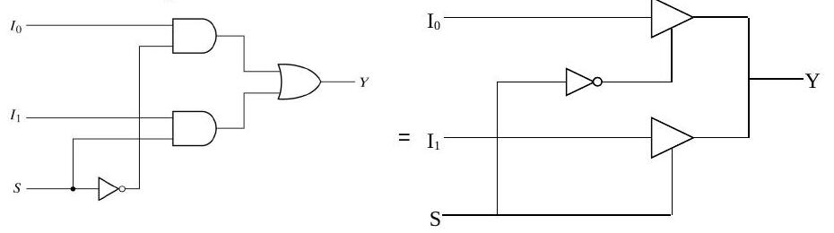
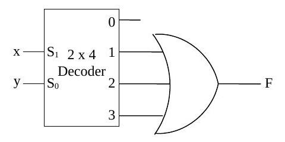

Bu yazı, Başkent Üniversitesi **EEM211 Sayısal Mantık Tasarımı** dersinin 2006 güz dönemindeki iki quizinin sorularını ve hocaların hazırladığı çözümleri içeriyor: **1 Kasım 2006** tarihli "EEM211 Quiz-1" ve **15 Aralık 2006** tarihli "EEM 211 Quiz-2 Solution". (Arşivdeki *Quiz 1, 2, 3 Cevap Anahtarı* yazıları aynı dönemin Ekim ayındaki farklı quizleridir.) Sorular ve çözümler İngilizce; puanlar çözümlerin içinde parantezle verilmiş. İki orijinal Word dosyası yazının sonunda ZIP olarak indirilebilir.

## Quiz-1 (1 Kasım 2006)

### Soru 1: İşaretli 2'ye tümleyen aritmetiği

> By using binary numbers of sufficient length, perform the following calculations in signed 2's complement arithmetic. Reconvert your results into decimal to verify that your results are correct. a) (+27) + (−61) (25 pts) b) (−27) + (+61) (25 pts)

**a)** (27)₁₀ = (0011011)₂ (5 puan) ve (61)₁₀ = (0111101)₂ (5 puan). 61'in 2'ye tümleyeni, 1'ler 0'a, 0'lar 1'e çevrilip 1 eklenerek bulunur: (1000011)₂ (5 puan). 27 ile 61'in 2'ye tümleyeni toplanır:

```
   0011011
 + 1000011
 ---------
   1011110
```

(1011110)₂'nin 2'ye tümleyeni (0100010)₂ = 34'tür (5 puan). Sonuç işaretli olduğundan **−34**'tür (= (+27) + (−61)).

**b)** 27'nin 2'ye tümleyeni (1100101)₂'dir. 61 ile toplanır:

```
    1100101
  + 0111101
  ---------
   10100010
```

8. bitte taşan bir bit oluşur (5 puan); sayılar 7 bitlik olduğundan bu bit atılır ve sonuç (0100010)₂ = **34** olur (= (−27) + (+61)).

*Not: Çözümde 8. bitteki bu bit "overflow" olarak adlandırılmış; aslında bu, 2'ye tümleyen toplamada atılan son eldedir (end carry). İşaretleri farklı iki sayının toplamında taşma (overflow) oluşmaz ve sonuç doğrudur.*

### Soru 2: Kanonik biçimler

> Given F(x, y, z) = x'(y' + z). Find the canonical product-of-sums and canonical sum-of-products expressions for the given function (25 pts). Write your results in ∏ and ∑ standard notations as well. Repeat the same thing for F' (25 pts).

F(x, y, z) = x'(y' + z) = x'y' + x'z
= x'y'(z' + z) + x'(y' + y)z
= x'y'z' + x'y'z + x'y'z + x'yz
= x'y'z' + x'y'z + x'yz (10 puan)
= **Σ(0, 1, 3)** (5 puan)

| x | y | z | F | F' |
|---|---|---|---|---|
| 0 | 0 | 0 | 1 | 0 |
| 0 | 0 | 1 | 1 | 0 |
| 0 | 1 | 0 | 0 | 1 |
| 0 | 1 | 1 | 1 | 0 |
| 1 | 0 | 0 | 0 | 1 |
| 1 | 0 | 1 | 0 | 1 |
| 1 | 1 | 0 | 0 | 1 |
| 1 | 1 | 1 | 0 | 1 |

Çözümdeki açıklamaya göre 0, 1 ve 3 terimleri doğruluk tablosunda F'nin 1 olduğu satırlardır; soruyu daha hızlı çözmek için çarpımların toplamı terimleri doğrudan doğruluk tablosundan alınabilir. F'nin çarpımların toplamı terimleri F'nin terimlerinin tersidir; F'nin tersi alınırsa F'nin toplamların çarpımı elde edilir:

- F'(x, y, z) = Σ(2, 4, 5, 6, 7) = x'yz' + xy'z' + xy'z + xyz' + xyz (5 puan)
- F(x, y, z) = (x + y' + z)(x' + y + z)(x' + y + z')(x' + y' + z)(x' + y' + z') = **∏(2, 4, 5, 6, 7)** (5 puan)

F' doğrudan F'nin tersinden de bulunabilir:

F' = (x'(y' + z))' = x + yz'
= x(y + y') + (x + x')yz'
= xyz + xyz' + xy'z + xy'z' + x'yz' (10 puan)
= **Σ(2, 4, 5, 6, 7)** (5 puan)

F''nin toplamların çarpımı, F''de bulunmayan terimlerin (yani F'nin terimlerinin) tersinden elde edilir:

- F'(x, y, z) = (x + y + z)(x + y + z')(x + y' + z') = **∏(0, 1, 3)** (5 puan)

## Quiz-2 (15 Aralık 2006)

### Soru 1: 2x1 MUX ile XNOR

> Realize the logical circuit for Boolean function of F = (x ⊕ y)' by using a 2x1 multiplexer (you may use inverted input).

F = (x ⊕ y)' = (xy' + x'y)' = (x' + y)(x + y') = x'x + x'y' + xy + yy' = **xy + x'y'**

| x | y | F | |
|---|---|---|---|
| 0 | 0 | 1 | F = y' |
| 0 | 1 | 0 | |
| 1 | 0 | 0 | F = y |
| 1 | 1 | 1 | |

Seçme girişi olarak x seçilirse MUX'un 0. girişine y', 1. girişine y bağlanır. Seçme girişi y seçilirse 0. girişe x', 1. girişe x bağlanır.

'")

### Soru 2: Yalnız tümleyici ve üç durumlu kapılarla eşdeğer devre

> Draw the equivalent circuit for the given logic circuit. Use ONLY INVERTER and THREE-STATE gates.

Verilen devre iki AND ve bir OR kapısıyla kurulmuş 2'ye 1 çoklayıcıdır (Y = I0·S' + I1·S). Devrede OR kapısı AND kapılarının çıkışlarını birleştirmek için kullanılıyor. Üç durumlu kapı yüksek empedans durumu sayesinde çıkışların doğrudan birbirine bağlanmasına izin verdiğinden, AND kapılarının yerine üç durumlu kapılar konup OR kapısı yerine doğrudan bağlantı kullanılabilir: I0'ın tamponu S' ile, I1'in tamponu S ile etkinleştirilir.



### Soru 3: 2x4 kod çözücü ve OR kapısı

> Realize the function F(x, y) = xy' + x'y + xy by using a 2x4 decoder and an OR gate ONLY.

Girişler bir kod çözücüye verildiğinde kod çözücünün her çıkış ucu doğruluk tablosunun bir satırına karşılık gelir. F'nin 1 olduğu satırlara karşılık gelen uçlar seçilip bir OR kapısına bağlanırsa çıkışta F elde edilir.

| Kod çözücü çıkışı | x | y | F |
|---|---|---|---|
| 0 | 0 | 0 | 0 |
| 1 | 0 | 1 | 1 |
| 2 | 1 | 0 | 1 |
| 3 | 1 | 1 | 1 |

x, S1'e; y, S0'a bağlanır; 1, 2 ve 3 numaralı çıkışlar OR kapısına girer. (Fonksiyon sadeleştirilince F = x + y olur.)


