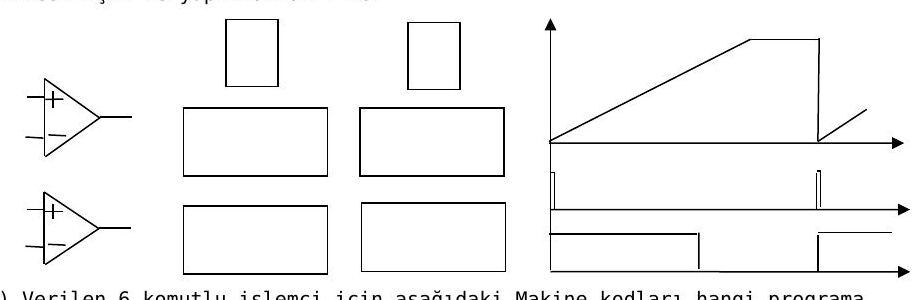

This post is a Word document found as a sample exam in the EEM211 Digital Logic Design course folder: the **10 January 2011** **1st program** and **2nd program final exams** of a **"Digital Design"** course. The document does not say which university it belongs to; the exams are signed "M.Y." and are 90 minutes each. Only the questions are given, without answers. The questions are provided below as text; the original Word file can be downloaded at the end of the post.

*This content belongs to a third-party source; it is shared for archival and nostalgic purposes with the source credited. It will be removed upon request by the rights holder.*

## 1st program final exam

1. Design a 3-bit comparator using NOR gates. (15 points)
1. Design a circuit that multiplies a 4-bit number B by 6 and adds 1. (20 points)
1. Design a 3-bit counter using T flip-flops that counts up by one when K = 1 and up by two when K = 0. (15 points) The T flip-flop table is given with the question: for T = 0, Q(t+1) = Q(t); for T = 1, Q(t+1) = Q(t)'.
1. In the digital voltmeter whose block diagram is given, with f_clk = 200 Hz and Tx = 0.02 s, what number will be seen on the display for a value of Vx = 1.6 V? What must be done so that the correct value can be seen on the display? (20 points)



*Note: In the block diagram in the Word document, the text inside the blocks is not visible; the figure is reproduced as it appears in the document.*

5\. a) Which program do the following machine codes correspond to for the given 6-instruction processor? Give the assembly language equivalent. (15 points) b) How does the program run? Explain. Show the final values the r registers will have after the program runs. (15 points + 10 points bonus)

| Instruction | Machine code format | Operation |
|---|---|---|
| `MOV Ra, #c` (copy the 8-bit constant c into register r) | 0011 r3r2r1r0 c7…c0 | Ra = c |
| `SUB Ra, Rb, Rc` (subtract Rc from Rb, write the result to Ra) | 0100 ra3…ra0 rb3…rb0 rc3…rc0 | Ra = Rb − Rc |
| `JNZ Ra, offset` (if Ra is nonzero, jump forward or backward by the 8-bit signed offset) | 0101 ra3…ra0 o7…o0 | If Ra ≠ 0, PC = PC + offset |
| `MOV Ra, d` (copy the value at address d in data memory into Ra) | 0000 r3r2r1r0 d7…d0 | Ra = data(d) |
| `MOV d, Ra` (copy the value in Ra to address d in data memory) | 0001 r3r2r1r0 d7…d0 | data(d) = Ra |
| `ADD Ra, Rb, Rc` (add Rb and Rc, write the result to Ra) | 0010 ra3…ra0 rb3…rb0 rc3…rc0 | Ra = Rb + Rc |

```
Adres   Komut
00      0011 0001 1000 0000
01      0011 0010 0000 0101
02      0011 0011 0000 1010
03      0011 0000 0000 0001
04      0100 0010 0010 0000
05      0101 0010 0000 0011
06      0100 0001 0001 0011
07      0101 0001 1111 1101
08      0001 0001 0000 0101
```

## 2nd program final exam

1. Design a T flip-flop using NAND gates. (10 points)
1. Design a digital circuit that finds the total number of inputs that are "1" in a circuit with 7 inputs a, b, c, d, e, f, g. (20 points)
1. We want to perform 16-bit subtraction with a 1-bit subtractor circuit using a shift register. Design the setup and briefly explain how it works. (20 points)
1. We want to design a speedometer circuit for a bicycle (00–99 km/h). When the wheel completes one revolution, 4 clock (clk) pulses arrive from the sensor to our circuit. The wheel circumference is 2.5 meters. Accordingly, draw the block diagram of the measurement circuit consisting of ready-made 4-bit BCD counters with parallel load. Determine the timings required for the system. (20 points)
1. a) Explain the LUT (look-up table), switch matrix, and CLB (configurable logic block) modules used in an FPGA system with the help of a sample design that uses at least 2 LUTs. (15 points) b) Explain each line of the given FPGA code, and determine the operation performed in the circuit by drawing the block diagram of the circuit. (15 points) c) Compare the FPGA system with alternative systems and explain how an FPGA application is implemented. (15 points)

Verilog code for question 5b:

```verilog
module ma2(a,b,mi, s,do);

input [1:0] a,b;
input mi;
output [1:0] s;
output do ;
wire [1:0] s;
wire do;
wire tel1,tel2,tel3;
ma f1(a[0], b[0], mi, s[0], tel1);
ma f2(a[1], b[1], tel1, s[1], tel2);
endmodule

module ma( in_a, in_b, min, m, dout );
    input   min;
    input    in_a;
    input    in_b;
    output   m;
    output dout;
    reg m, dout;
    always @(in_a or in_b or min)
    begin
    m <= in_a ^ in_b ^ min;
    dout <= (in_b & min) | (in_a & min) | (in_a & in_b);
    end
endmodule
```

On the last page of the document, in connection with question 5a, a figure from Frank Vahid's *Digital Design* (2006) slide "FPGA Internals: Configurable Logic Blocks (CLBs)" is pasted.
